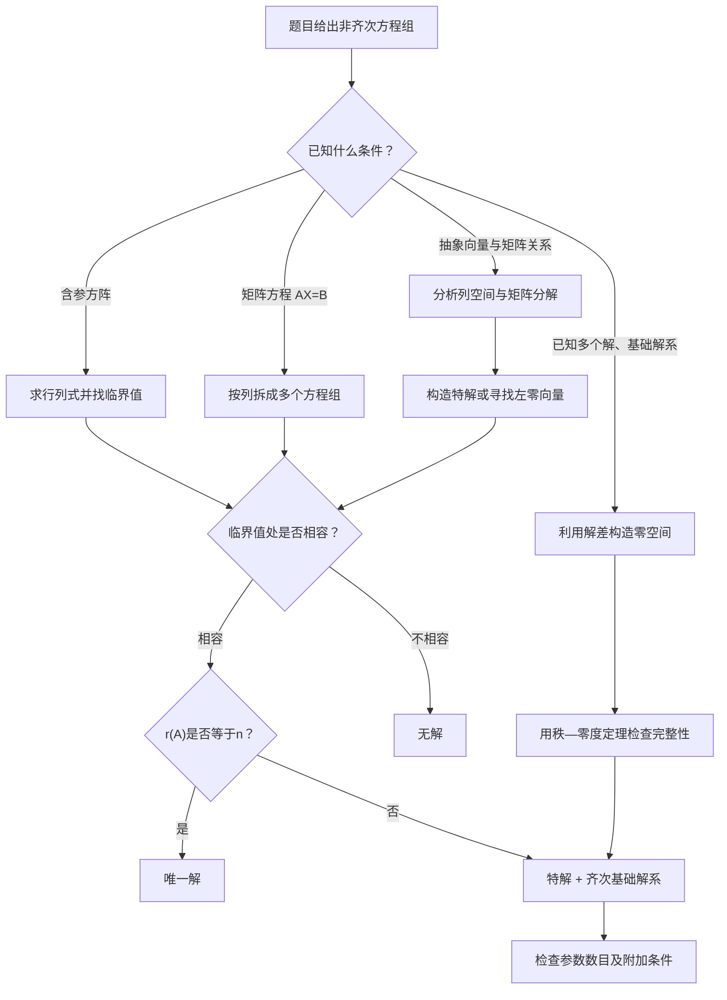

本节主题：非齐次线性方程组的解的判定、结构、通解与综合应用

我已从你提供的 Google Drive 压缩包《数学分类题目1101.zip》中定位并读取以下资料：

| 资料        | 阅读范围                    |
| --------- | ----------------------- |
| 考研核心题目    | 第三章第五节《非齐次线性方程组》，28道核心题 |
| 分类模拟题1031 | 对应专题，9道模拟题              |
| 张宇1000题   | 线性代数第四章《线性方程组》          |
| 李林880题    | 第十三章《线性方程组》             |
| 李正元习题     | 第四章《线性方程组》              |

以下以资料中标注的历年考研真题为主要母题，结合张宇、李林、李正元及分类模拟题进行讲解。题目的年份和来源按照压缩包中的标注引用；另外编写的训练题会注明为原创变式。

## 一、本节的完整知识体系

先建立一个核心认识：

非齐次线性方程组不是单纯的解方程问题，而是一个关于列空间、零空间、矩阵秩和仿射空间的问题。

绝大多数考题，都可以归结为三个问题：

1. 方程组有没有解？
2. 如果有解，是唯一解还是无穷多解？
3. 如果有无穷多解，怎样不遗漏地写出全部解？

这三个问题由以下结构统一解决。

设

$$
A\in\mathbb R^{m\times n},\qquad b\in\mathbb R^m,
$$

考虑非齐次线性方程组

$$
\boxed{Ax=b}
$$

对应的齐次线性方程组是

$$
Ax=0.
$$

定义增广矩阵

$$
\overline A=(A\mid b).
$$

### 1. 三种解的情况：必须掌握

令 $r=r(A)$。

| 解的情况  | 充要条件                         |
| ----- | ---------------------------- |
| 无解    | $r(A)<r(\overline A)$   |
| 有唯一解  | $r(A)=r(\overline A)=n$  |
| 有无穷多解 | $r(A)=r(\overline A)<n$ |

这里最容易忽略的是：

判断唯一解和无穷多解，要与未知数个数 $n$ 比较，而不是直接与方程个数 $m$ 比较。

例如，若 $A$ 是 $3\times5$ 矩阵，即使三行线性无关，也只有

$$
r(A)=3<5.
$$

一旦方程组有解，就一定有两个自由参数，所以有无穷多解。

但如果 $A$ 是 $5\times3$ 矩阵，且

$$
r(A)=r(\overline A)=3,
$$

则尽管有五个方程、三个未知数，仍然只有唯一解。

### 2. 为什么秩决定解的个数？

这要联系上一节学过的齐次线性方程组。

由秩—零度定理：

$$
\boxed{\dim\ker A=n-r(A)}
$$

其中

$$
\ker A=\{x:Ax=0\}.
$$

如果 $Ax=b$ 有一个特解 $x_0$，那么其全部解可以表示成

$$
\boxed{x=x_0+\xi,\qquad \xi\in\ker A.}
$$

因此：

- 当 $\dim\ker A=0$ 时，没有可以自由变化的方向，解唯一。
- 当 $\dim\ker A\ge1$ 时，可以沿零空间方向自由移动，产生无穷多个解。

这就是秩与解的个数之间的根本联系。

### 3. 本节最重要的主公式

如果

$$
Ax=b
$$

有特解 $\eta$，而

$$
Ax=0
$$

的基础解系为

$$
\xi_1,\xi_2,\ldots,\xi_{n-r},
$$

那么非齐次方程组的通解为

$$
\boxed{ x=\eta+k_1\xi_1+k_2\xi_2+\cdots+k_{n-r}\xi_{n-r} }
$$

其中 $k_1,\ldots,k_{n-r}$ 为任意实数。

这条公式表面简单，但考研会从四个角度考查：

- 能否正确找出特解 $\eta$。
- 能否通过已知解构造齐次解。
- 能否证明齐次解向量构成基础解系。
- 能否利用解空间结构反推出参数、矩阵秩甚至未知矩阵。

接下来要把这四种能力全部掌握。

## 二、基础原理：为什么通解等于特解加齐次通解？

### 1. 从两个解的差出发

假设 $\eta_1,\eta_2$ 都满足

$$
A\eta_1=b,\qquad A\eta_2=b.
$$

两式相减：

$$
A(\eta_1-\eta_2)=b-b=0.
$$

所以

$$
\boxed{\eta_1-\eta_2\in\ker A.}
$$

即：

任意两个非齐次解之差，必为对应齐次方程组的解。

反过来，如果

$$
A\eta=b,\qquad A\xi=0,
$$

那么

$$
A(\eta+\xi)=b.
$$

因此，在已有特解的基础上，加上任意齐次解，都不会改变方程右端。

### 2. 为什么这种表示不会漏解？

设 $x$ 是非齐次方程组的任意解。

由于

$$
Ax=b,\qquad A\eta=b,
$$

所以

$$
A(x-\eta)=0.
$$

这说明 $x-\eta$ 必在齐次解空间内。

因此，任意非齐次解都可写成

$$
x=\eta+\xi.
$$

再把 $\xi$ 用齐次基础解系展开，就得到了完整通解。

这个证明的重要性在于：

通解公式并不是一种经验性的解题模板，而是对所有可能解的严格刻画。

### 3. 已知多个非齐次解，怎样构造新解？

若

$$
A\eta_1=A\eta_2=\cdots=A\eta_s=b,
$$

则对于任意系数 $c_1,\ldots,c_s$，

$$
A\left(\sum_{i=1}^{s}c_i\eta_i\right) =\left(\sum_{i=1}^{s}c_i\right)b.
$$

若 $b\ne0$，便得到两个极重要的结论：

$$
\boxed{ \sum_{i=1}^{s}c_i=1 \quad\Longrightarrow\quad \sum_{i=1}^{s}c_i\eta_i \text{ 是非齐次解} }
$$

$$
\boxed{ \sum_{i=1}^{s}c_i=0 \quad\Longrightarrow\quad \sum_{i=1}^{s}c_i\eta_i \text{ 是齐次解} }
$$

当 $b\ne0$ 时，上述系数和条件对相应组合也是必要的。

例如：

$$
A\eta_1=A\eta_2=b.
$$

那么

$$
\frac{\eta_1+\eta_2}{2}
$$

是非齐次解，因为系数和为 $1$。

而

$$
\eta_1-\eta_2
$$

是齐次解，因为系数和为 $0$。

但是

$$
\eta_1+\eta_2
$$

一般不是 $Ax=b$ 的解，因为

$$
A(\eta_1+\eta_2)=2b.
$$

还要特别注意：

即使找到了若干齐次解向量，也不意味着它们一定构成基础解系。必须另外证明：

$$
\boxed{\text{线性无关，并且数量等于 }n-r(A).}
$$

这是本节很多选择题的真正陷阱。

## 三、真题母题一：已知多个非齐次解，判断通解

这是本节最基础、也是最容易出现概念混淆的题型。

### 母题1：1990年数学一——特解与基础解系的辨别

题目（核心题目第1题）

已知 $\beta_1,\beta_2$ 是非齐次线性方程组

$$
Ax=b
$$

的两个不同解，$\alpha_1,\alpha_2$ 是对应齐次线性方程组的基础解系。

判断下列形式是否一定为通解：

$$
x=k_1\alpha_1+k_2(\alpha_1-\alpha_2) +\frac{\beta_1+\beta_2}{2}.
$$

<Steps>

  <Step>

### 第一步：判断固定部分是不是非齐次特解

因为

$$
A\beta_1=A\beta_2=b,
$$

所以

$$
A\left(\frac{\beta_1+\beta_2}{2}\right) =\frac{b+b}{2}=b.
$$

因此

$$
\eta=\frac{\beta_1+\beta_2}{2}
$$

是非齐次特解。

  </Step>

  <Step>

### 第二步：判断参数部分是不是齐次解

由于

$$
A\alpha_1=A\alpha_2=0,
$$

所以

$$
A(\alpha_1-\alpha_2)=0.
$$

因此两个参数所乘的向量都属于零空间。

  </Step>

  <Step>

### 第三步：判断齐次方向是否足够

题目已知

$$
\{\alpha_1,\alpha_2\}
$$

是基础解系。

考察

$$
\{\alpha_1,\alpha_1-\alpha_2\}.
$$

如果

$$
c_1\alpha_1+c_2(\alpha_1-\alpha_2)=0,
$$

则

$$
(c_1+c_2)\alpha_1-c_2\alpha_2=0.
$$

由 $\alpha_1,\alpha_2$ 线性无关，得

$$
c_1+c_2=0,\qquad c_2=0.
$$

因此 $c_1=c_2=0$，新向量组仍然是基础解系。

所以给定表达式确实为通解。

$$
\boxed{ x=\frac{\beta_1+\beta_2}{2} +k_1\alpha_1+k_2(\alpha_1-\alpha_2) }
$$

答案：原题B。

  </Step>

</Steps>

### 这道题真正要掌握什么？

记住三个检查步骤：

固定项检查右端，参数项检查齐次性，最后检查是否张成整个零空间。

尤其要注意：

$$
\beta_1-\beta_2
$$

虽然是齐次解，但不一定能与 $\alpha_1$ 构成基础解系。

例如

$$
\beta_2=\beta_1+\alpha_1,
$$

则

$$
\beta_1-\beta_2=-\alpha_1.
$$

这时两条齐次方向线性相关，会漏掉一部分解。

所以不能简单地认为“两个不同特解之差非零”，就一定能补成基础解系。

### 母题2：2011年数学三——三个线性无关的非齐次解

这道题虽然标注为数学三，但它的结论对数学一很重要。

题目

设 $A$ 为 $4\times3$ 矩阵，$\eta_1,\eta_2,\eta_3$ 是非齐次线性方程组

$$
Ax=b,\qquad b\ne0
$$

的三个线性无关的解。

求其通解结构。

### 核心分析

三个特解满足

$$
A\eta_1=A\eta_2=A\eta_3=b.
$$

构造两个差向量：

$$
\xi_1=\eta_2-\eta_1,
$$

$$
\xi_2=\eta_3-\eta_1.
$$

显然

$$
A\xi_1=A\xi_2=0.
$$

现在证明它们无关。

假设

$$
c_1\xi_1+c_2\xi_2=0.
$$

展开：

$$
-(c_1+c_2)\eta_1+c_1\eta_2+c_2\eta_3=0.
$$

因为 $\eta_1,\eta_2,\eta_3$ 线性无关，所以

$$
c_1=c_2=0.
$$

故零空间至少包含两个独立方向。

由于 $A$ 有三个未知数：

$$
3-r(A)\ge2.
$$

即

$$
r(A)\le1.
$$

另一方面，题设 $b\ne0$，且 $Ax=b$ 有解，所以 $A\ne0$，从而

$$
r(A)\ge1.
$$

因此

$$
\boxed{r(A)=1}
$$

且

$$
\dim\ker A=2.
$$

所以 $\xi_1,\xi_2$ 恰好构成基础解系。

取 $\eta_1$ 为特解，得

$$
\boxed{ x=\eta_1 +k_1(\eta_2-\eta_1) +k_2(\eta_3-\eta_1) }
$$

这就是全部解。

原题还可以把特解换成

$$
\frac{\eta_2+\eta_3}{2},
$$

得到等价形式。

### 高阶推论：非齐次解向量能有多少个线性无关？

设 $Ax=b$ 相容，$b\ne0$，且

$$
r(A)=r.
$$

则

$$
\dim\ker A=n-r.
$$

由于任意非齐次解均为

$$
x=\eta+\xi,\qquad \xi\in\ker A,
$$

且 $\eta\notin\ker A$，所以全部非齐次解所张成的线性空间维数是

$$
1+(n-r).
$$

因此：

$$
\boxed{ \text{非齐次方程组最多有 }n-r(A)+1 \text{ 个线性无关的解向量} }
$$

这比单纯记住“解之差是齐次解”更有价值。

例如，对于一个四元非齐次方程组，如果存在三个线性无关的解，则

$$
n-r(A)+1\ge3,
$$

所以

$$
r(A)\le2.
$$

这一结论直接连接下一道经典真题。

## 四、真题母题二：由解的线性无关性反推参数

### 母题3：2006年数学一、数学二

题目（核心题目第3题）

已知非齐次线性方程组

$$
\begin{cases} x_1+x_2+x_3+x_4=-1,\\ 4x_1+3x_2+5x_3-x_4=-1,\\ ax_1+x_2+3x_3+bx_4=1 \end{cases}
$$

有三个线性无关的解。

求：

（1）证明 $r(A)=2$。

（2）确定 $a,b$，并求通解。

### 1. 题型识别

题目并没有直接告诉我们系数矩阵的秩，但给出了：

> 有三个线性无关的非齐次解。

看到这个条件，应立即想到：

$$
r(A)\le n-3+1.
$$

这里 $n=4$，因此

$$
r(A)\le2.
$$

另一方面，从前两行提取第1、2列组成的子式：

$$
\begin{vmatrix} 1&1\\ 4&3 \end{vmatrix} =3-4=-1\ne0.
$$

故

$$
r(A)\ge2.
$$

两者结合：

$$
\boxed{r(A)=2}.
$$

这就是第一问的完整证明。

### 2. 利用行相关确定参数

系数矩阵为

$$
A= \begin{pmatrix} 1&1&1&1\\ 4&3&5&-1\\ a&1&3&b \end{pmatrix}.
$$

前两行无关且矩阵秩为2，因此第三行必为前两行的线性组合。

设

$$
R_3=uR_1+vR_2.
$$

比较第二、三列：

$$
\begin{cases} u+3v=1,\\ u+5v=3. \end{cases}
$$

两式相减：

$$
2v=2.
$$

所以

$$
v=1,\qquad u=-2.
$$

于是

$$
R_3=-2R_1+R_2.
$$

比较第一列：

$$
a=-2\cdot1+4=2.
$$

比较第四列：

$$
b=-2\cdot1-1=-3.
$$

得到

$$
\boxed{a=2,\qquad b=-3}.
$$

### 3. 为什么还要检查右端？

这是整道题最容易丢分的地方。

系数矩阵第三行满足

$$
R_3=-2R_1+R_2.
$$

那么为了保证非齐次方程组有解，对应右端也必须满足

$$
1=-2(-1)+(-1).
$$

右边确实等于1。

因此系数行之间的关系与常数列相容，方程组确实有解。

如果右端不满足同样的组合关系，即使系数矩阵秩为2，方程组也会无解。

### 4. 求通解

代入参数后，只需要保留前两个独立方程：

$$
\begin{cases} x_1+x_2+x_3+x_4=-1,\\ 4x_1+3x_2+5x_3-x_4=-1. \end{cases}
$$

第二式减去第一式的4倍：

$$
-x_2+x_3-5x_4=3.
$$

得到

$$
x_2=-3+x_3-5x_4.
$$

代入第一式：

$$
x_1=2-2x_3+4x_4.
$$

令

$$
x_3=s,\qquad x_4=t.
$$

则

$$
\begin{cases} x_1=2-2s+4t,\\ x_2=-3+s-5t,\\ x_3=s,\\ x_4=t. \end{cases}
$$

因此

$$
\boxed{ x= \begin{pmatrix} 2\\-3\\0\\0 \end{pmatrix} +s\begin{pmatrix} -2\\1\\1\\0 \end{pmatrix} +t\begin{pmatrix} 4\\-5\\0\\1 \end{pmatrix} }
$$

其中 $s,t\in\mathbb R$。

### 5. 这道母题怎样迁移？

以后遇到以下条件：

- 非齐次方程组有若干个线性无关的解；
- 有两个不同解；
- 已知基础解系所含向量个数；
- 已知解空间维数；

应首先把它们翻译成秩的条件。

然后再根据非零子式、行相关关系或消元求出参数。

这类题的标准流程是：

$$
\boxed{ \text{解的信息} \rightarrow \text{秩的约束} \rightarrow \text{行或列之间的关系} \rightarrow \text{参数} \rightarrow \text{通解} }
$$

这道真题属于本节必须真正独立掌握的核心母题。

## 五、真题母题三：含参方程组的完整分类

这类题在数学一中十分重要，也是模拟题最喜欢增加计算量的部分。

### 1. 先掌握通用方法

对一个 $n$ 阶方阵 $A(t)$，考虑

$$
A(t)x=b(t).
$$

一般分两步。

第一步：求行列式，找可能出现秩变化的参数。

如果

$$
|A(t)|\ne0,
$$

则矩阵可逆，方程组一定有唯一解。

如果

$$
|A(t)|=0,
$$

则不可能有唯一解，但仍须判断是无解还是无穷多解。

第二步：把所有临界参数逐一代回增广矩阵。

计算

$$
r(A),\qquad r(A\mid b).
$$

<Callout type="warn" title="先判相容，再判解的个数">

不能仅凭行列式为零就宣布无穷多解。

</Callout>

### 母题4：2010年数学一、数学二、数学三

设

$$
A= \begin{pmatrix} \lambda&1&1\\ 0&\lambda-1&0\\ 1&1&\lambda \end{pmatrix}, \qquad b= \begin{pmatrix} a\\1\\1 \end{pmatrix}.
$$

已知 $Ax=b$ 存在两个不同的解。

求 $\lambda,a$ 以及通解。

<Steps>

  <Step>

### 第一步：由两个不同的解判断矩阵奇异

如果矩阵可逆，只能存在唯一解。

所以

$$
|A|=0.
$$

计算行列式：

$$
\begin{aligned} |A| &=(\lambda-1) \begin{vmatrix} \lambda&1\\ 1&\lambda \end{vmatrix}\\ &=(\lambda-1)(\lambda^2-1)\\ &=(\lambda-1)^2(\lambda+1). \end{aligned}
$$

于是

$$
\lambda=1\quad\text{或}\quad\lambda=-1.
$$

  </Step>

  <Step>

### 第二步：讨论 $\lambda=1$

当 $\lambda=1$，第二个方程变成

$$
0x_1+0x_2+0x_3=1.
$$

即

$$
0=1.
$$

显然矛盾。

因此

$$
\lambda\ne1.
$$

  </Step>

  <Step>

### 第三步：讨论 $\lambda=-1$

代入得到

$$
A= \begin{pmatrix} -1&1&1\\ 0&-2&0\\ 1&1&-1 \end{pmatrix}.
$$

观察三行：

$$
R_1+R_2+R_3=0.
$$

为了保证方程组有解，右端也必须满足相同关系：

$$
a+1+1=0.
$$

因此

$$
\boxed{\lambda=-1,\qquad a=-2}.
$$

  </Step>

  <Step>

### 第四步：求通解

原方程化为

$$
\begin{cases} -x_1+x_2+x_3=-2,\\ -2x_2=1,\\ x_1+x_2-x_3=1. \end{cases}
$$

第二式给出

$$
x_2=-\frac12.
$$

代入第一式：

$$
-x_1+x_3=-\frac32.
$$

所以

$$
x_1=\frac32+x_3.
$$

令 $x_3=t$，则

$$
\boxed{ x= \begin{pmatrix} \frac32\\-\frac12\\0 \end{pmatrix} +t\begin{pmatrix} 1\\0\\1 \end{pmatrix} }.
$$

  </Step>

</Steps>

### 解题规律总结

本题最大的陷阱是：

$$
|A|=0
$$

仅仅给出两个候选值，不能直接认为这两个值都满足题意。

本题中：

$$
\lambda=1\Longrightarrow\text{无解},
$$

$$
\lambda=-1,\ a=-2 \Longrightarrow\text{无穷多解}.
$$

所以参数题必须把不同临界值分开讨论。

### 母题5：1997年数学二——同一个参数产生两种不同的退化情况

资料中的题目为：

$$
\begin{cases} 2x_1+\lambda x_2-x_3=1,\\ \lambda x_1-x_2+x_3=2,\\ 4x_1+5x_2-5x_3=-1. \end{cases}
$$

系数矩阵行列式为

$$
|A|=(\lambda-1)(5\lambda+4).
$$

因此临界值为

$$
\lambda=1,\qquad \lambda=-\frac45.
$$

分别检查增广秩，得到

$$
\boxed{ \begin{array}{c|c} \lambda & \text{解的情况}\\ \hline 1&\text{无穷多解}\\ -\frac45&\text{无解}\\ \text{其他实数}&\text{唯一解} \end{array} }
$$

当 $\lambda=1$ 时，通解为

$$
\boxed{ x= \begin{pmatrix} 1\\-1\\0 \end{pmatrix} +t\begin{pmatrix} 0\\1\\1 \end{pmatrix} }.
$$

这一题和上一题共同说明：

行列式负责寻找临界值，增广矩阵负责决定临界值处的真实解的情况。

### 母题6：汤家凤八套卷——参数同时出现在系数与右端

取分类模拟题中第五套第5题：

$$
\begin{cases} x_1+x_2+x_3=-1,\\ x_1-2x_2+ax_3=3,\\ x_1+4x_2+a^2x_3=b. \end{cases}
$$

要求有无穷多解。

第二式减第一式：

$$
-3x_2+(a-1)x_3=4.
$$

第三式减第一式：

$$
3x_2+(a^2-1)x_3=b+1.
$$

把后两式相加：

$$
(a^2+a-2)x_3=b+5.
$$

注意：

$$
a^2+a-2=(a+2)(a-1).
$$

前两行始终线性无关，所以有无穷多解的条件就是

$$
\begin{cases} (a+2)(a-1)=0,\\ b+5=0. \end{cases}
$$

因此

$$
\boxed{ (a,b)=(-2,-5) \quad\text{或}\quad (1,-5) }
$$

这道题的重要技巧是：

遇到含参方程组，不必一开始就把增广矩阵完全化成最简阶梯形。

如果能够通过简单的行相加、行相减，直接制造出

$$
0=b+5
$$

这样的相容条件，那么计算会更快、更清晰。

需要特别注意，这里的第一式还保留着一个非零主元，因此两组参数下的系数秩都是2，最终均为无穷多解。

## 六、核心方法：左零空间与相容性判别

前面的方法主要通过消元判断有解。

现在引入一种更高效的方法：利用左零空间判断右端是否满足相容条件。

这是理解抽象非齐次方程组的重要工具。

### 1. 左零空间是什么？

对矩阵

$$
A\in\mathbb R^{m\times n},
$$

考虑

$$
A^Ty=0.
$$

其解空间

$$
\ker A^T
$$

称为矩阵 $A$ 的左零空间。

为什么它与非齐次方程组有关？

如果 $Ax=b$ 有解，那么对于任意满足 $A^Ty=0$ 的向量 $y$，都有

$$
y^Tb=y^TAx.
$$

而

$$
y^TA=(A^Ty)^T=0.
$$

所以

$$
\boxed{y^Tb=0}.
$$

实际上，在实数域上还有更强的结论：

$$
\boxed{ Ax=b\text{ 有解} \iff y^Tb=0,\quad\forall y\in\ker A^T }
$$

这是因为

$$
\operatorname{Col}(A)=(\ker A^T)^\perp.
$$

这条关系可以理解为：

> 右端向量 $b$ 必须与系数矩阵的所有左零方向正交，才能由 $A$ 的列向量线性表示。

### 2. 什么时候优先使用左零空间？

遇到以下题目时特别有效：

- 矩阵本身已经确定，只有右端含参数；
- 系数矩阵的行明显线性相关；
- 题目只要求求出参数，不要求求出全部未知数；
- 可以很快找到一个非零左零向量。

### 母题7：张宇1000题、分类模拟题中的参数相容题

已知

$$
A= \begin{pmatrix} 1&1&-1\\ -1&-2&1\\ 1&-1&-1 \end{pmatrix},
$$

$$
\beta_1= \begin{pmatrix}2\\1\\3\end{pmatrix}, \qquad \beta_2= \begin{pmatrix}1\\3\\-1\end{pmatrix}.
$$

若

$$
Ax=k\beta_1+\beta_2
$$

有解，求 $k$。

<Steps>

  <Step>

### 第一步：寻找左零向量

观察矩阵的行，可以验证

$$
(-3,-2,1)A=0.
$$

所以

$$
y= \begin{pmatrix}-3\\-2\\1\end{pmatrix}
$$

是左零向量。

矩阵前两行线性无关，且有上述行关系，所以

$$
r(A)=2.
$$

因此左零空间维数为

$$
3-r(A)=1.
$$

找到的这个 $y$ 就张成整个左零空间。

  </Step>

  <Step>

### 第二步：直接写相容条件

由于方程有解，必须满足

$$
y^T(k\beta_1+\beta_2)=0.
$$

计算

$$
y^T\beta_1=-6-2+3=-5,
$$

$$
y^T\beta_2=-3-6-1=-10.
$$

因此

$$
-5k-10=0.
$$

得到

$$
\boxed{k=-2}.
$$

<Callout type="idea" title="左零空间法：先找相容条件">

这道题甚至不需要真正求出未知向量 $x$。

</Callout>

  </Step>

</Steps>

### 重要推论：任意右端都有解意味着什么？

对于任意 $m\times n$ 矩阵 $A$，

$$
\boxed{ Ax=b\text{ 对任意 }b\in\mathbb R^m\text{ 均有解} \iff r(A)=m }
$$

也就是满行秩。

这里还隐含一个必要条件：

$$
m\le n.
$$

因为

$$
r(A)\le\min(m,n).
$$

对于 $n$ 阶方阵，这个结论进一步化为

$$
\boxed{ Ax=b\text{ 对任意 }b\text{ 均有唯一解} \iff |A|\ne0. }
$$

注意：

<Callout type="warn" title="量词差异：任意右端与特定右端">

“对任意右端都有解”与“对某个右端有解”是完全不同的条件。

</Callout>

## 七、真题母题四：矩阵方程 $AX=B$

这是数学一中非常重要的综合题型。

### 1. 矩阵方程其实是多个同系数的非齐次方程组

设

$$
A\in\mathbb R^{m\times n}, \quad X\in\mathbb R^{n\times p}, \quad B\in\mathbb R^{m\times p}.
$$

把未知矩阵和右端矩阵按列分块：

$$
X=(x_1,x_2,\ldots,x_p),
$$

$$
B=(b_1,b_2,\ldots,b_p).
$$

那么

$$
AX=B
$$

等价于

$$
\begin{cases} Ax_1=b_1,\\ Ax_2=b_2,\\ \vdots\\ Ax_p=b_p. \end{cases}
$$

因此：

$$
\boxed{ AX=B\text{ 有解} \iff r(A)=r(A\mid B) }
$$

若有解，且 $r(A)=r$，则所有解可写成

$$
\boxed{X=X_0+N}
$$

其中

$$
AX_0=B,\qquad AN=0.
$$

每一列可以独立添加齐次解。

所以解矩阵中的自由参数总数是

$$
\boxed{p(n-r)}
$$

这里指实数域上线性独立的自由标量参数数目。

### 母题8：2016年数学一——多右端含参矩阵方程

设

$$
A= \begin{pmatrix} 1&-1&-1\\ 2&a&1\\ -1&1&a \end{pmatrix},
$$

$$
B= \begin{pmatrix} 2&2\\ 1&a\\ -a-1&-2 \end{pmatrix}.
$$

讨论方程

$$
AX=B
$$

无解、唯一解和无穷多解的情况，并在有解时求解。

<Steps>

  <Step>

### 第一步：寻找临界参数

计算

$$
|A|=(a-1)(a+2).
$$

因此，当

$$
a\ne1,-2
$$

时，矩阵 $A$ 可逆，方程有唯一矩阵解。

计算得到

$$
\boxed{ X= \begin{pmatrix} 1&\dfrac{3a}{a+2}\\ 0&\dfrac{a-4}{a+2}\\ -1&0 \end{pmatrix} }.
$$

  </Step>

  <Step>

### 第二步：分析 $a=-2$

此时

$$
A= \begin{pmatrix} 1&-1&-1\\ 2&-2&1\\ -1&1&-2 \end{pmatrix}.
$$

注意

$$
(-1,1,1)A=0.
$$

取右端矩阵的第二列：

$$
b_2= \begin{pmatrix} 2\\-2\\-2 \end{pmatrix}.
$$

则

$$
(-1,1,1)b_2=-6\ne0.
$$

所以第二列方程

$$
Ax_2=b_2
$$

无解。

因此整个矩阵方程也无解：

$$
\boxed{a=-2\Longrightarrow AX=B\text{ 无解}.}
$$

这里有一个非常值得掌握的细节：

多右端矩阵方程只要有一列不相容，整个方程就无解。

  </Step>

  <Step>

### 第三步：分析 $a=1$

此时

$$
A= \begin{pmatrix} 1&-1&-1\\ 2&1&1\\ -1&1&1 \end{pmatrix},
$$

$$
B= \begin{pmatrix} 2&2\\ 1&1\\ -2&-2 \end{pmatrix}.
$$

两列右端相同，均为

$$
b_0= \begin{pmatrix}2\\1\\-2\end{pmatrix}.
$$

求解

$$
Ax=b_0.
$$

由前两式：

$$
\begin{cases} x_1-x_2-x_3=2,\\ 2x_1+x_2+x_3=1. \end{cases}
$$

相加：

$$
3x_1=3.
$$

所以

$$
x_1=1.
$$

又有

$$
x_2+x_3=-1.
$$

令 $x_3=t$，则

$$
x_2=-1-t.
$$

因此每一列的通解为

$$
x= \begin{pmatrix}1\\-1\\0\end{pmatrix} +t\begin{pmatrix}0\\-1\\1\end{pmatrix}.
$$

由于 $X$ 有两列，两列可以采用不同的自由参数：

$$
\boxed{ X= \begin{pmatrix} 1&1\\ -1-t_1&-1-t_2\\ t_1&t_2 \end{pmatrix} }.
$$

最终完整分类：

| 参数             | 方程 $AX=B$ 的情况 |
| -------------- | ----------------- |
| $a=-2$     | 无解                |
| $a=1$      | 无穷多解，含两个自由参数      |
| $a\ne-2,1$ | 唯一解               |

  </Step>

</Steps>

### 矩阵方程的常见陷阱

第一，不能只判断 $A$ 是否奇异。

第二，不能只检查 $B$ 的第一列。

第三，矩阵方程有多个右端时，各列的齐次方向相同，但自由参数相互独立。

第四，如果题目要求未知矩阵 $X$ 可逆，那么求出 $AX=B$ 的一般解之后，还必须额外判断

$$
|X|\ne0.
$$

这是2018年数学一、数学二、数学三相关真题的主要难点之一。

## 八、真题母题五：特殊矩阵结构与非齐次方程组

普通消元是通用方法，但面对具有特殊结构的矩阵，应该优先使用结构信息。

### 1. 循环矩阵：2012年数学一、数学二、数学三

设

$$
A= \begin{pmatrix} 1&a&0&0\\ 0&1&a&0\\ 0&0&1&a\\ a&0&0&1 \end{pmatrix}, \qquad b= \begin{pmatrix} 1\\-1\\0\\0 \end{pmatrix}.
$$

已知 $Ax=b$ 有无穷多解，求 $a$ 及通解。

首先利用循环结构：

$$
\boxed{|A|=1-a^4}.
$$

因为只讨论实参数，所以

$$
a=1\quad\text{或}\quad a=-1.
$$

当 $a=1$ 时，四条方程左端按正、负、正、负相加为零，但右端对应组合为

$$
1-(-1)+0-0=2\ne0.
$$

因此无解。

当 $a=-1$ 时，方程组变成

$$
\begin{cases} x_1-x_2=1,\\ x_2-x_3=-1,\\ x_3-x_4=0,\\ -x_1+x_4=0. \end{cases}
$$

令

$$
x_4=t.
$$

逐式回代：

$$
x_3=t,\qquad x_2=t-1,\qquad x_1=t.
$$

所以

$$
\boxed{ a=-1,\qquad x= \begin{pmatrix} 0\\-1\\0\\0 \end{pmatrix} +t\begin{pmatrix} 1\\1\\1\\1 \end{pmatrix} }.
$$

推广思路：

看到循环矩阵、三对角矩阵、对称矩阵、范德蒙德矩阵时，先尝试利用结构确定秩、行列式或零空间，再处理非齐次右端。

不必把结构完全破坏后才开始消元。

### 2. 范德蒙德结构：2015年真题

设

$$
A= \begin{pmatrix} 1&1&1\\ 1&2&a\\ 1&4&a^2 \end{pmatrix}, \qquad b= \begin{pmatrix} 1\\\alpha\\\alpha^2 \end{pmatrix}.
$$

求 $Ax=b$ 有无穷多解的充要条件。

定义

$$
v(t)= \begin{pmatrix} 1\\t\\t^2 \end{pmatrix}.
$$

则

$$
A=(v(1),v(2),v(a)).
$$

要求有无穷多解，首先需要

$$
|A|=0.
$$

利用范德蒙德行列式：

$$
|A|=(a-1)(a-2).
$$

因此

$$
a\in\{1,2\}.
$$

此时

$$
\operatorname{Col}(A) =\operatorname{span}\{v(1),v(2)\},
$$

且列空间维数为2。

右端 $b=v(\alpha)$ 必须属于这个列空间：

$$
\det(v(1),v(2),v(\alpha))=0.
$$

即

$$
(\alpha-1)(\alpha-2)=0.
$$

所以

$$
\alpha\in\{1,2\}.
$$

最终：

$$
\boxed{ a\in\{1,2\},\quad \alpha\in\{1,2\} }
$$

这一题能够推广到一般的多项式插值方程组。

如果矩阵的行或列由

$$
1,t,t^2,\ldots,t^{n-1}
$$

构成，应该优先识别范德蒙德结构。

其中的根本关系仍然是：系数矩阵降秩，并且右端不使增广矩阵升秩。

## 九、真题母题六：与特征值、特征向量综合

### 母题9：2017年数学一、数学二、数学三

设三阶矩阵

$$
A=(\alpha_1,\alpha_2,\alpha_3)
$$

有三个不同的特征值，且

$$
\alpha_3=\alpha_1+2\alpha_2.
$$

（1）证明 $r(A)=2$。

（2）若

$$
\beta=\alpha_1+\alpha_2+\alpha_3,
$$

求 $Ax=\beta$ 的通解。

<Steps>

  <Step>

### 第一步：从列关系构造齐次解

由于

$$
\alpha_3=\alpha_1+2\alpha_2,
$$

所以

$$
\alpha_1+2\alpha_2-\alpha_3=0.
$$

写成矩阵形式：

$$
A \begin{pmatrix} 1\\2\\-1 \end{pmatrix} =0.
$$

因此

$$
|A|=0.
$$

于是零是 $A$ 的一个特征值。

  </Step>

  <Step>

### 第二步：利用三个不同特征值判断秩

因为 $A$ 是三阶矩阵，而且三个特征值互不相同，所以零特征值只能出现一次。

另外两个特征值必然非零。

又因为互异特征值保证矩阵可相似对角化，所以

$$
A\sim \operatorname{diag}(0,\lambda_2,\lambda_3), \qquad \lambda_2\lambda_3\ne0.
$$

相似变换不改变秩，因此

$$
\boxed{r(A)=2}.
$$

  </Step>

  <Step>

### 第三步：确定齐次基础解系

由

$$
\dim\ker A=3-2=1,
$$

且已经找到非零齐次解

$$
\xi= \begin{pmatrix} 1\\2\\-1 \end{pmatrix},
$$

所以它就是一个完整的基础解系。

  </Step>

  <Step>

### 第四步：寻找特解

题目给定

$$
\beta=\alpha_1+\alpha_2+\alpha_3.
$$

立即想到

$$
A \begin{pmatrix} 1\\1\\1 \end{pmatrix} =\beta.
$$

因此

$$
\eta= \begin{pmatrix} 1\\1\\1 \end{pmatrix}
$$

是特解。

最终

$$
\boxed{ x= \begin{pmatrix} 1\\1\\1 \end{pmatrix} +t\begin{pmatrix} 1\\2\\-1 \end{pmatrix} }.
$$

  </Step>

</Steps>

### 这道题的高阶价值

它将三个知识点组合在一起：

$$
\text{列向量之间的关系} \Longrightarrow \text{齐次解}
$$

$$
\text{不同特征值} \Longrightarrow \text{矩阵的精确秩}
$$

$$
\text{列向量的线性组合} \Longrightarrow \text{非齐次特解}
$$

这类题不应该首先列增广矩阵消元。

更高效的思路是：

先利用抽象结构找到特解和齐次解，再用秩说明它们是否已经构成全部解。

## 十、真题母题七：列空间包含关系

这类题尤其适合用来训练面对新题时的判断能力。

### 母题10：资料标注的2026年数学一

设 $A,B$ 为 $n$ 阶矩阵，$\beta$ 为 $n$ 维列向量。

若 $A$ 的列向量组可以由 $B$ 的列向量组线性表示，判断下列命题：

> 当 $Ax=\beta$ 有解时，$Bx=\beta$ 是否必有解？

<Steps>

  <Step>

### 第一步：把文字条件翻译成矩阵关系

“$A$ 的列向量组可以由 $B$ 的列向量组线性表示”意味着存在某个矩阵 $C$，使

$$
\boxed{A=BC}.
$$

因此

$$
\operatorname{Col}(A)\subseteq\operatorname{Col}(B).
$$

  </Step>

  <Step>

### 第二步：用原方程构造新方程的解

假设

$$
Ax_0=\beta.
$$

因为

$$
A=BC,
$$

所以

$$
BCx_0=\beta.
$$

令

$$
y=Cx_0,
$$

立即有

$$
By=\beta.
$$

故

$$
\boxed{ Ax=\beta\text{ 有解} \Longrightarrow Bx=\beta\text{ 有解} }.
$$

注意，结论是两个方程组都存在解，并不是说同一个 $x_0$ 必然同时满足两个方程组。

  </Step>

</Steps>

### 为什么反方向不一定成立？

考虑

$$
A= \begin{pmatrix} 1&0\\ 0&0 \end{pmatrix}, \qquad B=I_2, \qquad \beta= \begin{pmatrix} 0\\1 \end{pmatrix}.
$$

显然

$$
\operatorname{Col}(A)\subseteq\operatorname{Col}(B).
$$

但

$$
Bx=\beta
$$

有解，而

$$
Ax=\beta
$$

无解。

因此，不能反向推出。

### 进一步推广

对任意同样行数的矩阵 $A,B$，都有

$$
\boxed{ \operatorname{Col}(A)\subseteq\operatorname{Col}(B) \iff r(A\mid B)=r(B) }
$$

以及

$$
\boxed{ \operatorname{Col}(A)\subseteq\operatorname{Col}(B) \iff \exists C,\ A=BC }.
$$

这些结论连接了第三章前面学过的线性表出、向量组的秩和本节的方程相容性。

它们非常适合被命题人设计成综合选择题。

## 十一、提高母题：正规方程为什么一定有解？

这是非齐次方程组与最小二乘、矩阵秩以及正交投影的综合考点。

### 母题11：李林880题——证明正规方程必有解

设

$$
A\in\mathbb R^{m\times n}, \qquad b\in\mathbb R^m.
$$

证明：

$$
\boxed{A^TAx=A^Tb}
$$

必有解。

注意，这里没有要求 $A$ 可逆、满秩或为方阵。

### 1. 首先证明一个重要恒等式

$$
\boxed{\ker(A^TA)=\ker A}
$$

证明如下。

若

$$
Ax=0,
$$

则显然

$$
A^TAx=0.
$$

反过来，若

$$
A^TAx=0,
$$

两边左乘 $x^T$：

$$
x^TA^TAx=0.
$$

即

$$
(Ax)^T(Ax)=0.
$$

所以

$$
\|Ax\|^2=0.
$$

由于实向量的欧几里得范数平方非负，且只有零向量的范数为零，因此

$$
Ax=0.
$$

故

$$
\boxed{\ker(A^TA)=\ker A}.
$$

### 2. 利用秩证明相容性

由秩—零度定理：

$$
r(A^TA)=r(A).
$$

同时

$$
r(A^T)=r(A).
$$

因此

$$
r(A^TA)=r(A^T).
$$

另一方面，因为

$$
A^TA=A^T\cdot A,
$$

所以

$$
\operatorname{Col}(A^TA) \subseteq \operatorname{Col}(A^T).
$$

两个空间具有相同维数，所以

$$
\boxed{ \operatorname{Col}(A^TA) = \operatorname{Col}(A^T) }.
$$

而 $A^Tb$ 显然属于 $\operatorname{Col}(A^T)$，所以必然属于 $\operatorname{Col}(A^TA)$。

于是存在向量 $x$，使得

$$
A^TAx=A^Tb.
$$

命题得证。

### 3. 为什么这与最小二乘有关？

考虑最小化问题

$$
\min_x\|Ax-b\|^2.
$$

令

$$
f(x)=\|Ax-b\|^2.
$$

展开：

$$
f(x)=x^TA^TAx-2b^TAx+b^Tb.
$$

对 $x$ 求梯度：

$$
\nabla f(x)=2A^TAx-2A^Tb.
$$

令梯度为零：

$$
A^TAx=A^Tb.
$$

这就是正规方程。

它描述的是：当原方程 $Ax=b$ 无法精确成立时，寻找一个 $x$，使残差

$$
Ax-b
$$

的长度尽可能小。

因此，正规方程总有解，意味着最小二乘问题总存在最优解。

但最优解不一定唯一。

由

$$
\ker(A^TA)=\ker A
$$

可知：

$$
\boxed{ \text{正规方程解唯一} \iff r(A)=n }
$$

即 $A$ 满列秩。

### 母题12：2016年数学二、数学三——原方程无解，正规方程仍有解

资料中给出

$$
A= \begin{pmatrix} 1&1&1-a\\ 1&0&a\\ a+1&1&a+1 \end{pmatrix}, \qquad b= \begin{pmatrix} 0\\1\\2a-2 \end{pmatrix}.
$$

已知 $Ax=b$ 无解。

先求

$$
|A|=a(a-2).
$$

因此只需要检查

$$
a=0,\qquad a=2.
$$

当 $a=0$ 时，系数矩阵第一、三行相同，但对应右端分别是 $0,-2$，所以无解。

当 $a=2$ 时，第三行等于第一行加第二行的两倍，右端也满足相同关系，因此有解。

所以

$$
\boxed{a=0}.
$$

此时

$$
A= \begin{pmatrix} 1&1&1\\ 1&0&0\\ 1&1&1 \end{pmatrix}, \qquad b= \begin{pmatrix} 0\\1\\-2 \end{pmatrix}.
$$

计算得

$$
A^TA= \begin{pmatrix} 3&2&2\\ 2&2&2\\ 2&2&2 \end{pmatrix}, \qquad A^Tb= \begin{pmatrix} -1\\-2\\-2 \end{pmatrix}.
$$

正规方程化为

$$
\begin{cases} 3x_1+2x_2+2x_3=-1,\\ 2x_1+2x_2+2x_3=-2. \end{cases}
$$

两式相减：

$$
x_1=1.
$$

于是

$$
x_2+x_3=-2.
$$

令 $x_3=t$，得到

$$
\boxed{ x= \begin{pmatrix} 1\\-2\\0 \end{pmatrix} +t\begin{pmatrix} 0\\-1\\1 \end{pmatrix} }.
$$

这道题值得反复研究，因为它同时体现了三层关系：

$$
Ax=b\text{ 无解}
$$

不代表

$$
A^TAx=A^Tb\text{ 无解},
$$

而且正规方程的齐次解空间与原矩阵的零空间相同。

## 十二、综合提高：由非齐次通解反求矩阵

这类题是数学一创新题的重要方向。

表面上题目让你求矩阵，实际上给定的通解已经包含大量矩阵信息。

### 母题13：李永乐六套卷——实对称矩阵与矩阵高次幂

资料中的题目为：

设 $A$ 是三阶实对称矩阵，且

$$
\operatorname{tr}(A)=3.
$$

已知非齐次方程组

$$
Ax=b
$$

的通解为

$$
x= \begin{pmatrix} 1\\0\\0 \end{pmatrix} +k_1 \begin{pmatrix} 1\\1\\0 \end{pmatrix} +k_2 \begin{pmatrix} 0\\1\\1 \end{pmatrix}.
$$

求 $A,b$，并计算

$$
(A-2I)^{100}.
$$

<Steps>

  <Step>

### 第一步：由通解确定零空间

直接读出

$$
\ker A= \operatorname{span} \left\{ \begin{pmatrix}1\\1\\0\end{pmatrix}, \begin{pmatrix}0\\1\\1\end{pmatrix} \right\}.
$$

两向量线性无关，所以

$$
\dim\ker A=2.
$$

因此

$$
\boxed{r(A)=1}.
$$

  </Step>

  <Step>

### 第二步：利用实对称性恢复矩阵

因为 $A$ 是实对称矩阵，所以不同特征值对应的特征子空间正交。

零空间的正交补为

$$
(\ker A)^\perp.
$$

设其方向向量为

$$
u= \begin{pmatrix} u_1\\u_2\\u_3 \end{pmatrix}.
$$

要求

$$
\begin{cases} u_1+u_2=0,\\ u_2+u_3=0. \end{cases}
$$

可取

$$
u= \begin{pmatrix} 1\\-1\\1 \end{pmatrix}.
$$

由于 $r(A)=1$，矩阵只有一个非零特征值。

又因为矩阵的迹等于全部特征值之和，所以该非零特征值为3。

因此

$$
A=3\frac{uu^T}{u^Tu}.
$$

注意

$$
u^Tu=3.
$$

于是

$$
A=uu^T.
$$

得到

$$
\boxed{ A= \begin{pmatrix} 1&-1&1\\ -1&1&-1\\ 1&-1&1 \end{pmatrix} }.
$$

  </Step>

  <Step>

### 第三步：求右端

题目给定的非齐次特解为

$$
\eta= \begin{pmatrix} 1\\0\\0 \end{pmatrix}.
$$

因此

$$
b=A\eta.
$$

得到

$$
\boxed{ b= \begin{pmatrix} 1\\-1\\1 \end{pmatrix} }.
$$

  </Step>

  <Step>

### 第四步：计算矩阵高次幂

直接展开100次矩阵乘法是不现实的。

应该利用特征值。

矩阵 $A$ 的特征值为

$$
3,0,0.
$$

所以 $A-2I$ 的特征值为

$$
1,-2,-2.
$$

令

$$
P=\frac13A.
$$

因为 $A^2=3A$，所以

$$
P^2=P.
$$

因此

$$
A-2I=P-2(I-P).
$$

由于

$$
P(I-P)=0,
$$

所以

$$
(A-2I)^{100} =P+(-2)^{100}(I-P).
$$

整理得

$$
\boxed{ (A-2I)^{100} = 2^{100}I+\frac{1-2^{100}}3A }.
$$

这个表达式已经是简洁、完整的答案。

  </Step>

</Steps>

### 本题的核心迁移方法

如果已知：

- 实对称矩阵；
- 非齐次方程组的通解；
- 矩阵的迹、特征值或者满足的多项式；
- 要求矩阵、右端或矩阵高次幂；

可以采用下面的思路：

$$
\boxed{ \text{通解} \rightarrow \ker A \rightarrow r(A) \rightarrow \text{特征空间} \rightarrow A \rightarrow b }
$$

若还要求矩阵幂，优先利用特征值和谱投影。

这比先设九个未知矩阵元素再列方程高效得多。

## 十三、几何理解：为什么非齐次解集是平移后的空间？

这是将抽象代数知识转化为直观判断的重要部分。

设

$$
Ax=b
$$

有解。

其解集为

$$
S=x_0+\ker A.
$$

这表示：把经过原点的线性空间 $\ker A$，整体平移到经过 $x_0$ 的位置。

当未知数个数为3时：

| 系数秩          | 零空间维数 | 相容时解集的几何形状             |
| ------------ | ----- | ---------------------- |
| $r(A)=3$ | 0     | 一个点                    |
| $r(A)=2$ | 1     | 一条直线                   |
| $r(A)=1$ | 2     | 一个平面                   |
| $r(A)=0$ | 3     | 整个三维空间（此时必须 $b=0$） |

如果方程组无解，那么解集就是空集，不存在上述几何对象。

### 母题14：2025年数学一——解集是一条直线还是一个平面？

设 $\alpha_1,\alpha_2,\alpha_3,\alpha_4$ 是 $n$ 维向量，满足

$$
\alpha_1,\alpha_2\text{ 线性无关},
$$

$$
\alpha_1,\alpha_2,\alpha_3\text{ 线性相关},
$$

且

$$
\alpha_1+\alpha_2+\alpha_4=0.
$$

考虑

$$
x\alpha_1+y\alpha_2+z\alpha_3=\alpha_4.
$$

问解集是什么几何图形？

因为 $\alpha_1,\alpha_2$ 无关，而 $\alpha_3$ 可以由它们线性表出，所以

$$
r(\alpha_1,\alpha_2,\alpha_3)=2.
$$

未知数为三个，因此齐次解空间维数是

$$
3-2=1.
$$

再由

$$
\alpha_4=-\alpha_1-\alpha_2,
$$

可以立即找到特解

$$
(x,y,z)=(-1,-1,0).
$$

因此，方程组有解，而且解集是一条直线。

因为

$$
\alpha_4\ne0,
$$

所以原点不满足方程组。

故答案是

$$
\boxed{\text{一条不经过原点的直线}}.
$$

这一题训练的是：

$$
\boxed{ \text{秩决定解集维数，右端决定能否平移到原点} }
$$

不必知道 $\alpha_i$ 的具体坐标，也可以准确判断。

## 十四、进阶综合：抽象矩阵方程与附加条件

### 1. 交换子方程：2013年真题

设

$$
A= \begin{pmatrix} 1&a\\1&0 \end{pmatrix}, \qquad B= \begin{pmatrix} 0&1\\1&b \end{pmatrix}.
$$

求何时存在矩阵 $C$，满足

$$
AC-CA=B.
$$

这看似不是普通的非齐次方程组，但只要设出矩阵元素，就会转化为线性方程组。

先利用一个性质：

$$
\operatorname{tr}(AC)=\operatorname{tr}(CA).
$$

所以

$$
\operatorname{tr}(AC-CA)=0.
$$

因此

$$
\operatorname{tr}B=b=0.
$$

这是必要条件。

设

$$
C= \begin{pmatrix} x&y\\z&w \end{pmatrix}.
$$

代入计算：

$$
AC-CA= \begin{pmatrix} az-y&a(w-x)+y\\ x-z-w&y-az \end{pmatrix}.
$$

与 $B$ 对应元素相等：

$$
\begin{cases} az-y=0,\\ a(w-x)+y=1,\\ x-z-w=1,\\ y-az=b. \end{cases}
$$

由第一式：

$$
y=az.
$$

由第三式：

$$
x=z+w+1.
$$

代入第二式：

$$
a\bigl(w-(z+w+1)\bigr)+az=1.
$$

整理：

$$
-a=1.
$$

所以

$$
a=-1.
$$

结合 $b=0$，最终

$$
\boxed{a=-1,\qquad b=0}.
$$

此时全部解为

$$
\boxed{ C= \begin{pmatrix} s+t+1&-s\\ s&t \end{pmatrix} ,\quad s,t\in\mathbb R }.
$$

**这类题的价值：**即使题目把未知对象从向量改成矩阵，也没有改变线性方程组的本质。

碰到新型矩阵方程时，应先考虑能否通过按列分块、按元素展开或矩阵结构性质，转化为熟悉的线性系统。

### 2. 非齐次方程组附带非线性约束

李正元第四章中有一类特别值得练习的题目：

先求

$$
Ax=b
$$

的通解，再要求满足

$$
x_1^2=x_2^2
$$

的全部解。

这类题的关键不是把平方条件与原方程组同时消元。

更推荐：

第一步，求出原线性方程组的通解：

$$
x=\eta+s\xi_1+t\xi_2.
$$

第二步，得到

$$
x_1=f(s,t),\qquad x_2=g(s,t).
$$

第三步，利用

$$
x_1^2=x_2^2 \iff x_1=x_2 \quad\text{或}\quad x_1=-x_2.
$$

于是原来的非线性条件转化为自由参数的两个线性条件：

$$
f(s,t)=g(s,t)
$$

或

$$
f(s,t)=-g(s,t).
$$

最后分别求出两族解，再取并集。

这个方法可以扩展到很多创新题：

$$
x_1x_2=0,\qquad x_1^2+x_2^2=1, \qquad x_1+x_2+x_3=c.
$$

总原则：先求完整线性解集，再施加额外约束。

## 十五、原创综合母题：模拟未来考研数学一新题

下面将相容性、零空间、非线性附加条件与最小范数结合起来。

这道题是根据本节知识点设计的原创综合变式，不是历年真题。

### 题目

设

$$
A= \begin{pmatrix} 1&1&0\\ 0&1&1\\ 1&2&1 \end{pmatrix}, \qquad b= \begin{pmatrix} 1\\a\\3 \end{pmatrix}.
$$

求：

（1）参数 $a$ 为何值时，方程组 $Ax=b$ 有解？

（2）求方程组全部解。

（3）在全部解中，求满足

$$
x_1^2=x_3^2
$$

的解。

（4）在全部解中，求使

$$
x_1^2+x_2^2+x_3^2
$$

取得最小值的解。

### 第一问：判断相容性

观察系数矩阵：

$$
R_3=R_1+R_2.
$$

因此

$$
r(A)=2.
$$

方程组有解时，右端必须满足

$$
3=1+a.
$$

故

$$
\boxed{a=2}.
$$

### 第二问：求通解

代入 $a=2$，方程组等价于

$$
\begin{cases} x_1+x_2=1,\\ x_2+x_3=2. \end{cases}
$$

令

$$
x_2=t.
$$

则

$$
x_1=1-t,\qquad x_3=2-t.
$$

所以

$$
\boxed{ x= \begin{pmatrix} 1\\0\\2 \end{pmatrix} +t\begin{pmatrix} -1\\1\\-1 \end{pmatrix} }.
$$

### 第三问：处理平方约束

代入通解：

$$
(1-t)^2=(2-t)^2.
$$

利用平方差公式：

$$
[(1-t)-(2-t)][(1-t)+(2-t)]=0.
$$

即

$$
(-1)(3-2t)=0.
$$

所以

$$
t=\frac32.
$$

得到唯一符合条件的解：

$$
\boxed{ x= \begin{pmatrix} -\frac12\\[2pt] \frac32\\[2pt] \frac12 \end{pmatrix} }.
$$

### 第四问：求最小范数解

考虑

$$
f(t)=(1-t)^2+t^2+(2-t)^2.
$$

展开：

$$
f(t)=3t^2-6t+5.
$$

配方：

$$
f(t)=3(t-1)^2+2.
$$

因此，当

$$
t=1
$$

时取最小值。

对应的向量为

$$
\boxed{ x_{\min}= \begin{pmatrix} 0\\1\\1 \end{pmatrix} }.
$$

### 这道综合题的核心意义

第一问考相容性：

$$
r(A)=r(A\mid b).
$$

第二问考仿射解集：

$$
x=\eta+\ker A.
$$

第三问考附加约束与参数分类。

第四问考解空间中的最优化。

还可以从几何上理解第四问：

最小范数解是仿射解集中距离原点最近的点。

如果

$$
x=\eta+t\xi,
$$

那么最优点必满足

$$
x_{\min}^T\xi=0.
$$

也就是最小范数解与齐次方向正交。

对于多个自由参数的情况，进一步推广为

$$
\boxed{x_{\min}\perp\ker A}.
$$

这与前面正规方程、正交分解的思想是一致的。

## 十六、母题迁移：必须掌握的八种题型

| 题型       | 识别信号                  | 首选解题方法             |
| -------- | --------------------- | ------------------ |
| 已知多个非齐次解 | 两个不同解、三个线性无关解         | 作差构造齐次解，再检查维数      |
| 含参方程组分类  | 求无解、唯一解、无穷多解          | 行列式找临界值，增广秩逐一判别    |
| 右端含参数    | $Ax=kb_1+b_2$     | 左零空间正交条件           |
| 矩阵方程     | $AX=B$、$AP=B$ | 按列分解，同时检查全部右端      |
| 抽象列空间题   | 一组向量可以由另一组表示          | $A=BC$，利用列空间包含 |
| 特殊结构矩阵   | 循环、对称、范德蒙德            | 先求秩、零空间或特征信息       |
| 已知通解反求矩阵 | 给出齐次基础解系、迹或矩阵多项式      | 反推零空间、秩及谱结构        |
| 方程组附加条件  | 平方条件、最值、矩阵幂           | 先求通解，再利用自由参数解决     |

真正熟练之后，看到一道新题，应先判断它属于哪个结构，而不是立即开始机械消元。

## 十七、本节高频易错点

<Accordions>

  <Accordion title="易错点1：把行列式为零误认为无穷多解">

错误推理：

$$
|A|=0\Longrightarrow Ax=b\text{ 有无穷多解}.
$$

正确结论是：

$$
|A|=0
$$

仅说明方阵 $A$ 不可逆。

此时还可能无解。

必须检查

$$
r(A)=r(\overline A)
$$

是否成立。

  </Accordion>

  <Accordion title="易错点2：把齐次解误认为非齐次特解">

已知

$$
A\eta_1=A\eta_2=b\ne0.
$$

则

$$
\eta_1-\eta_2
$$

不是原非齐次方程的解，而是对应齐次方程的解。

  </Accordion>

  <Accordion title="易错点3：找到了齐次解，就认为得到了基础解系">

非零齐次解不一定构成完整的基础解系。

还需要证明线性无关，并且向量数目等于

$$
n-r(A).
$$

  </Accordion>

  <Accordion title="易错点4：只看方程个数，不看未知数个数">

自由变量个数是

$$
n-r(A),
$$

而不是

$$
m-r(A).
$$

后者是左零空间的维数。

  </Accordion>

  <Accordion title="易错点5：将某个右端可解推广成任意右端可解">

$$
Ax=b_0
$$

有解，只说明

$$
b_0\in\operatorname{Col}(A).
$$

并不能证明 $A$ 满行秩。

  </Accordion>

  <Accordion title="易错点6：矩阵方程漏掉某一列的相容性">

$$
AX=B
$$

有解，要求 $B$ 的全部列都在 $\operatorname{Col}(A)$ 内。

不能只检验第一列。

  </Accordion>

  <Accordion title="易错点7：把正规方程与原方程混为一谈">

$$
Ax=b
$$

可能无解，但

$$
A^TAx=A^Tb
$$

对实矩阵总有解。

它们描述的是不同问题。

  </Accordion>

  <Accordion title="易错点8：把列空间包含与行空间包含混淆">

如果

$$
A=BC,
$$

则

$$
\operatorname{Col}(A)\subseteq\operatorname{Col}(B).
$$

但不能据此认为 $A^T$ 与 $B^T$ 的列空间也具有相同方向的包含关系。

  </Accordion>

</Accordions>

## 十八、分层训练：怎样真正做到独立解决一类题？

根据已读取的资料，我建议把本节练习分成三个层次。

### 第一层：基础题，要求快速且准确

训练A：张宇1000题

已知

$$
\begin{cases} ax+y+z=1,\\ x+ay+z=1,\\ x+y+az=-2. \end{cases}
$$

若有无穷多解，求 $a$。

提示：系数矩阵为

$$
A=(a-1)I+J,
$$

其中 $J$ 是全1矩阵。

行列式为

$$
|A|=(a-1)^2(a+2).
$$

分别检查 $a=1,-2$。

答案：

$$
\boxed{a=-2}.
$$

训练B：李正元习题

设

$$
A\eta_i=b,\qquad i=1,\ldots,s,
$$

且 $b\ne0$。

证明：

$$
\sum_{i=1}^{s}c_i\eta_i
$$

仍为非齐次解的充要条件是

$$
\boxed{\sum_{i=1}^{s}c_i=1}.
$$

这道题要能够不看答案，直接用矩阵的线性性完成证明。

### 第二层：强化题，训练结构识别

训练C：李林880题

设 $r(A)=n-2$，已知三个非齐次解 $\alpha_1,\alpha_2,\alpha_3$ 满足

$$
\alpha_1+\alpha_2= \begin{pmatrix}1\\2\\3\\4\end{pmatrix},
$$

$$
\alpha_2+2\alpha_3= \begin{pmatrix}-2\\1\\5\\3\end{pmatrix},
$$

$$
2\alpha_3+3\alpha_1= \begin{pmatrix}11\\5\\-6\\7\end{pmatrix}.
$$

求全部解。

这道题不必先解出三个 $\alpha_i$。

分别记题给的三个向量为 $u,v,w$。

则

$$
Au=2b,\quad Av=3b,\quad Aw=5b.
$$

可以立即构造特解

$$
\eta=\frac12u
$$

和两个齐次解

$$
\xi_1=3u-2v,
$$

$$
\xi_2=w-u-v.
$$

计算得到

$$
\boxed{ x= \begin{pmatrix} \frac12\\1\\\frac32\\2 \end{pmatrix} +s\begin{pmatrix} 7\\4\\-1\\6 \end{pmatrix} +t\begin{pmatrix} 12\\2\\-14\\0 \end{pmatrix} }.
$$

最后一定要验证两条齐次方向线性无关。

这样才能完成从“找到两个齐次解”到“确认完整通解”的关键一步。

训练D：含参相容性

重新独立完成前面2012年循环矩阵真题，要求做到：

- 不用完整高斯消元，求出行列式；
- 利用行之间的组合关系判断 $a=1$ 无解；
- 直接读出 $a=-1$ 时的通解。

### 第三层：综合与创新题

训练E：右逆矩阵

设 $A\in\mathbb R^{m\times n}$，且

$$
r(A)=m.
$$

证明存在矩阵 $B\in\mathbb R^{n\times m}$，满足

$$
AB=I_m.
$$

提示：因为 $A$ 满行秩，所以 $AA^T$ 是可逆的。

可以直接构造

$$
\boxed{B=A^T(AA^T)^{-1}}.
$$

验证：

$$
AB=AA^T(AA^T)^{-1}=I_m.
$$

这是李林880题相关题型的一个重要提高。

它进一步说明：

$$
\boxed{ A\text{ 满行秩} \iff A\text{ 存在右逆矩阵} }.
$$

训练F：实对称矩阵反求

设三阶实对称矩阵 $A$ 满足

$$
A^2=2A.
$$

且

$$
Ax=b
$$

的通解为

$$
x= \begin{pmatrix} 1\\2\\-1 \end{pmatrix} +t\begin{pmatrix} -1\\1\\0 \end{pmatrix}.
$$

求 $A,b$。

提示：由通解可知

$$
\ker A=\operatorname{span} \left\{ \begin{pmatrix}-1\\1\\0\end{pmatrix} \right\}.
$$

再由

$$
A^2=2A
$$

得知 $A$ 的特征值只能是 $0$ 或 $2$。

结合对称性，得到

$$
\boxed{ A= \begin{pmatrix} 1&1&0\\ 1&1&0\\ 0&0&2 \end{pmatrix} },
$$

$$
\boxed{ b= \begin{pmatrix} 3\\3\\-2 \end{pmatrix} }.
$$

这对应分类模拟资料中汤家凤八套卷第七套的相关题目。

## 十九、考试时的标准决策流程

面对非齐次线性方程组，不要一上来就进行大量运算。

建议形成下面这套判断顺序。

### 考场中尤其要问自己三个问题

第一个问题：题目给出的条件能否直接转化为秩？

例如，给出了三个线性无关的非齐次解，就要想到零空间至少存在两个独立方向。

第二个问题：有没有必要真正求出全部未知数？

如果只要求右端参数，可能找一个左零向量就能完成。

如果已知特解和基础解系，也完全不必重新消元。

第三个问题：怎样证明自己写的是全部解？

仅仅代入原方程验证，最多证明你得到的向量确实是解。

要证明是全部解，还必须说明自由参数数目恰当，并且齐次方向线性无关。

## 二十、本节最终总结：必须掌握的十条核心结论

| 核心结论                                                               | 作用           |
| ------------------------------------------------------------------ | ------------ |
| $Ax=b$ 有解 $\iff r(A)=r(A\mid b)$                           | 判断相容性        |
| $r(A)=r(A\mid b)=n$                                            | 判断唯一解        |
| $r(A)=r(A\mid b)<n$                                           | 判断无穷多解       |
| $\dim\ker A=n-r(A)$                                            | 计算自由参数数目     |
| $x=\eta+\ker A$                                                | 描述非齐次全部解     |
| 两个非齐次解之差是齐次解                                                       | 由已知解构造基础解系   |
| $\operatorname{Col}(A)=(\ker A^T)^\perp$                       | 利用左零空间判断相容性  |
| $\operatorname{Col}(A)\subseteq\operatorname{Col}(B)\iff A=BC$ | 解决抽象线性表出问题   |
| $\ker(A^TA)=\ker A$                                            | 解决正规方程与秩的问题  |
| $A^TAx=A^Tb$ 总有解                                               | 连接最小二乘与线性方程组 |

### 建议的掌握标准

这一节真正学会，不是能够背出通解公式，而是要达到以下水平：

看到已知多个解的题，能够立即构造齐次解并反推出秩；看到含参方程组，能够自觉区分降秩条件与相容条件；看到抽象矩阵关系，能够转化为列空间包含；看到实对称矩阵与方程通解，能够反推零空间和特征结构；看到新式的附加条件，能够先求完整线性解集，再在自由参数上解决剩余问题。

整节内容可以最终浓缩成一个统一思想：

$$
\boxed{ \underbrace{\text{列空间}}_{\text{决定有没有解}} \quad+\quad \underbrace{\text{零空间}}_{\text{决定解如何变化}} \quad+\quad \underbrace{\text{矩阵的秩}}_{\text{决定自由度}} }
$$

这三者之间的关系，才是非齐次线性方程组的本质。

掌握它之后，你不仅可以处理本节的真题、张宇1000题、李林880题、李正元习题和分类模拟题，也能够把方法迁移到矩阵方程、特征值与特征向量、二次型、最小二乘以及未来可能出现的综合创新题中。
