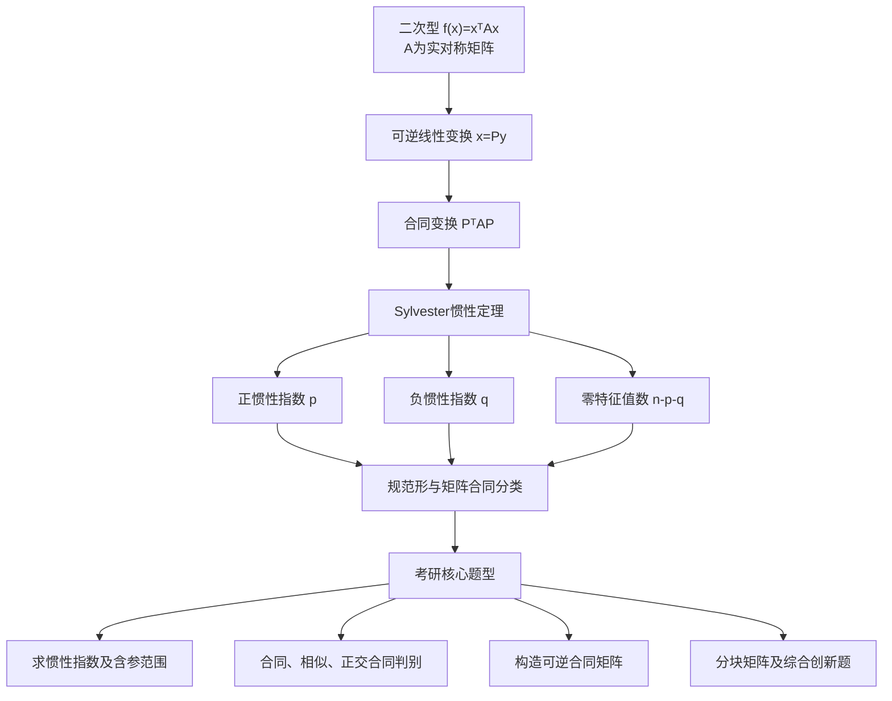
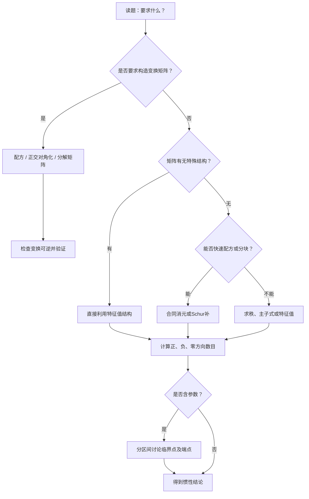

核心主题：Sylvester 惯性定理、正负惯性指数、矩阵合同与相似的区别、含参数二次型、合同变换构造及综合应用。

## 一、资料核对与本节学习路线

已经下载并读取你提供的《数学分类题目1101.zip》，定位到以下资料：

| 资料      | 阅读范围                    |
| ------- | ----------------------- |
| 考研核心题目  | 第五章第二节《惯性定理与合同》，共20道归档题 |
| 分类模拟题   | 对应小节的张宇、李林、李永乐模拟题       |
| 张宇1000题 | 线性代数第六章《二次型》            |
| 李林880题  | 第十五章《二次型》，基础题、综合题与拓展题   |
| 李正元     | 线性代数第六章《二次型》            |

其中，核心题目文件收录了2001、2007、2008、2011、2014、2016、2021、2025及2026年标注的历年试题，也收录了对应的强化练习。

以下以数学一真题及数学一相关模拟题为主，同时选取数学二、数学三中知识点完全共通的代表题。题目年份和出处按照资料中的标注呈现，未独立核验的原卷出处不视为已经确认。

#### 本节知识结构

学习本节需要形成三种能力：

第一层：会判断。 不必求出具体特征值，就能确定二次型的正负惯性指数。

第二层：会构造。 不仅知道两个矩阵合同，还能求出满足 $P^TAP=B$ 的可逆矩阵 $P$。

第三层：会迁移。 遇到含参数、分块矩阵、伴随矩阵、二次曲面或两个二次型同时化简时，能够识别题目的本质仍然是合同与惯性。

## 第一部分：基础理论与深层理解

### 二、什么是矩阵合同？

#### 2.1 从二次型的坐标变换出发

设一个 $n$ 元实二次型为

$$
f(x)=x^TAx,
$$

其中 $A$ 为 $n$ 阶实对称矩阵。

进行可逆线性变换

$$
x=Py,\qquad |P|\ne0.
$$

代入原二次型：

$$
\begin{aligned}
f(x)
&=(Py)^TA(Py)\\
&=y^TP^TAPy.
\end{aligned}
$$

所以在新的坐标下，二次型矩阵变成

$$
\boxed{B=P^TAP}.
$$

这个变换称为合同变换。

对于两个同阶实矩阵 $A,B$，若存在可逆矩阵 $P$，使

$$
\boxed{B=P^TAP},
$$

就称 $A$ 与 $B$ 合同，记作

$$
A\simeq_c B.
$$

这里 $P$ 不必是正交矩阵。

#### 2.2 合同究竟意味着什么？

从几何上理解：

同一个二次型换了一套可逆坐标系，它的代数表达式可能改变，但二次型本身的正负结构并没有改变。

例如：

$$
f(x_1,x_2)=4x_1^2-9x_2^2.
$$

令

$$
y_1=2x_1,\qquad y_2=3x_2,
$$

得到

$$
f=y_1^2-y_2^2.
$$

虽然系数由 (4,-9) 变成了 (1,-1)，但是始终存在一个正方向和一个负方向。

所以：

> <Callout type="idea" title="合同的几何意义">

合同变换允许改变非零平方项系数的大小，却不能改变二次型本质上的正负方向数目。

</Callout>

这是本节全部内容的出发点。

### 三、标准形、规范形和惯性指数

#### 3.1 标准形

任意实二次型都可以经过可逆线性变换化成

$$
f=d_1y_1^2+d_2y_2^2+\cdots+d_ry_r^2,
$$

其中

$$
d_i\ne0,\qquad r\le n.
$$

这称为二次型的标准形。

当采用正交变换时，标准形中的系数就是原矩阵的特征值：

$$
Q^TAQ=
\operatorname{diag}(\lambda_1,\ldots,\lambda_n),
\qquad Q^TQ=I.
$$

于是

$$
f=\lambda_1y_1^2+\cdots+\lambda_ny_n^2.
$$

#### 3.2 规范形

对标准形中每个非零平方项进一步进行非零数乘，就能把系数变成 (1) 或 (-1)。

因此任意实二次型都合同于

$$
\boxed{
f=z_1^2+\cdots+z_p^2
-z\_{p+1}^2-\cdots-z\_{p+q}^2
}.
$$

其余 $n-p-q$ 个变量对应的系数为零。

对应矩阵是

$$
\boxed{
J\_{p,q}=
\operatorname{diag}(I_p,-I_q,0\_{n-p-q})
}.
$$

其中：

- $p$：正惯性指数，即正平方项数目。
- $q$：负惯性指数，即负平方项数目。
- $n-p-q$：零惯性指数，即零特征值个数。

特别重要的是

$$
\boxed{r(A)=p+q}.
$$

例如，若一个四元二次型的规范形为

$$
z_1^2+z_2^2-z_3^2,
$$

则

$$
p=2,\qquad q=1,\qquad r(A)=3.
$$

还剩下一个零方向。

#### 3.3 为什么惯性指数不能直接数原式中的平方项？

考虑

$$
f=x_1^2+2x_1x_2.
$$

原式中似乎只有一个正平方项，没有负平方项。

但配方可得

$$
\begin{aligned}
f
&=(x_1+x_2)^2-x_2^2.
\end{aligned}
$$

令

$$
y_1=x_1+x_2,\qquad y_2=x_2.
$$

这是可逆变换，因此

$$
f=y_1^2-y_2^2.
$$

所以

$$
\boxed{p=1,\qquad q=1}.
$$

<Callout type="warn" title="不能直接数原式平方项">

原式没有出现负的平方项，不代表负惯性指数为零。

</Callout>

考研重要认识：惯性指数是二次型经过可逆变换之后的内在属性，不是直接观察原式系数得到的结果。

### 四、Sylvester 惯性定理

这是本节最重要的定理。

#### 4.1 定理内容

对于任意 $n$ 阶实对称矩阵 $A$，存在可逆矩阵 $P$，使

$$
P^TAP=\operatorname{diag}(I_p,-I_q,0).
$$

并且，无论怎样选择可逆变换，最终得到的正平方项和负平方项的数目都不会改变。

因此：

$$
\boxed{
\begin{gathered}
A,B\text{ 为同阶实对称矩阵},\\
A\text{ 与 }B\text{ 合同}
\\
\Longleftrightarrow\\
p(A)=p(B),\quad q(A)=q(B).
\end{gathered}
}
$$

这就是 Sylvester 惯性定理给出的合同判别准则。

注意适用条件：

<Callout type="info" title="惯性定理的使用范围">

同阶、实对称、实数域上的可逆合同变换。

</Callout>

#### 4.2 为什么正负惯性指数不变？

给出一个有助于理解定理的证明思路。

考虑二次型

$$
f(x)=x^TAx.
$$

定义 (p$A$) 为使二次型在其上严格为正的线性子空间的最大维数。

也就是说，存在一个维数为 $p$ 的子空间 $U$，使

$$
x^TAx>0,\qquad \forall x\in U,\ x\ne0.
$$

经过可逆变换 $x=Py$，原来的 $U$ 对应到新坐标中的子空间

$$
P^{-1}U.
$$

由于 $P$ 可逆，

$$
\dim(P^{-1}U)=\dim U.
$$

而且对于 $y\in P^{-1}U\setminus{0}$，

$$
y^T(P^TAP)y=(Py)^TA(Py)>0.
$$

因此，变换前后的最大正定子空间维数相同。

同理，最大负定子空间维数也相同。

于是正负惯性指数不变。

这个观点非常有价值：惯性指数衡量的是二次型内部的正负方向维数，而不是特征值本身的大小。

#### 4.3 合同保持什么？不保持什么？

设

$$
B=P^TAP,\qquad |P|\ne0.
$$

则有下表：

| 性质           | 合同是否保持 |
| ------------ | ------ |
| 正惯性指数 $p$    | 保持     |
| 负惯性指数 $q$    | 保持     |
| 零特征值个数       | 保持     |
| 矩阵的秩         | 保持     |
| 正定、负定、半正定等性质 | 保持     |
| 行列式的符号       | 保持     |
| 特征值的具体数值     | 不一定    |
| 迹            | 不一定    |
| 行列式的具体数值     | 不一定    |
| 特征值的代数重数     | 不一定    |

其中，行列式满足

$$
\begin{aligned}
|B|
&=|P^TAP|\\
&=|P^T||A||P|\\
&=|P|^2|A|.
\end{aligned}
$$

因为

$$
|P|^2>0,
$$

所以

$$
\boxed{\operatorname{sgn}|B|=\operatorname{sgn}|A|}.
$$

但一般

$$
|B|\ne|A|.
$$

例如

$$
A=\begin{pmatrix}1&0\\0&-1\end{pmatrix},
\qquad
P=\begin{pmatrix}2&0\\0&3\end{pmatrix}.
$$

则

$$
P^TAP=
\begin{pmatrix}4&0\\0&-9\end{pmatrix}.
$$

两者合同，但是特征值、迹和行列式数值都发生了改变。

### 五、相似、合同、等价：考研最容易混淆的三种关系

#### 5.1 三个定义

| 关系 | 数学形式         | 最核心的不变量   |
| -- | ------------ | --------- |
| 等价 | $B=PAQ$      | 秩         |
| 相似 | $B=P^{-1}AP$ | 特征值及其代数重数 |
| 合同 | $B=P^TAP$    | 正、负惯性指数   |

其中所有参与相应变换的矩阵均须可逆。

对于任意同阶矩阵：

$$
\boxed{A\sim_e B\iff r(A)=r(B)}.
$$

对于实对称矩阵：

$$
\boxed{
A\sim_c B
\iff
(p_A,q_A)=(p_B,q_B)
}.
$$

对于实对称矩阵，相似的充要条件是两者具有完全相同的特征值及其重数。

#### 5.2 实对称矩阵的特殊关系

若 $A,B$ 都是实对称矩阵，则

$$
\boxed{
A\text{ 与 }B\text{ 相似}
\Longrightarrow
A\text{ 与 }B\text{ 合同}
\Longrightarrow
A\text{ 与 }B\text{ 等价}
}.
$$

第一个箭头为什么成立？

因为实对称矩阵具有相同特征值时，可以通过正交变换化为同一个对角矩阵。

因此存在正交矩阵 $Q$，使

$$
B=Q^TAQ.
$$

而正交矩阵满足

$$
Q^{-1}=Q^T.
$$

于是该变换同时是相似变换和合同变换。

反过来一般不成立。

例如

$$
A=\operatorname{diag}(2,-3),
\qquad
B=\operatorname{diag}(1,-1).
$$

二者都具有

$$
(p,q)=(1,1),
$$

所以合同。

但特征值不同，因此不相似。

#### 5.3 一道题如何快速判断？

拿到“合同、相似、等价”的选择题，推荐固定采用以下顺序：

先看矩阵是否实对称，再看秩，然后比较正负惯性指数，最后比较完整特征值。

判断顺序可以概括为

$$
\boxed{
\text{秩}
\longrightarrow
\text{惯性}
\longrightarrow
\text{特征值}
}.
$$

秩相同只够判断等价；惯性相同才能判断实对称矩阵合同；特征值完全相同才可以判断实对称矩阵相似。

这个流程可以解决本节绝大多数关系判别题。

## 第二部分：求惯性指数的六大方法

### 六、方法一：特征值法——适合有特殊结构的矩阵

实对称矩阵可以正交对角化，因此：

$$
\boxed{
\begin{aligned}
p(A)&=\text{正特征值个数},\\
q(A)&=\text{负特征值个数}.
\end{aligned}
}
$$

这里必须计算重数。

但考研时不应遇到任何矩阵都直接展开特征多项式。

优先观察特殊结构。

#### 6.1 等对角、等非对角矩阵

考虑

$$
A=
\begin{pmatrix}
a&b&b\\
b&a&b\\
b&b&a
\end{pmatrix}.
$$

令

$$
e=(1,1,1)^T,
$$

则

$$
A=(a-b)I+bee^T.
$$

注意

$$
e^Te=3.
$$

沿 $e$ 方向：

$$
Ae=(a+2b)e.
$$

对于任意满足 $e^Tv=0$ 的向量：

$$
Av=(a-b)v.
$$

因此特征值为

$$
\boxed{
a+2b,\quad a-b,\quad a-b
}.
$$

直接根据三个数的正负判断惯性即可。

推广到 $n$ 阶：

$$
A=
\begin{pmatrix}
a&b&\cdots&b\\
b&a&\cdots&b\\
\vdots&\vdots&\ddots&\vdots\\
b&b&\cdots&a
\end{pmatrix},
$$

其特征值为

$$
\boxed{
\begin{cases}
a+(n-1)b,&\text{一重},\\
a-b,&\text{(n-1) 重}.
\end{cases}
}
$$

这是二次型、特征值和参数讨论题中的高频母模型。

#### 6.2 特殊结构的快速推广

对于

$$
A=\alpha I+\beta uu^T,\qquad u\ne0,
$$

有

$$
\boxed{
\begin{cases}
\alpha+\beta u^Tu,&\text{一重},\\
\alpha,&\text{(n-1) 重}.
\end{cases}
}
$$

因此一个秩一扰动矩阵的惯性问题，往往可以压缩成两个数的符号问题。

### 七、方法二：配方法——最适合直接给出二次型表达式的题

配方法的基本原则是：

每完成一次平方，就消去该变量与其余变量的交叉项。

例如

$$
f=x_1^2+2ax_1x_2+bx_2^2.
$$

可以写成

$$
\boxed{
f=(x_1+ax_2)^2+(b-a^2)x_2^2
}.
$$

令

$$
y_1=x_1+ax_2,\qquad y_2=x_2,
$$

这是行列式为 (1) 的可逆变换。

因此：

$$
p=1+\mathbf 1\_{{b-a^2>0}},
$$

$$
q=\mathbf 1\_{{b-a^2<0}},
$$

其中 $\mathbf 1$ 表示条件成立时取 (1)，否则取 (0)。

特别注意：

当

$$
b-a^2=0
$$

时，最后一项消失，产生一个零方向。

#### 配方法的标准流程

先选取非零平方项系数作为主元，将该变量的交叉项配成完整平方；再对剩余二次型继续配方；最后检查所有新变量能否构成可逆坐标变换，并数出正、负、零平方项。

如果配方得到

$$
f=3u^2-2v^2+5w^2,
$$

且 $u,v,w$ 是三个独立的新坐标，则

$$
(p,q)=(2,1).
$$

如果 $u,v,w$ 线性相关，就不能直接数三项。

这是配方法最重要的适用条件。

### 八、方法三：利用秩、行列式和正定性

#### 8.1 二阶实对称矩阵的快速判别

设

$$
A=\begin{pmatrix}a&b\b&c\end{pmatrix}.
$$

则

$$
|A|=ac-b^2.
$$

如果

$$
|A|<0,
$$

两个实特征值的乘积为负，因此一正一负：

$$
\boxed{p=q=1}.
$$

这是二阶不定二次型最重要的秒判公式。

如果 $|A|>0$，两个特征值同号，需要进一步看迹：

$$
\operatorname{tr}A=a+c.
$$

于是：

| 条件                               | 正惯性指数 | 负惯性指数 |
| -------------------------------- | ----- | ----- |
| $\|A\|<0$                        | 1     | 1     |
| $\|A\|>0,\ \operatorname{tr}A>0$ | 2     | 0     |
| $\|A\|>0,\ \operatorname{tr}A<0$ | 0     | 2     |
| $\|A\|=0,\ \operatorname{tr}A>0$ | 1     | 0     |
| $\|A\|=0,\ \operatorname{tr}A<0$ | 0     | 1     |
| $\|A\|=0,\ \operatorname{tr}A=0$ | 0     | 0     |

最后一种情况中，两个实特征值的和与积都为零，因此 $A=0$。

#### 8.2 三阶矩阵不能只看行列式符号

三阶实对称矩阵满足

$$
|A|=\lambda_1\lambda_2\lambda_3.
$$

如果 $|A|<0$，可能是

$$
(p,q)=(2,1),
$$

也可能是

$$
(p,q)=(0,3).
$$

所以三阶及以上，单独使用行列式符号通常不够。

还需要结合迹、秩、正定性、主子式或特征值结构。

#### 8.3 秩和惯性结合

如果一个三阶实对称矩阵满足

$$
r(A)=2,\qquad x^TAx\ge0\quad(\forall x),
$$

那么所有非零特征值都为正，因此

$$
\boxed{(p,q)=(2,0)}.
$$

类似地，若已知

$$
p=1,\qquad q=1,
$$

则立即得到

$$
r(A)=2.
$$

因此三阶矩阵的行列式必为零。

这在含参数题中可以先求出候选参数，大幅减少计算量。

### 九、方法四：合同消元与顺序主子式

这是配方法的矩阵版本。

考虑二阶实对称矩阵

$$
A=
\begin{pmatrix}
a&b\\
b&c
\end{pmatrix},\qquad a\ne0.
$$

对应二次型为

$$
f=ax_1^2+2bx_1x_2+cx_2^2.
$$

配方得到

$$
f=a\left(x_1+\frac ba x_2\right)^2+
\left(c-\frac{b^2}{a}\right)x_2^2.
$$

因此

$$
A\simeq_c
\operatorname{diag}\left(a,c-\frac{b^2}{a}\right).
$$

注意

$$
c-\frac{b^2}{a}=\frac{|A|}{a}.
$$

所以

$$
\boxed{
A\simeq_c
\operatorname{diag}\left(a,\frac{|A|}{a}\right)
}.
$$

#### 推广：顺序主子式法

设 $A$ 是 $n$ 阶实对称矩阵，定义前 $k$ 阶顺序主子式

$$
\Delta_k=
\det A[1!:!k,1!:!k],
\qquad \Delta_0=1.
$$

如果

$$
\Delta_k\ne0,\qquad k=1,2,\ldots,n,
$$

则

$$
\boxed{
A\simeq_c
\operatorname{diag}\left(
\Delta_1,
\frac{\Delta_2}{\Delta_1},
\ldots,
\frac{\Delta_n}{\Delta\_{n-1}}
\right)
}.
$$

右侧对角元中正数的个数就是 $p$，负数的个数就是 $q$。

例如

$$
A=
\begin{pmatrix}
2&1\\
1&-1
\end{pmatrix}.
$$

有

$$
\Delta_1=2,\qquad \Delta_2=-3.
$$

因此

$$
A\simeq_c\operatorname{diag}\left(2,-\frac32\right).
$$

故

$$
(p,q)=(1,1).
$$

适用条件不能忽略： 上面的比值公式要求所有有关的顺序主子式非零。

例如

$$
A=\begin{pmatrix}0&1\\1&0\end{pmatrix}
$$

虽然 $\Delta_1=0$，但仍然有两个非零特征值 (1,-1)。

这时不能直接套比值公式，应采用对称行列交换、二阶分块消元或特征值法。

### 十、方法五：分块矩阵与 Schur 补

这是综合题最值得掌握的进阶方法之一。

设

$$
M=
\begin{pmatrix}
H&K\\
K^T&D
\end{pmatrix},
$$

其中 $H,D$ 实对称，且 $H$ 可逆。

将变量分块为

$$
x=\begin{pmatrix}u\v\end{pmatrix}.
$$

那么

$$
x^TMx=u^THu+2u^TKv+v^TDv.
$$

配方可得

$$
\begin{aligned}
x^TMx
\={}&(u+H^{-1}Kv)^TH(u+H^{-1}Kv)\\
&+v^T(D-K^TH^{-1}K)v.
\end{aligned}
$$

所以

$$
\boxed{
M\simeq_c
\begin{pmatrix}
H&0\\
0&D-K^TH^{-1}K
\end{pmatrix}
}.
$$

其中

$$
S=D-K^TH^{-1}K
$$

称为关于 $H$ 的 Schur 补。

于是

$$
\boxed{
\begin{aligned}
p(M)&=p(H)+p(S),\\
q(M)&=q(H)+q(S).
\end{aligned}
}
$$

这是分块矩阵惯性指数的加法公式。

一个特别重要的模型是

$$
M=
\begin{pmatrix}
A+\alpha\alpha^T&\alpha\\
\alpha^T&1
\end{pmatrix}.
$$

其二次型可以写成

$$
f=u^TAu+(t+\alpha^Tu)^2.
$$

因此

$$
\boxed{
M\simeq_c\operatorname{diag}(A,1)
}.
$$

换言之，无论向量 $\alpha$ 如何变化，

$$
\boxed{
p(M)=p(A)+1,\qquad q(M)=q(A)
}.
$$

后面会用李林880原题具体演示。

### 十一、方法六：平方和、Gram 矩阵与秩

如果一个二次型可以写成

$$
f(x)=|Bx|^2,
$$

那么

$$
f(x)=x^TB^TBx.
$$

设

$$
A=B^TB,
$$

则必有

$$
x^TAx=|Bx|^2\ge0.
$$

所以

$$
q(A)=0.
$$

同时

$$
r(B^TB)=r(B).
$$

因此

$$
\boxed{
p(B^TB)=r(B),\qquad q(B^TB)=0
}.
$$

这个结论的重要性在于：计算惯性指数可以转化成求一个普通矩阵的秩。

特别地，如果 $B$ 是 $m\times n$ 实矩阵，且列满秩

$$
r(B)=n,
$$

那么

$$
B^TB
$$

是正定矩阵，正惯性指数为 $n$。

这个模型经常和线性方程组、向量组线性无关以及最小二乘问题结合。

## 第三部分：历年真题母题精讲

以下题目选自已读取的《考研核心题目》第五章第二节，按照知识递进而不是年份顺序讲解。

### 母题一：合同但不相似的判别

资料标注：2007年数学一、二、三真题。

已知

$$
A=
\begin{pmatrix}
2&-1&-1\\
-1&2&-1\\
-1&-1&2
\end{pmatrix},
\quad
B=\operatorname{diag}(1,1,0).
$$

判断 $A,B$ 是否相似、是否合同。

<Steps>

  <Step>

### 第一步：识别特殊矩阵

注意到

$$
A=3I-ee^T,
\qquad
e=(1,1,1)^T.
$$

因此：

沿 $e$ 的方向，特征值为

$$
3-3=0.
$$

在 $e^\perp$ 的二维空间中，特征值为

$$
3.
$$

所以

$$
\lambda(A)={3,3,0}.
$$

而

$$
\lambda(B)={1,1,0}.
$$

  </Step>

  <Step>

### 第二步：判断相似

两者特征值不同，因此

$$
\boxed{A,B\text{ 不相似}}.
$$

  </Step>

  <Step>

### 第三步：判断合同

两者都具有两个正特征值和一个零特征值：

$$
p(A)=p(B)=2,
\qquad
q(A)=q(B)=0.
$$

根据惯性定理：

$$
\boxed{A,B\text{ 合同}}.
$$

  </Step>

  <Step>

### 第四步：理解为什么合同不要求特征值相同

设正交矩阵 $Q$ 满足

$$
Q^TAQ=\operatorname{diag}(3,3,0).
$$

再取

$$
D=\operatorname{diag}
\left(\frac1{\sqrt3},\frac1{\sqrt3},1\right).
$$

令

$$
P=QD.
$$

则

$$
\begin{aligned}
P^TAP
&=D^TQ^TAQD\\
&=\operatorname{diag}(1,1,0)=B.
\end{aligned}
$$

也就是说，先正交对角化，再进行坐标缩放，就可以把 (3) 变成 (1)。

这正是合同变换与正交相似的本质区别。

  </Step>

</Steps>

#### 从这道题提炼通用方法

设

$$
A=\operatorname{diag}(a_1,\ldots,a_n),
\quad
B=\operatorname{diag}(b_1,\ldots,b_n).
$$

只要二者正、负、零对角元的数目分别相同，就合同。

但只有全部特征值及重数相同，才可能相似；对于实对称矩阵，这也是相似的充分条件。

### 母题二：含参数二次型的惯性指数

资料标注：2014年数学一、二、三真题。

设

$$
f=x_1^2-x_2^2+2ax_1x_3+4x_2x_3.
$$

已知负惯性指数为 (1)，求 $a$ 的范围。

这是一道特别重要的参数题，因为它考查的是不等式边界能不能取等号。

<Steps>

  <Step>

### 第一步：寻找配方结构

与 $x_1$ 有关的项：

$$
x_1^2+2ax_1x_3
\=(x_1+ax_3)^2-a^2x_3^2.
$$

与 $x_2$ 有关的项：

$$
-x_2^2+4x_2x_3
\=-(x_2-2x_3)^2+4x_3^2.
$$

合并：

$$
\boxed{
f=(x_1+ax_3)^2-(x_2-2x_3)^2
+(4-a^2)x_3^2
}.
$$

  </Step>

  <Step>

### 第二步：检查变换可逆

令

$$
\begin{cases}
y_1=x_1+ax_3,\\
y_2=x_2-2x_3,\\
y_3=x_3.
\end{cases}
$$

其变换矩阵为

$$
T=
\begin{pmatrix}
1&0&a\\
0&1&-2\\
0&0&1
\end{pmatrix}.
$$

因为

$$
|T|=1\ne0,
$$

所以这是合法可逆变换。

于是

$$
f=y_1^2-y_2^2+(4-a^2)y_3^2.
$$

  </Step>

  <Step>

### 第三步：讨论参数

前两项已经分别贡献一个正方向和一个负方向。

最后一项的系数决定总的惯性：

| 参数范围      | 正惯性指数 | 负惯性指数 | 秩 |
| --------- | ----- | ----- | - |
| $\|a\|<2$ | 2     | 1     | 3 |
| $\|a\|=2$ | 1     | 1     | 2 |
| $\|a\|>2$ | 1     | 2     | 3 |

题设只要求

$$
q=1.
$$

因此

$$
4-a^2\ge0.
$$

最终

$$
\boxed{-2\le a\le2}.
$$

  </Step>

</Steps>

#### 为什么端点必须保留？

当

$$
a=\pm2
$$

时，

$$
4-a^2=0.
$$

此时负惯性指数仍为 (1)，只是矩阵秩从 (3) 下降到了 (2)。

题目并没有要求矩阵满秩，因此端点必须保留。

#### 考研变式

如果把题目改成：

正惯性指数为 (2)，那么

$$
\boxed{-2<a<2}.
$$

因为端点的正惯性指数只有 (1)。

如果改成：

秩为 (2)，那么

$$
\boxed{a=\pm2}.
$$

如果改成：

二次型不定且退化，则仍然是

$$
\boxed{a=\pm2}.
$$

这三个变式说明：不同条件对参数端点的要求不同，不能机械地把所有惯性题都写成严格不等式。

### 母题三：交叉项隐藏正负惯性

资料标注：2025年数学一真题。

设

$$
f=x_1^2+2x_1x_2+2x_1x_3.
$$

求正惯性指数。

<Tabs items={["配方法 · 直接看正负平方项", "矩阵法 · 结合秩与负主子式"]} defaultIndex={0}>

  <Tab value="配方法 · 直接看正负平方项">

观察到

$$
\begin{aligned}
f
&=x_1^2+2x_1(x_2+x_3)\\
&=(x_1+x_2+x_3)^2-(x_2+x_3)^2.
\end{aligned}
$$

取

$$
\begin{cases}
y_1=x_1+x_2+x_3,\\
y_2=x_2+x_3,\\
y_3=x_3.
\end{cases}
$$

此变换可逆，得到

$$
f=y_1^2-y_2^2.
$$

因此

$$
\boxed{p=1,\qquad q=1,\qquad r=2}.
$$

  </Tab>

  <Tab value="矩阵法 · 结合秩与负主子式">

二次型矩阵为

$$
A=
\begin{pmatrix}
1&1&1\\
1&0&0\\
1&0&0
\end{pmatrix}.
$$

第2、3行相同，所以

$$
r(A)\le2.
$$

左上角二阶主子式为

$$
\begin{vmatrix}
1&1\\
1&0
\end{vmatrix}
\=-1<0.
$$

因此这个二维主子块一正一负，而且秩为 (2)。

结合整个矩阵秩为 (2)，得到

$$
p=q=1.
$$

  </Tab>

</Tabs>

#### 母题推广

对于任意两个线性无关的实线性式 (u$x$,v$x$)，若

$$
f(x)=u(x)v(x),
$$

则

$$
uv=\frac14\big[(u+v)^2-(u-v)^2\big].
$$

由于 $u,v$ 线性无关，$u+v$ 与 $u-v$ 也线性无关。

可以补充其余坐标构成可逆变换，所以

$$
\boxed{p=q=1}.
$$

这类题根本不需要求特征多项式。

例如张宇1000题中的对应模型：

$$
f=(x_1+3x_2+ax_3)(x_1+5x_2+bx_3).
$$

两个因子的 $x_1$ 系数均为 (1)，但 $x_2$ 系数分别为 (3,5)，因此对任何 $a,b$，它们都不可能成比例。

故恒有

$$
\boxed{p=q=1}.
$$

这个结论对任意两个独立线性式的乘积都成立。

### 母题四：多个线性式的平方和、平方差

资料标注：2021年数学一、二、三真题。

设

$$
f=(x_1+x_2)^2+(x_2+x_3)^2-(x_3-x_1)^2.
$$

求正负惯性指数。

这道题最容易出现的错误是：

> 有两个正平方、一个负平方，所以 $p=2,q=1$。

这个判断错误，因为三个线性式不独立。

<Steps>

  <Step>

### 第一步：展开

$$
\begin{aligned}
f={}&x_1^2+2x_1x_2+x_2^2\\
&+x_2^2+2x_2x_3+x_3^2\\
&-x_3^2+2x_1x_3-x_1^2.
\end{aligned}
$$

整理：

$$
f=2x_2^2+2x_2(x_1+x_3)+2x_1x_3.
$$

  </Step>

  <Step>

### 第二步：构造更合适的变量

令

$$
u=x_1+x_3,\qquad v=x_1-x_3.
$$

由于

$$
2x_1x_3=\frac{u^2-v^2}{2},
$$

因此

$$
\begin{aligned}
f
&=2x_2^2+2ux_2+\frac{u^2-v^2}{2}\\
&=2\left(x_2+\frac u2\right)^2-\frac12v^2.
\end{aligned}
$$

令

$$
y_1=x_2+\frac{x_1+x_3}{2},
\qquad
y_2=x_1-x_3,
\qquad
y_3=x_1+x_3.
$$

这是可逆变换。

所以

$$
f=2y_1^2-\frac12y_2^2.
$$

得到

$$
\boxed{(p,q)=(1,1)}.
$$

  </Step>

</Steps>

#### 深层理解：为什么三个平方项只得到秩2？

设

$$
u_1=x_1+x_2,\quad
u_2=x_2+x_3,\quad
u_3=x_3-x_1.
$$

注意

$$
u_3=u_2-u_1.
$$

因此三个线性式只有两个独立方向。

原式其实是

$$
f=u_1^2+u_2^2-(u_2-u_1)^2.
$$

展开：

$$
f=2u_1u_2.
$$

于是立刻得到

$$
p=q=1.
$$

这实际上是更快的解法。

#### 未来创新题的识别方式

遇到

$$
f=\sum\_{i=1}^{k}c_iL_i(x)^2
$$

时，不能只数系数 $c_i$ 的正负。

必须先判断这些线性式 $L_i$ 是否独立。

若把所有线性式写成

$$
L(x)=Cx,
$$

则

$$
f=x^TC^TDCx,
\qquad
D=\operatorname{diag}(c_1,\ldots,c_k).
$$

如果 $C$ 可逆，惯性与 $D$ 相同。

如果 $C$ 不可逆，原式正负项可能发生抵消，必须进一步分析。

这是线性相关性与惯性定理相结合的一类重要综合题。

### 母题五：合同关系与正交变换的综合

资料标注：2025年数学二真题，数学一完全适用。

设

$$
A=
\begin{pmatrix}
4&1&-2\\
1&1&1\\
-2&1&a
\end{pmatrix},
\qquad
B=
\begin{pmatrix}
k&0&0\\
0&6&0\\
0&0&0
\end{pmatrix}.
$$

已知 $A,B$ 合同。

求 $a,k$ 的条件；若进一步存在正交矩阵 $Q$，使

$$
Q^TAQ=B,
$$

求 $k,Q$。

这是典型的“先合同、再正交”的综合母题。

#### 第一问：确定合同参数

由于 $B$ 有一个零特征值，

$$
r(B)\le2.
$$

合同保持秩，因此

$$
r(A)\le2.
$$

所以

$$
|A|=0.
$$

计算得到

$$
|A|=3(a-4).
$$

因此

$$
\boxed{a=4}.
$$

代入得到

$$
A=
\begin{pmatrix}
4&1&-2\\
1&1&1\\
-2&1&4
\end{pmatrix}.
$$

它的特征值为

$$
\boxed{6,3,0}.
$$

因此

$$
p(A)=2,\qquad q(A)=0.
$$

由于 $B$ 的特征值为

$$
k,6,0,
$$

要使两者惯性相同，必须

$$
k>0.
$$

反过来，若 $k>0$，则 $B$ 也有两个正特征值和一个零特征值，所以必与 $A$ 合同。

于是第一问答案为

$$
\boxed{a=4,\qquad k>0}.
$$

注意这里是充要条件，而不只是必要条件。

#### 第二问：进一步要求正交变换

当

$$
Q^TAQ=B,\qquad Q^TQ=I
$$

时，有

$$
Q^{-1}=Q^T.
$$

所以

$$
B=Q^{-1}AQ.
$$

也就是说，$A,B$ 还必须相似。

因此两者特征值必须完全相同：

$$
{6,3,0}={6,k,0}.
$$

从而

$$
\boxed{k=3}.
$$

#### 第三步：构造正交矩阵

按照特征值 (3,6,0) 的顺序，分别取单位特征向量：

$$
q_1=\frac1{\sqrt3}
\begin{pmatrix}1\\1\\1\end{pmatrix},
$$

$$
q_2=\frac1{\sqrt2}
\begin{pmatrix}-1\\0\\1\end{pmatrix},
$$

$$
q_3=\frac1{\sqrt6}
\begin{pmatrix}1\\-2\\1\end{pmatrix}.
$$

它们两两正交，且长度为 (1)。

构成

$$
\boxed{
Q=
\begin{pmatrix}
\frac1{\sqrt3}&-\frac1{\sqrt2}&\frac1{\sqrt6}\\
\frac1{\sqrt3}&0&-\frac2{\sqrt6}\\
\frac1{\sqrt3}&\frac1{\sqrt2}&\frac1{\sqrt6}
\end{pmatrix}
}.
$$

于是

$$
\boxed{
Q^TAQ=\operatorname{diag}(3,6,0)=B
}.
$$

#### 本题的真正价值

两问使用了不同层次的不变量。

| 条件         | 应使用的依据   | 结果        |
| ---------- | -------- | --------- |
| $A,B$ 合同   | 秩与惯性指数   | $a=4,k>0$ |
| $A,B$ 正交相似 | 完整特征值    | $a=4,k=3$ |
| 求正交矩阵      | 单位正交特征向量 | 构造 $Q$    |

未来考研如果换成“存在可逆矩阵 $P$”与“存在正交矩阵 $Q$”两种条件同时出现，也按照这个顺序处理。

## 第四部分：强化练习母题与综合题精讲

### 母题六：含参数、秩下降与合同变换构造

来源：李林880题，第十五章综合题第34题；核心题目文件第15题。

设

$$
\begin{aligned}
f(x_1,x_2,x_3)
\={}&x_1^2+ax_2^2+x_3^2\\
&+2x_1x_2-2ax_1x_3-2x_2x_3.
\end{aligned}
$$

已知正、负惯性指数都是 (1)。

求参数 $a$，并求可逆矩阵 $B$，使 $x=By$ 将二次型化为标准形。

<Steps>

  <Step>

### 第一步：由惯性确定秩

题目给出

$$
p=q=1.
$$

因此

$$
\boxed{r(A)=2}.
$$

对应矩阵为

$$
A=
\begin{pmatrix}
1&1&-a\\
1&a&-1\\
-a&-1&1
\end{pmatrix}.
$$

由于秩为 (2)，必有

$$
|A|=0.
$$

计算得

$$
|A|=-(a-1)^2(a+2).
$$

所以

$$
(a-1)^2(a+2)=0.
$$

候选参数为

$$
a=1\quad\text{或}\quad a=-2.
$$

  </Step>

  <Step>

### 第二步：检查候选参数是否满足秩恰好为2

当 $a=1$ 时：

$$
A=
\begin{pmatrix}
1&1&-1\\
1&1&-1\\
-1&-1&1
\end{pmatrix}.
$$

它可以写成

$$
A=vv^T,
\qquad v=(1,1,-1)^T.
$$

因此

$$
r(A)=1.
$$

不符合题意。

当 $a=-2$ 时，

$$
A=
\begin{pmatrix}
1&1&2\\
1&-2&-1\\
2&-1&1
\end{pmatrix}.
$$

其左上角二阶主子式为

$$
\begin{vmatrix}
1&1\\
1&-2
\end{vmatrix}
\=-3\ne0.
$$

结合 $|A|=0$，得到

$$
r(A)=2.
$$

又因为该二阶主子块行列式为负，所以具有一正一负两个方向，整个矩阵也满足

$$
p=q=1.
$$

故

$$
\boxed{a=-2}.
$$

  </Step>

  <Step>

### 第三步：配方法构造可逆变换

代入 $a=-2$：

$$
f=x_1^2-2x_2^2+x_3^2
+2x_1x_2+4x_1x_3-2x_2x_3.
$$

配方：

$$
\boxed{
f=(x_1+x_2+2x_3)^2-3(x_2+x_3)^2
}.
$$

令

$$
\begin{cases}
y_1=x_1+x_2+2x_3,\\
y_2=x_2+x_3,\\
y_3=x_3.
\end{cases}
$$

解出

$$
\begin{cases}
x_1=y_1-y_2-y_3,\\
x_2=y_2-y_3,\\
x_3=y_3.
\end{cases}
$$

因此可取

$$
\boxed{
B=
\begin{pmatrix}
1&-1&-1\\
0&1&-1\\
0&0&1
\end{pmatrix}
}.
$$

由于

$$
|B|=1\ne0,
$$

且

$$
B^TAB=\operatorname{diag}(1,-3,0),
$$

所以最终得到标准形

$$
\boxed{f=y_1^2-3y_2^2}.
$$

  </Step>

</Steps>

#### 本题最重要的两个解题习惯

第一，$|A|=0$ 只能推出秩小于 (3)，不能推出秩恰好为 (2)。

第二，如果题目要求的是 $x=By$，那么一定要从新变量 $y$ 解出原变量 $x$。

很多同学直接把 $y=Tx$ 的系数矩阵写成 $B$，实际应该是

$$
\boxed{B=T^{-1}}.
$$

这个错误在合同变换构造题中十分常见。

### 母题七：2027模拟题——合同构造与迹运算

来源：李林六套卷第三套第21题，资料标注为数学一模拟题。

设

$$
A=
\begin{pmatrix}
1&a&a\\
a&1&a\\
a&a&1
\end{pmatrix},
\qquad
B=
\begin{pmatrix}
1&1&0\\
1&1&0\\
0&0&3
\end{pmatrix}.
$$

已知 $A,B$ 合同。

要求确定 $a$，构造可逆矩阵 $C$，使

$$
C^TAC=B,
$$

并求满足

$$
\operatorname{tr}\left[A(CX)(CX)^T\right]=0
$$

的向量 $X$。

这道题非常适合训练综合解题能力，因为它将特征值、秩、合同构造、矩阵迹与二次型零点结合在一起。

#### 第一问：求参数

矩阵 $B$ 的特征值为

$$
2,3,0.
$$

因此

$$
p(B)=2,\qquad q(B)=0,\qquad r(B)=2.
$$

对于 $A$，写成

$$
A=(1-a)I+aee^T,
\qquad e=(1,1,1)^T.
$$

所以其特征值为

$$
1+2a,\qquad 1-a,\qquad 1-a.
$$

要与 $B$ 合同，必须恰有两个正特征值、一个零特征值。

若 $a=1$，则特征值为

$$
3,0,0,
$$

秩为 (1)，排除。

因此只能令

$$
1+2a=0.
$$

得到

$$
\boxed{a=-\frac12}.
$$

#### 第二问：构造合同矩阵

代入参数：

$$
A=
\begin{pmatrix}
1&-\frac12&-\frac12\\
-\frac12&1&-\frac12\\
-\frac12&-\frac12&1
\end{pmatrix}.
$$

注意

$$
A\begin{pmatrix}1\\1\\1\end{pmatrix}=0.
$$

这说明向量

$$
e=(1,1,1)^T
$$

位于 $A$ 的零空间中。

目标矩阵 $B$ 的前两列对应的二次型内积相同，因此可以利用零空间构造两列具有特殊关系的向量。

取

$$
c_1=
\begin{pmatrix}1\\0\\0\end{pmatrix},
\qquad
c_2=
\begin{pmatrix}2\\1\\1\end{pmatrix}.
$$

由于

$$
c_2-c_1=e,
$$

所以

$$
Ac_2=Ac_1.
$$

再取

$$
c_3=
\begin{pmatrix}0\\1\\-1\end{pmatrix}.
$$

于是

$$
C=(c_1,c_2,c_3)=\begin{pmatrix}
1&2&0\\
0&1&1\\
0&1&-1
\end{pmatrix}.
$$

验证：

$$
\boxed{
C^TAC=
\begin{pmatrix}
1&1&0\\
1&1&0\\
0&0&3
\end{pmatrix}=B
}.
$$

而且

$$
|C|=-2\ne0.
$$

因此构造成功。

#### 第三问：把迹条件转化为二次型

利用迹的循环不变性：

$$
\begin{aligned}
\operatorname{tr}[A(CX)(CX)^T]
&=\operatorname{tr}(ACXX^TC^T)\\
&=\operatorname{tr}(X^TC^TACX)\\
&=X^TC^TACX\\
&=X^TBX.
\end{aligned}
$$

设

$$
X=(x_1,x_2,x_3)^T.
$$

代入 $B$：

$$
X^TBX=(x_1+x_2)^2+3x_3^2.
$$

题目要求该式为零。

由于变量为实数，两项均非负，所以

$$
\begin{cases}
x_1+x_2=0,\\
x_3=0.
\end{cases}
$$

因此

$$
\boxed{
X=t\begin{pmatrix}1\\-1\\0\end{pmatrix},
\quad t\in\mathbb R
}.
$$

#### 可以从本题推广出的模型

对于任意实对称半正定矩阵 $B$，有

$$
\boxed{x^TBx=0\iff Bx=0}.
$$

证明很简单。

若

$$
B=Q\operatorname{diag}(\lambda_1,\ldots,\lambda_n)Q^T,
$$

其中所有 $\lambda_i\ge0$，令 $y=Q^Tx$，则

$$
x^TBx=\sum\_{i=1}^n\lambda_i y_i^2.
$$

它等于零，当且仅当所有对应正特征值的坐标分量为零，也就是

$$
Bx=0.
$$

但如果 $B$ 是不定矩阵，结论一般不成立。

例如

$$
B=\operatorname{diag}(1,-1),
\qquad x=(1,1)^T,
$$

有

$$
x^TBx=0,
$$

但

$$
Bx\ne0.
$$

这一区别很适合考研命题：二次型为零不一定意味着向量属于零空间，必须检查矩阵是否半正定或半负定。

### 母题八：李林880分块矩阵题

设

$$
A=
\begin{pmatrix}
-1&1\\
1&1
\end{pmatrix},
\qquad
\alpha=(a,b)^T.
$$

考虑三阶矩阵

$$
M=
\begin{pmatrix}
A+\alpha\alpha^T&\alpha\\
\alpha^T&1
\end{pmatrix}.
$$

求 $M$ 对应二次型的规范形。

<Steps>

  <Step>

### 第一步：不要展开三阶矩阵

很多同学会把它展开成

$$
M=
\begin{pmatrix}
a^2-1&ab+1&a\\
ab+1&b^2+1&b\\
a&b&1
\end{pmatrix}.
$$

然后计算三阶特征多项式。

这是可以避免的繁琐方法。

  </Step>

  <Step>

### 第二步：直接对分块二次型配方

令

$$
X=\begin{pmatrix}u\t\end{pmatrix},
\qquad u\in\mathbb R^2.
$$

那么

$$
\begin{aligned}
X^TMX
&=u^T(A+\alpha\alpha^T)u
+2t\alpha^Tu+t^2\\
&=u^TAu+(\alpha^Tu+t)^2.
\end{aligned}
$$

令

$$
s=t+\alpha^Tu.
$$

这是可逆变换。

因此

$$
M\simeq_c\operatorname{diag}(A,1).
$$

  </Step>

  <Step>

### 第三步：求二维矩阵的惯性

因为

$$
|A|=(-1)(1)-1=-2<0,
$$

所以

$$
p(A)=q(A)=1.
$$

再增加一个正平方项：

$$
\boxed{p(M)=2,\qquad q(M)=1}.
$$

因此规范形是

$$
\boxed{z_1^2+z_2^2-z_3^2}.
$$

  </Step>

</Steps>

#### 为什么这个模型值得记住？

因为整道题中出现的 $a,b$ 完全不需要求解。

参数只出现在某个能够被配方消去的部分。

因此，无论 $a,b$ 取什么实数，惯性指数都不变。

遇到分块矩阵时，优先检查它能否写成

$$
\begin{pmatrix}
A+C^TC&C^T\\
C&I
\end{pmatrix}
$$

的形式。

因为这种矩阵恒与

$$
\operatorname{diag}(A,I)
$$

合同。

这是非常具有推广价值的结构。

### 母题九：合同但不相似的含参模拟题

来源：张宇8套卷第7套第15题。

设

$$
A=
\begin{pmatrix}
-3&0&0\\
0&-1&2\\
0&2&2
\end{pmatrix},
\quad
B=
\begin{pmatrix}
0&3&0\\
3&0&0\\
0&0&k
\end{pmatrix}.
$$

若 $A,B$ 合同但不相似，求 $k$ 的范围。

<Steps>

  <Step>

### 第一步：求特征值

对于 $A$，右下二阶块

$$
\begin{pmatrix}-1&2\\2&2\end{pmatrix}
$$

的特征值为 (3,-2)。

因此

$$
\lambda(A)={-3,-2,3}.
$$

对于 $B$，左上二阶块

$$
\begin{pmatrix}0&3\\3&0\end{pmatrix}
$$

的特征值为 (3,-3)。

所以

$$
\lambda(B)={3,-3,k}.
$$

  </Step>

  <Step>

### 第二步：满足合同

$A$ 具有一个正特征值、两个负特征值。

因此 $B$ 也必须具有一个正特征值、两个负特征值。

由于已经存在 (3,-3)，所以

$$
\boxed{k<0}.
$$

  </Step>

  <Step>

### 第三步：排除相似

若两者相似，则必须具有相同特征值。

这要求

$$
k=-2.
$$

题目要求不相似，因此必须排除。

最终：

$$
\boxed{k<0,\qquad k\ne-2}.
$$

这道题的通用解题框架是

$$
\boxed{
\text{合同条件}
+
\text{排除相似条件}
}.
$$

前者通常产生一个参数范围，后者通常需要排除其中若干特殊值。

  </Step>

</Steps>

## 第五部分：如何构造合同变换矩阵？

判断合同和实际构造合同矩阵，是两种不同难度的能力。

### 十二、通法：分别化为同一个规范形

假设已知 $A,B$ 合同，需要求

$$
P^TAP=B.
$$

可以分别找可逆矩阵 $U,V$，使

$$
U^TAU=J,
$$

$$
V^TBV=J,
$$

其中 $J$ 是相同的规范形矩阵。

由第二式得

$$
B=V^{-T}JV^{-1}.
$$

将 $J=U^TAU$ 代入：

$$
B=V^{-T}U^TAUV^{-1}.
$$

所以

$$
\boxed{P=UV^{-1}}.
$$

立即得到

$$
P^TAP=B.
$$

这提供了一个通用构造流程：

$$
A\longrightarrow J\longleftarrow B.
$$

只要两个矩阵能够经过可逆变换化成同一个规范形，就可以将两条变换连接起来。

这也是 Sylvester 惯性定理充分性部分的具体构造思路。

### 十三、正定矩阵的平方根分解法

对应张宇1000题二次型章节中的合同矩阵构造题。

设

$$
A=
\begin{pmatrix}
3&2&1\\
2&2&1\\
1&1&1
\end{pmatrix},
\qquad
\Lambda=\operatorname{diag}(2,3,1).
$$

求可逆矩阵 $C$，使

$$
C^TAC=\Lambda.
$$

<Steps>

  <Step>

### 第一步：将 $A$ 分解为 $U^TU$

注意到

$$
U=
\begin{pmatrix}
1&1&1\\
1&1&0\\
1&0&0
\end{pmatrix}
$$

满足

$$
U^TU=A.
$$

且

$$
|U|=-1\ne0.
$$

因此 $U$ 可逆。

  </Step>

  <Step>

### 第二步：将目标矩阵写成 $D^TD$

令

$$
D=\operatorname{diag}(\sqrt2,\sqrt3,1).
$$

则

$$
D^TD=\Lambda.
$$

  </Step>

  <Step>

### 第三步：令 $UC=D$

由

$$
C^TU^TUC=D^TD
$$

可知，只需取

$$
C=U^{-1}D.
$$

计算得

$$
\boxed{
C=
\begin{pmatrix}
0&0&1\\
0&\sqrt3&-1\\
\sqrt2&-\sqrt3&0
\end{pmatrix}
}.
$$

于是

$$
C^TAC
\=(UC)^T(UC)
\=D^TD=\Lambda.
$$

  </Step>

</Steps>

#### 推广

如果 $A,B$ 都是实对称正定矩阵，那么它们一定合同。

因为存在可逆矩阵 $U,V$，使

$$
A=U^TU,\qquad B=V^TV.
$$

取

$$
\boxed{P=U^{-1}V},
$$

就得到

$$
P^TAP=B.
$$

注意：两个正定矩阵虽然一定合同，但一般不相似。

例如

$$
I
\quad\text{与}\quad
\operatorname{diag}(2,3)
$$

都是正定矩阵，因此合同，却具有不同特征值。

## 第六部分：高阶综合与创新题模型

### 十四、两个二次型的同时合同对角化

来源：张宇1000题，对应核心题目第18题。

设

$$
f(x_1,x_2)=x_1^2+2x_1x_2+2x_2^2,
$$

$$
g(x_1,x_2)=-x_1^2+2x_1x_2+2x_2^2.
$$

求可逆变换 $x=Py$，使

$$
f=y_1^2+y_2^2,
$$

同时

$$
g=k_1y_1^2+k_2y_2^2.
$$

这是比普通合同更难的一种题型。

<Steps>

  <Step>

### 第一步：建立矩阵形式

两个二次型的矩阵分别为

$$
A=
\begin{pmatrix}
1&1\\
1&2
\end{pmatrix},
\qquad
G=
\begin{pmatrix}
-1&1\\
1&2
\end{pmatrix}.
$$

要求

$$
P^TAP=I,
$$

$$
P^TGP=\operatorname{diag}(k_1,k_2).
$$

  </Step>

  <Step>

### 第二步：为什么需要先考虑 $A$？

因为

$$
A\_{11}=1>0,\qquad |A|=1>0.
$$

因此 $A$ 正定。

这保证我们可以先将 $f$ 经过可逆变换化为单位二次型，再处理 $g$。

  </Step>

  <Step>

### 第三步：求广义特征值

考虑

$$
Gv=kAv.
$$

存在非零解的条件是

$$
|G-kA|=0.
$$

计算：

$$
\begin{aligned}
|G-kA|
&=
\begin{vmatrix}
-1-k&1-k\\
1-k&2-2k
\end{vmatrix}\\
&=(k-1)(k+3).
\end{aligned}
$$

所以

$$
\boxed{k_1=1,\qquad k_2=-3}.
$$

  </Step>

  <Step>

### 第四步：求相应的广义特征向量

对 $k_1=1$，可取

$$
v_1=(0,1)^T.
$$

对 $k_2=-3$，可取

$$
v_2=(-2,1)^T.
$$

可以验证

$$
v_1^TAv_2=0.
$$

而且

$$
v_1^TAv_1=v_2^TAv_2=2.
$$

所以令

$$
p_1=\frac{v_1}{\sqrt2},
\qquad
p_2=\frac{v_2}{\sqrt2}.
$$

取

$$
\boxed{
P=
\begin{pmatrix}
0&-\sqrt2\\
1/\sqrt2&1/\sqrt2
\end{pmatrix}
}.
$$

那么

$$
P^TAP=I,
$$

$$
P^TGP=\operatorname{diag}(1,-3).
$$

最终：

$$
\boxed{
f=y_1^2+y_2^2,\qquad
g=y_1^2-3y_2^2
}.
$$

  </Step>

</Steps>

#### 推广：为什么正定条件如此重要？

若 $A$ 是实对称正定矩阵、$G$ 是实对称矩阵，则一定存在可逆矩阵 $P$，使

$$
P^TAP=I
$$

且

$$
P^TGP
$$

是对角矩阵。

其本质是先利用正定矩阵 $A$ 建立一个新的内积：

$$
\langle u,v\rangle_A=u^TAv,
$$

再在这个内积下对第二个二次型进行对角化。

这一模型可以联系到广义特征值、优化问题与矩阵分析。

不过考研数学一中需要重点掌握的是其初等矩阵构造和基本思想，不必引入过多超纲理论。

### 十五、矩阵 $A^TA$、$AA^T$ 与惯性指数

这类题经常把二次型和向量组秩结合起来。

设 $A$ 是 $m\times n$ 实矩阵。

那么

$$
A^TA
$$

是 $n$ 阶实对称半正定矩阵。

因为

$$
x^TA^TAx=|Ax|^2\ge0.
$$

同时

$$
r(A^TA)=r(A).
$$

因此

$$
\boxed{
\begin{aligned}
p(A^TA)&=r(A),\\
q(A^TA)&=0,\\
\text{零惯性指数}&=n-r(A).
\end{aligned}
}
$$

类似地，

$$
\boxed{
\begin{aligned}
p(AA^T)&=r(A),\\
q(AA^T)&=0.
\end{aligned}
}
$$

#### 代表变式

设

$$
A=
\begin{pmatrix}
1&b&-1\\
a+2&3&-3a
\end{pmatrix}.
$$

已知二次型

$$
x^T(AA^T)x
$$

的规范形为 $y_1^2$。

求 $a+b$。

因为只有一个非零正平方项，所以

$$
r(AA^T)=1.
$$

因此

$$
r(A)=1.
$$

由于第一行不为零，第二行必须是第一行的倍数。

设

$$
(a+2,3,-3a)=t(1,b,-1).
$$

比较第一、三列：

$$
t=a+2=3a.
$$

因此

$$
a=1,\qquad t=3.
$$

再由

$$
3=tb
$$

得到

$$
b=1.
$$

最终

$$
\boxed{a+b=2}.
$$

这道题展示了一个重要技巧：

遇到 $A^TA$、$AA^T$ 的惯性问题，优先考虑秩，不要一上来计算特征值。

### 十六、几何模型：二次曲面与惯性指数

对应资料中2008年数学一双叶双曲面题。

考虑三元二次型

$$
x^TAx=1,
$$

其中 $A$ 是三阶实对称矩阵。

通过正交变换，可以写成

$$
\lambda_1y_1^2+\lambda_2y_2^2+\lambda_3y_3^2=1.
$$

当三个特征值均非零时，其几何类型取决于正负惯性指数。

| 正惯性指数 $p$ | 负惯性指数 $q$ | 曲面类型  |
| --------- | --------- | ----- |
| 3         | 0         | 椭球面   |
| 2         | 1         | 单叶双曲面 |
| 1         | 2         | 双叶双曲面 |
| 0         | 3         | 无实点   |

例如双叶双曲面的标准方程为

$$
\frac{y_1^2}{a^2}
-\frac{y_2^2}{b^2}
-\frac{y_3^2}{c^2}=1.
$$

因此对应矩阵恰有一个正特征值、两个负特征值：

$$
\boxed{p=1,\qquad q=2}.
$$

注意，这个表格针对右侧为 (1) 的非退化中心二次曲面。出现零特征值或右端改变时，需要重新分析曲面类型。

这里的核心是把几何分类转化为矩阵的符号结构。

## 第七部分：考研创新题的统一识别方法

### 十七、看到什么条件，应该想到什么？

| 题目中出现的条件           | 第一反应      | 推荐工具         |
| ------------------ | --------- | ------------ |
| $A,B$ 合同           | 惯性指数相同    | Sylvester 定理 |
| $P^TAP=B$          | 构造可逆坐标变换  | 配方、规范形       |
| $Q^TAQ=B,\ Q^TQ=I$ | 正交相似      | 特征值与特征向量     |
| 正负惯性指数已知           | 确定秩       | $r=p+q$      |
| 含参数且秩下降            | 先求行列式零点   | 行列式、非零子式     |
| (A=$a-b$I+bJ)      | 特殊谱结构     | 一维与正交补       |
| $A^TA$ 或 $AA^T$    | 半正定且秩不变   | Gram矩阵       |
| 若干线性式的平方和          | 检查线性式是否独立 | 矩阵秩、配方       |
| 分块矩阵               | 寻找可配方结构   | Schur补       |
| $A^\*$、$A^{-1}$    | 特征值如何变换   | 谱映射          |
| 两个二次型同时化简          | 是否一个正定    | 广义特征值        |

有两个需要特别补充的专题。

#### 17.1 伴随矩阵的惯性

若实对称矩阵 $A$ 可逆，则

$$
A^\*=|A|A^{-1}.
$$

设 $A$ 的特征值为

$$
\lambda_1,\ldots,\lambda_n.
$$

那么伴随矩阵的特征值为

$$
\boxed{
\mu_i=\frac{|A|}{\lambda_i}
}.
$$

因此：

若 $|A|>0$，所有特征值符号不变，所以

$$
(p(A^*),q(A^*))=(p(A),q(A)).
$$

若 $|A|<0$，所有特征值符号反转，所以

$$
\boxed{
p(A^*)=q(A),\qquad q(A^*)=p(A)
}.
$$

需要注意，这个直接公式要求 $A$ 可逆。

如果 $A$ 奇异，就不能使用

$$
A^\*=|A|A^{-1}.
$$

此时应从伴随矩阵定义或秩的性质重新分析。

#### 17.2 逆矩阵与原矩阵一定合同吗？

对可逆实对称矩阵 $A$，答案是肯定的。

因为

$$
P=A^{-1}
$$

可逆，而且

$$
P^T=P.
$$

于是

$$
\boxed{
P^TAP
\=A^{-1}AA^{-1}
\=A^{-1}
}.
$$

因此

$$
\boxed{A\simeq_c A^{-1}}.
$$

这个结果特别适合处理抽象矩阵证明题。

但不能因此推出

$$
A\sim A^{-1}.
$$

例如

$$
A=\operatorname{diag}(2,3)
$$

与其逆矩阵合同，但特征值集合不同，不相似。

## 第八部分：分层训练题

下面挑选具有迁移价值的练习模型。除标注了具体来源的原题外，这部分包含为巩固方法而设置的变式题。

建议先独立完成，再核对解答。

### 十八、基础巩固

#### 练习1：二阶不定矩阵

已知

$$
A(t)=
\begin{pmatrix}
2&t\\
t&-1
\end{pmatrix}.
$$

求使 (A$t$) 的正负惯性指数都是 (1) 的全部 $t$。

<Accordions>

  <Accordion title="展开参考答案与解题要点">

因为

$$
|A(t)|=-2-t^2<0
$$

对所有实数 $t$ 成立。

因此

$$
\boxed{t\in\mathbb R}.
$$

本题训练的是二阶行列式快速判断法。

  </Accordion>

</Accordions>

#### 练习2：四阶特殊结构

设

$$
A(t)=(t-1)I_4+J_4,
$$

其中 $J_4$ 是四阶全1矩阵。

求 (A$t$) 的正惯性指数为 (1)、负惯性指数为 (3) 的参数范围。

<Accordions>

  <Accordion title="展开参考答案与解题要点">

特征值为

$$
t+3,\qquad t-1,\qquad t-1,\qquad t-1.
$$

要求一个正、三个负，因此

$$
\begin{cases}
t+3>0,\\
t-1<0.
\end{cases}
$$

得到

$$
\boxed{-3<t<1}.
$$

本题是2016年惯性指数真题模型的四阶推广。

  </Accordion>

</Accordions>

#### 练习3：参数配方

设

$$
f=x_1^2+2tx_1x_2+(t^2-1)x_2^2.
$$

求正负惯性指数。

<Accordions>

  <Accordion title="展开参考答案与解题要点">

配方：

$$
f=(x_1+tx_2)^2-x_2^2.
$$

因此对任意实数 $t$：

$$
\boxed{p=q=1}.
$$

这一题提醒你，有些参数只决定坐标变换的具体形式，不影响惯性。

### 十九、综合提高

  </Accordion>

</Accordions>

#### 练习4：合同而不相似

设

$$
A=
\begin{pmatrix}
1&2&0\\
2&4&0\\
0&0&-1
\end{pmatrix}.
$$

判断它与

$$
B=\operatorname{diag}(3,-2,0)
$$

是否合同、是否相似。

<Accordions>

  <Accordion title="展开参考答案与解题要点">

矩阵 $A$ 的特征值为

$$
5,0,-1.
$$

因此

$$
p(A)=q(A)=1.
$$

矩阵 $B$ 的特征值为

$$
3,-2,0,
$$

所以

$$
p(B)=q(B)=1.
$$

两者合同。

但由于特征值不同，所以不相似。

因此

$$
\boxed{\text{合同，但不相似}}.
$$

  </Accordion>

</Accordions>

#### 练习5：平方和与矩阵秩

设 $A$ 是 $4\times3$ 实矩阵，且

$$
r(A)=2.
$$

求二次型

$$
f(x)=x^TA^TAx
$$

的正、负惯性指数及规范形。

<Accordions>

  <Accordion title="展开参考答案与解题要点">

因为

$$
x^TA^TAx=|Ax|^2\ge0,
$$

且

$$
r(A^TA)=r(A)=2,
$$

所以

$$
\boxed{p=2,\qquad q=0}.
$$

规范形为

$$
\boxed{y_1^2+y_2^2}.
$$

还存在一个零方向，因为该二次型有三个变量。

  </Accordion>

</Accordions>

#### 练习6：分块惯性

设

$$
M=
\begin{pmatrix}
A&b\\
b^T&1
\end{pmatrix},
$$

其中 $A$ 是二阶实对称矩阵，$b$ 为二维实列向量。

已知

$$
A-bb^T=
\begin{pmatrix}
2&1\\
1&-1
\end{pmatrix}.
$$

求 $M$ 的正、负惯性指数。

<Accordions>

  <Accordion title="展开参考答案与解题要点">

由于右下角为 (1)，可以对最后一个变量配方：

$$
M\simeq_c
\operatorname{diag}(A-bb^T,1).
$$

而

$$
\det(A-bb^T)=2(-1)-1=-3<0.
$$

所以 $A-bb^T$ 有一正一负两个特征值。

再加一个正方向，得到

$$
\boxed{p(M)=2,\qquad q(M)=1}.
$$

这是 Schur 补的直接应用。

  </Accordion>

</Accordions>

## 第九部分：错误陷阱与考场策略

### 二十、最容易失分的六类错误
<Accordions>

  <Accordion title="六类易错点 · 展开对照">

| 常见错误             | 为什么错          | 正确处理       |
| ---------------- | ------------- | ---------- |
| 把合同当成相似          | 合同不保留特征值数值    | 先比较惯性，再比较谱 |
| 只看秩判断合同          | 同秩可能有不同正负方向   | 必须比较 $p,q$ |
| 直接数原式中的平方项       | 交叉项会产生负方向     | 配方或正交对角化   |
| 行列式为零就认定秩为 $n-1$ | 可能降到更低秩       | 检查非零子式     |
| 配方后不验证变换可逆       | 相关线性式不能构成完整坐标 | 检查变换矩阵秩    |
| 用合同条件求正交矩阵       | 正交变换还保留特征值    | 增加完整谱相同的条件 |

其中，尤其需要记住一个反例：

$$
A=\operatorname{diag}(1,1,0),
\qquad
B=\operatorname{diag}(1,-1,0).
$$

虽然

$$
r(A)=r(B)=2,
$$

但是

$$
(p(A),q(A))=(2,0),
$$

$$
(p(B),q(B))=(1,1).
$$

因此它们不合同。

这说明：

$$
\boxed{
\text{秩相同只是合同的必要条件，而非充分条件}
}.
$$

  </Accordion>

</Accordions>

### 二十一、考场上最推荐的解题顺序

对于大多数二次型惯性问题，建议按照下面的流程执行：

这个顺序的核心是：

先识别结构，再选择工具，最后进行计算。

不要把求特征多项式当成所有二次型题的默认方法。

很多题可以通过一两步配方或秩分析直接解决。

## 第十部分：最后需要真正掌握的知识体系

### 二十二、核心公式总表

| 知识点            | 公式或结论                                                |
| -------------- | ---------------------------------------------------- |
| 合同定义           | $B=P^TAP,\ \|P\|\ne0$                                |
| Sylvester 惯性定理 | (A\simeq_c B\iff$p_A,q_A$=$p_B,q_B$)                 |
| 规范形            | (\operatorname{diag}$I_p,-I_q,0$)                    |
| 秩与惯性           | (r$A$=p+q)                                           |
| 行列式关系          | $\|B\|=\|P\|^2\|A\|$                                 |
| 二阶异号判别         | (\|A\|<0\Rightarrow$p,q$=(1,1))                      |
| Gram矩阵         | (p$A^TA$=r$A$,\ q$A^TA$=0)                           |
| 秩一扰动           | $\alpha I+\beta uu^T$ 的谱为 $\alpha+\beta u^Tu,\alpha$ |
| Schur补         | (M\simeq_c\operatorname{diag}$H,D-K^TH^{-1}K$)       |
| 可逆实对称矩阵        | $A\simeq_c A^{-1}$                                   |
| 正定矩阵           | 所有正定实对称矩阵彼此合同                                        |
| 正交合同           | $Q^TAQ=Q^{-1}AQ$                                     |

### 二十三、哪些题最值得反复做？

结合已读取的资料，最建议反复训练的是下面这些母题，而不是平均分配精力给每一道题。

| 题目来源         | 核心能力     | 训练重点         |
| ------------ | -------- | ------------ |
| 2007年合同与相似题  | 关系判别     | 谱与惯性的不变量     |
| 2014年含参惯性题   | 参数范围     | 边界、零特征值、秩变化  |
| 2021年平方差题    | 二次型化简    | 线性式相关性       |
| 2025年数学一惯性题  | 快速配方     | 交叉项与平方差      |
| 2025年数学二综合题  | 合同与正交相似  | 区分变换条件       |
| 李林880综合题第34题 | 含参秩与合同构造 | 排除伪参数、构造 $P$ |
| 李林880分块矩阵题   | Schur补   | 参数消去与惯性相加    |
| 张宇1000题矩阵构造题 | 求合同矩阵    | $U^TU$ 分解    |
| 张宇8套卷第7套第15题 | 合同但不相似   | 先取范围再排除特殊值   |
| 李林六套卷第三套第21题 | 多考点综合    | 秩、合同、零空间与迹   |
| 李正元二次型秩题     | 谱与规范形    | 标准形和规范形的区别   |

### 二十四、检验自己是否真正掌握

如果已经能够做到以下几点，说明你不只是会做某一道题，而是开始掌握了本节的整体方法。

基础层面： 给出一个二次型，能够正确写出对称矩阵，完成配方，区分标准形和规范形，并求出 $p,q,r$。

熟练层面： 对于合同、相似、等价的选择题，可以在不计算完整特征多项式的情况下筛选大部分选项；遇到含参数题，知道先找秩变化点，再讨论特征值符号。

提高层面： 能够构造满足 $P^TAP=B$ 的可逆矩阵，并区分 $y=Tx$ 与 $x=Py$ 所对应的不同矩阵。

综合层面： 能够识别 $A^TA$、分块矩阵、伴随矩阵、特殊秩一扰动，以及两个二次型同时化简等问题背后的惯性结构。

创新层面： 题目即使没有直接出现“二次型”“惯性指数”“合同”等关键词，也能够从平方和、矩阵秩、坐标变换、迹运算或二次曲面中发现相同的数学本质。

### 最终总结

第五章第二节最重要的思想，不是记住几十个惯性指数计算公式，而是理解：

$$
\boxed{
\text{二次型的正负结构}
\xrightarrow{\text{可逆线性变换}}
\text{保持不变}
}
$$

矩阵的具体数值表示可以改变，但二次型所具有的正方向、负方向和零方向的数目不会改变。

因此，无论题目表现为参数判定、矩阵合同、构造线性变换、平方和、分块矩阵还是二次曲面，最终都可以回到三个基本量：

$$
\boxed{
p(A),\qquad q(A),\qquad r(A)=p(A)+q(A)
}.
$$

本节最值得形成的解题思维是：求惯性先看结构，判合同只看惯性，判相似比较特征值，求变换必须构造并验证。

这套方法既能够覆盖资料中绝大多数对应练习，也能够作为处理未来考研数学一二次型综合题与新题型的基本框架。

---
