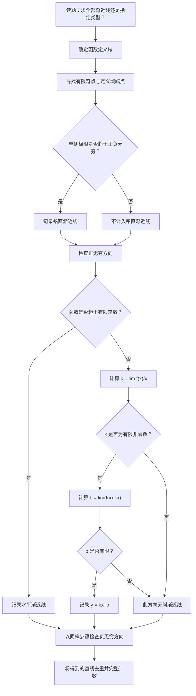

<Callout type="idea" title="核心目标">

核心目标：从会计算渐近线，到能够独立识别、分析和解决渐近线综合题与创新题。

</Callout>

我已核对你提供的 Google Drive 压缩包《数学分类题目1101.zip》，并对照 Exam Docs 中的真题分类和练习资料。本节的学习材料包括：

- 核心题目： 第八节《渐近线》，共28道，覆盖6类主要模型。
- 历年真题： 专题收录的1989—2026年相关题目，包括2007年、2012年数学一渐近线计数题，2022年数学一微分方程综合题，以及其他年份数学二、数学三的高价值共通考点题。
- 分类模拟题： 你提供的1031版压缩包中，本节归档9道，涉及张宇、李林、李永乐和汤家凤模拟卷。
- 专项练习： 张宇1000题、李林880题、李正元练习题中与渐近线有关的题目。

重点参考原文：

[核心题目·第八节 渐近线](https://exam.any1.tech/docs/math/core-questions/01-b69fd298/01-ca2ddca1/08-7d6b2082/?utm_source=chatgpt.com)

[历年考研真题·渐近线](https://exam.any1.tech/docs/math/past-exams/01-2f981f64/s-60d222c9/08-7d6b2082/?utm_source=chatgpt.com)

[在线模拟题分类·渐近线（1030版）](https://exam.any1.tech/docs/math/exam/classified-1030/mock-exam-gaoshu-1030/module-01/08/?utm_source=chatgpt.com)

下面先构建完整的知识体系，再按照真题母题、名师练习、综合创新题的顺序深入讲解。

## 第一部分：理解渐近线的数学本质
### 一、渐近线到底是什么？
很多同学把渐近线理解成：

> 函数图像无限接近、但永远不会碰到的一条直线。

这种理解有两个问题。

第一，渐近线与曲线可以相交，甚至可以相交无穷多次。

第二，渐近线有不同类型，铅直渐近线与无穷远处的斜渐近线不能使用完全相同的极限判据。

#### 1. 无穷远处的渐近线
设曲线为

$$
y=f(x).
$$

若存在直线

$$
L:y=kx+b,
$$

使得

$$
\boxed{ \lim_{x\to+\infty}[f(x)-(kx+b)]=0, }
$$

那么称 $y=kx+b$ 是曲线在正无穷方向的一条直线渐近线。

负无穷方向同理。

这个定义的几何意义是：

当曲线沿某个无穷远方向延伸时，曲线上的点与某条直线之间的距离趋于零。

事实上，点 $(x,f(x))$ 到直线 $kx-y+b=0$ 的距离为

$$
d(x)=\frac{|f(x)-kx-b|}{\sqrt{k^2+1}}.
$$

由于分母为固定正数，因此

$$
d(x)\to0 \iff f(x)-kx-b\to0.
$$

这就解释了为什么判断斜渐近线必须使用差值趋于零，而不仅是比值趋于1。

#### 2. 一个非常重要的反例
比较以下两个函数：

$$
f(x)=x+\frac1x,
$$

$$
g(x)=x+\sqrt{x}\qquad(x>0).
$$

对于第一个函数，

$$
f(x)-x=\frac1x\to0,
$$

所以 $y=x$ 是斜渐近线。

对于第二个函数，

$$
\frac{g(x)}x=1+\frac1{\sqrt{x}}\to1.
$$

看起来 $g(x)\sim x$，但是

$$
g(x)-x=\sqrt{x}\to+\infty.
$$

因此不存在形如 $y=x+b$ 的斜渐近线。

而因为 $g(x)/x\to1$，其他有限斜率也不可能成立。

所以 $g$ 在正无穷方向没有直线渐近线。

由此得到本节第一个必须掌握的结论：

$$
\boxed{ f(x)\sim kx \not\Rightarrow y=kx\text{ 是渐近线}. }
$$

原因在于：

<Callout type="warn" title="等价与渐近线的判据不同">

等价无穷大强调相对误差；渐近线要求绝对误差趋于零。

</Callout>

这一差别是2014年真题、李永乐综合模拟题以及高阶展开题反复考查的核心。

### 二、三种常见渐近线及其判据
| 类型    | 方程                       | 存在条件                                                 | 核心考查     |
| ----- | ------------------------ | ---------------------------------------------------- | -------- |
| 铅直渐近线 | $x=a$                | 在 $a$ 的至少一侧，函数趋于 $+\infty$ 或 $-\infty$   | 定义域、单侧极限 |
| 水平渐近线 | $y=b$                | $f(x)\to b$，其中 $x\to+\infty$ 或 $-\infty$ | 两端极限     |
| 斜渐近线  | $y=kx+b$，$k\ne0$ | $f(x)-kx-b\to0$                                  | 斜率、截距与误差 |

特别注意： 有水平渐近线时，直线的斜率 $k=0$。因此，水平渐近线可以看成一般直线渐近线的特殊情形，但考研题目通常将水平渐近线和斜渐近线分别计数、分别命名。

### 三、铅直渐近线：单侧趋于无穷就足够
曲线 $y=f(x)$ 在 $x=a$ 附近，如果满足

$$
\lim_{x\to a^+}f(x)=+\infty,
$$

或者

$$
\lim_{x\to a^-}f(x)=-\infty,
$$

以及其他两个正负无穷组合中的任意一个，那么

$$
\boxed{x=a}
$$

就是铅直渐近线。

不需要左右极限同时发散，更不需要符号相同。

例如：

$$
f(x)=xe^{1/x}.
$$

当 $x\to0^+$ 时，令 $t=1/x$，则

$$
xe^{1/x}=\frac{e^t}{t}\to+\infty.
$$

当 $x\to0^-$ 时，

$$
xe^{1/x}\to0.
$$

虽然两侧表现完全不同，仍然有

$$
\boxed{x=0}.
$$

这是2026年考研数学三真题中的重要判断点，数学一同样需要掌握。

#### 两个容易混淆的概念
函数无定义，不代表铅直渐近线存在。

例如

$$
f(x)=\frac{x^2-1}{x-1}, \qquad x\ne1.
$$

虽然 $x=1$ 不在定义域，但

$$
\lim_{x\to1}f(x) =\lim_{x\to1}(x+1)=2.
$$

因此 $x=1$ 只是可去间断点，不是铅直渐近线。

函数在邻域内无界，不应直接代替单侧无穷极限的证明。

按照考研常用的铅直渐近线判据，应验证某一侧函数确实趋于正无穷或负无穷，而不是只找到一个发散子列。

## 第二部分：必须熟练掌握的核心公式
### 一、水平渐近线
分别计算

$$
b_+=\lim_{x\to+\infty}f(x),
$$

$$
b_-=\lim_{x\to-\infty}f(x).
$$

如果极限存在且有限，则得到相应水平渐近线。

一个特别重要的事实是：

正负无穷方向的水平渐近线可以不同。

例如

$$
f(x)=\frac{e^x+1}{2e^x-1}.
$$

当 $x\to+\infty$ 时，

$$
f(x)=\frac{1+e^{-x}}{2-e^{-x}}\to\frac12.
$$

当 $x\to-\infty$ 时，

$$
e^x\to0,
$$

所以

$$
f(x)\to-1.
$$

因此存在两条水平渐近线：

$$
\boxed{y=\frac12,\qquad y=-1}.
$$

这就是张宇2027预测8套卷第7套第1题所涉及的模型。

### 二、斜渐近线的两个极限公式
这是全节最重要的计算工具。

设

$$
y=kx+b,\qquad k\ne0
$$

是正无穷方向的斜渐近线。

因为

$$
f(x)=kx+b+o(1),
$$

两边除以 $x$，可得

$$
\frac{f(x)}x =k+\frac bx+\frac{o(1)}x.
$$

所以

$$
\boxed{ k=\lim_{x\to+\infty}\frac{f(x)}x. }
$$

然后

$$
f(x)-kx=b+o(1),
$$

得到

$$
\boxed{ b=\lim_{x\to+\infty}[f(x)-kx]. }
$$

负无穷方向采用完全相同的公式。

两者的区别是：

- 第一个极限确定直线的斜率。
- 第二个极限确定直线的截距，同时验证渐近线是否真正存在。

两个极限都必须存在且有限。

其中第一个极限为零时，应该转而检查水平渐近线。

#### 为什么两个极限必须按顺序计算？
假设

$$
f(x)=3x+5+\frac{\sin x}{x}.
$$

首先

$$
k=\lim_{x\to+\infty}\frac{f(x)}x=3.
$$

然后

$$
b=\lim_{x\to+\infty}[f(x)-3x]=5.
$$

所以

$$
\boxed{y=3x+5}.
$$

但若

$$
f(x)=3x+5+\sin x,
$$

则同样有

$$
\lim_{x\to+\infty}\frac{f(x)}x=3,
$$

却不存在

$$
\lim_{x\to+\infty}[f(x)-3x].
$$

因此第二个函数没有斜渐近线。

可以总结为：

$$
\boxed{ \text{斜率极限存在，只能说明有候选直线，不能保证渐近线存在。} }
$$

### 三、一个统一的渐近展开公式
实际上，所有无穷远处的直线渐近线问题，都可以归结为寻找

$$
\boxed{ f(x)=kx+b+o(1) \qquad(x\to\pm\infty). }
$$

这比单独记斜率公式和截距公式更有用。

因为：

- $kx$ 是一次主项；
- $b$ 是常数项；
- $o(1)$ 是必须趋于零的误差项。

只要能够把函数展开成这个形式，渐近线便一目了然。

例如

$$
f(x)=2x+3+\frac7x+O\left(\frac1{x^2}\right),
$$

立即得到

$$
\boxed{y=2x+3}.
$$

而

$$
f(x)=2x+3+\ln x
$$

不能得到斜渐近线，因为 $\ln x$ 不趋于零，也不能并入某个有限常数。

这就是本节各种计算方法背后的统一原理。

## 第三部分：历年真题母题精讲
这一部分优先研究真正能够代表一类考法的真题。

每道题都要掌握三个层次：

1. 为什么应该想到这种方法？
2. 关键计算为什么这样做？
3. 换掉函数形式以后，方法是否仍然成立？

### 母题一：有限端点有振荡，是否存在铅直渐近线？
来源：1989年考研数学一、数学二真题

设 $x>0$，判断曲线

$$
y=x\sin\frac1x
$$

是否具有水平渐近线、铅直渐近线。

<Steps>

  <Step>

### 第一步：分析定义域

题目明确规定

$$
x>0.
$$

因此只需检查：

$$
x\to0^+,\qquad x\to+\infty.
$$

不需要考虑 $x\to-\infty$。

  </Step>

  <Step>

### 第二步：判断铅直渐近线

当 $x\to0^+$ 时，$\sin(1/x)$ 持续振荡，但

$$
-1\le\sin\frac1x\le1.
$$

因为 $x>0$，所以

$$
-x\le x\sin\frac1x\le x.
$$

由夹逼定理，

$$
\lim_{x\to0^+}x\sin\frac1x=0.
$$

所以 $x=0$ 不是铅直渐近线。

  </Step>

  <Step>

### 第三步：判断水平渐近线

当 $x\to+\infty$ 时，

$$
\frac1x\to0.
$$

将函数改写成标准极限形式：

$$
x\sin\frac1x = \frac{\sin(1/x)}{1/x}.
$$

由

$$
\lim_{t\to0}\frac{\sin t}{t}=1,
$$

得到

$$
\lim_{x\to+\infty}x\sin\frac1x=1.
$$

因此

$$
\boxed{y=1}.
$$

答案是只有水平渐近线。

  </Step>

</Steps>
#### 从母题推广
考虑更一般的函数

$$
f(x)=x^\alpha\sin\frac1x, \qquad x>0.
$$

当 $x\to0^+$ 时：

- 如果 $\alpha>0$，由夹逼定理，函数趋于零。
- 如果 $\alpha=0$，函数振荡，没有单侧无穷极限。
- 如果 $\alpha<0$，函数振幅越来越大，但正负振荡，并不趋于固定符号的无穷。

因此，按照本节采用的单侧无穷极限判据，这三种情况在 $x=0$ 都不能直接得到铅直渐近线。

当 $x\to+\infty$ 时，

$$
\sin\frac1x\sim\frac1x,
$$

所以

$$
f(x)\sim x^{\alpha-1}.
$$

由此进一步得到：

$$
\lim_{x\to+\infty}f(x)= \begin{cases} 0,&\alpha<1,\\ 1,&\alpha=1,\\ +\infty,&\alpha>1. \end{cases}
$$

这说明同一道母题可以自然生成三种不同的水平渐近线判断情况。

其中 $\alpha>1$ 时是否还有斜渐近线，需要继续检查增长阶数，不能因为不存在水平渐近线就立即作出结论。

迁移能力： 遇到“有界振荡因子 × 幂函数”时，先确定外部因子如何控制振幅，再判断整个函数的极限。

### 母题二：可去间断点与铅直渐近线的区别
来源：2012年考研数学一、二、三真题

曲线

$$
y=\frac{x^2+x}{x^2-1}
$$

有几条渐近线？

<Steps>

  <Step>

### 第一步：找出所有候选点

由

$$
x^2-1=(x-1)(x+1),
$$

知道原函数在

$$
x=1,\qquad x=-1
$$

处无定义。

这两个点都要检查。

  </Step>

  <Step>

### 第二步：约分，但必须保留原定义域

当 $x\ne\pm1$ 时，

$$
f(x)=\frac{x(x+1)}{(x-1)(x+1)} =\frac{x}{x-1}.
$$

先检查 $x=-1$：

$$
\lim_{x\to-1}f(x) =\frac{-1}{-2} =\frac12.
$$

极限有限，所以 $x=-1$ 不是铅直渐近线。

再检查 $x=1$：

$$
\lim_{x\to1^-}\frac{x}{x-1} =-\infty,
$$

$$
\lim_{x\to1^+}\frac{x}{x-1} =+\infty.
$$

因此有

$$
\boxed{x=1}.
$$

  </Step>

  <Step>

### 第三步：考查无穷远

将函数继续拆分：

$$
\frac{x}{x-1}=1+\frac1{x-1}.
$$

由于

$$
\frac1{x-1}\to0 \qquad(x\to\pm\infty),
$$

所以

$$
\boxed{y=1}
$$

也是渐近线。

最终共有

$$
\boxed{2\text{ 条}}.
$$

  </Step>

</Steps>
#### 这道真题背后的通法
对于有理函数

$$
f(x)=\frac{P(x)}{Q(x)},
$$

不要简单数分母的零点。

正确做法是：

先判断哪些零点能够约掉，再检查约分后函数是否真正发散。

如果分子、分母在某点具有零点重数 $m,n$，经过约分后：

- 当 $m\ge n$ 时，该点附近通常可以得到有限极限。
- 当 $m<n$ 时，在其他因子非零的条件下会留下分母中的极点，从而产生铅直渐近线。

这种通过零点阶数判断极点的方法，对复杂含参有理函数特别有效。

### 母题三：一条铅直线、一条水平线、一条斜线同时出现
来源：2007年考研数学一、二、三真题

求曲线

$$
y=\frac1x+\ln(1+e^x)
$$

的渐近线条数。

这是一道必须掌握的完整计数母题。

<Steps>

  <Step>

### 第一步：检查有限奇点

定义域为

$$
D=(-\infty,0)\cup(0,+\infty).
$$

唯一可能的铅直渐近线是 $x=0$。

由于

$$
\lim_{x\to0}\ln(1+e^x)=\ln2,
$$

而

$$
\frac1x\to\pm\infty,
$$

所以

$$
\boxed{x=0}.
$$

  </Step>

  <Step>

### 第二步：检查负无穷方向

当 $x\to-\infty$ 时，

$$
\frac1x\to0,\qquad e^x\to0.
$$

于是

$$
\ln(1+e^x)\to0.
$$

因此

$$
\lim_{x\to-\infty}f(x)=0.
$$

得到水平渐近线

$$
\boxed{y=0}.
$$

  </Step>

  <Step>

### 第三步：检查正无穷方向

当 $x\to+\infty$ 时，$\ln(1+e^x)$ 不再趋于零，而是近似于 $x$。

这里必须掌握一个高频恒等变形：

$$
\boxed{ \ln(1+e^x)=x+\ln(1+e^{-x}). }
$$

因此

$$
f(x)=x+\frac1x+\ln(1+e^{-x}).
$$

从而

$$
f(x)-x=\frac1x+\ln(1+e^{-x})\to0.
$$

得到斜渐近线

$$
\boxed{y=x}.
$$

  </Step>

</Steps>
#### 结论
三条渐近线分别是

$$
\boxed{ x=0,\qquad y=0,\qquad y=x. }
$$

所以答案为3条。

#### 真正需要学会的是什么？
不是记住这道题的答案，而是掌握两个重要模型。

模型A：对数指数复合函数的两端行为

对于

$$
F(x)=\ln(1+e^x),
$$

有

$$
F(x)= \begin{cases} o(1),&x\to-\infty,\\ x+o(1),&x\to+\infty. \end{cases}
$$

因此它在负无穷方向近似水平线，在正无穷方向近似斜线。

模型B：一题完整计数的三个检查方向

$$
\boxed{ \text{有限奇点} \quad+\quad x\to+\infty \quad+\quad x\to-\infty. }
$$

今后遇到绝对值、指数、分段函数、反三角函数等结构时，都必须保留这一检查习惯。

### 母题四：有理函数的斜渐近线
来源：2005年考研数学一真题

求

$$
y=\frac{x^2}{2x+1}
$$

的斜渐近线。

<Tabs items={["多项式除法", "斜率—截距公式"]} defaultIndex={0}>
  <Tab value="多项式除法">

**解法一：多项式除法**

这是有理函数题的首选方法。

通过整式除法：

$$
\frac{x^2}{2x+1} = \frac12x-\frac14 +\frac1{4(2x+1)}.
$$

显然

$$
\lim_{x\to\pm\infty}\frac1{4(2x+1)}=0.
$$

所以

$$
\boxed{y=\frac12x-\frac14}.
$$

这种方法的优点是直接给出

$$
f(x)=kx+b+o(1).
$$

无需分别计算两个极限。

  </Tab>
  <Tab value="斜率—截距公式">

**解法二：斜率—截距公式**

先求斜率：

$$
k=\lim_{x\to\infty}\frac{f(x)}x =\lim_{x\to\infty}\frac{x}{2x+1} =\frac12.
$$

再求截距：

$$
\begin{aligned} b &=\lim_{x\to\infty} \left(\frac{x^2}{2x+1}-\frac x2\right)\\ &=\lim_{x\to\infty} \frac{-x}{2(2x+1)}\\ &=-\frac14. \end{aligned}
$$

得到相同结果。

  </Tab>
</Tabs>

#### 一般规律：有理函数按次数判断
设

$$
f(x)=\frac{P_m(x)}{Q_n(x)},
$$

其中 $P_m,Q_n$ 分别是 $m,n$ 次多项式。

| 次数关系        | 无穷远处的典型情况            |
| ----------- | -------------------- |
| $m<n$  | 水平渐近线 $y=0$      |
| $m=n$   | 水平渐近线为最高次项系数之比       |
| $m=n+1$ | 通常存在斜渐近线             |
| $m>n+1$ | 多项式主项次数高于1，一般没有直线渐近线 |

最后一类虽然没有直线渐近线，但可能存在高次多项式渐近曲线。

例如

$$
\frac{x^3+1}{x}=x^2+\frac1x
$$

在无穷远处趋近抛物线

$$
y=x^2,
$$

但考研本节所说的直线渐近线不包括这种情况。

考试策略：有理函数先尝试除法，不必一上来使用洛必达法则。

### 母题五：振荡函数的“伪渐近线”
来源：2014年考研数学一、二、三真题

判断下列函数哪一个有渐近线：

$$
\begin{aligned} \text{A.}\quad &y=x+\sin x,\\ \text{B.}\quad &y=x^2+\sin x,\\ \text{C.}\quad &y=x+\sin\frac1x,\\ \text{D.}\quad &y=x^2+\sin\frac1x. \end{aligned}
$$

#### A项
有

$$
\lim_{x\to\infty}\frac{x+\sin x}{x}=1.
$$

因此若有斜渐近线，斜率只能是1。

但是

$$
f(x)-x=\sin x
$$

没有极限。

所以A没有斜渐近线。

#### B项
$$
\frac{f(x)}x=x+\frac{\sin x}{x}.
$$

由于右侧趋于无穷，不能得到有限斜率。

因此没有无穷远处的直线渐近线。

#### C项
$$
f(x)-x=\sin\frac1x.
$$

当 $x\to\pm\infty$ 时，

$$
\sin\frac1x\to0.
$$

因此

$$
\boxed{y=x}.
$$

#### D项
$$
f(x)=x^2+\sin\frac1x.
$$

二次主项仍然无法被一次函数抵消，因此没有直线渐近线。

四个函数在有限定义域边界附近也没有满足单侧无穷极限判据的铅直渐近线。

正确答案为

$$
\boxed{\text{C}}.
$$

#### 这道题的深层考法
考研特别喜欢比较：

$$
x+\sin x
$$

与

$$
x+\sin\frac1x.
$$

虽然两者都可以写成“$x+\text{有界项}$”，但有界项在无穷远处的行为完全不同。

更一般地：

若

$$
f(x)=kx+b+r(x),
$$

则只要

$$
r(x)\to0,
$$

就有渐近线 $y=kx+b$。

若 $r(x)$ 有界但不收敛，则不能由此推出渐近线。

若 $r(x)\to+\infty$，则它也不能构成有限截距。

所以在求完线性主项以后，剩余项的行为至关重要。

### 母题六：根式渐近线与常数项
来源：2005年考研数学二真题，数学一同样适用

求曲线

$$
y=\frac{(1+x)^{3/2}}{\sqrt{x}}, \qquad x>0
$$

的斜渐近线。

<Steps>

  <Step>

### 第一步：化成适合无穷远展开的形式

$$
\frac{(1+x)^{3/2}}{\sqrt{x}} =x\left(1+\frac1x\right)^{3/2}.
$$

因此斜率为

$$
k=\lim_{x\to+\infty} \left(1+\frac1x\right)^{3/2}=1.
$$

  </Step>

  <Step>

### 第二步：求截距

$$
b=\lim_{x\to+\infty} x\left[\left(1+\frac1x\right)^{3/2}-1\right].
$$

令

$$
t=\frac1x,
$$

则

$$
b=\lim_{t\to0^+}\frac{(1+t)^{3/2}-1}{t}.
$$

这是函数

$$
F(t)=(1+t)^{3/2}
$$

在 $t=0$ 处的导数，因此

$$
b=F'(0)=\frac32.
$$

最终

$$
\boxed{y=x+\frac32}.
$$

  </Step>

</Steps>
#### 推广成通用公式
考虑

$$
f(x)=x\left(1+\frac ax\right)^\alpha.
$$

当 $x\to+\infty$ 时，

$$
\left(1+\frac ax\right)^\alpha = 1+\frac{\alpha a}{x} +O\left(\frac1{x^2}\right).
$$

所以

$$
f(x)=x+\alpha a+O\left(\frac1x\right).
$$

因此

$$
\boxed{y=x+\alpha a}.
$$

这是一大类根式、分数幂函数斜渐近线的统一模型。

例如：

$$
\sqrt{x^2+ax+b} = x+\frac a2+O\left(\frac1x\right), \qquad x\to+\infty.
$$

于是正无穷方向有

$$
\boxed{y=x+\frac a2}.
$$

但千万注意：

这个结论不能不加修改地用于 $x\to-\infty$。

因为

$$
\sqrt{x^2}=|x|,
$$

负无穷方向需要另行展开。

### 母题七：幂指函数与高阶截距
来源：2020年考研数学二解答题，数学一高价值必练

求曲线

$$
y=\frac{x^{1+x}}{(1+x)^x}, \qquad x>0
$$

的斜渐近线。

这是从基础极限过渡到高阶渐近分析的典型题。

<Steps>

  <Step>

### 第一步：识别幂指结构

将原式化为

$$
y=x\left(\frac{x}{1+x}\right)^x.
$$

即

$$
y=x\left(1+\frac1x\right)^{-x}.
$$

注意：

$$
\left(1+\frac1x\right)^x\to e.
$$

因此

$$
\frac{y}{x}\to e^{-1},
$$

斜率为

$$
k=\frac1e.
$$

但是不能直接得出 $y=x/e$。

因为尚未计算截距。

  </Step>

  <Step>

### 第二步：取对数展开

令

$$
A(x)=\left(1+\frac1x\right)^{-x}.
$$

则

$$
\ln A(x)=-x\ln\left(1+\frac1x\right).
$$

利用

$$
\ln(1+t)=t-\frac{t^2}{2}+\frac{t^3}{3}+O(t^4),
$$

得到

$$
\begin{aligned} \ln A(x) &=-x\left[ \frac1x-\frac1{2x^2} +\frac1{3x^3} +O(x^{-4}) \right]\\ &=-1+\frac1{2x}-\frac1{3x^2} +O(x^{-3}). \end{aligned}
$$

  </Step>

  <Step>

### 第三步：指数还原

$$
A(x) = e^{-1} \exp\left[ \frac1{2x}+O(x^{-2}) \right].
$$

由于

$$
e^u=1+u+O(u^2),
$$

因此

$$
A(x)=\frac1e \left[ 1+\frac1{2x}+O(x^{-2}) \right].
$$

  </Step>

  <Step>

### 第四步：乘回外部因子

$$
\begin{aligned} y &=xA(x)\\ &=\frac xe+\frac1{2e}+O(x^{-1}). \end{aligned}
$$

所以

$$
\boxed{ y=\frac xe+\frac1{2e} }
$$

是所求斜渐近线。

  </Step>

</Steps>
#### 这类题最重要的方法
如果

$$
f(x)=xA(x),
$$

并且

$$
A(x)=a_0+\frac{a_1}{x} +O\left(\frac1{x^2}\right),
$$

那么

$$
f(x)=a_0x+a_1+O\left(\frac1x\right).
$$

因此

$$
\boxed{y=a_0x+a_1}.
$$

这意味着：

外部乘一个 $x$，内部就必须多展开一阶，才能确定截距。

这个规律还可以推广。

如果

$$
f(x)=x^mG(1/x),
$$

那么为了求出最终的常数项，通常需要把 $G(t)$ 展开到 $t^m$ 阶。

这正是张宇1000题中高阶渐近线模型的核心。

### 母题八：立方根与符号问题
来源：2025年考研数学二真题

求曲线

$$
y=\sqrt[3]{x^3-3x^2}+1
$$

的渐近线。

这里最容易出错的地方是根式符号。

因为是实立方根，所以

$$
\sqrt[3]{x^3}=x
$$

对所有实数 $x$ 都成立。

因此

$$
\sqrt[3]{x^3-3x^2} = x\sqrt[3]{1-\frac3x}.
$$

利用

$$
(1+t)^{1/3} =1+\frac t3+O(t^2),
$$

得到

$$
\left(1-\frac3x\right)^{1/3} = 1-\frac1x+O(x^{-2}).
$$

于是

$$
\sqrt[3]{x^3-3x^2} = x-1+O(x^{-1}).
$$

所以

$$
f(x)=x+O(x^{-1}).
$$

因此

$$
\boxed{y=x}.
$$

#### 根号与立方根的根本区别
对于平方根：

$$
\sqrt{x^2}=|x|.
$$

对于立方根：

$$
\sqrt[3]{x^3}=x.
$$

所以涉及偶次根式时，正负无穷方向经常产生不同的渐近线。

而奇次根式则可以保留 $x$ 的符号。

这也是为什么根式渐近线计数题经常考查绝对值。

### 母题九：微分方程与渐近线综合
来源：2022年考研数学一、三真题

已知 $y=y(x)$ 满足

$$
y'+\frac1{2\sqrt{x}}y=2+\sqrt{x},
$$

并且

$$
y(1)=3.
$$

求曲线的渐近线。

这种题最重要的不是极限计算，而是先求出函数的渐近结构。

<Steps>

  <Step>

### 第一步：识别一阶线性微分方程

标准形式为

$$
y'+P(x)y=Q(x).
$$

这里

$$
P(x)=\frac1{2\sqrt{x}}.
$$

由初值所在区间，考虑 $x>0$。

  </Step>

  <Step>

### 第二步：求积分因子

$$
\mu(x)=e^{\int P(x)\,\mathrm dx}.
$$

因为

$$
\int\frac1{2\sqrt{x}}\,\mathrm dx=\sqrt{x},
$$

所以

$$
\mu(x)=e^{\sqrt{x}}.
$$

原方程变成

$$
\left(ye^{\sqrt{x}}\right)' =(2+\sqrt{x})e^{\sqrt{x}}.
$$

  </Step>

  <Step>

### 第三步：积分求解

注意到

$$
\left(2xe^{\sqrt{x}}\right)' = 2e^{\sqrt{x}}+\sqrt{x}e^{\sqrt{x}},
$$

正好等于右端。

因此

$$
ye^{\sqrt{x}}=2xe^{\sqrt{x}}+C.
$$

得到

$$
y=2x+Ce^{-\sqrt{x}}.
$$

由初值

$$
3=2+Ce^{-1},
$$

得到

$$
C=e.
$$

所以

$$
y=2x+e^{1-\sqrt{x}}.
$$

  </Step>

  <Step>

### 第四步：判断渐近线

当 $x\to+\infty$ 时，

$$
e^{1-\sqrt{x}}\to0.
$$

因此

$$
y-2x\to0.
$$

最终得到

$$
\boxed{y=2x}.
$$

  </Step>

</Steps>
#### 重要推论：特解决定渐近线
考虑微分方程的解

$$
y(x)=y_p(x)+y_h(x),
$$

其中 $y_p$ 是某个特解，$y_h$ 是齐次方程的解。

如果

$$
y_p(x)=kx+b+o(1),
$$

并且

$$
y_h(x)\to0,
$$

那么

$$
y(x)=kx+b+o(1).
$$

于是渐近线为

$$
\boxed{y=kx+b}.
$$

这说明有时初值只决定衰减项的系数，而不会改变渐近线。

但是不能把它理解成所有微分方程的初值都不影响渐近线。若齐次解不衰减，结论可能完全不同。

## 第四部分：张宇、李林、李正元与分类模拟题精讲
下面进入提高部分。

这些题的价值在于：它们不再只是直接求某个极限，而是通过函数结构、参数条件、积分、根式、复合函数等方式考查渐近线的本质。

### 母题十：指数复合函数的完整计数
来源：张宇2027预测8套卷·第1套·第1题

求曲线

$$
y=(x+2)e^{1/x}
$$

的渐近线条数。

<Steps>

  <Step>

### 第一步：检查 $x=0$

定义域为 $x\ne0$。

当 $x\to0^+$ 时，

$$
e^{1/x}\to+\infty,
$$

而

$$
x+2\to2.
$$

所以

$$
(x+2)e^{1/x}\to+\infty.
$$

得到铅直渐近线

$$
\boxed{x=0}.
$$

  </Step>

  <Step>

### 第二步：求无穷远渐近线

当 $x\to\pm\infty$ 时，

$$
e^{1/x} =1+\frac1x+\frac1{2x^2}+O(x^{-3}).
$$

所以

$$
\begin{aligned} (x+2)e^{1/x} &=(x+2)\left(1+\frac1x+O(x^{-2})\right)\\ &=x+3+O(x^{-1}). \end{aligned}
$$

因此

$$
\boxed{y=x+3}.
$$

最终共有

$$
\boxed{2\text{ 条渐近线}}.
$$

  </Step>

</Steps>
#### 进一步推广：指数模型的统一公式
考虑

$$
f(x)=(ax+b)e^{c/x}.
$$

当 $x\to\pm\infty$ 时，

$$
e^{c/x} =1+\frac cx+O(x^{-2}).
$$

于是

$$
\begin{aligned} f(x) &=(ax+b)\left(1+\frac cx+O(x^{-2})\right)\\ &=ax+(ac+b)+O(x^{-1}). \end{aligned}
$$

因此当 $a\ne0$ 时，

$$
\boxed{ y=ax+ac+b }
$$

是两端共同的斜渐近线。

当 $a=0$ 时，结果退化为水平渐近线 $y=b$。

这是可以直接迁移到很多模拟题的公式。

但还需要注意：这一公式只解决无穷远处的渐近线。若要求全部渐近线，仍需单独检查 $x=0$。

### 母题十一：两个铅直渐近线、两个斜渐近线
来源：张宇1000题·微分学几何应用

求

$$
y=\frac{x^2+1}{\sqrt{x^2-1}}
$$

的渐近线条数。

这是根式渐近线计数的经典母题。

<Steps>

  <Step>

### 第一步：求定义域

因为根式位于分母，所以要求

$$
x^2-1>0.
$$

得到

$$
D=(-\infty,-1)\cup(1,+\infty).
$$

  </Step>

  <Step>

### 第二步：检查两个有限边界

当 $x\to1^+$ 时，

$$
\sqrt{x^2-1}\to0^+,
$$

而分子趋于2，因此

$$
f(x)\to+\infty.
$$

得到

$$
x=1.
$$

当 $x\to-1^-$ 时，完全类似：

$$
f(x)\to+\infty.
$$

得到

$$
x=-1.
$$

因此共有两条铅直渐近线。

  </Step>

  <Step>

### 第三步：检查正无穷方向

注意

$$
\sqrt{x^2-1} = |x|\sqrt{1-\frac1{x^2}}.
$$

当 $x\to+\infty$ 时，$|x|=x$，于是

$$
f(x) = x\frac{1+x^{-2}}{\sqrt{1-x^{-2}}}.
$$

利用

$$
(1-u)^{-1/2} =1+\frac u2+O(u^2),
$$

得到

$$
\frac{1+u}{\sqrt{1-u}} = 1+\frac32u+O(u^2).
$$

因此

$$
f(x)=x+\frac3{2x}+O(x^{-3}).
$$

所以正无穷方向的渐近线为

$$
\boxed{y=x}.
$$

  </Step>

  <Step>

### 第四步：检查负无穷方向

当 $x\to-\infty$ 时，

$$
|x|=-x.
$$

因此

$$
f(x) = -x\frac{1+x^{-2}}{\sqrt{1-x^{-2}}}.
$$

展开得到

$$
f(x)=-x-\frac3{2x}+O(x^{-3}).
$$

所以

$$
f(x)+x\to0.
$$

负无穷方向的渐近线为

$$
\boxed{y=-x}.
$$

  </Step>

</Steps>
#### 最终结论
$$
\boxed{ x=-1,\quad x=1,\quad y=x,\quad y=-x. }
$$

共有4条。

这道题真正要掌握的核心：

偶次根式提取最高次幂时，必须保留绝对值。

$$
\sqrt{x^2}=|x|
$$

不是 $x$。

这是导致斜渐近线数量判断错误的高频原因。

### 母题十二：同一个余项，在不同端点产生不同效果
来源：李正元练习题·第四章

求曲线

$$
y=3x+\frac{\ln x}{2x}+1
$$

的全部渐近线。

这道题将铅直渐近线和斜渐近线建立了非常直接的联系。

<Steps>

  <Step>

### 第一步：确定定义域

由于存在 $\ln x$，所以

$$
x>0.
$$

需要检查

$$
x\to0^+,\qquad x\to+\infty.
$$

  </Step>

  <Step>

### 第二步：有限端点

当 $x\to0^+$ 时，

$$
\ln x\to-\infty,
$$

且 $x\to0^+$。

因此

$$
\frac{\ln x}{2x}\to-\infty.
$$

所以

$$
f(x)\to-\infty.
$$

得到

$$
\boxed{x=0}.
$$

  </Step>

  <Step>

### 第三步：无穷远

直接观察：

$$
f(x)-(3x+1)=\frac{\ln x}{2x}.
$$

由于

$$
\lim_{x\to+\infty}\frac{\ln x}{x}=0,
$$

所以

$$
\boxed{y=3x+1}.
$$

最终共有两条。

  </Step>

</Steps>
#### 关键推论
考虑一般形式

$$
f(x)=kx+b+\frac{\ln x}{x^\alpha}, \qquad x>0,\ \alpha>0.
$$

当 $x\to+\infty$ 时，

$$
\frac{\ln x}{x^\alpha}\to0.
$$

因此当 $k\ne0$ 时，斜渐近线始终为

$$
\boxed{y=kx+b}.
$$

当 $x\to0^+$ 时，

$$
\frac{\ln x}{x^\alpha}\to-\infty.
$$

所以还有铅直渐近线

$$
\boxed{x=0}.
$$

同一个函数余项，可以在一个端点造成发散，在另一个方向成为趋于零的误差。

以后遇到含有 $\ln x/x^\alpha$ 的函数，应该立即想到这一结构。

### 母题十三：绝对值与对数共同产生四条渐近线
来源：李林880题

求

$$
y=\frac1{|x|-1}+\ln(1+e^{-x})
$$

的渐近线条数。

<Steps>

  <Step>

### 第一步：铅直渐近线

因为

$$
|x|-1=0
$$

得到

$$
x=\pm1.
$$

对数部分在这两点附近连续有界，而分式部分发散。

所以

$$
\boxed{x=-1,\qquad x=1}.
$$

  </Step>

  <Step>

### 第二步：正无穷方向

当 $x\to+\infty$ 时，

$$
|x|=x,
$$

且

$$
\frac1{x-1}\to0, \qquad \ln(1+e^{-x})\to0.
$$

所以

$$
\boxed{y=0}.
$$

  </Step>

  <Step>

### 第三步：负无穷方向

当 $x\to-\infty$ 时，

$$
|x|=-x.
$$

同时利用恒等变形

$$
\ln(1+e^{-x}) = -x+\ln(1+e^x).
$$

于是

$$
f(x) = -x+\frac1{-x-1}+\ln(1+e^x).
$$

后面两项均趋于零。

因此

$$
\boxed{y=-x}.
$$

  </Step>

</Steps>
#### 结论
$$
\boxed{ x=-1,\quad x=1,\quad y=0,\quad y=-x. }
$$

共有4条渐近线。

#### 考试迁移
这道题把两个非常常见的技巧放在一起：

第一，含 $|x|$ 的函数，要按照 $x\to+\infty$ 和 $x\to-\infty$ 分别去掉绝对值。

第二，含有

$$
\ln(1+e^{ax})
$$

的函数，要根据 $ax\to+\infty$ 还是 $ax\to-\infty$ 选择不同变形。

掌握这两个技巧后，很多看起来复杂的计数题就能够拆成几个简单极限。

## 第五部分：高阶计算与综合创新题
### 一、张宇1000题：需要展开到二阶的渐近线
求

$$
y=x^2\left[ \frac{(1+1/x)^x}{e}-1 \right], \qquad x>0
$$

的斜渐近线。

#### 为什么这道题比2020年真题更难？
因为外部有 $x^2$。

如果括号内只展开到 $1/x$，乘以 $x^2$ 后只能得到一次项，无法确定截距。

因此必须展开到 $1/x^2$ 阶。

令

$$
t=\frac1x.
$$

则

$$
\frac{(1+1/x)^x}{e} = \exp\left[ \frac{\ln(1+t)}t-1 \right].
$$

利用

$$
\frac{\ln(1+t)}t-1 = -\frac t2+\frac{t^2}3+O(t^3).
$$

记

$$
u=-\frac t2+\frac{t^2}3+O(t^3).
$$

由于

$$
e^u=1+u+\frac{u^2}{2}+O(u^3),
$$

有

$$
\begin{aligned} e^u &=1-\frac t2+\frac{t^2}3 +\frac12\left(\frac{t^2}4\right) +O(t^3)\\ &=1-\frac t2+\frac{11}{24}t^2+O(t^3). \end{aligned}
$$

因此

$$
\frac{(1+1/x)^x}{e} = 1-\frac1{2x} +\frac{11}{24x^2} +O(x^{-3}).
$$

乘以 $x^2$：

$$
\begin{aligned} y &=x^2\left[ -\frac1{2x} +\frac{11}{24x^2} +O(x^{-3}) \right]\\ &=-\frac x2+\frac{11}{24}+O(x^{-1}). \end{aligned}
$$

因此

$$
\boxed{ y=-\frac12x+\frac{11}{24}. }
$$

#### 方法总结
这类题必须形成一种精度意识：

$$
\boxed{ \text{先看外部放大倍数，再决定内部展开阶数。} }
$$

如果外部乘 $x$，通常内部需要展开到 $1/x$。

如果外部乘 $x^2$，通常内部需要展开到 $1/x^2$。

如果外部乘 $x^3$，通常内部需要展开到 $1/x^3$。

当然，展开过程中还需要考虑低阶项是否抵消，不能机械套用。

### 二、张宇8套卷：变限积分与斜渐近线
来源：2027预测8套卷·第6套·第17题

求

$$
y= \frac{ 1+\displaystyle\int_0^{1/x}e^{t^2}\,\mathrm dt }{ 1-e^{1/x} }, \qquad x>0
$$

的斜渐近线。

这是一道典型的“积分局部展开＋分式渐近分析”综合题。

<Steps>

  <Step>

### 第一步：改变变量

令

$$
u=\frac1x\to0^+.
$$

函数变成

$$
y= \frac{1+\int_0^u e^{t^2}\,\mathrm dt} {1-e^u}.
$$

  </Step>

  <Step>

### 第二步：分别展开分子和分母

因为

$$
e^{t^2}=1+t^2+O(t^4),
$$

所以

$$
\int_0^u e^{t^2}\,\mathrm dt = u+\frac{u^3}3+O(u^5).
$$

分子为

$$
1+u+O(u^3).
$$

分母为

$$
1-e^u = -u-\frac{u^2}2+O(u^3).
$$

  </Step>

  <Step>

### 第三步：确定斜率与截距

因此

$$
\begin{aligned} y &= -\frac{1+u+O(u^3)} {u\left(1+\frac u2+O(u^2)\right)}\\ &= -\frac1u (1+u+O(u^2)) \left(1-\frac u2+O(u^2)\right)\\ &= -\frac1u\left(1+\frac u2+O(u^2)\right)\\ &=-\frac1u-\frac12+O(u). \end{aligned}
$$

由于 $u=1/x$，所以

$$
y=-x-\frac12+O(x^{-1}).
$$

最终

$$
\boxed{ y=-x-\frac12. }
$$

  </Step>

</Steps>
#### 这类题的统一处理思路
如果出现

$$
f(x)= \frac{A(1/x)}{B(1/x)},
$$

其中 $B(0)=0$，应该先令

$$
t=\frac1x.
$$

然后根据分母零点的阶数和分子首个非零项的阶数判断增长速度。

例如：

$$
A(t)=a_0+a_1t+O(t^2),
$$

$$
B(t)=b_1t+b_2t^2+O(t^3), \qquad b_1\ne0.
$$

则

$$
\frac{A(t)}{B(t)} = \frac{a_0}{b_1t} + \left( \frac{a_1}{b_1} -\frac{a_0b_2}{b_1^2} \right) +O(t).
$$

因此当 $a_0\ne0$ 时，得到通用公式

$$
\boxed{ y= \frac{a_0}{b_1}x+ \left( \frac{a_1}{b_1} -\frac{a_0b_2}{b_1^2} \right) +o(1). }
$$

这就是变限积分、指数分式、三角函数分式等题型能够统一处理的原因。

### 三、李林六套卷：利用条件反求参数
来源：2027李林六套卷·第5套·第11题

设

$$
\lim_{x\to+\infty} \left( \sqrt{4x^2+\frac a2x+1}-ax-b \right)=0.
$$

求对应斜渐近线。

<Steps>

  <Step>

### 第一步：反求斜率

将整个极限式除以 $x$。

因为原差值趋于零，所以除以 $x$ 后仍趋于零。

因此

$$
\lim_{x\to+\infty} \frac{\sqrt{4x^2+\frac a2x+1}}x=a.
$$

左侧为

$$
\lim_{x\to+\infty} \sqrt{4+\frac a{2x}+\frac1{x^2}} =2.
$$

所以

$$
\boxed{a=2}.
$$

  </Step>

  <Step>

### 第二步：反求截距

代入后，

$$
b= \lim_{x\to+\infty} \left(\sqrt{4x^2+x+1}-2x\right).
$$

采用有理化：

$$
\begin{aligned} b &=\lim_{x\to+\infty} \frac{x+1}{\sqrt{4x^2+x+1}+2x}\\ &=\frac14. \end{aligned}
$$

因此

$$
\boxed{y=2x+\frac14}.
$$

  </Step>

</Steps>
#### 如何识别这种题？
如果题设出现

$$
\lim_{x\to\infty}[f(x)-ax-b]=0,
$$

应该立即反应过来：

题目已经直接告诉你，$ax+b$ 是函数的渐近线。

因此不需要先解出所有参数，再重新研究渐近线。

可以直接利用

$$
a=\lim\frac{f(x)}x,
$$

$$
b=\lim[f(x)-ax].
$$

这类题的核心是根据渐近线定义反求参数。

### 四、李林880题：两端不同的根式对数渐近线
求

$$
y=\sqrt{4x^2+x}\, \ln\left(2+\frac1x\right)
$$

的全部渐近线。

这道题综合了定义域、对数、根式、正负无穷展开，是提高阶段非常值得反复练习的题。

<Steps>

  <Step>

### 第一步：确定定义域

平方根要求

$$
4x^2+x\ge0,
$$

即

$$
x(4x+1)\ge0.
$$

对数要求

$$
2+\frac1x>0.
$$

联立得到

$$
\boxed{ D=(-\infty,-\tfrac12)\cup(0,+\infty). }
$$

因此有限边界是

$$
x=-\frac12,\qquad x=0.
$$

  </Step>

  <Step>

### 第二步：检查铅直渐近线

当 $x\to-\frac12^-$ 时，

$$
2+\frac1x\to0^+,
$$

所以

$$
\ln\left(2+\frac1x\right)\to-\infty.
$$

而

$$
\sqrt{4x^2+x}\to\sqrt{\frac12}>0.
$$

因此

$$
f(x)\to-\infty.
$$

得到

$$
\boxed{x=-\frac12}.
$$

当 $x\to0^+$ 时，

$$
\sqrt{4x^2+x}\sim\sqrt{x},
$$

$$
\ln\left(2+\frac1x\right)\sim-\ln x.
$$

所以

$$
f(x)\sim-\sqrt{x}\ln x\to0.
$$

因此 $x=0$ 不是铅直渐近线。

  </Step>

  <Step>

### 第三步：正无穷方向

当 $x\to+\infty$ 时，

$$
\sqrt{4x^2+x} = 2x+\frac14+O(x^{-1}).
$$

同时

$$
\ln\left(2+\frac1x\right) = \ln2+\frac1{2x}+O(x^{-2}).
$$

两式相乘：

$$
\begin{aligned} f(x) &= \left(2x+\frac14+O(x^{-1})\right) \left(\ln2+\frac1{2x}+O(x^{-2})\right)\\ &=2x\ln2+1+\frac{\ln2}{4}+O(x^{-1}). \end{aligned}
$$

因此

$$
\boxed{ y=2x\ln2+1+\frac{\ln2}{4}. }
$$

  </Step>

  <Step>

### 第四步：负无穷方向

当 $x\to-\infty$ 时，

$$
\sqrt{4x^2+x} = -2x-\frac14+O(x^{-1}).
$$

对数项仍然有

$$
\ln\left(2+\frac1x\right) = \ln2+\frac1{2x}+O(x^{-2}).
$$

所以

$$
f(x) = -2x\ln2-1-\frac{\ln2}{4}+O(x^{-1}).
$$

得到

$$
\boxed{ y=-2x\ln2-1-\frac{\ln2}{4}. }
$$

  </Step>

</Steps>
#### 最终答案
共有3条：

$$
\boxed{ \begin{aligned} x&=-\frac12,\\ y&=2x\ln2+1+\frac{\ln2}{4},\\ y&=-2x\ln2-1-\frac{\ln2}{4}. \end{aligned} }
$$

这道题体现了完整求解复杂渐近线问题的标准路线：

定义域 → 有限边界 → 正无穷展开 → 负无穷展开 → 去重计数。

## 第六部分：参数曲线与积分型渐近线
### 一、参数曲线的渐近线怎么求？
普通函数写成

$$
y=f(x)
$$

时，可以直接对 $x$ 求极限。

但参数曲线给出的是

$$
\begin{cases} x=\varphi(t),\\ y=\psi(t). \end{cases}
$$

必须先研究参数 $t$ 如何使曲线走向无穷远。

对于铅直渐近线，要寻找满足

$$
\varphi(t)\to a,
$$

同时

$$
\psi(t)\to+\infty \quad\text{或}\quad -\infty
$$

的参数分支。

对于非铅直直线渐近线，要寻找

$$
|\varphi(t)|\to\infty
$$

的参数分支。

然后计算

$$
k=\lim\frac{\psi(t)}{\varphi(t)},
$$

$$
b=\lim[\psi(t)-k\varphi(t)].
$$

### 二、李永乐模拟题：参数曲线的多分支分析
来源：2027李永乐六套卷·模拟一·第11题

已知参数曲线

$$
\begin{cases} x=\dfrac{t^2}{t-1},\\[4pt] y=\dfrac{t}{t^2-1}, \end{cases} \qquad t\ne\pm1.
$$

求其斜渐近线。

<Steps>

  <Step>

### 第一步：寻找 $x$ 发散的参数点

当 $t\to1$ 时，

$$
\left|\frac{t^2}{t-1}\right|\to\infty.
$$

因此 $t=1$ 附近可能产生斜渐近线。

  </Step>

  <Step>

### 第二步：求斜率

$$
\begin{aligned} k &=\lim_{t\to1}\frac yx\\ &=\lim_{t\to1} \frac{t}{t^2-1}\cdot\frac{t-1}{t^2}\\ &=\lim_{t\to1}\frac1{t(t+1)}\\ &=\frac12. \end{aligned}
$$

  </Step>

  <Step>

### 第三步：求截距

$$
\begin{aligned} b &=\lim_{t\to1}\left(y-\frac x2\right)\\ &=\lim_{t\to1} \left[ \frac{t}{(t-1)(t+1)} -\frac{t^2}{2(t-1)} \right]\\ &=\lim_{t\to1} \frac{2t-t^2(t+1)}{2(t-1)(t+1)}. \end{aligned}
$$

将分子因式分解：

$$
2t-t^2(t+1) =-t(t-1)(t+2).
$$

因此

$$
b = \lim_{t\to1} -\frac{t(t+2)}{2(t+1)} =-\frac34.
$$

得到

$$
\boxed{ y=\frac x2-\frac34. }
$$

  </Step>

</Steps>
#### 如果题目改成“求全部渐近线”呢？
这就是需要进一步掌握的变式。

当 $t\to-1$ 时，

$$
x\to-\frac12,
$$

而

$$
|y|\to\infty.
$$

所以还有铅直渐近线

$$
\boxed{x=-\frac12}.
$$

当 $t\to\pm\infty$ 时，

$$
|x|\to\infty,\qquad y\to0.
$$

所以还有水平渐近线

$$
\boxed{y=0}.
$$

因此，如果要求全部直线渐近线，则共有三条：

$$
\boxed{ x=-\frac12,\quad y=0,\quad y=\frac x2-\frac34. }
$$

这说明：

题目只问斜渐近线，与题目要求全部渐近线，解题范围是不同的。

### 三、汤家凤模拟题：高斯积分与两端斜渐近线
来源：2027汤家凤八套卷·第3套·第14题

求曲线

$$
y=(2x+1)\int_0^x e^{-t^2}\,\mathrm dt
$$

在正负无穷方向的斜渐近线。

这道题体现了一个更高级的极限思想：

函数有极限，不代表它乘以 $x$ 后的误差仍然趋于零。

<Steps>

  <Step>

### 第一步：分析积分的极限

记

$$
F(x)=\int_0^x e^{-t^2}\,\mathrm dt.
$$

由高斯积分

$$
\int_{-\infty}^{+\infty}e^{-t^2}\,\mathrm dt=\sqrt{\pi},
$$

以及被积函数的偶性，得到

$$
\lim_{x\to+\infty}F(x)=\frac{\sqrt{\pi}}2,
$$

$$
\lim_{x\to-\infty}F(x)=-\frac{\sqrt{\pi}}2.
$$

  </Step>

  <Step>

### 第二步：求正无穷方向斜率

$$
\begin{aligned} k_+ &=\lim_{x\to+\infty}\frac{y}{x}\\ &=\lim_{x\to+\infty} \left(2+\frac1x\right)F(x)\\ &=\sqrt{\pi}. \end{aligned}
$$

那么截距是不是 $\sqrt{\pi}/2$？

不能直接通过 $F(x)\to\sqrt{\pi}/2$ 下结论。

因为这里有一个随 $x$ 增大的系数。

必须证明

$$
x\left(F(x)-\frac{\sqrt{\pi}}2\right)\to0.
$$

  </Step>

  <Step>

### 第三步：利用尾积分估计

当 $x>0$ 时，

$$
\frac{\sqrt{\pi}}2-F(x) = \int_x^\infty e^{-t^2}\,\mathrm dt.
$$

由于 $t\ge x$，所以

$$
\begin{aligned} 0 &\le\int_x^\infty e^{-t^2}\,\mathrm dt\\ &\le\frac1x\int_x^\infty t e^{-t^2}\,\mathrm dt\\ &=\frac{e^{-x^2}}{2x}. \end{aligned}
$$

因此

$$
x\left(F(x)-\frac{\sqrt{\pi}}2\right)\to0.
$$

于是

$$
\begin{aligned} &y-\left(\sqrt{\pi}x+\frac{\sqrt{\pi}}2\right)\\ &\qquad=(2x+1) \left(F(x)-\frac{\sqrt{\pi}}2\right)\to0. \end{aligned}
$$

得到正无穷方向渐近线

$$
\boxed{ y=\sqrt{\pi}x+\frac{\sqrt{\pi}}2. }
$$

  </Step>

  <Step>

### 第四步：负无穷方向

由

$$
F(-x)=-F(x),
$$

以及相同的尾积分估计，可得

$$
\boxed{ y=-\sqrt{\pi}x-\frac{\sqrt{\pi}}2. }
$$

  </Step>

</Steps>
#### 本题最重要的迁移结论
若

$$
F(x)\to L
$$

且

$$
x[F(x)-L]\to0,
$$

那么

$$
(ax+b)F(x) = aLx+bL+o(1).
$$

于是当 $aL\ne0$ 时，渐近线为

$$
\boxed{ y=aLx+bL. }
$$

但如果只知道

$$
F(x)\to L,
$$

而不知道误差的衰减速度，就不能直接套用该公式。

这是积分型渐近线最需要注意的条件。

## 第七部分：渐近线不存在的综合题
### 李永乐模拟题：看起来越来越像直线，却没有斜渐近线
来源：2027李永乐六套卷·模拟四·第1题

设

$$
f(x)=x^{\frac{x}{x+1}}, \qquad x>0.
$$

判断函数的极值及渐近线。

<Steps>

  <Step>

### 第一步：把幂指函数转成指数函数

$$
f(x)= \exp\left(\frac{x\ln x}{x+1}\right).
$$

令

$$
g(x)=\frac{x\ln x}{x+1}.
$$

因为指数函数单调递增，所以 $f$ 与 $g$ 具有相同的单调性。

求导：

$$
g'(x)= \frac{x+1+\ln x}{(x+1)^2}.
$$

令

$$
h(x)=x+1+\ln x.
$$

则

$$
h'(x)=1+\frac1x>0.
$$

因此 $h$ 严格递增。

并且

$$
\lim_{x\to0^+}h(x)=-\infty,
$$

$$
\lim_{x\to+\infty}h(x)=+\infty.
$$

所以存在唯一 $x_0>0$，满足

$$
h(x_0)=0.
$$

从而 $f$ 先减后增，恰有一个极小值，没有极大值。

  </Step>

  <Step>

### 第二步：检查铅直渐近线

由于

$$
\lim_{x\to0^+} \frac{x\ln x}{x+1}=0,
$$

所以

$$
\lim_{x\to0^+}f(x)=1.
$$

因此不存在铅直渐近线。

  </Step>

  <Step>

### 第三步：检查无穷远处的斜率

观察到

$$
\frac{x}{x+1}=1-\frac1{x+1}.
$$

因此

$$
f(x) =x\exp\left(-\frac{\ln x}{x+1}\right).
$$

所以

$$
\frac{f(x)}x = \exp\left(-\frac{\ln x}{x+1}\right)\to1.
$$

候选斜率为

$$
k=1.
$$

  </Step>

  <Step>

### 第四步：检查截距

$$
f(x)-x = x\left[ \exp\left(-\frac{\ln x}{x+1}\right)-1 \right].
$$

令

$$
u=-\frac{\ln x}{x+1}.
$$

由于 $u\to0$，有

$$
e^u-1\sim u.
$$

所以

$$
\begin{aligned} f(x)-x &\sim-\frac{x\ln x}{x+1}\\ &\sim-\ln x\\ &\to-\infty. \end{aligned}
$$

因此截距不存在有限极限。

结论是：

$$
\boxed{\text{无斜渐近线}}.
$$

又因为 $f(x)\sim x\to+\infty$，没有水平渐近线。

最终：

函数有一个极小值，没有极大值，也没有直线渐近线。

  </Step>

</Steps>
#### 为什么这道题很重要？
它能够检验你是否真正理解了

$$
\frac{f(x)}x\to k
$$

与

$$
f(x)-kx\to b
$$

之间的区别。

很多同学看到

$$
\frac{f(x)}x\to1
$$

就立即写出 $y=x$，这正是本题设置的陷阱。

## 第八部分：创新题与跨专题迁移
### 一、抽象函数直接给出渐近线
来源：李林880题

若

$$
\lim_{x\to+\infty} e^x[1+x+f(x)]
$$

存在且有限，求 $y=f(x)$ 的斜渐近线。

#### 解法
设

$$
e^x[1+x+f(x)]\to A,
$$

其中 $A$ 为有限常数。

于是

$$
1+x+f(x) = e^{-x}\left(A+o(1)\right).
$$

由于

$$
e^{-x}\to0,
$$

所以

$$
1+x+f(x)\to0.
$$

也就是

$$
f(x)-(-x-1)\to0.
$$

因此

$$
\boxed{y=-x-1}.
$$

#### 推广
如果已知

$$
g(x)[f(x)-(kx+b)]
$$

存在有限极限，并且

$$
|g(x)|\to\infty,
$$

则通常可以推出

$$
f(x)-(kx+b)\to0.
$$

这是抽象函数判断渐近线的高频思路。

### 二、反函数的渐近线
来源：2025年考研数学三真题，数学一共通知识

设 $g(x)$ 是

$$
f(x)=\frac12\ln\frac{3+x}{3-x}
$$

的反函数，求 $g$ 的渐近线。

<Steps>

  <Step>

### 第一步：求反函数

设

$$
y=\frac12\ln\frac{3+x}{3-x}.
$$

则

$$
e^{2y}=\frac{3+x}{3-x}.
$$

解出

$$
x=3\frac{e^{2y}-1}{e^{2y}+1}.
$$

交换变量：

$$
g(x)=3\frac{e^{2x}-1}{e^{2x}+1}.
$$

  </Step>

  <Step>

### 第二步：检查两端极限

当 $x\to+\infty$ 时，

$$
g(x)\to3.
$$

当 $x\to-\infty$ 时，

$$
g(x)\to-3.
$$

所以

$$
\boxed{y=3,\qquad y=-3}.
$$

  </Step>

</Steps>
#### 关键理解
原函数的定义域

$$
(-3,3)
$$

成为反函数的值域。

反函数自变量可以趋于正负无穷，而函数值分别趋于值域的两个端点。

因此两条水平渐近线自然产生。

### 三、极坐标曲线的斜渐近线
来源：张宇1000题·几何应用，提高拓展

设极坐标曲线

$$
r(3\theta-\pi)=1.
$$

求其斜渐近线。

<Steps>

  <Step>

### 第一步：寻找无穷远分支

由

$$
r=\frac1{3\theta-\pi},
$$

可知当

$$
\theta\to\frac\pi3
$$

时，

$$
|r|\to\infty.
$$

曲线向无穷远延伸。

  </Step>

  <Step>

### 第二步：判断直线方向

因为极角趋于

$$
\frac\pi3,
$$

所以候选渐近线的斜率为

$$
k=\tan\frac\pi3=\sqrt3.
$$

  </Step>

  <Step>

### 第三步：求截距

根据

$$
x=r\cos\theta,\qquad y=r\sin\theta,
$$

计算

$$
\begin{aligned} y-\sqrt3x &=r(\sin\theta-\sqrt3\cos\theta)\\ &=2r\sin\left(\theta-\frac\pi3\right). \end{aligned}
$$

令

$$
u=\theta-\frac\pi3.
$$

因为

$$
3\theta-\pi=3u,
$$

所以

$$
r=\frac1{3u}.
$$

于是

$$
y-\sqrt3x = \frac{2\sin u}{3u}\to\frac23.
$$

最终得到

$$
\boxed{ y=\sqrt3x+\frac23. }
$$

这类题的本质仍然是：

先识别曲线走向无穷远的方向，再求出与候选直线之间的差。

  </Step>

</Steps>
## 第九部分：所有常见题型的识别与解法
下面把前面的题目提炼成可重复使用的方法。

| 题型特征   | 首选方法                       | 关键注意事项                |
| ------ | -------------------------- | --------------------- |
| 有理函数   | 因式分解、整式除法                  | 可去点不算铅直渐近线            |
| 指数分式   | 分别研究 $e^x\to0,+\infty$ | 两端可能有不同水平线            |
| 对数指数复合 | 提取主导指数                     | 正负无穷方向要区分             |
| 根式     | 有理化、二项式展开                  | 偶次根式必须保留绝对值           |
| 幂指函数   | 取对数，再指数还原                  | 外部有 $x^m$ 时注意展开阶数 |
| 振荡函数   | 分析剩余项是否趋零                  | 有界不等于收敛               |
| 变限积分   | 局部展开、尾积分估计                 | 注意外部放大因子              |
| 参数曲线   | 找参数奇点及无穷分支                 | 不只检查 $t\to\infty$ |
| 抽象函数   | 直接寻找 $f(x)-kx-b$       | 不一定需要求出 $f(x)$    |
| 微分方程   | 求通解、分析齐次项                  | 初值是否影响渐近线要验证          |
| 反函数    | 求反函数或分析值域端点                | 原定义域与反函数值域对应          |

### 一、最常用的展开公式
为了高效计算斜渐近线，以下公式建议熟练掌握。

当 $t\to0$ 时：

$$
e^t = 1+t+\frac{t^2}{2}+\frac{t^3}{6} +O(t^4),
$$

$$
\ln(1+t) = t-\frac{t^2}{2}+\frac{t^3}{3} +O(t^4),
$$

$$
(1+t)^\alpha = 1+\alpha t+ \frac{\alpha(\alpha-1)}2t^2 +O(t^3),
$$

$$
\sin t=t-\frac{t^3}{6}+O(t^5),
$$

$$
\arctan t=t-\frac{t^3}{3}+O(t^5),
$$

$$
\arcsin t=t+\frac{t^3}{6}+O(t^5).
$$

这些公式并不是要求死记所有高阶系数。

重点是掌握：

展开几阶，取决于最终要保留哪一阶。

例如求

$$
x^2\ln\left(\sin\frac1x+\cos\frac1x\right)
$$

的斜渐近线时，外部有 $x^2$，因此必须保留括号内 $1/x^2$ 阶项。

令 $t=1/x$，则

$$
\sin t+\cos t = 1+t-\frac{t^2}{2}+O(t^3).
$$

所以

$$
\begin{aligned} \ln(\sin t+\cos t) &=\ln\left(1+t-\frac{t^2}{2}+O(t^3)\right)\\ &=t-\frac{t^2}{2}-\frac{t^2}{2}+O(t^3)\\ &=t-t^2+O(t^3). \end{aligned}
$$

因此

$$
x^2\ln\left(\sin\frac1x+\cos\frac1x\right) = x-1+O(x^{-1}).
$$

得到

$$
\boxed{y=x-1}.
$$

这也是张宇1000题中的一个典型高阶展开模型。

### 二、渐近线题的六个高频陷阱
<Accordions>

  <Accordion title="陷阱1：分母为零就认为存在铅直渐近线">

错误。

必须检查完整函数的单侧极限。

尤其要注意：

$$
\arctan\frac1{x-a}
$$

在 $x=a$ 附近虽然内部发散，但整体有界。

所以不会因此产生铅直渐近线。

  </Accordion>

  <Accordion title="陷阱2：只求正无穷，不求负无穷">

错误。

例如

$$
f(x)=\sqrt{x^2+1}.
$$

正无穷方向：

$$
f(x)-x\to0.
$$

负无穷方向：

$$
f(x)+x\to0.
$$

所以有两条斜渐近线：

$$
\boxed{y=x,\qquad y=-x}.
$$

  </Accordion>

  <Accordion title="陷阱3：认为曲线不能与渐近线相交">

错误。

例如

$$
f(x)=x+\frac{\sin x}{x}.
$$

在无穷远方向，

$$
f(x)-x=\frac{\sin x}{x}\to0.
$$

因此 $y=x$ 是斜渐近线。

但当

$$
x=n\pi,\qquad n\in\mathbb Z,\ n\ne0,
$$

曲线与直线相交。

因此它们有无穷多个交点。

  </Accordion>

  <Accordion title="陷阱4：把等价无穷大直接当成渐近线">

例如

$$
f(x)=x+\ln x.
$$

虽然

$$
f(x)\sim x,
$$

但

$$
f(x)-x=\ln x\to+\infty.
$$

所以不存在斜渐近线。

  </Accordion>

  <Accordion title="陷阱5：只保留首阶等价式，漏掉截距">

例如

$$
f(x)=xe^{1/x}.
$$

若只使用

$$
e^{1/x}\sim1,
$$

只能得出

$$
f(x)\sim x.
$$

但正确展开是

$$
xe^{1/x} = x+1+O(x^{-1}).
$$

所以真正的渐近线为

$$
\boxed{y=x+1}.
$$

  </Accordion>

  <Accordion title="陷阱6：渐近线存在，但重复计数">

如果

$$
\lim_{x\to+\infty}f(x)=2,
$$

并且

$$
\lim_{x\to-\infty}f(x)=2,
$$

则得到的是同一条直线

$$
y=2.
$$

应计为1条，而不是2条。

  </Accordion>

</Accordions>

## 第十部分：面对新题时的标准解题流程
建议以后将所有“求全部渐近线”的题统一按照下面流程处理。

注意：对于参数曲线，先寻找参数分支，再在每条分支上应用相应的判断条件。

### 标准答题模板
设要求曲线 $y=f(x)$ 的全部渐近线。

第一步： 确定定义域 $D$，列出所有有限奇点及定义域边界。

第二步： 对每个候选点 $a$，检查

$$
\lim_{x\to a^-}f(x),\qquad \lim_{x\to a^+}f(x),
$$

只考虑定义域内能够趋近的方向。

第三步： 分别研究 $x\to+\infty$ 和 $x\to-\infty$。

先判断水平渐近线；若不趋于有限值，再尝试计算斜率和截距。

第四步： 将所求结果代入

$$
\lim[f(x)-(kx+b)]=0
$$

作最终核验。

第五步： 将相同方程去重，给出全部渐近线及其条数。

## 第十一部分：综合训练——检验能否独立解决新题
下面是根据真题与上述母题设计的迁移训练。建议先独立做，再核对答案。

### 训练题
第1题｜基础计数

求曲线

$$
y=\frac{x^2-4}{x^2-3x+2}
$$

的全部渐近线。

第2题｜根式两端不同

求

$$
y=\sqrt{9x^2+6x+1}
$$

的全部直线渐近线。

第3题｜指数斜渐近线

求

$$
y=(3x-2)e^{2/x}
$$

在无穷远处的渐近线。

第4题｜高阶展开

求

$$
y=x^2\left(e^{1/x}-1-\frac1x\right)
$$

在无穷远处的渐近线。

第5题｜存在性判断

判断

$$
y=x+\frac{\sin(x^2)}{\sqrt{x}}, \qquad x>0
$$

是否存在斜渐近线。

第6题｜对数与两端计数

求曲线

$$
y=\frac1{x^2-1}+\ln(1+e^x)
$$

的全部渐近线。

第7题｜参数与截距

设

$$
f(x)=\sqrt{x^2+ax+1},
$$

且 $a$ 为实常数。求 $f$ 在正、负无穷方向的直线渐近线。

第8题｜创新综合

求曲线

$$
y=x^2\left[ \ln\left(1+\frac1x\right)-\frac1x \right]+x
$$

在无穷远处的渐近线。

<Accordions>
  <Accordion title="答案与关键思路（点击展开）">

| 题号 | 答案                                 | 核心方法                       |
| -- | ---------------------------------- | -------------------------- |
| 1  | $x=1,\ y=1$                    | 先约去 $x-2$，再检查极点        |
| 2  | $y=3x+1,\ y=-3x-1$             | 实际为 $\lvert3x+1\rvert$ |
| 3  | $y=3x+4$                       | 指数展开，保留一次修正                |
| 4  | $y=\frac12$                    | 展开后只剩常数项                   |
| 5  | 有，$y=x$                        | 振荡项被 $1/\sqrt{x}$ 压缩至零 |
| 6  | $x=-1,\ x=1,\ y=0,\ y=x$       | 两个极点、左水平、右斜线               |
| 7  | $y=x+\frac a2,\ y=-x-\frac a2$ | 正负无穷分别提出 $\|x\|$       |
| 8  | $y=x-\frac12$                  | 对数展开到二阶                    |

#### 第8题详细解析
原函数为

$$
y=x^2\left[ \ln\left(1+\frac1x\right)-\frac1x \right]+x.
$$

当 $x\to\pm\infty$ 时，

$$
\ln\left(1+\frac1x\right) = \frac1x-\frac1{2x^2} +\frac1{3x^3} +O(x^{-4}).
$$

因此

$$
\ln\left(1+\frac1x\right)-\frac1x = -\frac1{2x^2}+\frac1{3x^3}+O(x^{-4}).
$$

乘以 $x^2$：

$$
x^2\left[ \ln\left(1+\frac1x\right)-\frac1x \right] = -\frac12+\frac1{3x}+O(x^{-2}).
$$

所以

$$
y=x-\frac12+\frac1{3x}+O(x^{-2}).
$$

于是

$$
\lim_{x\to\pm\infty} \left[y-\left(x-\frac12\right)\right]=0.
$$

故

$$
\boxed{y=x-\frac12}.
$$

这道题兼具对数展开、低阶消项、外部放大、截距提取等多项考点，是非常典型的创新题结构。

  </Accordion>
</Accordions>

## 第十二部分：考研数学一复习重点与掌握标准
### 一、哪些内容最值得优先练熟？
按照真题代表性和综合迁移价值，可以采用以下顺序：

| 优先级 | 内容              | 对应母题                 |
| --- | --------------- | -------------------- |
| 最高  | 铅直、水平、斜渐近线的存在条件 | 1989、2007、2012年真题    |
| 最高  | 斜率与截距的两步计算      | 2005、2016、2017年真题    |
| 最高  | 两端不同渐近线的完整计数    | 2007年真题、张宇及李林题       |
| 最高  | 根式、指数、对数的渐近展开   | 2020、2025年真题及张宇1000题 |
| 高   | 只有斜率极限，但没有渐近线   | 2014年真题、李永乐模拟题       |
| 高   | 抽象函数与含参渐近线      | 李林880题、李林六套卷         |
| 高   | 积分型、参数型渐近线      | 张宇、李林、汤家凤模拟题         |
| 提高  | 微分方程与渐近线综合      | 2022年数学一真题           |
| 拓展  | 反函数、极坐标与高阶消项    | 2025年共通考点题、张宇拓展题     |

### 二、判断自己是否真正掌握了本节
完成本节学习后，应该能够独立回答以下问题：

- 为什么函数某点无定义，不一定有铅直渐近线？
- 为什么 $f(x)/x\to1$，不一定存在斜渐近线？
- 为什么 $\sqrt{x^2}$ 相关题目经常出现两条斜渐近线？
- 为什么 $xe^{1/x}$ 的渐近线不是 $y=x$？
- 为什么 $x^2G(1/x)$ 形式的题可能需要二阶展开？
- 为什么两个无穷远方向的渐近线可以不同？
- 为什么变限积分趋于常数，还必须检查它与常数之差的衰减速度？
- 如何从参数曲线中发现普通函数表达式看不出来的铅直渐近线？
- 如何判断一个函数只是与某条直线具有相同增长阶，而没有真正逼近这条直线？

如果这些问题都能解释清楚，并且能独立完成上面的综合训练，就说明你已经不只是记住了渐近线公式，而是掌握了本节主要的思维体系。

### 三、本节最重要的四个公式
公式一：铅直渐近线

$$
\boxed{ x=a,\qquad \lim_{x\to a^\pm}f(x)=\pm\infty }
$$

这里的记号表示：至少存在一个允许的单侧趋近方向，使函数趋于某个确定符号的无穷。

公式二：水平渐近线

$$
\boxed{ y=b,\qquad \lim_{x\to\pm\infty}f(x)=b }
$$

公式三：斜渐近线

$$
\boxed{ k=\lim_{x\to\pm\infty}\frac{f(x)}x,\qquad b=\lim_{x\to\pm\infty}[f(x)-kx]. }
$$

其中 $k\ne0$，两个极限均应有限。

公式四：统一渐近展开

$$
\boxed{ f(x)=kx+b+o(1). }
$$

这四个公式中，最后一个最值得深刻理解，因为它能够统一处理绝大多数无穷远处的直线渐近线题目。

### 最后总结：渐近线的真正核心
学完这一节，最重要的不是背下几十道题的答案，而是建立三个层次的认识。

第一层：会判断。

有限点研究单侧无穷极限，无穷远研究水平线和斜线，并明确不同方向可以产生不同结果。

第二层：会计算。

对于斜渐近线，必须确定一次项和常数项。利用有理化、整式除法、泰勒展开、积分估计等方法，将函数化为

$$
f(x)=kx+b+o(1).
$$

第三层：会迁移。

无论题目换成根式、幂指函数、抽象函数、积分函数、微分方程还是参数曲线，都能主动寻找与某条直线相差趋于零的结构。

最终，希望你形成这样的解题反应：

> 看到“渐近线”，先找所有可能走向无穷远的分支；看到“斜渐近线”，立即想到一次主项、常数项与剩余误差；看到复杂复合表达式，先确定要保留的精度，再选择合适的极限或展开方法。

只要这个思路真正建立起来，渐近线就不再是一组零散的计算题，而是一个统一的渐近分析问题。
