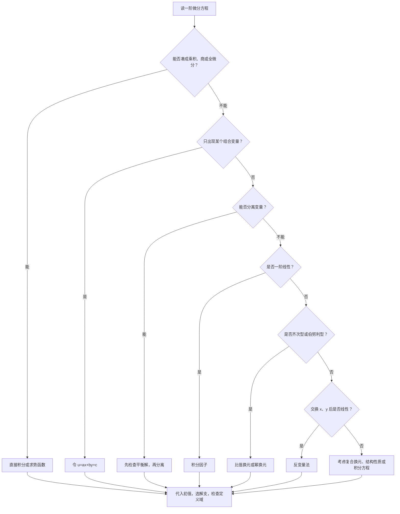

<Callout type="idea" title="本节学习目标">

学习目标：从识别方程类型、掌握基本解法，到解决真题中的换元、初值、函数方程、周期解及创新综合题。

</Callout>

本节不仅要学会计算，还要建立一种判断能力：

> 看到一道陌生的一阶微分方程，能够判断它的数学结构，选择最简单的变形，找到正确的求解方法，并检查特殊解、定义域和初值条件。

## 一、资料核对与本节考情

已经读取并核对以下资料：

- [云盘原始压缩包：数学分类题目1101](https://drive.google.com/file/d/1SHlVBo0SXIpfryv3NC7gjDnF4pKLMQJD/view?usp=drivesdk\&utm_source=chatgpt.com)，包括第五模块第一节的31道核心题目，以及张宇1000题、李林880题、李正元练习题和2027数学一分类模拟题。
- [一阶微分方程历年真题专题](https://exam.any1.tech/docs/math/past-exams/01-2f981f64/s-5ca32763/01-3e9fafd6/?utm_source=chatgpt.com)，重点核对1993年、2014年、2016年、2018年、2019年、2024年和2025年等代表性题目。
- [核心题目第一节](https://exam.any1.tech/docs/math/core-questions/01-b69fd298/05-28175cc9/01-3e9fafd6/?utm_source=chatgpt.com)。
- [分类模拟题第一节](https://exam.any1.tech/docs/math/exam/classified-1030/mock-exam-gaoshu-1030/module-05/01/?utm_source=chatgpt.com)，与压缩包中的更新版本交叉核对。

需要说明：以下涉及不同年份、不同数学卷种的题目，会标明实际归档来源；数二、数三的题目只在考点同样适用于数学一时使用。教材中的练习题与原创变式也会明确区分。

## 二、先建立一阶微分方程的完整知识地图

一阶微分方程通常写为

$$
F(x,y,y')=0.
$$

如果能够解出导数，可写成

$$
y'=f(x,y).
$$

它的核心困难通常不在求积分，而在于如何把原来的方程变成能够直接积分的形式。

| 类型     | 识别特征                              | 核心方法              |
| ------ | --------------------------------- | ----------------- |
| 可分离变量  | $y'=f(x)g(y)$                 | 分离 $x,y$，两边积分 |
| 一阶线性   | $y'+P(x)y=Q(x)$               | 积分因子              |
| 齐次型    | $y'=F(y/x)$                   | 令 $y=ux$      |
| 伯努利型   | $y'+Py=Qy^n$                  | 令 $u=y^{1-n}$ |
| 恰当微分   | $Mdx+Ndy=0$，且 $M_y=N_x$   | 求势函数              |
| 反变量型   | 直接求 $y(x)$ 困难，但关于 $x$ 呈线性 | 改求 $x(y)$     |
| 组合变量型  | 反复出现 $ax+by+c$                | 令 $u=ax+by+c$ |
| 复合函数型  | 同时出现 $G(y)$ 和 $G'(y)y'$   | 令 $u=G(y)$    |
| 积分方程型  | 未知函数出现在变上限积分中                     | 求导或换元             |
| 特殊解结构型 | 给出两个特解、周期条件或极限条件                  | 利用线性方程结构          |

这些类型并不是互斥的。

例如：

$$
xy'-y=x^2e^x
$$

既是一阶线性方程，又可以直接识别为商的导数：

$$
\left(\frac yx\right)'=e^x.
$$

后者显然更快。

因此，本节最重要的解题原则是：

<Callout type="idea" title="优先使用结构识别">

先观察能否凑微分，再判断标准类型，最后才使用通用公式。

</Callout>

## 三、基础理论：一阶微分方程究竟在求什么？

#### 1. 微分方程、解、通解和特解

考虑

$$
y'=2xy.
$$

这里要求的不是一个具体数值，而是一个未知函数 $y(x)$。

由于

$$
\frac{y'}y=2x,
$$

当 $y\ne0$ 时，

$$
\ln|y|=x^2+C_1.
$$

得到

$$
\boxed{y=Ce^{x^2}}.
$$

其中 $C$ 为任意常数。这是一族解。

如果增加条件

$$
y(0)=2,
$$

就有

$$
C=2.
$$

于是

$$
\boxed{y=2e^{x^2}}.
$$

这称为满足给定初值的特解。

注意：$y\equiv0$ 也是原方程的解，而且已经包含在 $Ce^{x^2}$ 中（取 $C=0$）。

#### 2. 什么叫通解？

一阶微分方程的常规通解一般含有一个独立任意常数。

但必须理解三个问题：

第一，含有一个任意常数，不代表它一定包含全部解。

第二，某些特殊解可能在分离变量、取倒数或交换变量时丢失。

<Callout type="warn" title="隐式解与分支选择">

第三，隐式通解不一定对应唯一一条函数曲线，初值可能还负责选择解支。

</Callout>

这三个问题在考研题中非常重要。

#### 3. 解的存在性和唯一性

对于初值问题

$$
y'=f(x,y),\qquad y(x_0)=y_0,
$$

如果在初值点附近，$f$ 对 $x,y$ 连续，并且对 $y$ 满足局部 Lipschitz 条件，例如 $f_y$ 在邻域内连续，那么存在唯一的局部解。

特别地，对于

$$
y'+P(x)y=Q(x),
$$

只要 $P,Q$ 在某个区间上连续，那么给定该区间内的初值，就存在唯一解，并且可以延伸到这个区间的全部位置。

但不要把这个结论随意用于存在奇点的非线性方程。

例如

$$
y'=\sqrt{|y|},\qquad y(0)=0
$$

就不满足上述唯一性条件。它除了零解外，还可以有从零开始延迟离开的其他解。

#### 4. 求解后必须检查什么？

一道一阶微分方程做完后，需要检查：

1. 是否因为除以某个表达式而遗漏了特殊解。
2. 对数、根式及分母对定义域有什么限制。
3. 初值是否要求选择特定的正负分支。
4. 隐式结果能否在初值附近表示成 $y(x)$。
5. 若原题是积分方程，求导得到的解是否满足原积分关系。

其中第1、3、5点尤其容易在综合题中失分。

## 四、基础方法精讲：真正掌握六大基本题型

### 方法一：可分离变量微分方程

#### 1. 标准形式

$$
\frac{dy}{dx}=f(x)g(y).
$$

当 $g(y)\ne0$ 时，移项得到

$$
\frac{dy}{g(y)}=f(x)\,dx.
$$

积分：

$$
\boxed{\int\frac{dy}{g(y)}=\int f(x)\,dx+C}.
$$

这是最基础的方法，但也是最容易遗漏特殊解的方法。

#### 2. 真正需要理解的关键

分离变量时，如果除以了 $y$、$y^2$、$y-a$ 或其他含 $y$ 的表达式，就需要检查这些表达式为零时是否存在解。

例如

$$
y'=y(y-2).
$$

若直接除以 $y(y-2)$，得到

$$
\frac{dy}{y(y-2)}=dx,
$$

那么已经排除了

$$
y=0,\qquad y=2.
$$

检查原方程：

当 $y\equiv0$ 或 $y\equiv2$ 时，两侧都等于零。

所以它们都是原方程的常值解。

重要结论：分离变量之前，先检查使 $g(y)=0$ 的常值解。

#### 3. 代表题：李正元练习题——伯努利方程中的特殊解

求

$$
y'-3xy=xy^2.
$$

先观察：

$$
y'=xy(y+3).
$$

直接分离变量可以做，但换元为线性方程更具有通用性。

先检查 $y\equiv0$，发现它确实是解。

对于 $y\ne0$，两边除以 $y^2$：

$$
\frac{y'}{y^2}-\frac{3x}{y}=x.
$$

令

$$
u=\frac1y, \qquad u'=-\frac{y'}{y^2}.
$$

于是

$$
-u'-3xu=x,
$$

即

$$
u'+3xu=-x.
$$

积分因子为

$$
\mu(x)=e^{\frac32x^2}.
$$

因此

$$
\left(ue^{\frac32x^2}\right)' =-xe^{\frac32x^2}.
$$

积分得

$$
ue^{\frac32x^2} =-\frac13e^{\frac32x^2}+C.
$$

所以

$$
u=-\frac13+Ce^{-\frac32x^2}.
$$

还原：

$$
\boxed{ y=\frac{3}{C_1e^{-\frac32x^2}-1} }.
$$

再补上先前检查得到的解：

$$
\boxed{y\equiv0}.
$$

这道题应该掌握的不是积分计算，而是：

> 当一种解法必须除以未知函数时，先处理可能被排除的解，再求一般非零解。

### 方法二：一阶线性微分方程——全节最重要的基本模型

#### 1. 标准形式

$$
\boxed{y'+P(x)y=Q(x)}.
$$

它包含两种情形。

齐次方程：

$$
y'+P(x)y=0.
$$

非齐次方程：

$$
y'+P(x)y=Q(x).
$$

#### 2. 一阶线性齐次方程

观察

$$
y'=-P(x)y.
$$

当 $y\ne0$ 时，

$$
\frac{y'}y=-P(x).
$$

积分：

$$
\ln|y|=-\int P(x)\,dx+C_1.
$$

因此

$$
\boxed{y=Ce^{-\int P(x)\,dx}}.
$$

这里允许 $C=0$，因而包含零解。

#### 3. 一阶线性非齐次方程

对于

$$
y'+P(x)y=Q(x),
$$

我们希望找到一个函数 $\mu(x)$，使左边成为乘积导数：

$$
(\mu y)'=\mu y'+\mu'y.
$$

对比发现，只需要满足

$$
\mu'=P(x)\mu.
$$

因此可以取

$$
\boxed{\mu(x)=e^{\int P(x)\,dx}}.
$$

这就是积分因子。

原方程两边乘以它：

$$
\mu y'+\mu Py=\mu Q.
$$

由于 $\mu'=P\mu$，得到

$$
(\mu y)'=\mu Q.
$$

两边积分：

$$
\mu y=\int\mu Q\,dx+C.
$$

所以

$$
\boxed{ y=e^{-\int P(x)\,dx} \left[ \int Q(x)e^{\int P(x)\,dx}\,dx+C \right] }.
$$

这就是一阶线性方程的通解公式。

但考试时不要机械套公式，应当优先检查左端是否已经接近某个乘积的导数。

#### 4. 真题母题一：2025年考研数学三

已知

$$
xy'-y+x^2e^x=0, \qquad y(1)=-e.
$$

求 $y$。

第一步：识别结构。

左边出现

$$
xy'-y.
$$

回忆商的求导公式：

$$
\left(\frac yx\right)' =\frac{xy'-y}{x^2}.
$$

所以在 $x\ne0$ 的区间上，将原方程除以 $x^2$：

$$
\frac{xy'-y}{x^2}=-e^x.
$$

因此

$$
\left(\frac yx\right)'=-e^x.
$$

第二步：直接积分。

$$
\frac yx=-e^x+C.
$$

得到

$$
y=x(C-e^x).
$$

第三步：代入初值。

由

$$
y(1)=C-e=-e,
$$

得

$$
C=0.
$$

最终

$$
\boxed{y=-xe^x}.
$$

#### 5. 这道母题能推广到什么程度？

今后只要看到以下结构，都应该立即产生对应的求导联想：

| 原式中的结构          | 优先联想到                     |
| --------------- | ------------------------- |
| $xy'+y$     | $(xy)'$               |
| $xy'-y$     | $x^2(y/x)'$           |
| $x^2y'+2xy$ | $(x^2y)'$             |
| $y'+2xy$    | $e^{-x^2}(e^{x^2}y)'$ |
| $2yy'$      | $(y^2)'$              |
| $e^yy'$     | $(e^y)'$              |
| $y'\sec^2y$ | $(\tan y)'$           |

特别值得掌握的是：

$$
\boxed{ x^ny'+nx^{n-1}y=(x^ny)' }
$$

以及

$$
\boxed{ xy'-ny=x^{n+1}\left(\frac{y}{x^n}\right)' }.
$$

它们是很多一阶微分方程的计算入口。

### 方法三：恰当微分方程——不要把全微分当成普通线性方程

#### 1. 基本概念

考虑

$$
M(x,y)\,dx+N(x,y)\,dy=0.
$$

如果存在某个二元函数 $F(x,y)$，满足

$$
F_x=M,\qquad F_y=N,
$$

那么

$$
dF=M\,dx+N\,dy.
$$

原方程就成为

$$
dF=0.
$$

因此

$$
\boxed{F(x,y)=C}.
$$

这称为恰当微分方程。

#### 2. 最重要的判别条件

由混合偏导数相等，

$$
F_{xy}=F_{yx},
$$

可以得到

$$
\boxed{ \frac{\partial M}{\partial y} = \frac{\partial N}{\partial x} }.
$$

当 $M,N$ 连续可微，且讨论区域为单连通区域时，这个条件也是存在势函数的充分条件。

对于考研中的多项式、指数函数等常见题目，通常可以直接使用这个判别条件。

#### 3. 真题母题二：2025年考研数学二

已知

$$
(2y-3x)\,dx+(2x-5y)\,dy=0,
$$

并且

$$
y(1)=1.
$$

求满足初值的解。

第一步：判断是否恰当。

设

$$
M=2y-3x,\qquad N=2x-5y.
$$

计算：

$$
M_y=2,\qquad N_x=2.
$$

因此

$$
M_y=N_x.
$$

原方程为恰当微分方程。

第二步：寻找势函数。

因为

$$
F_x=2y-3x,
$$

对 $x$ 积分：

$$
F(x,y)=2xy-\frac32x^2+\varphi(y).
$$

注意：这里不能直接写普通积分常数 $C$。

因为对 $x$ 求偏导时，任何仅依赖 $y$ 的函数都会消失。

所以必须写成

$$
\varphi(y).
$$

第三步：确定未知函数。

对 $y$ 求偏导：

$$
F_y=2x+\varphi'(y).
$$

又已知

$$
F_y=2x-5y.
$$

比较得到

$$
\varphi'(y)=-5y.
$$

于是

$$
\varphi(y)=-\frac52y^2.
$$

故

$$
2xy-\frac32x^2-\frac52y^2=C.
$$

整理：

$$
3x^2+5y^2-4xy=C_1.
$$

第四步：代入初值。

$$
3+5-4=4.
$$

因此

$$
\boxed{ 3x^2+5y^2-4xy=4 }.
$$

#### 4. 隐式解为什么还要考虑解支？

这道题给出的是隐式关系，而不是显式函数 $y=f(x)$。

令

$$
G(x,y)=3x^2+5y^2-4xy-4.
$$

有

$$
G_y=10y-4x.
$$

在初值点 $(1,1)$：

$$
G_y(1,1)=6\ne0.
$$

所以在初值附近可以将这条隐式曲线唯一地表示为函数 $y(x)$。

如果要求显式解，可以将它视为关于 $y$ 的二次方程：

$$
5y^2-4xy+3x^2-4=0.
$$

得到

$$
y=\frac{2x\pm2\sqrt{5-3x^2}}5.
$$

由 $y(1)=1$，必须选择正号：

$$
\boxed{ y=\frac{2x+2\sqrt{5-3x^2}}5 }.
$$

这就是初值选择解支的具体体现。

#### 5. 练习迁移：李林880题

求

$$
(x\cos y+\cos x)y'-y\sin x+\sin y=0.
$$

写成

$$
(\sin y-y\sin x)\,dx +(x\cos y+\cos x)\,dy=0.
$$

注意

$$
M_y=\cos y-\sin x=N_x.
$$

因此存在势函数。

直接观察：

$$
d(x\sin y+y\cos x)
$$

恰好等于原来的微分形式。

所以

$$
\boxed{x\sin y+y\cos x=C}.
$$

这道题告诉我们：

能直接凑全微分时，不必每次都完整地求偏导、积分、比较未知函数。

### 方法四：齐次微分方程

这里的“齐次”与一阶线性齐次方程不是同一个概念。

#### 1. 识别条件

如果方程能够写成

$$
\boxed{y'=F\left(\frac yx\right)},
$$

那么可以令

$$
u=\frac yx, \qquad y=xu.
$$

于是

$$
y'=u+xu'.
$$

代入：

$$
u+xu'=F(u).
$$

得到

$$
xu'=F(u)-u.
$$

从而变成可分离变量方程：

$$
\boxed{ \frac{du}{F(u)-u}=\frac{dx}{x} }.
$$

注意 $F(u)-u=0$ 对应的常值比率解，应单独检查。

#### 2. 真题母题三：2014年考研数学一

已知

$$
xy'+y(\ln x-\ln y)=0,
$$

且

$$
y(1)=e^3.
$$

求 $y(x)$。

第一步：观察特殊结构。

题目含有

$$
\ln x-\ln y=\ln\frac xy.
$$

说明方程中真正重要的变量组合是 $y/x$。

因为初值为正，先在 $x>0,y>0$ 的区域讨论。

令

$$
u=\frac yx, \qquad y=xu.
$$

则

$$
y'=u+xu'.
$$

而

$$
\ln x-\ln y=-\ln u.
$$

代入原方程：

$$
x(u+xu')-xu\ln u=0.
$$

除以 $x$：

$$
u+xu'-u\ln u=0.
$$

于是

$$
xu'=u(\ln u-1).
$$

第二步：继续换元。

如果直接分离变量，会出现

$$
\frac{du}{u(\ln u-1)}.
$$

虽然能够积分，但更直观的方法是令

$$
v=\ln u.
$$

则

$$
v'=\frac{u'}u.
$$

所以

$$
xv'=v-1.
$$

又变成一阶线性方程：

$$
v'-\frac vx=-\frac1x.
$$

观察可知其通解为

$$
v=1+Cx.
$$

第三步：还原并代入初值。

由于

$$
v=\ln u=\ln\frac yx,
$$

得到

$$
\ln\frac yx=1+Cx.
$$

即

$$
y=xe^{1+Cx}.
$$

代入

$$
y(1)=e^3
$$

得到

$$
C=2.
$$

最终

$$
\boxed{y=xe^{2x+1}}.
$$

#### 3. 这道题的真正价值

本题使用了连续两次换元：

$$
y \longrightarrow u=\frac yx \longrightarrow v=\ln u.
$$

以后面对含有以下结构的题目：

$$
\frac yx,\qquad \ln\frac yx,\qquad e^{y/x},
$$

应该优先考虑比值换元。

当第一次换元后仍然复杂，不代表方法错误，还应观察能否继续换元。

### 方法五：伯努利方程

#### 1. 标准形式

$$
\boxed{ y'+P(x)y=Q(x)y^n },
$$

其中 $n\ne0,1$。

关键在于将非线性方程转化为线性方程。

对于 $y\ne0$，两边除以 $y^n$：

$$
y^{-n}y'+P(x)y^{1-n}=Q(x).
$$

令

$$
u=y^{1-n}.
$$

则

$$
u'=(1-n)y^{-n}y'.
$$

于是

$$
\boxed{ u'+(1-n)P(x)u=(1-n)Q(x) }.
$$

这就是一阶线性方程。

#### 2. 真题母题四：1993年考研数学一

求

$$
x^2y'+xy=y^2, \qquad y(1)=1.
$$

第一步：识别伯努利结构。

在 $x>0$ 上除以 $x^2$：

$$
y'+\frac1xy=\frac1{x^2}y^2.
$$

这里 $n=2$，因此令

$$
u=y^{-1}=\frac1y.
$$

有

$$
u'=-\frac{y'}{y^2}.
$$

原方程除以 $y^2$：

$$
x^2\frac{y'}{y^2}+x\frac1y=1.
$$

代入得到

$$
-x^2u'+xu=1.
$$

整理：

$$
u'-\frac1xu=-\frac1{x^2}.
$$

第二步：求积分因子。

$$
\mu(x)=e^{-\int\frac1x\,dx}=\frac1x
$$

（取 $x>0$）。

所以

$$
\left(\frac ux\right)'=-\frac1{x^3}.
$$

积分：

$$
\frac ux=\frac1{2x^2}+C.
$$

因此

$$
u=\frac1{2x}+Cx.
$$

第三步：代入初值。

$$
y(1)=1\Longrightarrow u(1)=1.
$$

所以

$$
1=\frac12+C, \qquad C=\frac12.
$$

于是

$$
u=\frac{1+x^2}{2x}.
$$

还原：

$$
\boxed{ y=\frac{2x}{1+x^2} }.
$$

这道题是伯努利方程的标准母题。

核心记忆应当是：

$$
\boxed{ \text{出现 }y^2\text{ 的伯努利方程} \ \Longrightarrow\ \text{优先考虑 }u=\frac1y }.
$$

### 方法六：交换自变量与因变量

这是不少考生容易忽视的重要方法。

#### 1. 为什么要交换变量？

有些方程写成

$$
\frac{dy}{dx}=f(x,y)
$$

很复杂。

但如果改成

$$
\frac{dx}{dy}=\frac1{f(x,y)},
$$

就可能变为关于 $x(y)$ 的一阶线性方程。

使用时要注意：只有在相应局部解支上 $dy/dx\ne0$ 时，才能合法交换变量。

#### 2. 真题母题五：2012年考研数学二

已知

$$
y\,dx+(x-3y^2)\,dy=0,
$$

且

$$
y(1)=1.
$$

求特解。

如果直接求 $y'$，会得到

$$
y'=-\frac{y}{x-3y^2},
$$

难以直接分类。

但观察原来的微分形式：

$$
y\,dx+(x-3y^2)\,dy=0.
$$

把 $x$ 看成 $y$ 的函数：

$$
y\frac{dx}{dy}+x-3y^2=0.
$$

得到

$$
\frac{dx}{dy}+\frac1y x=3y.
$$

这是关于 $x(y)$ 的一阶线性方程。

积分因子为 $y$，于是

$$
\frac{d(xy)}{dy}=3y^2.
$$

积分：

$$
xy=y^3+C.
$$

由初值 $(x,y)=(1,1)$ 得

$$
C=0.
$$

故

$$
xy=y^3.
$$

在初值附近 $y\ne0$，得到

$$
x=y^2.
$$

由于 $y(1)=1>0$，应选择正支：

$$
\boxed{y=\sqrt{x}}.
$$

#### 3. 方法迁移：李林880题

求非恒定解

$$
y'=\frac{y}{x+(y+1)^2}.
$$

改写为

$$
\frac{dx}{dy}=\frac{x+(y+1)^2}{y}.
$$

得到

$$
\frac{dx}{dy}-\frac1y x =\frac{(y+1)^2}{y}.
$$

乘以积分因子 $1/y$：

$$
\left(\frac xy\right)' =\frac{(y+1)^2}{y^2}.
$$

右侧展开：

$$
\frac{(y+1)^2}{y^2} =1+\frac2y+\frac1{y^2}.
$$

积分得到

$$
\frac xy=y+2\ln|y|-\frac1y+C.
$$

所以

$$
\boxed{ x=y^2+2y\ln|y|-1+Cy }.
$$

这是标准的隐式解。

题目已经排除了常函数解；如果没有排除，就还应检查 $y\equiv0$ 在原方程有定义的区间上是否成立。

识别规律：当 $y'$ 的分母里出现 $x+g(y)$，而分子主要含 $y$ 时，优先尝试交换变量。

## 五、关键进阶：组合变量与复合函数换元

这是本节考研真题和模拟题特别值得研究的部分。

### 1. 组合变量换元的统一思想

若

$$
y'=F(ax+by+c),
$$

令

$$
u=ax+by+c.
$$

则

$$
u'=a+by' =a+bF(u).
$$

因此得到

$$
\boxed{ \frac{du}{a+bF(u)}=dx }.
$$

原来的二元结构变成单变量方程。

这是一个非常具有迁移能力的模型。

### 2. 真题母题六：2024年考研数学一、数学二

已知

$$
y'=\frac1{(x+y)^2}, \qquad y(1)=0.
$$

求满足初值的解。

第一步：观察重复出现的变量组合。

右边只出现 $x+y$，因此令

$$
u=x+y.
$$

有

$$
u'=1+y'.
$$

代入：

$$
u'=1+\frac1{u^2} =\frac{u^2+1}{u^2}.
$$

第二步：分离变量。

$$
\frac{u^2}{1+u^2}\,du=dx.
$$

利用

$$
\frac{u^2}{1+u^2} =1-\frac1{1+u^2},
$$

得到

$$
\int\left(1-\frac1{1+u^2}\right)du =\int dx.
$$

于是

$$
u-\arctan u=x+C.
$$

代回 $u=x+y$：

$$
x+y-\arctan(x+y)=x+C.
$$

即

$$
y-\arctan(x+y)=C.
$$

第三步：代入初值。

当 $x=1,y=0$ 时，

$$
C=-\frac\pi4.
$$

最终

$$
\boxed{ y+\frac\pi4=\arctan(x+y) }.
$$

#### 为什么这是重要的真题母题？

它看起来不是传统的线性、齐次或伯努利方程。

但实际上，只要发现重复变量组合，解题就非常直接。

以后看到

$$
y'=F(x+y),
$$

$$
y'=F(2x-y),
$$

$$
y'=F(3x+2y+1),
$$

都应立即尝试组合变量换元。

### 3. 李正元练习题：换元后不能遗漏平衡解

求

$$
y'=\frac{2x-y+1}{2x-y-1}.
$$

令

$$
u=2x-y.
$$

有

$$
u'=2-y'.
$$

所以

$$
u'=2-\frac{u+1}{u-1} =\frac{u-3}{u-1}.
$$

对于 $u\ne3$，分离变量：

$$
\frac{u-1}{u-3}\,du=dx.
$$

即

$$
\left(1+\frac2{u-3}\right)du=dx.
$$

积分：

$$
u+2\ln|u-3|=x+C.
$$

还原：

$$
2x-y+2\ln|2x-y-3|=x+C.
$$

整理得到

$$
\boxed{ y-x-2\ln|2x-y-3|=C }.
$$

但这里有一个关键问题：分离变量时除以了 $u-3$。

如果

$$
u\equiv3,
$$

那么

$$
2x-y=3,
$$

即

$$
\boxed{y=2x-3}.
$$

代回原方程可验证它确实成立。

所以该题除了通常的隐式积分曲线外，还有这个特殊解。

这也是考研中很有代表性的“通解之外寻找特殊解”的问题。

### 4. 复合函数换元：看到导数配对就换元

例如

$$
y'\sec^2y+\frac{x}{1+x^2}\tan y=x.
$$

由于

$$
(\tan y)'=y'\sec^2y,
$$

令

$$
u=\tan y.
$$

原方程化为

$$
u'+\frac{x}{1+x^2}u=x.
$$

积分因子为

$$
\mu(x)=\sqrt{1+x^2}.
$$

因此

$$
\left(u\sqrt{1+x^2}\right)' =x\sqrt{1+x^2}.
$$

积分：

$$
u\sqrt{1+x^2} =\frac13(1+x^2)^{3/2}+C.
$$

所以

$$
u=\frac{1+x^2}{3} +\frac{C}{\sqrt{1+x^2}}.
$$

若初值为 $y(0)=0$，则 $u(0)=0$，得到

$$
C=-\frac13.
$$

最终

$$
\boxed{ \tan y=\frac13\left( 1+x^2-\frac1{\sqrt{1+x^2}} \right) }.
$$

这是李林880题中的代表性模型。

看到 $y'G'(y)$ 与 $G(y)$ 同时出现，应考虑令 $u=G(y)$。

特别记住：

$$
\begin{aligned} 2yy'&=(y^2)',\\ e^yy'&=(e^y)',\\ \frac{y'}y&=(\ln|y|)',\\ \cos y\,y'&=(\sin y)',\\ \sec^2y\,y'&=(\tan y)'. \end{aligned}
$$

## 六、真题综合：利用一阶线性方程的解结构

这一部分比单纯套公式更加重要。

### 1. 一阶非齐次线性方程的结构定理

设

$$
L[y]=y'+P(x)y.
$$

非齐次方程为

$$
L[y]=Q(x).
$$

若 $y_1,y_2$ 都是它的解，那么

$$
L[y_1]=Q,\qquad L[y_2]=Q.
$$

两式相减：

$$
L[y_1-y_2]=0.
$$

因此：

$$
\boxed{ \text{两个非齐次特解之差是对应齐次方程的解} }.
$$

又由于

$$
L\left[\frac{y_1+y_2}{2}\right] =\frac12L[y_1]+\frac12L[y_2] =Q,
$$

所以两个特解的平均仍为非齐次方程的特解。

更一般地：

$$
\boxed{ \lambda y_1+(1-\lambda)y_2 }
$$

仍然是原非齐次方程的解。

### 2. 真题母题七：2016年考研数学一

已知

$$
y_1=(1+x^2)^2-\sqrt{1+x^2},
$$

$$
y_2=(1+x^2)^2+\sqrt{1+x^2}
$$

是

$$
y'+P(x)y=Q(x)
$$

的两个解。

求 $Q(x)$。

第一步：相减寻找齐次解。

$$
y_2-y_1=2\sqrt{1+x^2}.
$$

所以

$$
y_h=\sqrt{1+x^2}
$$

是对应齐次方程的非零解。

因此

$$
y_h'+P(x)y_h=0.
$$

得到

$$
P(x)=-\frac{y_h'}{y_h}.
$$

计算：

$$
y_h'=\frac{x}{\sqrt{1+x^2}}.
$$

所以

$$
\boxed{ P(x)=-\frac{x}{1+x^2} }.
$$

第二步：取平均寻找非齐次特解。

$$
y_p=\frac{y_1+y_2}{2}=(1+x^2)^2.
$$

代入：

$$
Q(x)=y_p'+P(x)y_p.
$$

即

$$
Q(x)=4x(1+x^2) -\frac{x}{1+x^2}(1+x^2)^2.
$$

化简：

$$
\boxed{ Q(x)=3x(1+x^2) }.
$$

#### 这一母题的迁移价值

以后只要题目给出同一非齐次线性方程的两个特解，就优先考虑：

$$
\boxed{ \begin{aligned} y_h&=y_1-y_2,\\ y_p&=\frac{y_1+y_2}{2}. \end{aligned} }
$$

然后利用

$$
P=-\frac{y_h'}{y_h}, \qquad Q=y_p'+Py_p.
$$

这类题目不需要先求解原微分方程。

## 七、高价值证明题：周期解的存在性与唯一性

### 真题母题八：2018年考研数学一

已知

$$
y'+y=f(x),
$$

其中 $f(x)$ 在整个实轴上连续。

（1）当 $f(x)=x$ 时，求通解。

（2）若 $f(x)$ 是周期为 $T>0$ 的周期函数，证明原方程存在唯一的 $T$ 周期解。

<Steps>

  <Step>

### 第一问：直接积分

$$
y'+y=x.
$$

积分因子为 $e^x$。

所以

$$
(e^xy)'=xe^x.
$$

积分得

$$
e^xy=(x-1)e^x+C.
$$

因此

$$
\boxed{ y=x-1+Ce^{-x} }.
$$

  </Step>

  <Step>

### 第二问：证明存在性

对于一般的连续函数 $f(x)$，通解为

$$
y(x)=e^{-x} \left[ C+\int_0^xe^tf(t)\,dt \right].
$$

要让 $y(x)$ 成为 $T$ 周期函数，必须满足

$$
y(T)=y(0).
$$

由于

$$
y(0)=C,
$$

而

$$
y(T)=e^{-T} \left[ C+\int_0^Te^tf(t)\,dt \right],
$$

因此

$$
e^{-T} \left[ C+\int_0^Te^tf(t)\,dt \right]=C.
$$

整理：

$$
C(e^T-1)=\int_0^Te^tf(t)\,dt.
$$

由于 $T>0$，有 $e^T-1\ne0$，故存在唯一的常数

$$
\boxed{ C=\frac{\int_0^Te^tf(t)\,dt}{e^T-1} }.
$$

由此得到一个满足端点相等条件的解。

但这里要注意：

仅证明 $y(T)=y(0)$，还没有完成周期性证明。

令

$$
z(x)=y(x+T).
$$

由于 $f$ 为 $T$ 周期函数，

$$
z'(x)+z(x)=f(x+T)=f(x).
$$

而

$$
z(0)=y(T)=y(0).
$$

因此 $z(x)$ 和 $y(x)$ 满足同一个一阶线性方程及同一个初值。

由解的唯一性：

$$
z(x)=y(x).
$$

于是

$$
\boxed{y(x+T)=y(x)}.
$$

周期解存在。

  </Step>

  <Step>

### 第三步：证明唯一性

假设存在两个周期解 $y_1,y_2$。

令

$$
w=y_1-y_2.
$$

则

$$
w'+w=0.
$$

所以

$$
w=Ce^{-x}.
$$

由于 $w$ 也为 $T$ 周期函数，

$$
Ce^{-(x+T)}=Ce^{-x}.
$$

因此

$$
C(e^{-T}-1)=0.
$$

因为 $T>0$，所以

$$
C=0.
$$

于是

$$
y_1=y_2.
$$

证毕。

  </Step>

</Steps>
#### 4. 推广：如果方程变为 $y'+ay=f(x)$ 呢？

这是非常值得掌握的创新变式。

假设 $f$ 为 $T$ 周期函数。

若 $a\ne0$，通过同样的积分因子法，可以证明存在唯一的 $T$ 周期解。

若 $a=0$，方程变成

$$
y'=f(x).
$$

此时

$$
y(x)=C+\int_0^xf(t)\,dt.
$$

要求周期性，需要

$$
\boxed{\int_0^Tf(t)\,dt=0}.
$$

因此：

- 当积分为零时，存在无穷多个 $T$ 周期解。
- 当积分不为零时，不存在 $T$ 周期解。

这个结论揭示了周期解问题真正的本质：周期条件约束的不是积分技巧，而是解在经过一个周期后能否回到原来的初值。

## 八、抽象函数与积分方程：一阶微分方程的重要综合考法

这类题目往往不是直接告诉你微分方程，而是把它隐藏在积分、极限或函数关系中。

### 1. 典型套路

如果题目给出

$$
f(x)=\int_0^xf(t)\,dt+g(x),
$$

应考虑两边求导：

$$
f'(x)=f(x)+g'(x).
$$

从而得到

$$
f'-f=g'.
$$

还要利用原式在 $x=0$ 时的取值：

$$
f(0)=g(0).
$$

因此可转化为一个初值问题。

### 2. 真题母题九：1995年考研数学三

已知连续函数 $f(x)$ 满足

$$
f(x)=\int_0^{3x}f\left(\frac t3\right)dt+e^{2x}.
$$

求 $f(x)$。

第一步：先处理积分结构。

令

$$
u=\frac t3.
$$

则

$$
dt=3du.
$$

原积分变成

$$
\int_0^{3x}f\left(\frac t3\right)dt =3\int_0^xf(u)\,du.
$$

因此

$$
f(x)=3\int_0^xf(u)\,du+e^{2x}.
$$

第二步：两边求导。

由连续性和微积分基本定理：

$$
f'(x)=3f(x)+2e^{2x}.
$$

所以

$$
f'-3f=2e^{2x}.
$$

第三步：获取初值。

从原积分方程令 $x=0$：

$$
f(0)=1.
$$

第四步：求解线性方程。

乘以积分因子 $e^{-3x}$：

$$
(fe^{-3x})'=2e^{-x}.
$$

积分：

$$
fe^{-3x}=-2e^{-x}+C.
$$

因此

$$
f=-2e^{2x}+Ce^{3x}.
$$

利用 $f(0)=1$：

$$
1=-2+C, \qquad C=3.
$$

所以

$$
\boxed{ f(x)=3e^{3x}-2e^{2x} }.
$$

#### 为什么求导之后还要检查原式？

因为微分通常会丢掉一个积分常数。

原积分方程所包含的信息比求导得到的微分方程更多。

所以标准操作是：

$$
\boxed{ \text{积分方程} \rightarrow \text{微分方程} \rightarrow \text{初值} \rightarrow \text{求解} \rightarrow \text{回代验证} }.
$$

### 3. 真题母题十：2002年考研数学二——极限条件变微分方程

已知 $f(x)>0$，且

$$
\lim_{x\to+\infty}f(x)=1,
$$

并且

$$
\lim_{h\to0} \left( \frac{f(x+hx)}{f(x)} \right)^{1/h} =e^{1/x}, \qquad x>0.
$$

求 $f(x)$。

这是一个很有代表性的抽象创新型题目。

第一步：对幂指表达式取对数。

由 $f(x)>0$，可以合法取对数。

得到

$$
\lim_{h\to0} \frac{\ln f(x+hx)-\ln f(x)}h =\frac1x.
$$

注意这里增量是 $hx$，不是 $h$。

令

$$
\Delta x=hx.
$$

由于 $h=\Delta x/x$，所以

$$
\lim_{h\to0} \frac{\ln f(x+hx)-\ln f(x)}h =x(\ln f(x))'.
$$

因此

$$
x\frac{f'(x)}{f(x)}=\frac1x.
$$

得到

$$
\frac{f'}f=\frac1{x^2}.
$$

第二步：积分。

$$
\ln f=-\frac1x+C.
$$

所以

$$
f(x)=Ke^{-1/x}, \qquad K>0.
$$

第三步：使用无穷远条件。

由于

$$
\lim_{x\to+\infty}e^{-1/x}=1,
$$

而题设要求 $f(x)\to1$，故

$$
K=1.
$$

最终

$$
\boxed{ f(x)=e^{-1/x} }.
$$

#### 需要提炼的思路

面对类似表达式

$$
\left( \frac{f(x+h)}{f(x)} \right)^{1/h},
$$

首先想到

$$
(\ln f(x))'.
$$

面对

$$
\left( \frac{f(x+hx)}{f(x)} \right)^{1/h},
$$

则应该想到

$$
x(\ln f(x))'.
$$

这类题能够把极限、导数定义与一阶微分方程联系起来。

## 九、分类模拟题精讲：从解方程到高等数学综合应用

基础题主要考方法识别，而高质量模拟题往往把微分方程和极限、导数应用、积分应用结合在一起。

### 模拟母题一：张宇8套卷第3套第13题

设过原点的曲线 $y=y(x)$ 满足

$$
y'=(x+y)^2.
$$

求

$$
\lim_{x\to0}\frac{y(x)}{x^3}.
$$

<Tabs items={["先求通解", "直接求高阶导数"]} defaultIndex={0}>

  <Tab value="先求通解">

**方法一：先完整求出函数**

令

$$
u=x+y.
$$

则

$$
u'=1+y'=1+u^2.
$$

因此

$$
\frac{du}{1+u^2}=dx.
$$

积分：

$$
\arctan u=x+C.
$$

由于曲线过原点，

$$
y(0)=0, \qquad u(0)=0.
$$

故 $C=0$。

于是

$$
u=\tan x.
$$

所以

$$
y=\tan x-x.
$$

利用泰勒展开：

$$
\tan x=x+\frac{x^3}{3}+O(x^5).
$$

得到

$$
\boxed{ \lim_{x\to0}\frac{y(x)}{x^3}=\frac13 }.
$$

  </Tab>

  <Tab value="直接求高阶导数">

**方法二：不求通解，直接求局部高阶导数**

由于

$$
y'=(x+y)^2, \qquad y(0)=0,
$$

所以

$$
y'(0)=0.
$$

再求导：

$$
y''=2(x+y)(1+y').
$$

于是

$$
y''(0)=0.
$$

继续求导：

$$
y'''=2(1+y')^2+2(x+y)y''.
$$

所以

$$
y'''(0)=2.
$$

由泰勒公式：

$$
y(x)=y(0)+y'(0)x+\frac{y''(0)}2x^2 +\frac{y'''(0)}6x^3+o(x^3).
$$

因此

$$
y(x)=\frac{x^3}{3}+o(x^3).
$$

所以

$$
\boxed{\frac13}.
$$

  </Tab>

</Tabs>

#### 两种解法如何选择？

第一种方法适合能快速求出显式函数的情况。

第二种方法适合只要求局部极限，且微分方程容易连续求导的情况。

这是非常重要的策略：

> 题目问极限，不一定需要先求出未知函数。

对于未来出现的复杂微分方程局部极限题，这个思路尤其有价值。

### 模拟母题二：李林六套卷第3套第18题

设 $n$ 为正整数，函数满足

$$
(1-x)f'(x)+nf(x)=n(1-x)^{n+1},
$$

且

$$
f(0)=0.
$$

若 $f$ 在 $(0,1)$ 上的最大值为 $M(n)$，求

$$
\lim_{n\to\infty}M(n),
$$

并证明

$$
M(n)<\frac1e.
$$

这道题将三个知识点串联起来：

$$
\text{一阶线性方程} \rightarrow \text{函数最值} \rightarrow \text{数列极限和不等式}.
$$

<Steps>

  <Step>

### 第一步：求 $f(x)$

对于 $0\le x<1$，除以 $1-x$：

$$
f'+\frac n{1-x}f=n(1-x)^n.
$$

积分因子为

$$
\mu(x)=(1-x)^{-n}.
$$

所以

$$
\left[f(x)(1-x)^{-n}\right]'=n.
$$

积分：

$$
f(x)(1-x)^{-n}=nx+C.
$$

由 $f(0)=0$ 得 $C=0$，因此

$$
\boxed{ f(x)=nx(1-x)^n }.
$$

  </Step>

  <Step>

### 第二步：求最大值

求导：

$$
f'(x)=n(1-x)^{n-1}[1-(n+1)x].
$$

令 $f'(x)=0$：

$$
x=\frac1{n+1}.
$$

导数在该点左侧为正，右侧为负，所以取得最大值。

代入：

$$
M(n)=n\frac1{n+1} \left(1-\frac1{n+1}\right)^n.
$$

整理：

$$
\boxed{ M(n)=\left(\frac n{n+1}\right)^{n+1} }.
$$

  </Step>

  <Step>

### 第三步：求极限

$$
M(n)=\left(1+\frac1n\right)^{-(n+1)}.
$$

由经典极限：

$$
\left(1+\frac1n\right)^n\to e,
$$

得到

$$
\boxed{ \lim_{n\to\infty}M(n)=e^{-1} }.
$$

  </Step>

  <Step>

### 第四步：证明严格不等式

利用

$$
\ln(1+t)>\frac{t}{1+t}, \qquad t>0.
$$

取

$$
t=\frac1n,
$$

得

$$
\ln\left(1+\frac1n\right)>\frac1{n+1}.
$$

所以

$$
(n+1)\ln\left(1+\frac1n\right)>1.
$$

即

$$
\ln M(n)<-1.
$$

因此

$$
\boxed{M(n)<e^{-1}}.
$$

  </Step>

</Steps>
#### 这类综合题的通用流程

先解微分方程，再研究已知函数的性质。

如果题目含有参数 $n$，往往需要继续研究参数极限、不等式或单调性。

不要在看到参数时急于讨论参数；先完整求解未知函数，很多复杂结构才会自然显现。

### 模拟母题三：张宇8套卷第4套第18题

已知

$$
g(x)=\int_0^1xf(tx)\,dt,
$$

且

$$
f'(x)+g'(x)=x, \qquad f(0)=0.
$$

求曲线

$$
y=f(x),\qquad y=e^{-x}
$$

及直线 $x=0,x=2$ 围成的面积。

<Steps>

  <Step>

### 第一步：将特殊积分转化为普通变上限积分

令

$$
u=tx.
$$

得到

$$
g(x)=\int_0^xf(u)\,du.
$$

因此

$$
g'(x)=f(x).
$$

原方程变成

$$
f'(x)+f(x)=x.
$$

  </Step>

  <Step>

### 第二步：求函数

积分因子为 $e^x$：

$$
(e^xf)'=xe^x.
$$

所以

$$
f=x-1+Ce^{-x}.
$$

由 $f(0)=0$ 得

$$
C=1.
$$

因此

$$
f(x)=x-1+e^{-x}.
$$

  </Step>

  <Step>

### 第三步：求面积

观察两个函数的差：

$$
f(x)-e^{-x}=x-1.
$$

因此

$$
S=\int_0^2|x-1|\,dx.
$$

在 $x=1$ 处分段：

$$
S=\int_0^1(1-x)\,dx+\int_1^2(x-1)\,dx.
$$

得到

$$
\boxed{S=1}.
$$

这道题的重要启示是：

有时微分方程只是综合题的中间步骤。最终仍要回到题目要求的面积、最值、极限或渐近线。

  </Step>

</Steps>
## 十、数学一高阶创新考法：不必求出全部函数

### 1. 微分方程与单调性、极值

如果已知

$$
y'+P(x)y=Q(x),
$$

那么

$$
y'=Q(x)-P(x)y.
$$

有时可以根据 $y$ 的符号、初值以及右边的关系，直接判断导数符号。

如果题目仅要求极值、拐点或某点导数，不一定需要完整求解。

### 2. 李永乐六套卷：利用微分方程判断拐点

设

$$
Q(x)=\int_0^1(1+t)|x-t|\,dt,
$$

函数 $f$ 满足

$$
f'(x)-Q(x)f(x)=Q'(x), \qquad f(0)=0.
$$

要求判断原点是否是极值点或拐点。

这道题不需要先求 $f(x)$ 的解析式。

首先

$$
Q(0)=\int_0^1(t+t^2)\,dt=\frac56.
$$

通过分段处理绝对值，可以得到：

当 $x<0$ 时，

$$
Q'(x)=-\frac32,\qquad Q''(x)=0.
$$

当 $0<x<1$ 时，

$$
Q'(x)=x^2+2x-\frac32,
$$

$$
Q''(x)=2x+2.
$$

由原微分方程：

$$
f'(0)=Q(0)f(0)+Q'(0)=-\frac32.
$$

由于

$$
f'(0)\ne0,
$$

所以原点不是极值点。

再对方程求导：

$$
f''=Q'f+Qf'+Q''.
$$

在原点左侧：

$$
\lim_{x\to0^-}f''(x) =\frac56\left(-\frac32\right) =-\frac54.
$$

在原点右侧：

$$
\lim_{x\to0^+}f''(x) =-\frac54+2 =\frac34.
$$

所以原点附近左侧二阶导数为负，右侧为正，曲线凹凸性发生变化。

因此

$$
\boxed{ (0,0)\text{ 是拐点，但 }x=0\text{ 不是极值点} }.
$$

这里 $f''(0)$ 不一定存在，但并不妨碍原点成为拐点。

#### 本题最应该学到什么？

当题目只要求某个点的导数、极值、拐点时：

优先利用微分方程本身以及它的求导关系，不要默认必须求出通解。

## 十一、特别重要的易错点与陷阱

这一部分建议在做完核心题目后反复检查。

| 易错点   | 错误做法                      | 正确原则                                |
| ----- | ------------------------- | ----------------------------------- |
| 分离变量  | 直接除以 $y$ 或 $y-a$  | 先检查被除掉的零因子是否对应特殊解                   |
| 线性方程  | 把 $P(x)$ 的符号写反        | 先统一为 $y'+Py=Q$                  |
| 积分因子  | 忘记指数中的积分                  | 使用 $e^{\int Pdx}$               |
| 恰当微分  | 对 $x$ 积分后只加常数 $C$ | 应加 $\varphi(y)$                 |
| 齐次型换元 | 写 $y'=u'$             | 正确的是 $y'=u+xu'$                 |
| 伯努利换元 | 忘记 $1-n$ 的系数          | 应令 $u=y^{1-n}$                  |
| 交换变量  | 无条件写 $dx/dy=1/y'$     | 必须考虑导数非零及局部可逆性                      |
| 组合变量  | 除以新变量的某个因子后不检查            | 检查平衡解                               |
| 根式解   | 同时写正负号却不选解支               | 利用初值确定符号                            |
| 积分方程  | 求导解完便结束                   | 应用原式确定初值并回代                         |
| 周期解   | 证明 $y(T)=y(0)$ 就结束    | 还须证明所有 $x$ 都有 $y(x+T)=y(x)$ |
| 分段方程  | 两侧分别积分但不衔接                | 用连续性或题设连接条件确定常数                     |

还有两个需要额外强调的细节。

#### 1. 隐式通解不是显式函数

例如

$$
x^2+y^2=C
$$

表示的是一族圆。

即使选择了 $C$，也不一定能够在整个圆上定义单值函数 $y(x)$。

所以题目明确要求 $y=y(x)$ 时，必须考虑局部函数分支。

#### 2. 原方程的定义域不能在求解过程中随意扩大

例如

$$
y'=\frac1{(x+y)^2}
$$

要求

$$
x+y\ne0.
$$

即使积分后的隐式关系在某些点仍然有意义，也不能把那些原微分方程无定义的点当成普通解点。

## 十二、遇到未来新题时，如何快速判断？

可以建立如下思维顺序。

这里还存在一个重要的考试经验：

不应只根据方程表面是否线性来分类，而应根据适当变形之后能否线性化来分类。

例如

$$
y'=\frac{y}{x+(y+1)^2}
$$

表面不是线性方程，但是交换变量后就是线性方程。

又如

$$
2yy'-y^2=2
$$

表面是非线性方程，但令 $u=y^2$ 后就成为

$$
u'-u=2.
$$

熟练掌握这些结构，比单纯记住十几个解题公式更重要。

## 十三、补充训练：八道高质量迁移题

以下为根据本节母题构造的训练题，均为自拟变式，不标作历年真题。

建议先独立做，再核对答案。

#### 训练1：一阶线性与商的导数

求初值问题

$$
xy'-y=x^3,\qquad y(1)=1.
$$

<Accordions>
  <Accordion title="答案与方法提示（独立完成后展开）">

答案：

$$
\boxed{y=\frac{x^3+x}{2}},\qquad x>0.
$$

提示：先除以 $x^2$，构造 $(y/x)'$。

#### 训练2：齐次方程与定义域

求

$$
y'=\frac yx+\left(\frac yx\right)^2, \qquad y(1)=1.
$$

<Accordions>
  <Accordion title="答案与方法提示（独立完成后展开）">

答案：

$$
\boxed{ y=\frac{x}{1-\ln x} },\qquad 0<x<e.
$$

提示：令 $u=y/x$，得到 $xu'=u^2$。

#### 训练3：复合函数线性化

求

$$
2yy'-y^2=2, \qquad y(0)=1.
$$

<Accordions>
  <Accordion title="答案与方法提示（独立完成后展开）">

答案：

$$
\boxed{ y=\sqrt{3e^x-2} }.
$$

提示：令 $u=y^2$，并由初值选择正支。

#### 训练4：全微分与隐式解

求

$$
(x+2y)\,dx+(2x+3y)\,dy=0,
$$

满足 $y(0)=1$ 的解。

<Accordions>
  <Accordion title="答案与方法提示（独立完成后展开）">

答案：

$$
\boxed{ x^2+4xy+3y^2=3 }.
$$

提示：先计算 $M_y,N_x$。

#### 训练5：非零解与特殊解

求

$$
y'=y^2.
$$

<Accordions>
  <Accordion title="答案与方法提示（独立完成后展开）">

答案：

非零解族为

$$
\boxed{ y=\frac1{C-x} }.
$$

另外还有

$$
\boxed{y\equiv0}.
$$

提示：不要在除以 $y^2$ 后遗漏零解。

#### 训练6：抽象函数与初值

已知连续函数 $f$ 满足

$$
f(x)=1+\int_0^x[2f(t)+t]\,dt.
$$

求 $f(x)$。

<Accordions>
  <Accordion title="答案与方法提示（独立完成后展开）">

答案：

$$
\boxed{ f(x)=\frac54e^{2x}-\frac x2-\frac14 }.
$$

提示：求导后是线性方程，且 $f(0)=1$。

#### 训练7：双重指数换元

求初值问题

$$
y'=(1+x)y\ln y, \qquad y(0)=e.
$$

<Accordions>
  <Accordion title="答案与方法提示（独立完成后展开）">

答案：

$$
\boxed{ y=\exp\left(e^{x+\frac{x^2}{2}}\right) }.
$$

提示：令 $u=\ln y$，把非线性方程变成一阶线性齐次方程。

#### 训练8：周期解中的参数讨论

设

$$
y'+ay=\cos x,\qquad a\in\mathbb R.
$$

讨论 $2\pi$ 周期解。

<Accordions>
  <Accordion title="答案与方法提示（独立完成后展开）">

先求通解：

$$
\boxed{ y=\frac{a\cos x+\sin x}{a^2+1}+Ce^{-ax} }.
$$

当 $a\ne0$ 时，有唯一的 $2\pi$ 周期解：

$$
\boxed{ y=\frac{a\cos x+\sin x}{a^2+1} }.
$$

当 $a=0$ 时：

$$
\boxed{ y=\sin x+C }.
$$

所有这些解都具有周期 $2\pi$，因此周期解不唯一。

这道题是2018年周期解真题的直接推广，值得重点掌握。

  </Accordion>
</Accordions>

  </Accordion>
</Accordions>

  </Accordion>
</Accordions>

  </Accordion>
</Accordions>

  </Accordion>
</Accordions>

  </Accordion>
</Accordions>

  </Accordion>
</Accordions>

  </Accordion>
</Accordions>

## 十四、如何分层完成这一节的题目？

根据已经读取的核心题目与对应练习资料，我建议按照以下顺序训练，而不是从第一题一直机械刷到最后一题。

| 学习层次      | 核心目标               | 代表题                         |
| --------- | ------------------ | --------------------------- |
| 第一层：基础计算  | 熟练凑微分、积分因子、求初值     | 2025数三、2025数二               |
| 第二层：方程分类  | 识别齐次、伯努利、反变量、组合换元  | 1993数一、2012数二、2014数一、2024数一 |
| 第三层：特殊解   | 检查分离变量漏解、根式分支、隐式曲线 | 李正元组合变量题、李林880反变量题          |
| 第四层：结构分析  | 两个特解反推方程、周期解存在唯一性  | 2016数一、2018数一               |
| 第五层：跨章节综合 | 积分方程、局部极限、面积、参数最值  | 1995数三、张宇8套卷、李林六套卷          |
| 第六层：创新题   | 根据要求直接求导数、极限或性质    | 李永乐六套卷拐点题及自拟训练题             |

其中，最应该反复研究的是2016年线性方程解结构、2018年周期解、2024年组合变量换元，以及张宇模拟卷中的局部极限题。

因为这些题目不只是考验会不会套公式，而是在考验能不能理解方程背后的结构。

## 十五、本节最终总结：必须真正内化的十个知识结论

完成本节学习后，至少应该能够不看资料，独立推导并解释以下结论：

第一，一阶线性方程的积分因子。

$$
y'+Py=Q
$$

对应

$$
\boxed{\mu=e^{\int Pdx}}.
$$

第二，齐次方程的比值换元。

$$
y'=F\left(\frac yx\right)
$$

对应

$$
\boxed{y=xu,\qquad y'=u+xu'}.
$$

第三，伯努利方程的幂换元。

$$
y'+Py=Qy^n
$$

对应

$$
\boxed{u=y^{1-n}}.
$$

第四，恰当微分的判别。

$$
Mdx+Ndy=0
$$

满足合适条件时，由

$$
\boxed{M_y=N_x}
$$

寻找势函数。

第五，组合变量的统一换元。

$$
y'=F(ax+by+c)
$$

对应

$$
\boxed{u=ax+by+c}.
$$

第六，复合函数换元。

当出现

$$
G'(y)y'+P(x)G(y)=Q(x)
$$

时，令

$$
\boxed{u=G(y)}.
$$

第七，反变量法。

若直接求 $y(x)$ 困难，但

$$
\frac{dx}{dy}=P(y)x+Q(y),
$$

则交换变量，利用一阶线性方程求 $x(y)$。

第八，一阶非齐次线性方程解的结构。

两个特解之差是齐次解，而它们的仿射组合仍是非齐次解。

第九，积分方程可以转化为微分方程。

但求导后必须利用原始条件确定常数，并验证。

第十，最终解不仅是一个表达式。

正确答案还要考虑特殊解、定义域、初值和解支。

## 十六、达到什么程度才算真正掌握？

我建议用四个标准检验自己。

第一，面对没有明确类型提示的一阶微分方程，能够在较短时间内判断是直接凑导数、换元、分离变量，还是使用积分因子。

第二，能够独立解释为什么选择某种换元，而不是仅仅记住答案。例如能说明为什么伯努利方程用 $y^{1-n}$，为什么 $y'=F(x+y)$ 用 $u=x+y$。

第三，能够解决包含初值、积分、极限、周期性或其他函数性质的综合问题，不会在求出通解后就停止。

第四，能够主动检查解的合法性。尤其是被除去的零因子、原方程的奇点、根式正负分支、隐式解的局部可逆性，以及求导后丢失的积分条件。

这一节的核心不是记住多少种微分方程，而是训练一种能力：把看似复杂的方程，通过结构识别与合适换元，化为自己已经能够解决的简单问题。

只要真正掌握这套方法，面对未来考研数学一的一阶微分方程新题，就能够从数学结构出发寻找突破口，而不必依赖是否曾经见过原题。
