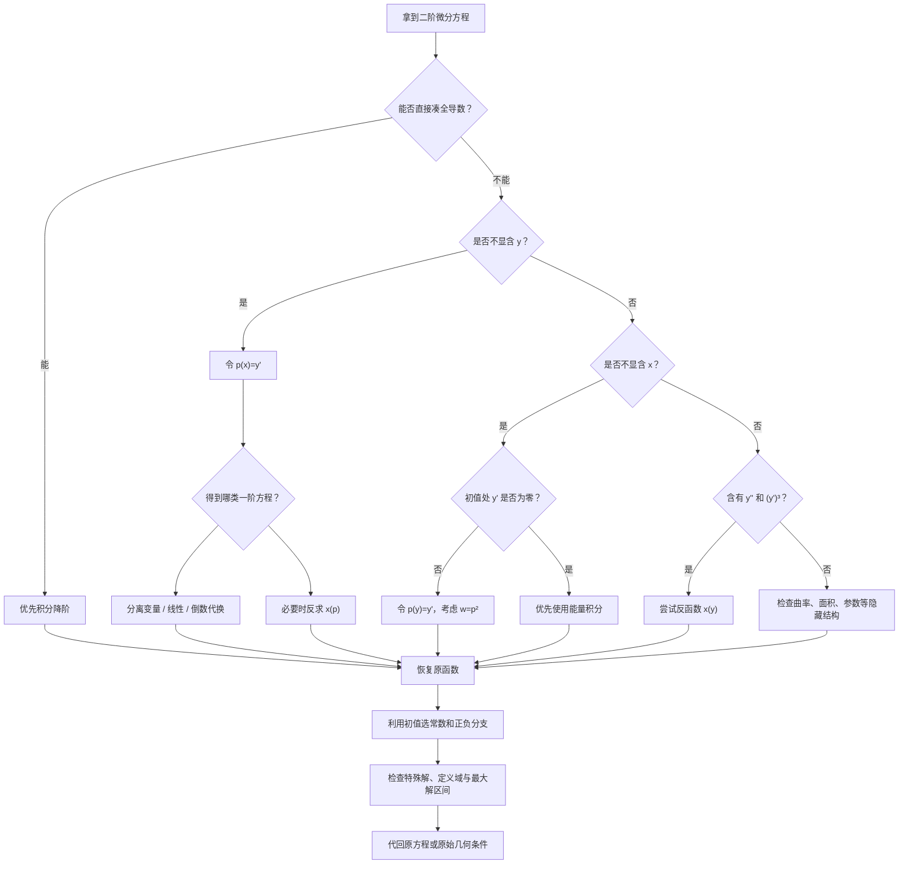

<Callout type="idea" title="从结构识别到综合迁移">

学习目标：从识别方程结构，到掌握降阶思想，再到独立解决非线性、几何、积分约束与创新综合题。

</Callout>

本节依据你提供的 Google Drive 压缩包《数学分类题目1101.zip》整理，重点参考了：

- 考研核心题目：第五模块第4节《可降阶微分方程》，包含16道分类核心题及变式。
- 考研真题：资料标注的1999、2000、2002年数学一相关题，以及2007、2010、2011、2026年数学二的同考点题。
- 分类模拟题：张宇2027数学一8套卷第6套第18题、汤家凤2027数学一8套卷第2套第19题。
- 专项练习：张宇1000题第15章、李林880题第7章、李正元《常微分方程》第6章。

其中，真题年份与题目来源按所提供资料的标注使用；为讲清方法而增加的例题会明确作为拓展例题。

原始资料：[第五模块第4节核心题目](https://exam.any1.tech/docs/math/core-questions/01-b69fd298/05-28175cc9/04-43079c2b/?utm_source=chatgpt.com) · [第五模块第4节分类模拟题](https://exam.any1.tech/docs/math/exam/classified-1030/mock-exam-gaoshu-1030/module-05/04/?utm_source=chatgpt.com) · [Google Drive 原始压缩包](https://drive.google.com/file/d/1SHlVBo0SXIpfryv3NC7gjDnF4pKLMQJD/view?utm_source=chatgpt.com)

## 一、建立知识体系：本节到底在研究什么？

### 1. 为什么二阶方程能够降为一阶？

一般二阶微分方程具有形式

$$
F(x,y,y',y'')=0.
$$

它涉及四个量：

$$
x,\qquad y,\qquad y',\qquad y''.
$$

如果方程具有特殊结构，例如不出现 $y$，或者不出现 $x$，就可以选择适当的新变量，把二阶问题化为一阶问题。

降阶不是为了减少一个导数符号，而是为了把原来难以直接处理的二阶关系，转化为熟悉的一阶方程。

从运动学角度理解：

$$
y=\text{位置},\qquad y'=\text{速度},\qquad y''=\text{加速度}.
$$

如果加速度只与时间和速度有关，就先求速度随时间如何变化。

如果加速度只与位置和速度有关，就可以利用速度与位置之间的关系，把时间暂时消去。

这正是两种基本降阶方法的直观来源。

### 2. 考研必须掌握的五条解题路线

| 方程特征                        | 核心代换或方法            | 降阶后的目标                    |
| --------------------------- | ------------------ | ------------------------- |
| 不显含 $y$                 | $p(x)=y'$      | 解关于 $p(x)$ 的一阶方程      |
| 不显含 $x$                 | $p(y)=y'$      | 解关于 $p(y)$ 的一阶方程      |
| $y''=f(y)$              | 两边乘 $2y'$      | 构造能量积分                    |
| 出现 $y''$ 与 $(y')^3$ | 考虑反函数 $x=x(y)$ | 把非线性方程转为关于 $x(y)$ 的方程 |
| 出现导数乘积、面积或曲率                | 凑全导数、几何建模          | 先找到隐藏的一阶关系                |

<Callout type="info" title="五条解题路线">

这张表是本节的核心。

</Callout>

考场拿到二阶方程，第一步不是求解，而是判断应当选择哪条路线。

## 二、基础原理与关键公式

### 1. 第一类：不显含因变量 $y$

#### 典型形式

$$
F(x,y',y'')=0.
$$

方程中没有单独出现 $y$，只出现自变量、导数和高阶导数。

令

$$
\boxed{p(x)=y'(x)}.
$$

于是

$$
y''=p'(x).
$$

原方程化为

$$
\boxed{F(x,p,p')=0}.
$$

这是一个一阶方程。

解出 $p(x)$ 后，再积分一次：

$$
\boxed{y(x)=\int p(x)\,\mathrm dx+C}.
$$

#### 为什么有效？

因为原方程只限制了导数如何变化，而没有直接限制函数的位置。

例如，如果 $y(x)$ 是解，那么 $y(x)+C$ 通常也是解。

这解释了为什么解出 $y'$ 后还需要积分常数。

#### 进一步细分

代换以后，常见的三种一阶方程为：

可分离变量型

$$
p'=f(x)g(p).
$$

优先分离变量。

一阶线性型

$$
p'+P(x)p=Q(x).
$$

使用积分因子

$$
\mu(x)=e^{\int P(x)\,\mathrm dx}.
$$

无独立常数项的 Riccati 型

$$
p'=a(x)p+b(x)p^2.
$$

当 $p\ne0$ 时，令

$$
u=\frac1p,
$$

可得

$$
\boxed{u'+a(x)u=-b(x)}.
$$

于是非线性方程被转化为线性方程。

这个倒数代换是本节重要的提高技巧。

### 2. 第二类：不显含自变量 $x$

#### 典型形式

$$
F(y,y',y'')=0.
$$

方程中没有显式出现 $x$。

在 $y'\ne0$ 的局部区间内，把 $y$ 作为自变量，令

$$
\boxed{p(y)=y'(x)}.
$$

<Callout type="warn" title="变量依赖关系">

注意：这里的 $p$ 是 $y$ 的函数，不再是 $x$ 的函数。

</Callout>

利用复合函数求导法则：

$$
y''=\frac{\mathrm d y'}{\mathrm dx} =\frac{\mathrm dp}{\mathrm dy} \frac{\mathrm dy}{\mathrm dx}.
$$

由于

$$
\frac{\mathrm dy}{\mathrm dx}=p,
$$

所以

$$
\boxed{y''=p\frac{\mathrm dp}{\mathrm dy}}.
$$

原方程化为

$$
\boxed{F\left(y,p,p\frac{\mathrm dp}{\mathrm dy}\right)=0}.
$$

这样就降低了一阶。

#### 最重要的进一步代换：$w=p^2$

因为

$$
\frac{\mathrm d(p^2)}{\mathrm dy} =2p\frac{\mathrm dp}{\mathrm dy},
$$

所以

$$
\boxed{ p\frac{\mathrm dp}{\mathrm dy} =\frac12\frac{\mathrm d(p^2)}{\mathrm dy} }.
$$

令

$$
w(y)=p^2(y),
$$

则

$$
\boxed{y''=\frac12w'(y)}.
$$

特别是遇到

$$
y''+A(y)(y')^2=B(y)
$$

时，可以直接得到

$$
\frac12w'+A(y)w=B(y),
$$

即

$$
\boxed{w'+2A(y)w=2B(y)}.
$$

一个看上去很复杂的非线性二阶方程，竟然变成了标准一阶线性方程。

这是本节必须形成条件反射的结构。

#### 适用条件

这里有一个非常重要的细节。

将 $y$ 作为新的局部自变量，通常要求

$$
y'\ne0.
$$

如果初值恰好满足

$$
y'(x_0)=0,
$$

就不能直接依靠局部反函数代换处理该点。

此时优先考虑下一种方法。

### 3. 第三类：能量积分法

对于

$$
\boxed{y''=f(y)},
$$

可以不除以 $y'$，而是直接将方程两边乘以 $2y'$：

$$
2y'y''=2f(y)y'.
$$

观察左边：

$$
2y'y''=\frac{\mathrm d}{\mathrm dx}(y')^2.
$$

如果 $V'(y)=f(y)$，则

$$
2f(y)y'=\frac{\mathrm d}{\mathrm dx}\bigl(2V(y)\bigr).
$$

因此

$$
\frac{\mathrm d}{\mathrm dx} \left[(y')^2-2V(y)\right]=0.
$$

积分得

$$
\boxed{ (y')^2=2\int f(y)\,\mathrm dy+C }.
$$

这是自治二阶微分方程的重要第一积分。

#### 直观理解

原来需要求解

$$
y''=f(y),
$$

即加速度与位置之间的关系。

经过能量积分，转化为

$$
(y')^2=G(y),
$$

即速度与位置之间的关系。

在可以确定正负分支的区间内，再写成

$$
y'=\pm\sqrt{G(y)},
$$

通过分离变量继续求解。

重要：这一步必须根据初值确定正负号，不能随意只取正根。

对于 $y'(x_0)=0$ 的情形，能量积分尤其有用，因为它不需要先除以 $y'$。

### 4. 第四类：反函数降阶

这一方法是数学一中较容易被忽略的提高考点。

设原函数满足

$$
y=y(x),\qquad y'\ne0.
$$

局部可以建立反函数

$$
x=x(y).
$$

记

$$
x_y=\frac{\mathrm dx}{\mathrm dy}.
$$

反函数求导公式给出

$$
\boxed{y'=\frac1{x_y}}.
$$

进一步求二阶导数：

$$
y'' =\frac{\mathrm d}{\mathrm dx}\left(\frac1{x_y}\right).
$$

由于

$$
\frac{\mathrm d}{\mathrm dx} =\frac1{x_y}\frac{\mathrm d}{\mathrm dy},
$$

所以

$$
\boxed{ y''=-\frac{x_{yy}}{(x_y)^3} }.
$$

于是

$$
\boxed{ \frac{y''}{(y')^3}=-x_{yy} }.
$$

这个等式特别重要。

如果原方程中同时出现

$$
y'',\qquad (y')^3,
$$

两者可能在反函数变换后发生抵消。

例如

$$
y''+(ax+b(y))(y')^3=0
$$

能够转化为

$$
\boxed{x_{yy}-ax=b(y)}.
$$

原来的非线性方程直接变成了线性方程。

### 5. 第五类：先凑全导数，再考虑换元

不是每道题都需要引入 $p$。

有些方程中已经隐藏了一个完整的导数。

必须熟练记住：

$$
\boxed{(yy')'=(y')^2+yy''}
$$

$$
\boxed{ \left(\frac{y'}y\right)' =\frac{yy''-(y')^2}{y^2} }
$$

$$
\boxed{ \left(\frac{y'}{y^2}\right)' =\frac{yy''-2(y')^2}{y^3} }
$$

$$
\boxed{ \left[(y')^2\right]'=2y'y'' }
$$

以及

$$
\boxed{ \left(y^m y'\right)' =my^{m-1}(y')^2+y^my'' }.
$$

只要看见

$$
yy''+(y')^2,\qquad yy''-(y')^2,\qquad yy''-2(y')^2,
$$

就应当立即检查能否凑出上述全导数。

优先顺序通常是：

$$
\boxed{ \text{凑全导数} \longrightarrow \text{结构代换} \longrightarrow \text{解一阶方程} \longrightarrow \text{恢复原函数} }.
$$

接下来通过真题和具有代表性的练习，将这五条路线真正转化为解题能力。

## 三、真题与核心母题精讲：六种基础能力

### 母题1：不显含 $y$，直接令 $p=y'$

来源：资料标注的2000年考研数学一真题

求微分方程

$$
xy''+3y'=0
$$

的通解。

<Steps>

  <Step>

### 第一步：识别结构

原方程没有出现 $y$，属于

$$
F(x,y',y'')=0.
$$

令

$$
p=y',\qquad p'=y''.
$$

得到

$$
xp'+3p=0.
$$

  </Step>

  <Step>

### 第二步：解一阶方程

当 $x\ne0$ 时，

$$
p'+\frac3x p=0.
$$

这是齐次一阶线性微分方程。

可以直接凑导数：

$$
x^3p'+3x^2p=0,
$$

所以

$$
(x^3p)'=0.
$$

因此

$$
x^3p=C_1,
$$

即

$$
y'=\frac{C_1}{x^3}.
$$

  </Step>

  <Step>

### 第三步：再次积分

$$
y=\int C_1x^{-3}\,\mathrm dx =-\frac{C_1}{2x^2}+C_2.
$$

重新命名积分常数，得到

$$
\boxed{ y=\frac{C_1}{x^2}+C_2 }.
$$

解的区间应取 $x>0$ 或 $x<0$，不能跨越奇点 $x=0$。

  </Step>

</Steps>
#### 这一题真正要掌握什么？

不是记住这一个答案，而是掌握：

$$
\boxed{ a(x)y''+b(x)y'=0 \ \Longrightarrow\ p'+\frac{b(x)}{a(x)}p=0 }.
$$

在 $a(x)\ne0$ 的区间上，

$$
p=Ce^{-\int \frac{b(x)}{a(x)}\,\mathrm dx}.
$$

因此

$$
\boxed{ y=C_1+C_2\int e^{-\int \frac{b(x)}{a(x)}\,\mathrm dx}\,\mathrm dx }.
$$

这就是一类不显含 $y$ 的齐次线性二阶方程的通解结构。

拓展练习

求

$$
(1+x^2)y''+2xy'=0, \qquad y(0)=0,\quad y'(0)=1.
$$

观察：

$$
\bigl[(1+x^2)y'\bigr]'=0.
$$

所以

$$
(1+x^2)y'=1.
$$

再次积分：

$$
\boxed{y=\arctan x,\qquad x\in\mathbb R}.
$$

这说明，即使不显含 $y$，有时也不必真的写出 $p$：先观察能否直接凑出乘积导数，往往更快。

### 母题2：先凑全导数——考研常用的快速解法

来源：资料标注的2002年考研数学一、数学二真题

求方程

$$
yy''+(y')^2=0
$$

满足

$$
y(0)=1,\qquad y'(0)=\frac12
$$

的特解。

<Steps>

  <Step>

### 第一步：观察导数组合

因为

$$
(yy')'=yy''+(y')^2,
$$

所以原方程立即化为

$$
(yy')'=0.
$$

这比使用 $p(y)$ 代换更直接。

  </Step>

  <Step>

### 第二步：第一次积分

$$
yy'=C_1.
$$

利用导数初值：

$$
C_1=y(0)y'(0)=\frac12.
$$

得到

$$
yy'=\frac12.
$$

  </Step>

  <Step>

### 第三步：第二次积分

注意

$$
(y^2)'=2yy'.
$$

所以

$$
(y^2)'=1.
$$

积分得

$$
y^2=x+C_2.
$$

由 $y(0)=1$，得

$$
C_2=1.
$$

于是

$$
y=\pm\sqrt{1+x}.
$$

由于初值要求 $y(0)=1>0$，所以必须取正分支：

$$
\boxed{y=\sqrt{1+x},\qquad x>-1}.
$$

  </Step>

</Steps>
#### 核心技巧：两种降阶方法如何选择？

这道题当然也可以令

$$
p=p(y)=y',
$$

得到

$$
yp\frac{\mathrm dp}{\mathrm dy}+p^2=0.
$$

当 $p\ne0$ 时，

$$
y\frac{\mathrm dp}{\mathrm dy}+p=0,
$$

于是

$$
\frac{\mathrm d(yp)}{\mathrm dy}=0.
$$

同样得到 $yp=C$。

但考场上应该优先使用全导数。

方法选择原则：

- 看见 $yy''+(y')^2$，直接凑 $(yy')'$。
- 看见 $yy''-(y')^2$，尝试 $(y'/y)'$。
- 看见 $yy''-2(y')^2$，尝试 $(y'/y^2)'$。

这三类式子应该练到能够直接识别。

### 母题3：不显含 $y$，但降阶后出现非线性

来源：核心题目收录的2026年考研数学二真题，适用于数学一同考点训练

求

$$
x^2y''-2xy'-(y')^2=0,\qquad x>2,
$$

满足

$$
y(3)=\frac12,\qquad y'(3)=-9
$$

的特解。

这道题比前两题明显提高了难度。

<Steps>

  <Step>

### 第一步：先降阶

令

$$
p=y'.
$$

则

$$
x^2p'-2xp-p^2=0.
$$

整理得

$$
p'=\frac2xp+\frac1{x^2}p^2.
$$

这是含有 $p^2$ 的一阶非线性方程。

普通分离变量法不方便。

  </Step>

  <Step>

### 第二步：识别倒数代换

方程具有

$$
p'=a(x)p+b(x)p^2
$$

的结构。

由于

$$
p(3)=-9\ne0,
$$

可以在初值附近设

$$
u=\frac1p.
$$

那么

$$
p'=-\frac{u'}{u^2}.
$$

代入：

$$
-x^2\frac{u'}{u^2} -2x\frac1u -\frac1{u^2}=0.
$$

乘以 $u^2$，得

$$
-x^2u'-2xu-1=0.
$$

即

$$
u'+\frac2xu=-\frac1{x^2}.
$$

非线性已经消失。

  </Step>

  <Step>

### 第三步：利用积分因子

一阶线性方程的积分因子为

$$
\mu(x)=e^{\int 2/x\,\mathrm dx}=x^2, \qquad x>2.
$$

于是

$$
(x^2u)'=-1.
$$

积分得

$$
x^2u=-x+C.
$$

由

$$
u(3)=\frac1{-9}=-\frac19,
$$

可得

$$
-1=-3+C.
$$

所以

$$
C=2.
$$

因此

$$
u=\frac{2-x}{x^2},
$$

$$
p=\frac{x^2}{2-x}.
$$

  </Step>

  <Step>

### 第四步：恢复 $y$

因为

$$
y'=p=-\frac{x^2}{x-2},
$$

对有理式进行除法：

$$
\frac{x^2}{x-2} =x+2+\frac4{x-2}.
$$

所以

$$
y'=-x-2-\frac4{x-2}.
$$

积分：

$$
y=-\frac{x^2}{2}-2x-4\ln(x-2)+C_1.
$$

代入 $y(3)=\frac12$：

$$
\frac12=-\frac92-6+C_1.
$$

因此

$$
C_1=11.
$$

最终得到

$$
\boxed{ y=-\frac{x^2}{2}-2x-4\ln(x-2)+11, \qquad x>2 }.
$$

  </Step>

</Steps>
#### 这道题的母题价值

需要掌握的不是复杂计算，而是识别：

$$
\boxed{ p'=a(x)p+b(x)p^2 \quad\stackrel{u=1/p}{\Longrightarrow}\quad u'+a(x)u=-b(x) }.
$$

这类方程容易与伯努利方程结合考查。

还要记住：换元 $u=1/p$ 会排除 $p=0$。

本题中的 $p\equiv0$ 也是降阶方程的一个解，对应常值函数 $y\equiv C$，只是它不满足给定初值。

创新题的出题方式可能是：

先设置一个复杂的二阶方程，再通过初值使 $y'\ne0$，引导考生采用倒数代换。难点往往不在积分，而在能否认出隐藏的一阶线性结构。

### 母题4：不显含 $x$，令 $w=(y')^2$

来源：李林880题第7章，核心文档第6题

求初值问题

$$
y''+\frac12(y')^2=2y,
$$

$$
y(0)=2,\qquad y'(0)=2.
$$

<Steps>

  <Step>

### 第一步：识别缺失变量

原方程含

$$
y,\qquad y',\qquad y'',
$$

但不显含 $x$。

所以令

$$
p=p(y)=y'.
$$

由

$$
y''=p\frac{\mathrm dp}{\mathrm dy},
$$

得到

$$
p\frac{\mathrm dp}{\mathrm dy}+\frac12p^2=2y.
$$

  </Step>

  <Step>

### 第二步：令 $w=p^2$

因为

$$
w'=2p\frac{\mathrm dp}{\mathrm dy},
$$

所以

$$
\frac12w'+\frac12w=2y.
$$

两边乘以2：

$$
\boxed{w'+w=4y}.
$$

这是关于 $w(y)$ 的一阶线性方程。

  </Step>

  <Step>

### 第三步：解线性方程

积分因子是 $e^y$：

$$
(e^yw)'=4ye^y.
$$

由于

$$
\int ye^y\,\mathrm dy=e^y(y-1)+C,
$$

所以

$$
e^yw=4e^y(y-1)+C.
$$

即

$$
w=4(y-1)+Ce^{-y}.
$$

初值给出

$$
y=2,\qquad p=2,
$$

所以

$$
w(2)=4.
$$

代入：

$$
4=4(2-1)+Ce^{-2}.
$$

因此 $C=0$。

于是

$$
\boxed{(y')^2=4(y-1)}.
$$

  </Step>

  <Step>

### 第四步：依据初值选择分支

因为 $y'(0)=2>0$，在初值附近取正分支：

$$
y'=2\sqrt{y-1}.
$$

分离变量：

$$
\frac{\mathrm dy}{\sqrt{y-1}}=2\,\mathrm dx.
$$

积分得

$$
2\sqrt{y-1}=2x+C_1.
$$

即

$$
\sqrt{y-1}=x+C_2.
$$

由 $y(0)=2$ 得 $C_2=1$，所以局部有

$$
y=(x+1)^2+1.
$$

  </Step>

  <Step>

### 第五步：检查解的延拓

最后一定要将函数代回原方程。

$$
y'=2(x+1),\qquad y''=2.
$$

因此

$$
y''+\frac12(y')^2 =2+2(x+1)^2 =2y.
$$

这说明表达式实际上对所有实数 $x$ 都满足原方程。

所以

$$
\boxed{y=(x+1)^2+1,\qquad x\in\mathbb R}.
$$

  </Step>

</Steps>
#### 非常重要的隐藏考点

在推导过程中，我们利用了 $y'(0)\ne0$，以 $y$ 为局部自变量。

但最终解在

$$
x=-1
$$

处满足

$$
y'(-1)=0.
$$

这并不意味着最终解在此处失效。

原因是：

换元方法的局部适用范围，与最终显式解的存在范围，并不是同一个概念。

只要最终函数满足原方程，并能光滑延拓，就不应机械地把换元过程的限制当成解的奇点。

这一点是区分基础水平与提高水平的重要标志。

### 母题5：驻点初值与能量积分

来源：李正元《常微分方程》第6章第17题

求

$$
\begin{cases} y^3y''+1=0,\\ y(1)=1,\quad y'(1)=0. \end{cases}
$$

#### 为什么这题重要？

与上一题不同，本题给出了

$$
y'(1)=0.
$$

如果强行采用

$$
p(y)=y'
$$

并在推导中除以 $p$，就可能在初值点失去合法性。

正确思路是：优先构造能量积分。

<Steps>

  <Step>

### 第一步：整理原方程

在初值附近，$y(1)=1>0$，故可写成

$$
y''=-\frac1{y^3}.
$$

两边乘以 $2y'$：

$$
2y'y''=-\frac{2y'}{y^3}.
$$

注意

$$
\frac{\mathrm d}{\mathrm dx}(y')^2 =2y'y'',
$$

$$
\frac{\mathrm d}{\mathrm dx}(y^{-2}) =-2y^{-3}y'.
$$

因此

$$
\frac{\mathrm d}{\mathrm dx}(y')^2 =\frac{\mathrm d}{\mathrm dx}(y^{-2}).
$$

积分得

$$
(y')^2-\frac1{y^2}=C.
$$

  </Step>

  <Step>

### 第二步：使用初值

由

$$
y(1)=1,\qquad y'(1)=0,
$$

得

$$
C=-1.
$$

故

$$
(y')^2=\frac1{y^2}-1 =\frac{1-y^2}{y^2}.
$$

又因为初值附近 $y>0$，所以

$$
y'=\pm\frac{\sqrt{1-y^2}}y.
$$

  </Step>

  <Step>

### 第三步：判断正负分支

由原方程

$$
y''(1)=-1<0
$$

可知：

$$
x=1
$$

是一个局部极大点。

所以在 $x=1$ 左侧附近，函数上升：

$$
y'>0.
$$

在右侧附近，函数下降：

$$
y'<0.
$$

因此要分别选择不同的符号。

以右侧为例：

$$
\frac{\mathrm dy}{\mathrm dx} =-\frac{\sqrt{1-y^2}}y.
$$

移项：

$$
\frac{y}{\sqrt{1-y^2}}\,\mathrm dy=-\mathrm dx.
$$

积分：

$$
-\sqrt{1-y^2}=-x+C.
$$

由 $x=1,y=1$ 确定常数，得到

$$
\sqrt{1-y^2}=x-1.
$$

左侧同理得到

$$
\sqrt{1-y^2}=1-x.
$$

两侧统一为

$$
1-y^2=(x-1)^2.
$$

所以

$$
\boxed{ y=\sqrt{1-(x-1)^2} }.
$$

因为初值处取正根，并要求 $y>0$，最大经典解区间为

$$
\boxed{0<x<2}.
$$

  </Step>

</Steps>
#### 从这道题得到的通用规律

对于

$$
y''=f(y),\qquad y'(x_0)=0,
$$

先求能量积分，再利用

$$
y''(x_0)=f(y(x_0))
$$

判断驻点性质。

如果

$$
f(y(x_0))<0,
$$

则初值点是严格局部极大点；若大于零，则是严格局部极小点。

这可以帮助确定两侧的正负分支。

特别注意：

$$
(y')^2=G(y)
$$

只是一个平方关系，并不能独立判断运动方向。

### 母题6：把导数当作新自变量

来源：资料标注的2007年考研数学二真题

求

$$
y''\bigl(x+(y')^2\bigr)=y',
$$

满足

$$
y(1)=1,\qquad y'(1)=1
$$

的特解。

这是一道非常有代表性的逆变量降阶题。

<Steps>

  <Step>

### 第一步：令 $p=y'$

代入得

$$
p'(x+p^2)=p.
$$

即

$$
\frac{\mathrm dp}{\mathrm dx} =\frac{p}{x+p^2}.
$$

直接求 $p(x)$ 不太方便。

但换个角度：

如果把 $x$ 看成 $p$ 的函数，就有

$$
\frac{\mathrm dx}{\mathrm dp} =\frac{x+p^2}{p}.
$$

所以

$$
\boxed{ \frac{\mathrm dx}{\mathrm dp}-\frac xp=p }.
$$

这变成了关于 $x(p)$ 的一阶线性方程。

  </Step>

  <Step>

### 第二步：求解 $x(p)$

在初值附近 $p>0$，积分因子为

$$
\mu(p)=e^{\int -1/p\,\mathrm dp}=\frac1p.
$$

因此

$$
\left(\frac xp\right)'_p=1.
$$

积分得

$$
\frac xp=p+C.
$$

即

$$
x=p^2+Cp.
$$

由

$$
x=1,\qquad p=1
$$

得

$$
1=1+C,
$$

所以 $C=0$。

于是

$$
x=p^2.
$$

根据 $p(1)=1$，取正根：

$$
p=\sqrt x.
$$

  </Step>

  <Step>

### 第三步：恢复原函数

$$
y'=\sqrt x.
$$

积分：

$$
y=\frac23x^{3/2}+C_1.
$$

由 $y(1)=1$，得

$$
C_1=\frac13.
$$

所以

$$
\boxed{ y=\frac23x^{3/2}+\frac13,\qquad x>0 }.
$$

  </Step>

</Steps>
#### 为什么这是一类母题？

请比较两个问题：

$$
\frac{\mathrm dp}{\mathrm dx} =\frac{p}{x+p^2}
$$

看上去是非线性的；

而

$$
\frac{\mathrm dx}{\mathrm dp}-\frac xp=p
$$

却是标准线性的。

这告诉我们：

求不显含 $y$ 的方程时，如果直接求 $p(x)$ 很困难，可以尝试反过来求 $x(p)$。

这是数学一创新题中很值得掌握的一种思维转换。

## 四、提高母题：非线性方程怎样变成线性方程？

### 母题7：利用反函数，将非线性二阶方程线性化

来源：张宇1000题第15章，核心文档第13题

将微分方程

$$
y''+(x+e^y+\sin y)(y')^3=0
$$

化为以 $x=x(y)$ 为未知函数的方程，并求解。

<Steps>

  <Step>

### 第一步：发现特殊结构

原方程含有

$$
y'',\qquad (y')^3.
$$

根据前面介绍的反函数公式：

$$
y'=\frac1{x_y}, \qquad y''=-\frac{x_{yy}}{(x_y)^3}.
$$

当 $y'\ne0$ 时，可以进行局部反函数变换。

  </Step>

  <Step>

### 第二步：代换并消去非线性

将上述公式代入：

$$
-\frac{x_{yy}}{(x_y)^3} +(x+e^y+\sin y)\frac1{(x_y)^3}=0.
$$

因为 $x_y\ne0$，两边乘以 $(x_y)^3$：

$$
-x_{yy}+x+e^y+\sin y=0.
$$

得到

$$
\boxed{ x_{yy}-x=e^y+\sin y }.
$$

这一步是整道题的关键。

原来的非线性二阶微分方程被转化为二阶常系数线性非齐次方程。

  </Step>

  <Step>

### 第三步：求齐次通解

对应齐次方程为

$$
x_{yy}-x=0.
$$

特征方程：

$$
r^2-1=0.
$$

特征根：

$$
r=\pm1.
$$

所以

$$
x_h=C_1e^y+C_2e^{-y}.
$$

  </Step>

  <Step>

### 第四步：求非齐次特解

右端为

$$
e^y+\sin y.
$$

可以使用叠加法分别求解。

对于 $e^y$，由于 $r=1$ 是齐次方程的特征根，会发生一次共振。

设

$$
x_{p1}=Aye^y.
$$

计算：

$$
x_{p1,yy}-x_{p1}=2Ae^y.
$$

令

$$
2A=1,
$$

得到

$$
A=\frac12.
$$

所以

$$
x_{p1}=\frac12ye^y.
$$

对于 $\sin y$，设

$$
x_{p2}=B\sin y.
$$

因为

$$
x_{p2,yy}-x_{p2}=-2B\sin y,
$$

所以

$$
B=-\frac12.
$$

得到

$$
x_{p2}=-\frac12\sin y.
$$

  </Step>

  <Step>

### 第五步：写出解并检查特殊解

因此非恒值局部解满足

$$
\boxed{ x=C_1e^y+C_2e^{-y} +\frac12ye^y-\frac12\sin y }.
$$

这里还要求

$$
x_y\ne0,
$$

才能在相应区间内恢复 $y=y(x)$。

另外，原方程还有常值解：

$$
\boxed{y\equiv C}.
$$

这是因为常值函数满足

$$
y'=0,\qquad y''=0.
$$

但是它无法通过反函数代换得到。

  </Step>

</Steps>
#### 这一题的核心结论

对于

$$
\boxed{ y''+\bigl[a(y)x+b(y)\bigr](y')^3=0 },
$$

如果 $y'\ne0$，就可以转化为

$$
\boxed{ x_{yy}-a(y)x=b(y) }.
$$

如果 $a(y)$ 是常数，就可能得到常系数线性方程。

因此，未来遇到含 $(y')^3$ 的复杂非线性方程，不要立即认为它超纲或无法求解。

它很可能是通过反函数变换隐藏起来的线性微分方程。

## 五、几何综合题：曲率、法线、面积与可降阶方程

几何综合题是本节最值得强化的部分。

这类题的共同特点是：

题目表面上没有给出微分方程，而是要求我们从几何条件中建立微分方程。

解题可以划分为四个阶段：

$$
\boxed{ \text{几何翻译} \to \text{建立方程} \to \text{识别降阶结构} \to \text{利用几何条件选解支} }.
$$

### 1. 曲率与法线的基础公式

对于平面曲线

$$
y=y(x),
$$

曲率为

$$
\boxed{ \kappa=\frac{|y''|}{[1+(y')^2]^{3/2}} }.
$$

曲率半径为

$$
\boxed{ R=\frac{[1+(y')^2]^{3/2}}{|y''|} }.
$$

曲线在 $P(x,y)$ 处的单位法向量可以取

$$
\boldsymbol n= \frac{(-y',1)}{\sqrt{1+(y')^2}}.
$$

当 $y>0$ 时，如果法线与 $x$ 轴相交于 $Q$，则法线段长度为

$$
\boxed{ |PQ|=y\sqrt{1+(y')^2} }.
$$

这几个公式会成为下面两道高质量模拟题的基础。

### 模拟母题1：曲率与法线段互为倒数

来源：汤家凤2027数学一八套卷，第2套第19题

题意：

上半平面内有曲线 $L:y=y(x)$，任一点 $P(x,y)$ 处的曲率与法线段 $PQ$ 的长度互为倒数，其中 $Q$ 为法线与 $x$ 轴的交点。

已知曲线经过 $(1,1)$，且该点切线水平。求曲线方程。

<Steps>

  <Step>

### 第一步：翻译初值条件

曲线经过 $(1,1)$，所以

$$
y(1)=1.
$$

切线水平意味着

$$
y'(1)=0.
$$

这些条件非常关键。

  </Step>

  <Step>

### 第二步：将几何条件变为微分方程

题目说曲率与法线段长度互为倒数，因此

$$
\kappa|PQ|=1.
$$

代入公式：

$$
\frac{|y''|}{[1+(y')^2]^{3/2}} \cdot y\sqrt{1+(y')^2}=1.
$$

整理得

$$
\frac{y|y''|}{1+(y')^2}=1.
$$

根据原题所采用的上方下弯曲线分支，取 $y''<0$，于是

$$
-\frac{yy''}{1+(y')^2}=1.
$$

即

$$
-yy''=1+(y')^2.
$$

移项：

$$
\boxed{ yy''+(y')^2=-1 }.
$$

至此，几何问题已经转化为可降阶微分方程。

  </Step>

  <Step>

### 第三步：识别全导数

因为

$$
(yy')'=yy''+(y')^2,
$$

所以

$$
(yy')'=-1.
$$

积分：

$$
yy'=-x+C_1.
$$

由 $x=1$ 时 $y=1,y'=0$，得到

$$
0=-1+C_1.
$$

因此

$$
C_1=1.
$$

故

$$
yy'=1-x.
$$

两边乘以2：

$$
(y^2)'=2-2x.
$$

积分得

$$
y^2=2x-x^2+C_2.
$$

由 $y(1)=1$：

$$
1=2-1+C_2,
$$

所以

$$
C_2=0.
$$

最终得到

$$
y^2=2x-x^2.
$$

由于曲线位于上半平面，必须取正根：

$$
\boxed{ y=\sqrt{2x-x^2},\qquad 0<x<2 }.
$$

  </Step>

  <Step>

### 第四步：几何验证

将结果整理：

$$
(x-1)^2+y^2=1.
$$

因此它是圆心 $(1,0)$、半径为1的上半圆弧。

对圆来说，所有法线经过圆心。

由于圆心位于 $x$ 轴上，因此

$$
|PQ|=1.
$$

圆的曲率为

$$
\kappa=\frac1R=1.
$$

故

$$
\kappa|PQ|=1.
$$

与题目完全一致。

  </Step>

</Steps>
#### 从这道题推广出的技巧

如果曲率条件中出现

$$
\frac{|y''|}{[1+(y')^2]^{3/2}},
$$

而另一部分几何条件提供

$$
\sqrt{1+(y')^2},
$$

就要立即检查两者相乘后能否消掉部分分母。

本题中正是如此：

$$
\kappa|PQ| =\frac{y|y''|}{1+(y')^2}.
$$

这样就把复杂的曲率公式化为了

$$
yy''+(y')^2=\text{常数}.
$$

这比直接积分曲率公式容易得多。

### 模拟母题2：给定曲率函数，反求曲线

来源：张宇2027数学一八套卷，第6套第18题

题目给出曲线在第一象限内，满足曲率条件

$$
\kappa=\frac{y}{(2-y^2)^{3/2}},
$$

并且曲线在原点与直线

$$
y=x
$$

相切，要求曲线表达式。

原题还限定

$$
0\le x\le1.
$$

<Steps>

  <Step>

### 第一步：将切线条件变成初值

在原点与直线 $y=x$ 相切意味着

$$
\boxed{y(0)=0,\qquad y'(0)=1}.
$$

这两个初值后面分别用于确定积分常数和解支。

  </Step>

  <Step>

### 第二步：建立曲率方程

曲率公式为

$$
\kappa=\frac{|y''|}{[1+(y')^2]^{3/2}}.
$$

按原题解析采用的向下弯曲分支，

$$
y''\le0.
$$

因此

$$
-\frac{y''}{[1+(y')^2]^{3/2}} =\frac{y}{(2-y^2)^{3/2}}.
$$

  </Step>

  <Step>

### 第三步：识别不显含 $x$

注意：

右侧只含 $y$，左侧只含 $y'$ 和 $y''$。

整个方程不显含 $x$。

令

$$
p=p(y)=y'.
$$

则

$$
y''=p\frac{\mathrm dp}{\mathrm dy}.
$$

代入后得到

$$
-\frac{p}{(1+p^2)^{3/2}} \frac{\mathrm dp}{\mathrm dy} = \frac{y}{(2-y^2)^{3/2}}.
$$

  </Step>

  <Step>

### 第四步：分离变量

移项得到

$$
-\frac{p\,\mathrm dp}{(1+p^2)^{3/2}} = \frac{y\,\mathrm dy}{(2-y^2)^{3/2}}.
$$

观察左侧：

$$
\frac{\mathrm d}{\mathrm dp} \left(\frac1{\sqrt{1+p^2}}\right) = -\frac{p}{(1+p^2)^{3/2}}.
$$

右侧：

$$
\frac{\mathrm d}{\mathrm dy} \left(\frac1{\sqrt{2-y^2}}\right) = \frac{y}{(2-y^2)^{3/2}}.
$$

因此积分后直接得到

$$
\boxed{ \frac1{\sqrt{1+p^2}} = \frac1{\sqrt{2-y^2}}+C }.
$$

  </Step>

  <Step>

### 第五步：利用初值确定积分常数

由

$$
y(0)=0,\qquad y'(0)=1,
$$

得到当 $y=0$ 时，

$$
p=1.
$$

代入：

$$
\frac1{\sqrt2} = \frac1{\sqrt2}+C.
$$

因此

$$
C=0.
$$

所以

$$
\frac1{\sqrt{1+p^2}} =\frac1{\sqrt{2-y^2}}.
$$

两边均为正，可得

$$
1+p^2=2-y^2.
$$

整理：

$$
\boxed{p^2=1-y^2}.
$$

由于 $p=y'$，得到

$$
(y')^2=1-y^2.
$$

  </Step>

  <Step>

### 第六步：选择分支并积分

因为 $y'(0)=1>0$，所以在初值附近

$$
y'=\sqrt{1-y^2}.
$$

于是

$$
\frac{\mathrm dy}{\sqrt{1-y^2}}=\mathrm dx.
$$

积分：

$$
\arcsin y=x+C_1.
$$

由 $y(0)=0$，得

$$
C_1=0.
$$

所以

$$
\boxed{y=\sin x,\qquad 0\le x\le1}.
$$

  </Step>

</Steps>
#### 这道题最值得掌握的三个思想

第一：识别不显含 $x$。

题目虽然使用曲率包装，但本质上仍属于

$$
F(y,y',y'')=0.
$$

第二：熟悉复杂分母的求导结构。

例如

$$
\frac{p}{(1+p^2)^{3/2}}
$$

应当联想到

$$
(1+p^2)^{-1/2}
$$

的导数。

第三：不要漏掉解支。

得到

$$
(y')^2=1-y^2
$$

以后，不能直接宣布

$$
y'=\sqrt{1-y^2}.
$$

必须通过

$$
y'(0)=1
$$

判断正分支。

#### 两道模拟题之间的区别

|      | 汤家凤第2套第19题        | 张宇第6套第18题           |
| ---- | ----------------- | ------------------- |
| 几何条件 | 曲率与法线段互为倒数        | 曲率是 $y$ 的函数     |
| 第一步  | 写出法线段长度           | 写出曲率公式              |
| 核心结构 | $yy''+(y')^2$ | $F(y,y',y'')=0$ |
| 最优方法 | 凑全导数              | $p(y)$ 代换       |
| 最终结果 | 上半圆               | 正弦曲线                |

这两道题恰好揭示了同一主题的两种不同出题方式。

以后遇到曲率题，应当先问：

曲率条件究竟能够化成全导数，还是应该令 $p=p(y)$？

而不是一看到曲率就机械套公式积分。

### 真题母题：切线三角形面积与变限积分

来源：资料标注的1999年考研数学一、数学二真题

设曲线 $y=y(x)$ 满足

$$
y(0)=1,\qquad y'>0,\qquad x\ge0.
$$

在曲线上任一点 $P(x,y)$ 作切线和过点 $P$ 的竖线，它们与 $x$ 轴围成的三角形面积记为 $S_1$。

从0到 $x$ 的曲线下方面积记为 $S_2$。

若

$$
2S_1-S_2=1,
$$

求曲线方程。

<Steps>

  <Step>

### 第一步：表示切线三角形面积

切线方程为

$$
Y-y=y'(X-x).
$$

令 $Y=0$，得到切线与 $x$ 轴的交点横坐标：

$$
X=x-\frac y{y'}.
$$

所以三角形底边长度为

$$
\frac y{y'}.
$$

高度为 $y$。

因此

$$
\boxed{S_1=\frac{y^2}{2y'}}.
$$

而曲线下方面积为

$$
\boxed{S_2=\int_0^x y(t)\,\mathrm dt}.
$$

  </Step>

  <Step>

### 第二步：建立积分方程

由条件

$$
2S_1-S_2=1,
$$

得到

$$
\frac{y^2}{y'} -\int_0^xy(t)\,\mathrm dt=1.
$$

注意，这还不是标准微分方程。

  </Step>

  <Step>

### 第三步：先利用端点条件

令 $x=0$。

因为 $y(0)=1$，所以

$$
\frac{1}{y'(0)}=1.
$$

因此

$$
\boxed{y'(0)=1}.
$$

这个隐藏初值十分重要。

  </Step>

  <Step>

### 第四步：对积分方程求导

对

$$
\frac{y^2}{y'} -\int_0^xy(t)\,\mathrm dt=1
$$

两边求导：

$$
\frac{2y(y')^2-y^2y''}{(y')^2}-y=0.
$$

化简：

$$
2y-\frac{y^2y''}{(y')^2}-y=0.
$$

所以

$$
y-\frac{y^2y''}{(y')^2}=0.
$$

由于 $y>0$，得到

$$
\boxed{yy''-(y')^2=0}.
$$

  </Step>

  <Step>

### 第五步：凑全导数

观察：

$$
\left(\frac{y'}y\right)' =\frac{yy''-(y')^2}{y^2}.
$$

因此

$$
\left(\frac{y'}y\right)'=0.
$$

积分：

$$
\frac{y'}y=C.
$$

利用

$$
y(0)=1,\qquad y'(0)=1,
$$

得到

$$
C=1.
$$

所以

$$
y'=y.
$$

积分：

$$
y=Ce^x.
$$

代入初值：

$$
\boxed{y=e^x,\qquad x\ge0}.
$$

  </Step>

  <Step>

### 第六步：回代验证

如果 $y=e^x$，那么

$$
2S_1=\frac{y^2}{y'}=e^x,
$$

而

$$
S_2=\int_0^xe^t\,\mathrm dt=e^x-1.
$$

所以

$$
2S_1-S_2 =e^x-(e^x-1)=1.
$$

符合题意。

  </Step>

</Steps>
#### 为什么这道题特别重要？

它把三个知识点连接起来：

$$
\boxed{ \text{切线方程} \to \text{变限积分} \to \text{可降阶微分方程} }.
$$

还有一个容易被忽视的原则：

对积分方程求导，通常只保留了原方程的必要条件。

求导前应该尽量提取端点信息，求解后必须回代原积分关系。

这是未来综合题中很常见的考查方式。

## 六、另外三类容易出现在综合题中的结构

前面已经讲清了本节最核心的题型。接下来补充三类容易与其他章节交叉考查的题目。

### 1. 参数方程与降阶

来源：核心文档第10题，资料标注的2010年考研数学二真题

设曲线由参数方程确定：

$$
x=2t+t^2,\qquad y=\psi(t),\qquad t>-1.
$$

已知

$$
\frac{\mathrm d^2y}{\mathrm dx^2} =\frac3{4(1+t)},
$$

且

$$
\psi(1)=\frac52,\qquad \psi'(1)=6.
$$

求 $\psi(t)$。

#### 关键知识

参数方程求一阶导数：

$$
\frac{\mathrm dy}{\mathrm dx} =\frac{y'(t)}{x'(t)}.
$$

求二阶导数时，应当再对 $t$ 求导，然后除以 $x'(t)$：

$$
\boxed{ \frac{\mathrm d^2y}{\mathrm dx^2} = \frac{x'(t)y''(t)-x''(t)y'(t)} {[x'(t)]^3} }.
$$

这是本题最重要的公式。

#### 解题过程

因为

$$
x'(t)=2(1+t),
$$

所以

$$
\frac{\mathrm dy}{\mathrm dx} =\frac{\psi'(t)}{2(1+t)}.
$$

进一步得到

$$
\frac{\mathrm d^2y}{\mathrm dx^2} = \frac{(1+t)\psi''-\psi'} {4(1+t)^3}.
$$

结合已知条件：

$$
\frac{(1+t)\psi''-\psi'} {4(1+t)^3} =\frac3{4(1+t)}.
$$

整理：

$$
(1+t)\psi''-\psi'=3(1+t)^2.
$$

令

$$
u=\psi',
$$

得到

$$
u'-\frac{u}{1+t}=3(1+t).
$$

利用积分因子，可写为

$$
\left(\frac{u}{1+t}\right)'=3.
$$

积分：

$$
\frac{u}{1+t}=3t+C.
$$

即

$$
\psi'=(1+t)(3t+C).
$$

由 $\psi'(1)=6$，得

$$
6=2(3+C),
$$

所以 $C=0$。

故

$$
\psi'=3t+3t^2.
$$

再次积分：

$$
\psi=\frac32t^2+t^3+C_1.
$$

由 $\psi(1)=\frac52$，得到 $C_1=0$。

最终

$$
\boxed{\psi(t)=\frac32t^2+t^3}.
$$

这一类题的识别方法： 题目给出参数方程以及对 $x$ 求的二阶导数，就先统一到参数 $t$，再寻找关于 $\psi'$ 的一阶方程。

### 2. 切线倾角与导数之间的关系

来源：核心文档第11题，资料标注的2011年考研数学二真题

设曲线在原点与 $y=x$ 相切，曲线上任一点切线倾角为 $\alpha$，满足

$$
\frac{\mathrm d\alpha}{\mathrm dx} =\frac{\mathrm dy}{\mathrm dx}.
$$

求曲线方程。

由切线关系

$$
y'=\tan\alpha.
$$

题设又给出

$$
\alpha'=y',
$$

所以

$$
\alpha'=\tan\alpha.
$$

先解倾角方程：

$$
\cot\alpha\,\mathrm d\alpha=\mathrm dx.
$$

积分得

$$
\ln|\sin\alpha|=x+C.
$$

由于原点处切线斜率为1，所以

$$
\alpha(0)=\frac\pi4.
$$

在对应的倾角分支上，

$$
\sin\alpha=\frac{e^x}{\sqrt2}.
$$

于是

$$
\alpha=\arcsin\left(\frac{e^x}{\sqrt2}\right).
$$

再由

$$
\alpha'=y'
$$

得到

$$
\alpha-y=C_1.
$$

利用 $y(0)=0,\alpha(0)=\frac\pi4$，得

$$
C_1=\frac\pi4.
$$

因此

$$
\boxed{ y=\arcsin\left(\frac{e^x}{\sqrt2}\right)-\frac\pi4 }.
$$

最大经典解区间为

$$
\boxed{x<\frac12\ln2}.
$$

本题告诉我们：如果题目同时出现倾角、斜率和倾角变化率，不一定要先建立复杂的二阶方程。

因为

$$
\alpha'=y'
$$

已经意味着

$$
\alpha-y=\text{常数}.
$$

利用几何变量构造新的未知函数，有时能直接跳过复杂降阶计算。

### 3. 识别幂函数解与解的爆破

来源：张宇1000题第15章，核心文档第8题

求

$$
2y''=3y^2,
$$

满足

$$
y(-2)=1,\qquad y'(-2)=1
$$

的特解。

<Tabs items={["能量积分", "幂次平衡"]} defaultIndex={0}>

  <Tab value="能量积分">

**常规方法：能量积分**

两边乘以 $y'$：

$$
2y'y''=3y^2y'.
$$

即

$$
\left[(y')^2\right]'=(y^3)'.
$$

所以

$$
(y')^2=y^3+C.
$$

代入初值：

$$
1=1+C,
$$

故 $C=0$。

于是

$$
(y')^2=y^3.
$$

因为初值处

$$
y=1>0,\qquad y'=1>0,
$$

选择

$$
y'=y^{3/2}.
$$

分离变量：

$$
y^{-3/2}\,\mathrm dy=\mathrm dx.
$$

积分：

$$
-\frac2{\sqrt y}=x+C_1.
$$

由 $x=-2,y=1$，得 $C_1=0$。

因此

$$
-\frac2{\sqrt y}=x.
$$

因为 $\sqrt y>0$，所以 $x<0$，从而

$$
\boxed{ y=\frac4{x^2},\qquad -\infty<x<0 }.
$$

  </Tab>

  <Tab value="幂次平衡">

**高阶技巧：幂次平衡**

对于

$$
y''=ky^n,
$$

有时可以尝试幂函数

$$
y=Ax^m.
$$

因为

$$
y''=Am(m-1)x^{m-2},
$$

而

$$
ky^n=kA^nx^{mn},
$$

比较指数：

$$
m-2=mn.
$$

当 $n\ne1$ 时，

$$
\boxed{m=-\frac2{n-1}}.
$$

本题 $n=2$，因此

$$
m=-2.
$$

尝试

$$
y=Ax^{-2}.
$$

代入：

$$
2\cdot6Ax^{-4}=3A^2x^{-4}.
$$

得到

$$
12A=3A^2.
$$

非零解对应

$$
A=4.
$$

所以迅速得到候选解

$$
y=\frac4{x^2}.
$$

再检验初值与解区间即可。

<Callout type="warn" title="幂次平衡不是通解法">

需要注意： 幂次平衡是寻找特解的技巧，并不保证得到通解。对给定初值问题，可以结合代回验证和解的唯一性使用。

</Callout>

这也是未来创新题非常可能采用的设计：表面给出较复杂的自治非线性方程，但存在能够快速识别的特殊解。

  </Tab>

</Tabs>

## 七、六大高频陷阱与解题规范

这一部分非常重要。很多考生能够完成计算，却因为解支、定义域或特殊解处理错误而失分。

### 陷阱1：把 $y''$ 错写成 $\mathrm dp/\mathrm dy$

若

$$
p=p(y)=y',
$$

必须记住

$$
\boxed{y''=p\frac{\mathrm dp}{\mathrm dy}}.
$$

不能漏掉前面的 $p$。

只有在令 $p=p(x)=y'$ 时，才有

$$
y''=\frac{\mathrm dp}{\mathrm dx}.
$$

两种代换的区别必须非常清楚。

### 陷阱2：随意除以 $y'$

例如

$$
yy''=2(y')^2.
$$

如果令 $p(y)=y'$，可能得到

$$
yp\frac{\mathrm dp}{\mathrm dy}=2p^2.
$$

然后约去 $p$。

但这一操作要求

$$
p\ne0.
$$

原方程实际上还存在全部常值解

$$
y\equiv C.
$$

因此，求通解时一定要检查除去的因子是否可能为零。

如果题目给出 $y'(x_0)\ne0$，则可以在初值附近使用该换元，但仍要留意解的延拓。

### 陷阱3：忽略正负分支

由

$$
(y')^2=G(y)
$$

只能得到

$$
y'=\pm\sqrt{G(y)}.
$$

必须利用初值和单调性判断符号。

尤其是驻点附近，正负号可能在左右两侧不同。

不能仅凭平方方程确定整个解。

### 陷阱4：最大定义区间判断错误

考研通常要求在包含初值点的区间上求解。

例如

$$
y=\frac1{1-x},\qquad y(0)=1.
$$

对应的最大解区间为

$$
(-\infty,1).
$$

而

$$
y=\sqrt{1-(x-1)^2}
$$

对应的最大经典解区间为

$$
(0,2).
$$

需要检查的不只是对数、根号是否有定义，还包括：

- $y'$ 和 $y''$ 是否存在；
- 原方程的分母是否为零；
- 换元过程是否遇到奇点；
- 解是否能通过该点光滑延拓。

其中，换元过程遇到的奇点并不一定是最终解的奇点。

### 陷阱5：把一阶积分关系当作原方程的充分条件

例如自治方程经过能量积分得到

$$
(y')^2=G(y).
$$

它是原方程解必须满足的关系，但在某些驻点处，仅满足这个平方关系的函数未必满足原二阶方程。

因此，特别是涉及分段拼接、驻点或者非唯一解时，应直接代回原方程检查。

### 陷阱6：求出了微分方程，却忘记验证原始几何条件

例如从面积关系

$$
2S_1-S_2=1
$$

求导得到微分方程。

这一求导过程可能损失一个积分常数条件。

所以正确步骤应当是：

1. 先利用端点条件提取隐藏初值。
2. 再求导建立微分方程。
3. 求出候选曲线。
4. 将结果代回原面积条件。

最后一步不是多余的，而是保证答案充分性的关键。

## 八、综合提高：如何处理未来可能出现的新题？

真正掌握本节，不能只记住几种固定题型，还要懂得构造隐藏结构。

下面给出两个值得重点掌握的综合模板。

### 综合模板1：含参数的非线性二阶方程

考虑

$$
\boxed{ yy''=\lambda(y')^2 }
$$

其中 $\lambda$ 为常数。

如何统一求解？

在 $y>0$ 的区间内，观察

$$
\left(\frac{y'}{y^\lambda}\right)' = \frac{yy''-\lambda(y')^2}{y^{\lambda+1}}.
$$

因此原方程直接化为

$$
\left(\frac{y'}{y^\lambda}\right)'=0.
$$

于是

$$
\boxed{y'=Cy^\lambda}.
$$

现在只需解一个一阶可分离变量方程。

当 $\lambda=1$ 时：

$$
y'=Cy,
$$

得到指数函数型解：

$$
y=Ae^{Cx}.
$$

当 $\lambda=2$ 时：

$$
y'=Cy^2,
$$

得到有理函数型解：

$$
y=\frac1{A-Cx}.
$$

对于一般的 $\lambda\ne1$，可得

$$
y^{1-\lambda}=(1-\lambda)Cx+D,
$$

再根据定义域和初值确定分支。

#### 这个模板为什么重要？

前面学过的

$$
yy''-(y')^2=0
$$

和

$$
yy''-2(y')^2=0
$$

实际上都属于同一个母题。

未来即使把系数改成任意参数，也可以直接解决，而不需要重新摸索。

### 综合模板2：切线面积比恒定，反求函数

来源：核心文档第15题，面积比参数变式

设

$$
f(0)=0,
$$

且对 $x>0$，

$$
f(x)>0,\qquad f'(x)>0.
$$

记曲线下方面积为

$$
A(x)=\int_0^xf(t)\,\mathrm dt,
$$

曲线上 $M(x,f(x))$ 处切线与竖线、$x$ 轴围成的三角形面积为 $T(x)$。

若

$$
A:T=5:3,
$$

求 $f(x)$。

<Steps>

  <Step>

### 第一步：建立面积关系

根据前面的切线公式：

$$
T=\frac{f^2}{2f'}.
$$

题目给出

$$
\frac{A}{T}=\frac53,
$$

因此

$$
6Af'=5f^2.
$$

同时

$$
A'=f.
$$

  </Step>

  <Step>

### 第二步：选择新的自变量

因为 $A'=f>0$，所以在 $x>0$ 的区间内，可以把 $f$ 看作 $A$ 的函数。

利用链式法则：

$$
f'=\frac{\mathrm df}{\mathrm dA}A' =f\frac{\mathrm df}{\mathrm dA}.
$$

代入：

$$
6Af\frac{\mathrm df}{\mathrm dA}=5f^2.
$$

约去 $f>0$：

$$
6A\frac{\mathrm df}{\mathrm dA}=5f.
$$

分离变量：

$$
\frac{\mathrm df}{f} =\frac56\frac{\mathrm dA}{A}.
$$

积分：

$$
f=KA^{5/6},\qquad K>0.
$$

又因为 $A'=f$，所以

$$
A'=KA^{5/6}.
$$

再次积分，结合 $A(0)=0$，得到

$$
A=\left(\frac{Kx}{6}\right)^6.
$$

于是

$$
\boxed{f(x)=Cx^5,\qquad C>0}.
$$

  </Step>

</Steps>
#### 这道题的创新在哪里？

它并不直接要求考生使用

$$
p=y'
$$

或者

$$
p=p(y).
$$

而是先把变限积分

$$
A(x)=\int_0^xf(t)\,\mathrm dt
$$

作为新的变量。

通过

$$
A'=f
$$

构造函数与面积之间的关系。

这说明降阶思想不仅适用于显式给出的微分方程，也可以应用在：

- 变限积分；
- 几何面积；
- 函数与其积分的比例关系；
- 物理量之间的守恒关系。

面对创新题，关键不是寻找熟悉的题面，而是寻找能够降低变量复杂度的新关系。

## 九、本节练习题的科学训练顺序

根据你提供的核心题目、张宇1000题、李林880题、李正元练习题和分类模拟题，我建议分成四层训练。

| 训练层次       | 代表题目                                            | 重点能力           |
| ---------- | ----------------------------------------------- | -------------- |
| 第一层：基础识别   | 核心题001、002、003；李林880第7章题015                     | 不显含变量、凑全导数     |
| 第二层：非线性降阶  | 核心题004、005、006、007、008；李林880题019、023；李正元第6章题017 | 倒数换元、能量积分、初值分支 |
| 第三层：复杂变量变换 | 核心题009、010、012、013；李林880题050；张宇1000题第15章题051    | 逆变量、反函数与参数方程   |
| 第四层：综合创新   | 核心题011、014、015、016；张宇8套卷第6套第18题；汤家凤8套卷第2套第19题   | 几何建模、曲率、面积与解支  |

建议每一层训练时，不只是做对，还要回答三个问题：

第一问： 我为什么选这种代换？

第二问： 如果题目改变一个条件，我的方法是否依然有效？

第三问： 我的求解过程中有没有除去可能为零的量，或者丢失解支？

能够回答这三个问题，才算真正理解了一道题。

## 十、检验是否掌握：六道迁移练习

下面六道题用于检验前面的方法是否已经转化为独立解题能力。建议先不看答案，自己完整推导。

#### 练习1：基础降阶

求

$$
y''+(y')^2=0,
$$

满足

$$
y(0)=0,\qquad y'(0)=1
$$

的特解。

<Accordions>
  <Accordion title="展开答案、解题关键与注意事项">

答案：

$$
\boxed{y=\ln(1+x),\qquad x>-1}.
$$

关键：令 $p=y'$，先解 $p'=-p^2$。

  </Accordion>
</Accordions>

#### 练习2：识别商的全导数

求

$$
yy''=2(y')^2,
$$

满足

$$
y(0)=1,\qquad y'(0)=1
$$

的特解。

<Accordions>
  <Accordion title="展开答案、解题关键与注意事项">

答案：

$$
\boxed{y=\frac1{1-x},\qquad x<1}.
$$

关键：

$$
\left(\frac{y'}{y^2}\right)'=0.
$$

  </Accordion>
</Accordions>

#### 练习3：驻点初值

求

$$
y''=-2y,
$$

满足

$$
y(0)=1,\qquad y'(0)=0
$$

的特解。

<Accordions>
  <Accordion title="展开答案、解题关键与注意事项">

答案：

$$
\boxed{y=\cos(\sqrt2x),\qquad x\in\mathbb R}.
$$

可以先利用能量积分：

$$
(y')^2+2y^2=2.
$$

但应注意，这里的能量关系不能替代对原二阶方程及初值的验证。

  </Accordion>
</Accordions>

#### 练习4：利用几何切线条件

曲线经过 $(1,0)$，且在该点与直线 $y=x-1$ 相切，同时满足

$$
x^2y''-(y')^2=0.
$$

求曲线方程。

<Accordions>
  <Accordion title="展开答案、解题关键与注意事项">

答案：

$$
\boxed{y=\frac{x^2-1}{2},\qquad x>0}.
$$

关键：先将切线条件转化为

$$
y(1)=0,\qquad y'(1)=1,
$$

再令 $p=y'$。

  </Accordion>
</Accordions>

#### 练习5：反函数线性化

将

$$
y''+(x+e^y)(y')^3=0
$$

化为以 $x=x(y)$ 为未知函数的方程，并求非恒值局部解。

<Accordions>
  <Accordion title="展开答案、解题关键与注意事项">

答案：

变换后得到

$$
x_{yy}-x=e^y.
$$

因此

$$
\boxed{ x=C_1e^y+C_2e^{-y}+\frac12ye^y }.
$$

要求在 $x_y\ne0$ 的区间内恢复原函数。

此外，原方程存在全部常值解。

  </Accordion>
</Accordions>

#### 练习6：综合能量积分

求

$$
y''=2y^3,
$$

满足

$$
y(0)=1,\qquad y'(0)=1
$$

的特解。

<Accordions>
  <Accordion title="展开答案、解题关键与注意事项">

答案：

两边乘 $2y'$，得到

$$
(y')^2=y^4+C.
$$

利用初值得 $C=0$，所以局部有

$$
y'=y^2.
$$

最终

$$
\boxed{ y=\frac1{1-x},\qquad x<1 }.
$$

这道题可以与练习2比较：虽然原方程不同，但两道题最终都得到相同的初值解。

  </Accordion>
</Accordions>

## 十一、考场实战：可降阶微分方程的完整决策流程

遇到陌生题目时，可以严格按照下面的顺序判断。

这个流程的目的，是让你在看到陌生方程时知道从哪里入手，而不是靠记忆题目外形。

### 标准答题步骤

对于考试中的一般可降阶问题，推荐采用这样的书面解题结构：

第一步：识别方程结构。

说明原方程不显含哪个变量，或者存在什么特殊导数组合。

第二步：写出合法代换。

例如

$$
p=y',\qquad y''=p'
$$

或

$$
p=p(y),\qquad y''=p\frac{\mathrm dp}{\mathrm dy}.
$$

必要时说明局部非零条件。

第三步：求解降阶后的一阶方程。

优先使用最简洁的方法，例如积分因子、分离变量、倒数代换或全导数。

第四步：恢复原函数。

求出 $y'$ 后再次积分，并保留需要的积分常数。

第五步：充分使用初值。

特别注意包含导数的初值，以及由几何、积分关系隐含的初值。

第六步：说明最终解支。

包括正负号、特殊常值解以及包含初值的最大经典解区间。

第七步：代回检查。

对于有非等价变形的步骤、复杂积分方程或几何问题，回代尤为重要。

## 十二、本节最后应当记住什么？

如果将这一节压缩成考试前的核心复习内容，我认为最值得掌握的是以下七条。

第一，不显含 $y$：

$$
\boxed{p(x)=y',\qquad y''=p'(x)}.
$$

第二，不显含 $x$：

$$
\boxed{p(y)=y',\qquad y''=p\frac{\mathrm dp}{\mathrm dy}}.
$$

第三，遇到 $(y')^2$：

$$
\boxed{w(y)=p^2(y),\qquad y''=\frac12w'(y)}
$$

在适当的局部换元区间内成立。

第四，自治方程：

$$
\boxed{ y''=f(y) \quad\Longrightarrow\quad (y')^2=2\int f(y)\,\mathrm dy+C }.
$$

第五，反函数降阶：

$$
\boxed{ y'=\frac1{x_y},\qquad y''=-\frac{x_{yy}}{(x_y)^3} }.
$$

第六，优先识别全导数：

$$
\boxed{ (yy')',\qquad \left(\frac{y'}y\right)',\qquad \left(\frac{y'}{y^2}\right)' }.
$$

第七，解题永远不能忽略：

$$
\boxed{ \text{特殊解} + \text{初值} + \text{正负分支} + \text{最大解区间} + \text{回代验证} }.
$$

### 最终学习建议

本节不需要盲目刷大量题目。相比之下，更重要的是建立对方程结构的敏感度。

建议按下面的顺序完成复习：先熟练掌握2000年、2002年标注真题中的直接降阶和全导数技巧，再完成李林880题中的自治方程与 $p(y)$ 代换，然后训练李正元的驻点初值问题，最后重点完成张宇1000题中的反函数降阶，以及张宇、汤家凤2027模拟卷中的两道曲率综合题。

完成后，你应当能够在面对一个新的二阶微分方程时，迅速判断：

> 这个方程为什么能够降阶？应该选择哪个变量？降阶后属于哪种一阶方程？是否会丢失特殊解？得到的解在哪个区间真正成立？

这五个问题能够独立回答，就说明你掌握的不再是一道道孤立的题，而是可降阶微分方程的完整解题方法体系。
