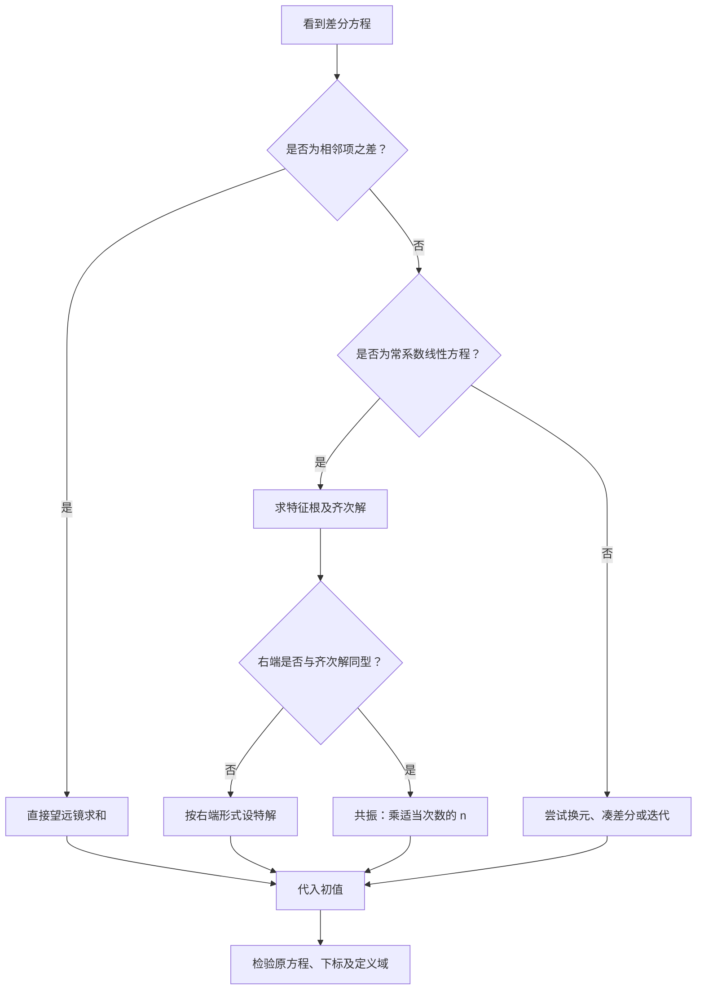

### 一、先明确考纲范围与本节定位

核对你提供的资料目录后，发现一个对备考非常重要的问题：

<Callout type="warn" title="数学一复习范围提醒">

第五模块第5节是《差分方程（数三）》，而不是数学一的必考内容。

</Callout>

目前资料的章节划分为：

| 章节  | 内容          | 数学一备考定位    |
| --- | ----------- | ---------- |
| 第1节 | 一阶微分方程      | 必须掌握       |
| 第2节 | 二阶及高阶线性微分方程 | 必须掌握       |
| 第3节 | 微分方程的应用     | 必须掌握       |
| 第4节 | 可降阶微分方程     | 必须掌握       |
| 第5节 | 差分方程        | 数三专题，数一非重点 |
| 第6节 | 欧拉方程        | 数一重点掌握     |

因此，这次讲解分清两个层次：

- 知识拓展：完整解释第5节差分方程的数学原理、解题方法和典型母题，让你理解它与微分方程的联系。
- 数学一应试重点：明确哪些内容不必占用大量复习时间，并建立与第1、2、4、6节的联系，避免复习方向偏离考试要求。

这两类内容不能混淆。尤其不能把数学三的差分方程真题误当成数学一的常规考点。

#### 1.1 资料核对结果

已读取你提供的 Google Drive 压缩包《数学分类题目1101.zip》中的第五模块分类文件，并与在线题库进行对照。

主要材料如下：

| 材料                                                                                                                        | 核对结果          | 本次用途        |
| ------------------------------------------------------------------------------------------------------------------------- | ------------- | ----------- |
| [考研核心题目·第5节](https://exam.any1.tech/docs/math/core-questions/01-b69fd298/05-28175cc9/05-b7048d74/?utm_source=chatgpt.com) | 5道核心母题        | 讲解主体        |
| [差分方程历年真题](https://exam.any1.tech/docs/math/past-exams/01-2f981f64/s-5ca32763/05-b7048d74/?utm_source=chatgpt.com)        | 8道归档题         | 真题优先分析      |
| 云盘《数学分类题目1101.zip》                                                                                                        | 第5节归档0道数学一模拟题 | 确认题源范围      |
| [张宇1000题·第15章](https://exam.any1.tech/docs/math/zhangyu-1000/s-61d9c1b0/15-6134564e/?utm_source=chatgpt.com)              | 微分方程训练        | 特征根、共振与欧拉方程 |
| [李林880题·第7章](https://exam.any1.tech/docs/math/lilin-880/s-a4e8c249/07-2d62d416/?utm_source=chatgpt.com)                   | 微分方程训练        | 非齐次方程、初值、重根 |
| [李正元·第6章](https://exam.any1.tech/docs/math/lizhengyuan/s-a4e8c249/06-afabeaaf/?utm_source=chatgpt.com)                    | 微分方程训练        | 共振、特解结构     |

张宇、李林、李正元上述数学一练习章节中没有独立的差分方程题目。因此，后面会严格区分三类题源：数学三原始真题、数学一原书练习题、自编拓展题。

考纲方面，2026年数学一考试大纲列出了欧拉方程，但未将差分方程列作数学一的常微分方程考点。2027备考资料也沿用这一划分。

[image](https://www.google.com/s2/favicons?domain=https://kaoyan.wendu.com\&sz=32)

kaoyan.wendu.com+1

## 二、基础知识体系：从微分到差分

### 2.1 什么是差分方程？

先理解一个最基本的问题。

假设某个量每年增加3个单位，初始值为5。

那么：

$$
y_0=5,\qquad y_1=8,\qquad y_2=11,\qquad y_3=14.
$$

可以写成

$$
y_{n+1}=y_n+3.
$$

即

$$
\boxed{y_{n+1}-y_n=3}
$$

这就是最简单的差分方程。

与微分方程相比，它不是研究某个时刻的瞬时变化率，而是研究从一个离散时刻到下一个离散时刻的变化。

| 对比维度  | 微分方程                | 差分方程                  |
| ----- | ------------------- | --------------------- |
| 自变量   | 通常连续                | 通常取整数                 |
| 基本变化量 | 导数 $y'(x)$      | 差分 $y_{n+1}-y_n$ |
| 基本运算  | 微分、积分               | 移位、求和                 |
| 指数型解  | $e^{\lambda x}$ | $\lambda^n$       |
| 求解思路  | 求齐次解、找特解            | 求齐次解、找特解              |
| 典型模型  | 连续增长                | 按期增长                  |

差分方程虽然不是数学一独立考点，但它和数一的数列、级数、微分方程、线性方程的解结构联系紧密。

### 2.2 一阶差分与高阶差分

定义一阶向前差分：

$$
\boxed{\Delta y_n=y_{n+1}-y_n}
$$

二阶差分就是对一阶差分再作差：

$$
\begin{aligned} \Delta^2y_n &=\Delta(\Delta y_n)\\ &=(y_{n+2}-y_{n+1})-(y_{n+1}-y_n)\\ &=\boxed{y_{n+2}-2y_{n+1}+y_n}. \end{aligned}
$$

类似地：

$$
\Delta^3y_n =y_{n+3}-3y_{n+2}+3y_{n+1}-y_n.
$$

一般公式为

$$
\boxed{ \Delta^m y_n =\sum_{k=0}^{m}(-1)^{m-k}\binom{m}{k}y_{n+k} }
$$

这是二项式定理在差分运算中的体现。

#### 如何直观理解高阶差分？

考虑：

$$
y_n=n^2.
$$

一阶差分为

$$
\Delta y_n=(n+1)^2-n^2=2n+1.
$$

二阶差分为

$$
\Delta^2y_n=2.
$$

三阶差分为

$$
\Delta^3y_n=0.
$$

这说明：

对于一个 $m$ 次多项式序列，作一次差分通常降低一次次数，作 $m+1$ 次差分则为零。

这与连续函数的求导规律非常相似。

由此还可以得到一个解题技巧：

如果

$$
\Delta y_n=P_m(n)
$$

且 $P_m(n)$ 是 $m$ 次多项式，那么可以尝试寻找一个 $m+1$ 次多项式特解。

### 2.3 最重要的原理：差分的逆运算是求和

连续情形：

$$
y'(x)=f(x) \quad\Longrightarrow\quad y(x)=\int f(x)\,\mathrm dx+C.
$$

离散情形：

$$
\Delta y_n=f(n).
$$

展开为：

$$
y_{n+1}-y_n=f(n).
$$

令下标从0到 $n-1$，逐项相加：

$$
\begin{aligned} &(y_1-y_0)+(y_2-y_1)+\cdots\\ &\qquad +(y_n-y_{n-1}) =\sum_{k=0}^{n-1}f(k). \end{aligned}
$$

中间项全部消去，所以

$$
\boxed{ y_n=y_0+\sum_{k=0}^{n-1}f(k) }
$$

这就是离散版本的微积分基本定理。

看到相邻两项之差，第一反应应该是求和，而不是立即尝试复杂的特征方程。

## 三、历年真题母题精讲：把差分方程的主要解法全部打通

### 母题一：2021年数学三真题——一阶差分直接求和

题目：

求差分方程

$$
\Delta y_n=n
$$

的通解。

<Steps>

  <Step>

### 第一步：识别题型

这是最基本的差分方程：

$$
y_{n+1}-y_n=n.
$$

左端是相邻两项之差，因此优先考虑望远镜求和。

  </Step>

  <Step>

### 第二步：逐项累加

$$
y_n-y_0=\sum_{k=0}^{n-1}k.
$$

由等差数列求和公式：

$$
\sum_{k=0}^{n-1}k=\frac{n(n-1)}2.
$$

于是

$$
\boxed{ y_n=C+\frac{n(n-1)}2 }
$$

其中 $C=y_0$。

  </Step>

  <Step>

### 第三步：反向检验

$$
\begin{aligned} y_{n+1}-y_n &=\frac{n(n+1)}2-\frac{n(n-1)}2\\ &=n. \end{aligned}
$$

完全满足原方程。

  </Step>

</Steps>
#### 从本题提炼出什么？

这道题真正考查的不是公式，而是：

$$
\boxed{ \text{相邻项差分} \longrightarrow \text{望远镜求和} }
$$

未来遇到

$$
y_{n+1}-y_n=f(n)
$$

都可以直接写成

$$
y_n=y_0+\sum_{k=0}^{n-1}f(k).
$$

因此，无论右端是多项式、指数函数，还是三角函数，只要能够求出相应的有限和，就能够解决。

例如：

$$
y_{n+1}-y_n=2n+3
$$

直接得到

$$
\begin{aligned} y_n &=C+\sum_{k=0}^{n-1}(2k+3)\\ &=C+n(n-1)+3n\\ &=\boxed{C+n^2+2n}. \end{aligned}
$$

这就是从母题到变式的迁移。

### 母题二：1997年数学三真题——多项式乘指数型非齐次差分

题目：

求差分方程

$$
\boxed{y_{n+1}-y_n=n2^n}
$$

的通解。

这是比上一题高一层的典型题。

它的右端不是普通多项式，而是

$$
n2^n.
$$

这类题可以用两种方法求解。

<Tabs items={["待定系数法", "求和法"]} defaultIndex={0}>

  <Tab value="待定系数法">

**方法一：待定系数法**

第一步：先求齐次方程的解。

令右端为零：

$$
y_{n+1}-y_n=0.
$$

得到

$$
y_n^{(h)}=C.
$$

第二步：根据右端设特解。

右端是一次多项式与指数型序列的乘积，因此设：

$$
y_n^{(p)}=(An+B)2^n.
$$

为什么是这个形式？

因为移位时，

$$
y_{n+1}^{(p)} =[A(n+1)+B]2^{n+1},
$$

仍然是一次多项式乘以 $2^n$ 的形式。

这说明这种函数类型在差分算子的作用下保持封闭。

第三步：代入求系数。

$$
[A(n+1)+B]2^{n+1}-(An+B)2^n=n2^n.
$$

两边除以 $2^n$：

$$
2(An+A+B)-(An+B)=n.
$$

化简：

$$
An+2A+B=n.
$$

比较系数：

$$
\begin{cases} A=1,\\ 2A+B=0. \end{cases}
$$

所以

$$
A=1,\qquad B=-2.
$$

于是特解为

$$
y_n^{(p)}=(n-2)2^n.
$$

第四步：齐次解加特解。

$$
\boxed{ y_n=C+(n-2)2^n }
$$

  </Tab>

  <Tab value="求和法">

**方法二：求和法**

由题意：

$$
y_n-y_0=\sum_{k=0}^{n-1}k2^k.
$$

需要计算：

$$
S_n=\sum_{k=0}^{n-1}k2^k.
$$

利用有限等比和：

$$
1+r+\cdots+r^{n-1}=\frac{1-r^n}{1-r}.
$$

两边对 $r$ 求导，再乘以 $r$，得到

$$
\sum_{k=0}^{n-1}kr^k =\frac{r-nr^n+(n-1)r^{n+1}}{(1-r)^2}.
$$

令 $r=2$：

$$
S_n=(n-2)2^n+2.
$$

因此

$$
y_n=y_0+(n-2)2^n+2.
$$

将 $y_0+2$ 记作新的任意常数 $C$，得到同样的答案：

$$
\boxed{y_n=C+(n-2)2^n}.
$$

  </Tab>

</Tabs>

#### 这一题的通用解题规律

如果右端是

$$
P_m(n)a^n,
$$

其中 $P_m(n)$ 是 $m$ 次多项式，那么在没有共振的情况下，可以尝试

$$
\boxed{y_n^{(p)}=Q_m(n)a^n}
$$

其中 $Q_m(n)$ 也是待定的 $m$ 次多项式。

但是，这个方法还有一个关键条件：

右端的指数型序列不能与齐次方程已有的解重复。

一旦重复，就要进行共振修正。

这正是下一道真题的核心。

### 母题三：2017年数学三真题——最重要的共振问题

题目：

求

$$
\boxed{y_{n+1}-2y_n=2^n}
$$

的通解。

<Steps>

  <Step>

### 第一步：求齐次方程

$$
y_{n+1}-2y_n=0.
$$

整理：

$$
y_{n+1}=2y_n.
$$

所以齐次解为

$$
y_n^{(h)}=C2^n.
$$

  </Step>

  <Step>

### 第二步：识别共振

右端恰好也是

$$
2^n.
$$

如果像上一题一样设

$$
y_n^{(p)}=A2^n,
$$

代入左端：

$$
A2^{n+1}-2A2^n=0.
$$

无论 $A$ 取什么值，左端恒为零，都不可能等于 $2^n$。

说明这种试探形式失效了。

其本质是：试探特解落入了齐次方程的解空间。

  </Step>

  <Step>

### 第三步：乘以 $n$ 修正

改设

$$
y_n^{(p)}=An2^n.
$$

代入：

$$
A(n+1)2^{n+1}-2An2^n=2^n.
$$

左边化简：

$$
2A2^n=2^n.
$$

所以

$$
A=\frac12.
$$

因此

$$
y_n^{(p)}=\frac n2\,2^n.
$$

通解：

$$
\boxed{ y_n=\left(C+\frac n2\right)2^n }
$$

  </Step>

</Steps>
#### 方法二：消去齐次增长因子

这个方法比待定系数法更有普适性。

由于齐次解含有 $2^n$，直接令

$$
y_n=2^nz_n.
$$

代入原方程：

$$
2^{n+1}z_{n+1}-2^{n+1}z_n=2^n.
$$

除以 $2^{n+1}$：

$$
z_{n+1}-z_n=\frac12.
$$

得到：

$$
z_n=C+\frac n2.
$$

因此

$$
y_n=2^nz_n =\boxed{\left(C+\frac n2\right)2^n}.
$$

#### 为什么这个方法重要？

因为它揭示了共振修正的本质。

面对

$$
y_{n+1}-ay_n=a^n f(n),\qquad a\ne0,
$$

令

$$
y_n=a^nz_n.
$$

就有

$$
a^{n+1}(z_{n+1}-z_n)=a^nf(n).
$$

于是

$$
\boxed{ z_{n+1}-z_n=\frac{f(n)}a }
$$

这就转化为了可以直接求和的问题。

如果 $f(n)$ 是一个 $m$ 次多项式，那么对它求和通常会得到一个 $m+1$ 次多项式。

所以共振时为什么会多出一个 $n$，就有了直观解释：

> 原来指数部分已经属于齐次解，差分运算会把它抵消；乘上一个 $n$，相当于在这个模式上增加一个可以产生非零差分的因子。

这个思想和数学一常系数非齐次微分方程的共振完全相通。

### 母题四：1998年数学三真题——常系数线性差分方程

题目：

求

$$
2y_{n+1}+10y_n-5n=0
$$

的通解。

<Steps>

  <Step>

### 第一步：化为标准形式

两边除以2：

$$
y_{n+1}+5y_n=\frac52n.
$$

  </Step>

  <Step>

### 第二步：求齐次解

对应齐次方程：

$$
y_{n+1}+5y_n=0.
$$

即

$$
y_{n+1}=-5y_n.
$$

得到

$$
y_n^{(h)}=C(-5)^n.
$$

  </Step>

  <Step>

### 第三步：设多项式特解

因为右端是一次多项式，而齐次特征根 $-5\ne1$，所以设：

$$
y_n^{(p)}=An+B.
$$

代入：

$$
A(n+1)+B+5(An+B)=\frac52n.
$$

整理：

$$
6An+A+6B=\frac52n.
$$

比较系数：

$$
6A=\frac52,\qquad A+6B=0.
$$

解得：

$$
A=\frac5{12},\qquad B=-\frac5{72}.
$$

于是

$$
\boxed{ y_n=C(-5)^n+\frac5{12}n-\frac5{72} }
$$

  </Step>

</Steps>
#### 这一题还有什么值得学？

注意齐次部分：

$$
C(-5)^n.
$$

它具有两个特征：

- 绝对值随 $n$ 增大而指数增长；
- 符号随 $n$ 的奇偶交替变化。

因此一般解不收敛。

但当 $C=0$ 时，虽然去掉了交替指数项，剩余的一次多项式仍然发散。

这提醒我们：

求通解与研究极限，是两个不同的问题。

不能因为某个解增长很快，就擅自将其系数设为零。

### 母题五：2001年数学三真题——从实际语言建立差分模型

题目：

某公司每年的工资总额比上一年增加20%，然后再追加2百万元。

设第 $n$ 年工资总额为 $W_n$，写出相应差分方程。

<Steps>

  <Step>

### 第一步：分析增加的顺序

上一年工资总额：

$$
W_{n-1}.
$$

先增加20%：

$$
1.2W_{n-1}.
$$

再追加2：

$$
1.2W_{n-1}+2.
$$

因此

$$
\boxed{ W_n=1.2W_{n-1}+2 }
$$

这就完成了原真题要求。

  </Step>

  <Step>

### 第二步：拓展——如果要求通项怎么办？

这是我在原题基础上增加的拓展，不是原题第二问。

考虑：

$$
W_n=1.2W_{n-1}+2.
$$

寻找一个常数平衡解 $W^*$：

$$
W^*=1.2W^*+2.
$$

解得：

$$
W^*=-10.
$$

令

$$
Z_n=W_n-W^*=W_n+10.
$$

则

$$
Z_n=1.2Z_{n-1}.
$$

所以

$$
Z_n=(1.2)^nZ_0.
$$

最终：

$$
\boxed{ W_n=(W_0+10)(1.2)^n-10 }
$$

这不是说工资的平衡水平在经济上是负数，而是说方程在数学上存在平衡解 $-10$。由于增长系数大于1，该平衡解是不稳定的。

  </Step>

</Steps>
#### 迁移到新题

以后遇到：

$$
y_{n+1}=ay_n+b
$$

当 $a\ne1$ 时，先找平衡点：

$$
y^*=\frac{b}{1-a}.
$$

就能迅速得到：

$$
\boxed{ y_n=y^*+a^n(y_0-y^*) }
$$

这比每次都展开迭代式更简洁。

当 $a=1$ 时，应单独处理：

$$
y_{n+1}=y_n+b \quad\Longrightarrow\quad y_n=y_0+nb.
$$

## 四、最值得数学一学习的综合母题：2008年数学三真题

这道题虽然来自数学三，但其核心数学方法——无穷级数求和、等比级数求导、正项级数的部分和比较——对数学一具有直接迁移价值。

### 4.1 真题题目

某基金会初始存款为 $A$ 万元，银行年利率为5%，按年复利计算。

基金会每年年末取款：

$$
19,\ 28,\ 37,\ \ldots
$$

第 $n$ 年年末取出：

$$
10+9n
$$

万元。

要求基金会可以永远按此规律取款，求最小初始存款。

### 4.2 解题的关键不是复利，而是统一时间

第一年年末的19万元，不等于现在的19万元。

因为现在存入：

$$
\frac{19}{1.05}
$$

万元，一年后才相当于19万元。

同理，第二年年末的28万元，折算到现在为：

$$
\frac{28}{1.05^2}.
$$

第 $n$ 年年末取款的现值为：

$$
\frac{10+9n}{1.05^n}.
$$

因此，所有未来提款的总现值是：

$$
\boxed{ A_{\min} =\sum_{n=1}^{\infty}\frac{10+9n}{1.05^n} }
$$

这一步是全题最重要的建模环节。

### 4.3 化为等比级数

令

$$
q=\frac1{1.05}=\frac{20}{21}.
$$

则

$$
0<q<1.
$$

因此：

$$
A_{\min} =10\sum_{n=1}^{\infty}q^n +9\sum_{n=1}^{\infty}nq^n.
$$

我们需要掌握两条公式：

$$
\boxed{ \sum_{n=1}^{\infty}q^n=\frac{q}{1-q} }
$$

以及

$$
\boxed{ \sum_{n=1}^{\infty}nq^n=\frac{q}{(1-q)^2} }
$$

其中 $|q|<1$。

### 4.4 第二条公式如何推导？

从几何级数开始：

$$
\sum_{n=0}^{\infty}q^n=\frac1{1-q}.
$$

在 $|q|<1$ 内逐项求导：

$$
\sum_{n=1}^{\infty}nq^{n-1} =\frac1{(1-q)^2}.
$$

两边乘以 $q$，得到：

$$
\sum_{n=1}^{\infty}nq^n =\frac{q}{(1-q)^2}.
$$

这一推导很重要。

以后遇到：

$$
\sum n^2q^n,\qquad \sum n(n-1)q^n
$$

同样可以通过继续求导解决。

特别是：

$$
\boxed{ \sum_{n=1}^{\infty}n^2q^n =\frac{q(1+q)}{(1-q)^3} }
$$

也值得掌握其推导，而不是单纯记忆。

### 4.5 代入计算

因为：

$$
1-q=\frac1{21},
$$

所以

$$
\frac{q}{1-q}=20,
$$

并且

$$
\frac{q}{(1-q)^2}=420.
$$

得到：

$$
\begin{aligned} A_{\min} &=10\times20+9\times420\\ &=200+3780. \end{aligned}
$$

所以：

$$
\boxed{A_{\min}=3980\text{ 万元}}
$$

### 4.6 为什么3980万元确实是最小值？

这一点是综合题、证明题可以深入考查的地方。

设前 $N$ 年提款的现值总和为：

$$
S_N=\sum_{n=1}^{N}\frac{10+9n}{1.05^n}.
$$

由于每项都为正：

$$
S_1<S_2<\cdots
$$

而且

$$
\lim_{N\to\infty}S_N=3980.
$$

因此：

如果 $A<3980$，由于部分和逐渐逼近3980，必定存在某个有限的 $N$，使得

$$
S_N>A.
$$

也就是说，基金会在某一年将没有足够的资金完成提款。

反过来，如果

$$
A=3980,
$$

那么对于每个有限的 $N$：

$$
A-S_N =\sum_{n=N+1}^{\infty}\frac{10+9n}{1.05^n}>0.
$$

因此所有有限年份的提款都可以完成。

故3980既是必要的，又是充分的。

#### 这道真题真正训练了哪些能力？

它同时涵盖了：

1. 根据文字建立数量关系；
2. 将不同时间的金额统一到同一基准；
3. 判断无穷级数的收敛性；
4. 利用幂级数逐项求导计算级数；
5. 用部分和与极限论证最小值。

对于数学一，尤其值得掌握第3、4、5项。

## 五、统一解题框架：遇到陌生差分方程应该怎么判断？

前面已经分析了5类代表性真题。现在把它们统一起来，建立一套能够迁移到新题的解题体系。

### 5.1 一阶线性差分方程的万能公式

考虑：

$$
\boxed{ y_{n+1}=ay_n+f(n) }
$$

其中 $a$ 为常数，$n\ge0$。

逐次迭代：

$$
y_1=ay_0+f(0).
$$

$$
y_2=a^2y_0+af(0)+f(1).
$$

$$
y_3=a^3y_0+a^2f(0)+af(1)+f(2).
$$

可以发现规律：

$$
\boxed{ y_n=a^ny_0+\sum_{k=0}^{n-1}a^{n-1-k}f(k) }
$$

这个公式对 $n\ge1$ 成立，包括 $a=0$ 的情形。

当 $a\ne0$ 时，还可以写成：

$$
\boxed{ y_n=a^n\left[ y_0+\sum_{k=0}^{n-1}\frac{f(k)}{a^{k+1}} \right] }
$$

这是一个相当于离散版常数变易法的公式。

#### 和数学一的一阶线性微分方程比较

数学一中的一阶线性微分方程：

$$
y'+P(x)y=Q(x).
$$

积分因子：

$$
\mu(x)=e^{\int P(x)\,\mathrm dx}.
$$

因此：

$$
\boxed{ y=e^{-\int P(x)\,\mathrm dx} \left[ C+\int Q(x)e^{\int P(x)\,\mathrm dx}\,\mathrm dx \right] }
$$

对比两者：

- 连续情形，用指数积分因子消去齐次增长；
- 离散情形，用 $a^n$ 消去齐次增长；
- 连续情形，最后进行积分；
- 离散情形，最后进行求和。

两者实际上是同一个数学思想：先消去齐次部分，再处理外部驱动项。

### 5.2 一阶差分方程的稳定性

考虑：

$$
y_{n+1}=ay_n+b,\qquad a\ne1.
$$

其通解为：

$$
y_n=\frac{b}{1-a} +a^n\left(y_0-\frac{b}{1-a}\right).
$$

因此，数列长期行为取决于 $a^n$。

| 条件            | 长期行为                       |
| ------------- | -------------------------- |
| $\|a\|<1$ | 收敛到平衡值 $\frac{b}{1-a}$ |
| $a=1$     | 一般呈线性增长或下降                 |
| $a=-1$    | 一般呈周期为2的振荡                 |
| $\|a\|>1$ | 除平衡解外，一般发散                 |

例如：

$$
y_{n+1}=\frac12y_n+3.
$$

其平衡点：

$$
y^*=6.
$$

故

$$
y_n=6+(y_0-6)\left(\frac12\right)^n.
$$

于是无论初始值 $y_0$ 是多少，

$$
\boxed{\lim_{n\to\infty}y_n=6}.
$$

这与数学一中微分方程

$$
y'+ay=b,\qquad a>0
$$

的长期稳定性十分相似。

连续方程的齐次部分是 $Ce^{-ax}$，随着 $x\to+\infty$ 衰减。

差分方程的齐次部分是 $Ca^n$，当 $|a|<1$ 时衰减。

### 5.3 二阶常系数差分方程

虽然数学一不需要将它作为独立专题复习，但了解基本结构能够帮助理解线性微分方程。

考虑：

$$
y_{n+2}+py_{n+1}+qy_n=0.
$$

设：

$$
y_n=\lambda^n.
$$

代入：

$$
\lambda^{n+2}+p\lambda^{n+1}+q\lambda^n=0.
$$

当 $\lambda\ne0$ 时，得到特征方程：

$$
\boxed{\lambda^2+p\lambda+q=0}
$$

其解法与二阶常系数线性微分方程高度相似。

#### 情形一：两个不同的非零实根

若：

$$
\lambda_1\ne\lambda_2,\qquad \lambda_1\lambda_2\ne0,
$$

那么：

$$
\boxed{ y_n=C_1\lambda_1^n+C_2\lambda_2^n }
$$

例如：

$$
y_{n+2}-3y_{n+1}+2y_n=0.
$$

特征方程：

$$
\lambda^2-3\lambda+2=0.
$$

得到：

$$
\lambda_1=1,\qquad \lambda_2=2.
$$

所以：

$$
\boxed{y_n=C_1+C_2\,2^n}.
$$

#### 情形二：非零二重实根

若：

$$
(\lambda-\lambda_0)^2=0, \qquad \lambda_0\ne0,
$$

那么：

$$
\boxed{ y_n=(C_1+C_2n)\lambda_0^n }
$$

这与数学一中的：

$$
y''-2\lambda_0 y'+\lambda_0^2y=0
$$

具有通解

$$
y=(C_1+C_2x)e^{\lambda_0x}
$$

完全对应。

#### 情形三：一对共轭复根

若特征根为：

$$
\lambda_{1,2}=r(\cos\theta\pm i\sin\theta), \qquad r>0,
$$

则实通解为：

$$
\boxed{ y_n=r^n\left( C_1\cos n\theta+C_2\sin n\theta \right) }
$$

这种形式把指数增长和周期振荡结合起来。

#### 一个特别容易忽略的陷阱：零特征根

你的资料中2018年数学三真题涉及：

$$
\Delta^2y_n-y_n=5.
$$

展开：

$$
y_{n+2}-2y_{n+1}=5.
$$

如果只考虑 $n\ge1$，可以得到：

$$
y_n=C2^n-5.
$$

但是，若原方程要求从 $n=0$ 开始成立，且 $y_0,y_1$ 都是独立初值，那么不能直接认为该形式已经包含所有解。

因为原方程根本不涉及 $y_0$。

此时 $y_0$ 可以任意取值，而对于 $n\ge1$：

$$
\boxed{ y_n=(y_1+5)2^{n-1}-5 }
$$

所以，处理零特征根时，必须关注数列的下标范围和初值个数。

这是比机械套特征根公式更深入的理解：通解形式必须覆盖全部允许的初始条件。

## 六、最重要的知识迁移：与数学一常系数微分方程建立联系

对于你的数学一备考，我认为这一部分比继续刷差分方程更加重要。

因为差分方程的特征根、共振、特解结构，可以帮助你更深入地掌握真正的数学一考点。

### 6.1 共振规律的统一

比较下面两个方程。

离散方程：

$$
y_{n+1}-2y_n=2^n.
$$

齐次解为：

$$
C2^n.
$$

由于右端与齐次解重复，必须设：

$$
y_n^{(p)}=An2^n.
$$

连续方程：

$$
y''-2y'+y=e^x.
$$

特征方程：

$$
(r-1)^2=0.
$$

齐次解为：

$$
y_h=(C_1+C_2x)e^x.
$$

因为 $r=1$ 是二重特征根，右端又是 $e^x$，故特解不能设成 $Ae^x$，也不能只乘一个 $x$。

必须设：

$$
\boxed{y_p=Ax^2e^x}.
$$

归纳为数学一真正需要熟练掌握的规则：

对于

$$
P(D)y=e^{\alpha x}Q_m(x),
$$

其中 $D$ 是求导算子，若 $\alpha$ 是特征方程 $P(r)=0$ 的 $s$ 重根，则尝试：

$$
\boxed{ y_p=x^se^{\alpha x}R_m(x) }
$$

其中 $R_m(x)$ 是待定的 $m$ 次多项式。

这个公式也能推广到含三角函数的强迫项，利用复特征根判断共振。

关键不是死记多乘几个 $x$，而是先判断：

非齐次项对应的函数形式，是否已经属于齐次解空间？如果是，重复了几次？

### 6.2 李正元原书代表题：复根共振

题目来自《李正元·第六章常微分方程》，选择题第3题。

求微分方程

$$
\boxed{ y''-2y'+3y=e^x\sin(\sqrt2x) }
$$

的特解形式。

<Steps>

  <Step>

### 第一步：求特征根

特征方程：

$$
r^2-2r+3=0.
$$

得到：

$$
r=1\pm i\sqrt2.
$$

齐次解：

$$
y_h=e^x\left( C_1\cos\sqrt2x+C_2\sin\sqrt2x \right).
$$

  </Step>

  <Step>

### 第二步：判断共振

右端：

$$
e^x\sin(\sqrt2x)
$$

与齐次解同型。

因此必须乘以 $x$。

设：

$$
\boxed{ y_p=xe^x\left( A\cos\sqrt2x+B\sin\sqrt2x \right) }
$$

对应原题选项B。

  </Step>

  <Step>

### 第三步：进一步求出特解

虽然原题只要求判断形式，我们继续计算。

令：

$$
y=e^xu.
$$

则：

$$
y'=e^x(u+u'),
$$

$$
y''=e^x(u+2u'+u'').
$$

代入原方程：

$$
e^x(u''+2u)=e^x\sin(\sqrt2x).
$$

因此：

$$
u''+2u=\sin(\sqrt2x).
$$

尝试：

$$
u_p=Ax\cos(\sqrt2x).
$$

计算：

$$
u_p''+2u_p=-2A\sqrt2\sin(\sqrt2x).
$$

比较系数：

$$
-2A\sqrt2=1.
$$

得到：

$$
A=-\frac1{2\sqrt2}.
$$

所以：

$$
\boxed{ y_p=-\frac{x e^x}{2\sqrt2}\cos(\sqrt2x) }
$$

  </Step>

</Steps>
#### 从这道题学到什么？

它是连续情形的共振母题。

不仅需要判断特征根，还需要判断非齐次项对应的指数和三角函数组合。

以后面对：

$$
e^{\alpha x}\sin\beta x
$$

或者

$$
e^{\alpha x}\cos\beta x,
$$

先检查：

$$
\alpha\pm i\beta
$$

是否为特征根。

若是单根，乘 $x$；若是二重根，乘 $x^2$。

这就是解题的关键判断。

## 七、数学一真正应该强化的相邻专题：欧拉方程

第五模块第6节是欧拉方程，属于数学一需要掌握的内容。

前面差分方程中的特征根思想，可以直接帮助你理解这类题。

### 7.1 欧拉方程的基本形式

典型二阶欧拉方程：

$$
\boxed{ x^2y''+axy'+by=f(x) }
$$

它与常系数方程不同，因为最高阶导数前面带有 $x^2$，一阶导数前面带有 $x$。

但是，它具有特殊的幂次结构。

<Tabs items={["对数换元", "特征指标速解"]} defaultIndex={0}>

  <Tab value="对数换元">

**关键换元**

在 $x>0$ 上令：

$$
t=\ln x,\qquad x=e^t.
$$

记：

$$
Y(t)=y(e^t).
$$

根据链式法则：

$$
\frac{dY}{dt}=xy',
$$

因此：

$$
\boxed{xy'=Y'}.
$$

再次求导：

$$
Y''=\frac{d}{dt}(xy') =xy'+x^2y''.
$$

所以：

$$
\boxed{x^2y''=Y''-Y'}.
$$

原方程便转化为：

$$
Y''+(a-1)Y'+bY=f(e^t).
$$

这就成了常系数线性微分方程。

  </Tab>

  <Tab value="特征指标速解">

**一种更快的方法**

对于齐次欧拉方程：

$$
x^2y''+axy'+by=0,
$$

直接设：

$$
y=x^m.
$$

那么：

$$
y'=mx^{m-1},
$$

$$
y''=m(m-1)x^{m-2}.
$$

代入：

$$
m(m-1)x^m+amx^m+bx^m=0.
$$

因此特征方程为：

$$
\boxed{ m(m-1)+am+b=0 }
$$

即：

$$
\boxed{ m^2+(a-1)m+b=0 }
$$

这就是欧拉方程的特征指标法。

  </Tab>

</Tabs>

### 7.2 李林880原题：欧拉方程的二重根

来自《李林880题·第七章》填空题第9题。

已知：

$$
x^2y''-xy'+y=0,\qquad x>0,
$$

且：

$$
y(1)=1,\qquad y'(1)=1.
$$

求 $y(x)$。

设：

$$
y=x^m.
$$

特征方程：

$$
m(m-1)-m+1=0.
$$

整理：

$$
(m-1)^2=0.
$$

所以 $m=1$ 是二重根。

欧拉方程出现二重特征根时，通解为：

$$
y=x(C_1+C_2\ln x).
$$

注意这里不是乘 $x$，而是出现 $\ln x$。

这是因为经过：

$$
t=\ln x
$$

变换后，常系数方程的二重根解含有：

$$
te^{mt}.
$$

换回原变量：

$$
te^{mt}=x^m\ln x.
$$

所以：

$$
\boxed{ y=x(C_1+C_2\ln x) }
$$

代入：

$$
y(1)=C_1=1.
$$

求导：

$$
y'=C_1+C_2(\ln x+1).
$$

于是：

$$
y'(1)=C_1+C_2=1.
$$

得到：

$$
C_2=0.
$$

故：

$$
\boxed{y=x}
$$

#### 核心迁移规律

| 方程类型           | 二重根时的结构                   |
| -------------- | ------------------------- |
| 常系数微分方程        | $(C_1+C_2x)e^{rx}$    |
| 常系数差分方程，根非零    | $(C_1+C_2n)\lambda^n$ |
| 欧拉方程，$x>0$ | $x^m(C_1+C_2\ln x)$   |

这三种结构都来自同一种思想：当特征根重复时，需要构造新的线性无关解。

### 7.3 张宇1000题代表题：复特征根的欧拉方程

来自《张宇1000题·第15章》填空题第21题。

求：

$$
x^2y''+3xy'+3y=0
$$

满足：

$$
y(1)=0,\qquad y'(1)=\sqrt2
$$

的解。

<Steps>

  <Step>

### 第一步：特征指标法

设：

$$
y=x^m.
$$

代入得到：

$$
m(m-1)+3m+3=0.
$$

即：

$$
m^2+2m+3=0.
$$

所以：

$$
m=-1\pm i\sqrt2.
$$

  </Step>

  <Step>

### 第二步：写通解

对于复特征根：

$$
m=\alpha\pm i\beta,
$$

欧拉方程的实通解为：

$$
\boxed{ y=x^\alpha\left( C_1\cos(\beta\ln x)+C_2\sin(\beta\ln x) \right) }
$$

因此本题：

$$
y=\frac1x\left[ C_1\cos(\sqrt2\ln x) +C_2\sin(\sqrt2\ln x) \right].
$$

  </Step>

  <Step>

### 第三步：代入初值

由：

$$
y(1)=0
$$

得到：

$$
C_1=0.
$$

于是：

$$
y=\frac{C_2}{x}\sin(\sqrt2\ln x).
$$

求导：

$$
y' =C_2x^{-2}\left[ -\sin(\sqrt2\ln x) +\sqrt2\cos(\sqrt2\ln x) \right].
$$

令 $x=1$：

$$
y'(1)=C_2\sqrt2=\sqrt2.
$$

所以：

$$
C_2=1.
$$

最后：

$$
\boxed{ y=\frac1x\sin(\sqrt2\ln x) }
$$

这一题真正值得记住的是：

欧拉方程的复根，会把三角函数的自变量从 $x$ 变成 $\ln x$。

  </Step>

</Steps>
## 八、2027数学一模拟题：欧拉方程与定积分综合

下面这道题来自你云盘压缩包中的分类模拟题：

汤家凤八套卷·第6套·原卷第17题

它比单纯求微分方程更值得数学一重点训练。

### 8.1 题目

设 $y(x)$ 满足：

$$
x^2y''+xy'-9y=0,
$$

且：

$$
y(1)=2,\qquad y'(1)=6.
$$

求：

（1）利用 $x=e^t$ 求 $y(x)$；

（2）计算：

$$
I=\int_0^2y(x)\sqrt{2x-x^2}\,\mathrm dx.
$$

### 8.2 第一问：解欧拉方程

设：

$$
x=e^t.
$$

则：

$$
xy'=Y',
$$

$$
x^2y''=Y''-Y'.
$$

代入原方程：

$$
Y''-Y'+Y'-9Y=0.
$$

化简：

$$
Y''-9Y=0.
$$

特征方程：

$$
r^2-9=0.
$$

特征根：

$$
r=\pm3.
$$

所以：

$$
Y=C_1e^{3t}+C_2e^{-3t}.
$$

换回 $x$：

$$
y=C_1x^3+C_2x^{-3}.
$$

代入：

$$
y(1)=C_1+C_2=2.
$$

求导：

$$
y'=3C_1x^2-3C_2x^{-4}.
$$

因此：

$$
y'(1)=3C_1-3C_2=6.
$$

解得：

$$
C_1=2,\qquad C_2=0.
$$

于是：

$$
\boxed{y(x)=2x^3}
$$

### 8.3 第二问：利用积分区间对称性

代入：

$$
I=2\int_0^2x^3\sqrt{2x-x^2}\,\mathrm dx.
$$

观察：

$$
2x-x^2=1-(x-1)^2.
$$

这是一个非常明显的对称结构。

令：

$$
u=x-1.
$$

则：

$$
x=u+1,
$$

积分区间：

$$
x=0\Rightarrow u=-1,
$$

$$
x=2\Rightarrow u=1.
$$

得到：

$$
I=2\int_{-1}^1(u+1)^3\sqrt{1-u^2}\,\mathrm du.
$$

展开：

$$
(u+1)^3=u^3+3u^2+3u+1.
$$

由于：

$$
\sqrt{1-u^2}
$$

是偶函数，奇次项积分为零。

因此：

$$
I=2\int_{-1}^1(1+3u^2)\sqrt{1-u^2}\,\mathrm du.
$$

拆分：

$$
I= 2\int_{-1}^1\sqrt{1-u^2}\,\mathrm du + 6\int_{-1}^1u^2\sqrt{1-u^2}\,\mathrm du.
$$

第一部分是半径为1的上半圆面积：

$$
\int_{-1}^1\sqrt{1-u^2}\,\mathrm du=\frac\pi2.
$$

第二部分，令：

$$
u=\sin\theta.
$$

可得：

$$
\int_{-1}^1u^2\sqrt{1-u^2}\,\mathrm du =\frac\pi8.
$$

故：

$$
I=2\cdot\frac\pi2+6\cdot\frac\pi8.
$$

最终：

$$
\boxed{ I=\frac{7\pi}{4} }
$$

### 8.4 这道综合题教会我们什么？

这类题具有典型的数学一综合题结构：

$$
\boxed{ \text{微分方程} \longrightarrow \text{确定未知函数} \longrightarrow \text{积分计算} }
$$

解题不能只停留在第一问。

第一问考查欧拉方程与初值条件，第二问考查定积分中的对称性、换元和三角代换。

面对未来可能出现的综合题，尤其要养成一个习惯：

求出函数后，先观察后续运算的结构，不要立即展开进行大量计算。

例如，本题如果一开始就处理 $x^3\sqrt{2x-x^2}$，运算会比较繁琐。

但只要发现：

$$
2x-x^2=1-(x-1)^2,
$$

就能利用中心对称迅速简化问题。

## 九、创新题与变式：如何应对不熟悉的题目？

下面两道是自编训练题，目的不是增加题量，而是检验你能否主动识别结构。

### 创新题一：差分方程与数列极限

已知：

$$
a_{n+1}=\frac12a_n+n,\qquad a_0=0.
$$

求：

$$
\lim_{n\to\infty}(a_n-2n).
$$

#### 解题思路

方程右端包含 $n$，说明需要寻找一次多项式特解。

设：

$$
a_n^{(p)}=An+B.
$$

代入：

$$
A(n+1)+B=\frac12(An+B)+n.
$$

比较系数：

$$
A=\frac A2+1.
$$

得到：

$$
A=2.
$$

常数项满足：

$$
A+B=\frac B2.
$$

所以：

$$
B=-4.
$$

特解：

$$
a_n^{(p)}=2n-4.
$$

齐次解：

$$
a_n^{(h)}=C\left(\frac12\right)^n.
$$

因此：

$$
a_n=C\left(\frac12\right)^n+2n-4.
$$

代入 $a_0=0$：

$$
C=4.
$$

所以：

$$
a_n=4\left(\frac12\right)^n+2n-4.
$$

最终：

$$
\boxed{ \lim_{n\to\infty}(a_n-2n)=-4 }
$$

#### 这道题的创新在哪里？

它不是直接要求通项，而是要求：

$$
a_n-2n
$$

的极限。

关键在于意识到，减去主要增长项后，剩余部分可能趋于常数。

这种思路也适用于数学一中的：

- 数列渐近行为；
- 函数渐近线；
- 微分方程特解的渐近性质；
- 极限中的主导项分离。

### 创新题二：共振与高阶多项式特解

已知：

$$
y_{n+1}-2y_n=n2^n,\qquad y_0=1.
$$

求 $y_n$。

<Steps>

  <Step>

### 第一步：识别共振

右端是：

$$
n2^n.
$$

齐次解为：

$$
C2^n.
$$

因此，直接设：

$$
y_n=2^nz_n.
$$

  </Step>

  <Step>

### 第二步：代换

原方程变为：

$$
2^{n+1}(z_{n+1}-z_n)=n2^n.
$$

所以：

$$
z_{n+1}-z_n=\frac n2.
$$

  </Step>

  <Step>

### 第三步：求和

$$
z_n-z_0=\frac12\sum_{k=0}^{n-1}k.
$$

即：

$$
z_n-z_0=\frac{n(n-1)}4.
$$

由：

$$
z_0=y_0=1,
$$

得到：

$$
z_n=1+\frac{n(n-1)}4.
$$

因此：

$$
\boxed{ y_n=2^n\left(1+\frac{n(n-1)}4\right) }
$$

  </Step>

</Steps>
#### 举一反三

如果把右端推广为：

$$
n^m a^n,
$$

且齐次解包含 $a^n$，那么特解中的多项式次数通常需要比右端多一次。

例如：

$$
y_{n+1}-ay_n=n^2a^n
$$

的特解可以尝试：

$$
y_n^{(p)}=a^n(An^3+Bn^2+Cn).
$$

其中 $a\ne0$。

这种通过结构判断未知函数形式的能力，比记住某一道题的答案更重要。

## 十、易错点与答题规范

结合真题和上述练习，整理出最容易失分的地方。

| 易错点      | 错误表现                                               | 正确处理                           |
| -------- | -------------------------------------------------- | ------------------------------ |
| 差分求和下标   | 把 $\sum_{k=0}^{n-1}k$ 算成 $\frac{n(n+1)}2$ | 先写清求和上下限                       |
| 忘记齐次解    | 找到特解就当成通解                                          | 必须加上齐次通解                       |
| 忽略共振     | 强迫项为 $2^n$ 仍设 $A2^n$                       | 先检查齐次特征根                       |
| 常数右端的特殊性 | 默认设常数特解一定成功                                        | 先检查特征根是否为1                     |
| 零特征根     | 机械套 $\lambda^n$ 且遗漏初值                          | 检查下标范围与初始项                     |
| 将增长和收敛混淆 | 看到指数项就认定所有解发散                                      | 分析系数以及剩余项                      |
| 欧拉方程二重根  | 误写 $x^m(C_1+C_2x)$                             | 应为 $x^m(C_1+C_2\ln x)$     |
| 欧拉方程定义域  | 对 $x=0$ 随意套 $\ln x$ 换元                     | 一般先在 $x>0$ 或 $x<0$ 上求解 |
| 复根共振     | 只设正弦项，漏掉余弦项                                        | 通常需要同时设正弦、余弦                   |
| 综合题的积分   | 求出 $y(x)$ 后立刻硬算                                | 先找奇偶性、对称性和换元                   |

特别提醒：对于欧拉方程，在 $x<0$ 的区间上也可以通过 $t=\ln|x|$ 进行类似变换，但需要单独处理定义区间，不能把穿过 $x=0$ 的解默认看作同一支光滑解。

## 十一、分层训练题

这组题按你备考数学一的目标设计。前五题用于检验第5节拓展知识，最后两题直接训练数学一欧拉方程。

先独立完成，再看答案。

### 第一组：基础与方法辨认

练习1（差分求和）

求满足

$$
\Delta y_n=3n^2+3n+1,\qquad y_0=2
$$

的数列通项。

练习2（共振）

求：

$$
y_{n+1}-3y_n=3^n,\qquad y_0=2.
$$

练习3（多项式特解）

求：

$$
y_{n+1}+2y_n=3n+1,\qquad y_0=0.
$$

### 第二组：提高与综合

练习4（二阶差分）

求：

$$
y_{n+2}-3y_{n+1}+2y_n=0,
$$

满足：

$$
y_0=1,\qquad y_1=0
$$

的通项。

练习5（数一可迁移的级数求和）

计算：

$$
\sum_{n=1}^{\infty}\frac{2n+1}{3^n}.
$$

### 第三组：数学一重点训练

练习6（欧拉方程初值问题）

求：

$$
x^2y''+xy'-4y=0,\qquad x>0,
$$

满足：

$$
y(1)=2,\qquad y'(1)=0
$$

的解。

练习7（欧拉方程重根与初值）

求：

$$
x^2y''-3xy'+4y=0,\qquad x>0,
$$

满足：

$$
y(1)=1,\qquad y'(1)=0
$$

的解。

<Accordions>
  <Accordion title="七道分层训练：参考答案与关键步骤">

| 题号 | 答案                                   | 核心方法                           |
| -- | ------------------------------------ | ------------------------------ |
| 1  | $y_n=n^3+2$                      | 利用 $\Delta(n^3)=3n^2+3n+1$ |
| 2  | $y_n=3^n\left(2+\frac n3\right)$ | 令 $y_n=3^nz_n$             |
| 3  | $y_n=n$                          | 特解 $An+B$，初值消去齐次项          |
| 4  | $y_n=2-2^n$                      | 特征根1、2                         |
| 5  | $2$                              | 等比级数及逐项求导                      |
| 6  | $y=x^2+x^{-2}$                   | 特征指标 $m=\pm2$              |
| 7  | $y=x^2(1-2\ln x)$                | 二重根 $m=2$                  |

其中第7题容易出现错误，补充说明。

特征指标方程：

$$
m(m-1)-3m+4=0.
$$

即：

$$
(m-2)^2=0.
$$

所以：

$$
y=x^2(C_1+C_2\ln x).
$$

由：

$$
y(1)=1
$$

得到：

$$
C_1=1.
$$

而：

$$
y'=x\left[2C_1+C_2+2C_2\ln x\right].
$$

代入：

$$
y'(1)=0
$$

得到：

$$
2C_1+C_2=0.
$$

因此：

$$
C_2=-2.
$$

最后：

$$
\boxed{ y=x^2(1-2\ln x) }
$$

  </Accordion>
</Accordions>

## 十二、建立最终的解题决策体系

### 12.1 差分方程决策树

### 12.2 数学一微分方程决策表

真正进入数学一考试时，应优先建立下面的识别能力。

| 题目特征                      | 第一反应                    |
| ------------------------- | ----------------------- |
| $y'=f(x)g(y)$         | 分离变量                    |
| $y'+P(x)y=Q(x)$       | 积分因子                    |
| $y'+P(x)y=Q(x)y^m$    | 伯努利换元                   |
| $y''=f(x,y')$         | 令 $p=y'$            |
| $y''=f(y,y')$         | 考虑 $p(y)=y'$        |
| 二阶常系数齐次方程                 | 特征方程                    |
| 二阶常系数非齐次方程                | 齐次解＋待定特解                |
| 非齐次项与齐次解重复                | 共振修正                    |
| $x^2y''+axy'+by=f(x)$ | 欧拉方程，令 $t=\ln\|x\|$ |
| 包含积分关系的未知函数问题             | 考虑求导转化为微分方程             |

其中最后一种尤为值得注意。

例如：

$$
f(x)=\cos x-\int_0^x(x-t)f(t)\,\mathrm dt
$$

这类题表面是积分方程，但通过连续求导可以转化为常系数微分方程。

李林880题第七章中就包含这种训练。

这体现了数学一更值得投入时间的创新方向：不是学习越来越多孤立的方程类型，而是在积分、函数、几何和微分方程之间灵活转换。

## 十三、本节复习总结与优先级

本节真正需要形成的知识体系可以概括为：

$$
\boxed{ \begin{gathered} \text{识别变化规律}\\ \Downarrow\\ \text{寻找齐次结构}\\ \Downarrow\\ \text{根据右端选择特解}\\ \Downarrow\\ \text{检查重复与共振}\\ \Downarrow\\ \text{利用初值确定解}\\ \Downarrow\\ \text{分析边界、收敛和实际意义} \end{gathered} }
$$

对于你的数学一备考，我建议按以下优先顺序安排：

| 知识内容          | 建议优先级 | 掌握目标             |
| ------------- | ----- | ---------------- |
| 二阶常系数微分方程的特征根 | 最高    | 熟练处理实根、重根、复根     |
| 非齐次方程的特解与共振   | 最高    | 根据右端直接写正确的待定形式   |
| 欧拉方程          | 最高    | 熟练掌握对数换元、特征指标、初值 |
| 线性微分方程解的结构    | 最高    | 能理解特解之差、解的线性组合   |
| 微分方程与定积分综合    | 高     | 能跨章节建立和求解方程      |
| 差分与求和关系       | 拓展了解  | 能处理简单差分和数列       |
| 一阶线性差分及共振     | 拓展了解  | 理解与连续微分方程的对应     |
| 高阶差分及复杂经济模型   | 低     | 数学一无需单独强化        |

#### 最终应达到的四个能力层次

第一层：会识别。 看到方程后，能够迅速发现它是否属于已知的标准结构，而不是立即开始代数运算。

第二层：会选择。 知道什么时候应该使用求和、积分因子、特征根、待定系数法或变量代换。

第三层：会解释。 不仅知道共振时要乘 $x$ 或 $n$，还能够说明为什么原来的特解形式失效，为什么需要新的线性无关函数。

第四层：会迁移。 即使未来的题目把微分方程包装在积分关系、几何条件、数列极限或者其他综合问题中，仍然能够识别背后的核心数学结构。

<Callout type="idea" title="数学一时间分配建议">

本次最重要的备考结论：第五模块第5节可以作为差分方程与级数思想的补充，但不建议为数学一投入大量独立刷题时间。应将主要精力放在第2节的非齐次线性微分方程、第4节的可降阶方程和第6节的欧拉方程，尤其是共振、初值与跨章节综合题。

</Callout>
