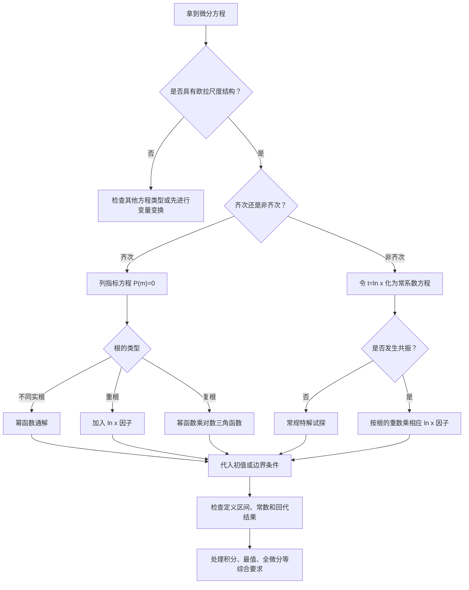

<Callout type="idea" title="学习目标">

本节核心目标：不仅会求欧拉方程的通解，还要掌握重根、复根、初值、非齐次共振，以及欧拉方程与多元微积分、积分和最值问题的综合应用。

</Callout>

已核对你提供的 Google Drive 压缩包《数学分类题目1101.zip》，并定位到 Fumadocs 中对应的《考研核心题目》第五模块第六节、历年真题分类、模拟题分类及三位老师的微分方程练习章节。

本节最重要的学习思路是：

识别尺度结构 → 构造指标方程 → 判断根的类型 → 求通解或特解 → 处理初值与定义区间 → 迁移到综合问题。

## 一、先建立知识体系：欧拉方程到底是什么？

### 1. 最重要的基本形式

二阶齐次欧拉方程的标准形式为

$$
\boxed{x^2y''+axy'+by=0}
$$

其中 $a,b$ 为常数。

它与普通二阶常系数方程

$$
y''+ay'+by=0
$$

最大的区别，在于导数前面的系数。

| 导数项  | 常系数方程          | 欧拉方程         |
| ---- | -------------- | ------------ |
| 二阶导数 | $y''$      | $x^2y''$ |
| 一阶导数 | $ay'$      | $axy'$   |
| 零阶项  | $by$       | $by$     |
| 基本试解 | $y=e^{rx}$ | $y=x^m$  |

欧拉方程的识别特征是：

$$
\boxed{x^ky^{(k)}}
$$

即 $k$ 阶导数前面乘以 $x^k$，从而使各项具有相同的尺度结构。

例如：

$$
x^2y''+5xy'+4y=0
$$

是欧拉方程。

$$
x^3y'''+3x^2y''+xy'=0
$$

也是欧拉型方程。

但是

$$
x^2y''+5y'+4y=0
$$

一般不是标准欧拉方程，因为 $y'$ 前缺少相应的 $x$ 因子。

这一区别决定了后续的解法。

### 2. 为什么欧拉方程要设 $y=x^m$？

普通常系数微分方程喜欢指数函数，是因为指数函数求导后形式基本不变。

欧拉方程则不同。

设

$$
y=x^m,\qquad x>0.
$$

则

$$
y'=mx^{m-1},
$$

$$
y''=m(m-1)x^{m-2}.
$$

因此

$$
xy'=mx^m,
$$

$$
x^2y''=m(m-1)x^m.
$$

注意这一点：

经过乘上适当的 $x$ 的幂次后，所有导数项都变成了 $x^m$ 的常数倍。

所以

$$
x^2y''+axy'+by = [m(m-1)+am+b]x^m.
$$

由于 $x>0$，可以约去 $x^m$，得到

$$
\boxed{m(m-1)+am+b=0}
$$

整理得

$$
\boxed{m^2+(a-1)m+b=0}
$$

这就是欧拉方程的指标方程。

它将微分方程问题转化成了一个一元二次方程问题。

这一推导是本节最重要的基础。

## 二、欧拉方程最根本的解法：对数换元

直接设 $y=x^m$ 虽然快捷，但对数换元是理解所有变式的关键。

尤其是非齐次方程、重根、复根和高阶欧拉方程，掌握换元后就能统一处理。

### 1. 关键换元

对 $x>0$，令

$$
\boxed{t=\ln x,\qquad x=e^t}
$$

并记

$$
Y(t)=y(e^t).
$$

由于

$$
\frac{dt}{dx}=\frac1x,
$$

根据复合函数求导法则：

$$
y'=\frac{dY}{dt}\frac{dt}{dx} =\frac{Y'}x.
$$

因此

$$
\boxed{xy'=Y'}.
$$

再求一次导数：

$$
\begin{aligned} y'' &=\frac{d}{dx}\left(\frac{Y'}x\right)\\ &=\frac1x\frac{dY'}{dx}-\frac{Y'}{x^2}\\ &=\frac{Y''}{x^2}-\frac{Y'}{x^2}. \end{aligned}
$$

所以

$$
\boxed{x^2y''=Y''-Y'}.
$$

这里的撇号需要特别注意：左边表示对 $x$ 求导，右边表示对 $t$ 求导。

### 2. 欧拉方程如何变成常系数方程？

原方程为

$$
x^2y''+axy'+by=0.
$$

代入上述两个公式：

$$
Y''-Y'+aY'+bY=0.
$$

整理得到

$$
\boxed{Y''+(a-1)Y'+bY=0}.
$$

这就是二阶常系数齐次微分方程。

其特征方程为

$$
r^2+(a-1)r+b=0.
$$

与前面的指标方程完全相同。

因此，欧拉方程实际上就是在对数坐标下的常系数微分方程。

这解释了为什么：

- 指标根不同，会出现不同幂函数；
- 指标根相同，会出现 $\ln x$；
- 指标根为复数，会出现 $\sin(\beta\ln x)$ 和 $\cos(\beta\ln x)$。

所有这些现象都可以从常系数方程的解直接推导出来。

### 3. 更深层的理解：尺度微分算子

定义

$$
D=x\frac{d}{dx}.
$$

则

$$
Dy=xy',
$$

$$
D^2y=x^2y''+xy'.
$$

因此

$$
x^2y''=D^2y-Dy.
$$

标准二阶欧拉方程便可以写成

$$
\boxed{[D^2+(a-1)D+b]y=0}.
$$

由于 $t=\ln x$ 时

$$
D=\frac{d}{dt},
$$

欧拉算子就变成了普通求导算子。

这个观点对创新题十分重要。

例如，给出

$$
(D-2)(D+3)y=0,
$$

你不需要再去展开所有导数。

只需知道指标根为 $2,-3$，立刻得到

$$
\boxed{y=C_1x^2+C_2x^{-3}}.
$$

## 三、三种特征根：必须完全掌握的核心公式

设

$$
x^2y''+axy'+by=0.
$$

其指标方程为

$$
m^2+(a-1)m+b=0.
$$

判别式为

$$
\boxed{\Delta=(a-1)^2-4b}.
$$

### 情况一：两个不同实根

当 $\Delta>0$，设两根为 $m_1,m_2$，且 $m_1\ne m_2$。

通解为

$$
\boxed{y=C_1x^{m_1}+C_2x^{m_2}}.
$$

这是最基础、最常考的情况。

### 情况二：两个相等实根

当 $\Delta=0$，设二重根为 $m$。

通解为

$$
\boxed{y=x^m(C_1+C_2\ln x)}.
$$

为什么必须多出一个 $\ln x$？

因为换元后的常系数方程具有二重特征根 $m$，其通解是

$$
Y=e^{mt}(C_1+C_2t).
$$

再由 $t=\ln x$，得到上面的公式。

不能把二重根简单写成 $C_1x^m+C_2x^m$，因为这实际上只有一个独立解。

### 情况三：一对共轭复根

当 $\Delta<0$，设指标根为

$$
m=\alpha\pm i\beta,\qquad\beta>0.
$$

通解为

$$
\boxed{ y=x^\alpha\left[ C_1\cos(\beta\ln x) +C_2\sin(\beta\ln x) \right] }.
$$

其中

$$
\alpha=-\frac{a-1}{2}, \qquad \beta=\frac{\sqrt{-\Delta}}2.
$$

推导的关键是：

$$
x^{\alpha+i\beta} =e^{(\alpha+i\beta)\ln x} =x^\alpha e^{i\beta\ln x}.
$$

根据欧拉公式

$$
e^{i\theta}=\cos\theta+i\sin\theta,
$$

便得到两组实值解。

### 三类通解速查

| 指标根类型                  | 通解结构                                                    |
| ---------------------- | ------------------------------------------------------- |
| $m_1\ne m_2$，两个实根  | $C_1x^{m_1}+C_2x^{m_2}$                             |
| $m_1=m_2=m$        | $x^m(C_1+C_2\ln x)$                                 |
| $\alpha\pm i\beta$ | $x^\alpha[C_1\cos(\beta\ln x)+C_2\sin(\beta\ln x)]$ |

上表默认 $x>0$。

<Callout type="warn" title="定义区间与对数">

如果在 $x<0$ 的区间求解，对数应改为 $\ln|x|$，幂函数基底也相应写为 $|x|^m$。

</Callout>

## 四、历年考研真题精讲：建立标准解题能力

优先从真题入手，因为真题最能体现命题人对基础知识掌握程度的要求。

### 真题一：2004年考研数学一——欧拉方程通解

来源：[2004年数学一真题分类·欧拉方程](https://exam.any1.tech/docs/math/past-exams/01-2f981f64/s-5ca32763/06-17f5b3b4/?utm_source=chatgpt.com)

#### 题目

求欧拉方程

$$
x^2y''+4xy'+2y=0,\qquad x>0
$$

的通解。

<Steps>

  <Step>

### 第一步：判断方程类型

观察

$$
x^2y'',\quad 4xy',\quad 2y,
$$

满足标准的欧拉方程结构。

因此优先采用幂函数试解。

  </Step>

  <Step>

### 第二步：列指标方程

设

$$
y=x^m.
$$

则

$$
m(m-1)+4m+2=0.
$$

化简：

$$
m^2+3m+2=0,
$$

即

$$
(m+1)(m+2)=0.
$$

因此

$$
m_1=-1,\qquad m_2=-2.
$$

  </Step>

  <Step>

### 第三步：写出通解

两根不同，因此

$$
y=C_1x^{-1}+C_2x^{-2}.
$$

最终：

$$
\boxed{y=\frac{C_1}{x}+\frac{C_2}{x^2}}
$$

  </Step>

</Steps>
#### 这道真题要学会什么？

第一，见到欧拉方程应该立即想到幂函数试解。

第二，指标方程中二阶项必须写成

$$
m(m-1),
$$

而不是 $m^2$。

第三，原题明确要求 $x>0$，因此在正半轴上写通解即可。

这是一道典型的基础母题。

今后即使把系数 $4,2$ 换成其他常数，方法也完全不变。

### 真题二：2021年考研数学一——欧拉方程初值问题

来源：[2021年数学一真题分类·欧拉方程](https://exam.any1.tech/docs/math/past-exams/01-2f981f64/s-5ca32763/06-17f5b3b4/?utm_source=chatgpt.com)

#### 题目

已知

$$
x^2y''+xy'-4y=0,
$$

满足

$$
y(1)=1,\qquad y'(1)=2,
$$

求 $y(x)$。

<Steps>

  <Step>

### 第一步：求指标根

设

$$
y=x^m.
$$

指标方程为

$$
m(m-1)+m-4=0.
$$

化简：

$$
m^2-4=0.
$$

得到

$$
m_1=2,\qquad m_2=-2.
$$

因此

$$
y=C_1x^2+C_2x^{-2}.
$$

  </Step>

  <Step>

### 第二步：求导

$$
y'=2C_1x-2C_2x^{-3}.
$$

  </Step>

  <Step>

### 第三步：代入初始条件

由 $y(1)=1$，得到

$$
C_1+C_2=1.
$$

由 $y'(1)=2$，得到

$$
2C_1-2C_2=2.
$$

即

$$
C_1-C_2=1.
$$

解得

$$
C_1=1,\qquad C_2=0.
$$

所以

$$
\boxed{y=x^2}.
$$

  </Step>

  <Step>

### 第四步：代回验证

$$
y'=2x,\qquad y''=2.
$$

代入原方程：

$$
2x^2+2x^2-4x^2=0.
$$

两个初值也同时满足。

  </Step>

</Steps>
#### 从这道真题提炼的解题模板

以后遇到二阶齐次欧拉方程的初值问题，按以下顺序：

1. 判断是不是欧拉型；
2. 列指标方程，确定根的类型；
3. 写出包含两个任意常数的通解；
4. 求一阶导数；
5. 代入 $y(x_0)$、$y'(x_0)$；
6. 求出常数，检查解的定义区间。

这里还有一个重要技巧。

初值点是 $x=1$ 时，欧拉方程特别容易计算。

因为

$$
1^m=1,\qquad \ln1=0.
$$

今后看到 $y(1)$、$y'(1)$，应该意识到命题人在有意简化常数的求解。

## 五、题型升级一：重根问题

#### 李林880代表题：指标重根与初值

来源：[李林880·高等数学第七章，基础填空题第9题](https://exam.any1.tech/docs/math/lilin-880/s-a4e8c249/07-2d62d416/?utm_source=chatgpt.com)

题目：

$$
x^2y''-xy'+y=0,\qquad x>0,
$$

且

$$
y(1)=1,\qquad y'(1)=1.
$$

求 $y(x)$。

#### 解题过程

指标方程为

$$
m(m-1)-m+1=0.
$$

化简：

$$
m^2-2m+1=0.
$$

即

$$
(m-1)^2=0.
$$

这是二重根：

$$
m_1=m_2=1.
$$

因此通解不是 $Cx$，而是

$$
\boxed{y=x(C_1+C_2\ln x)}.
$$

求导：

$$
y'=C_1+C_2\ln x+C_2.
$$

由 $y(1)=1$：

$$
C_1=1.
$$

再由 $y'(1)=1$：

$$
C_1+C_2=1.
$$

所以

$$
C_2=0.
$$

最终

$$
\boxed{y=x}.
$$

#### 进一步变式

假设把第二个初值改成

$$
y'(1)=3.
$$

则

$$
C_1=1,\qquad C_1+C_2=3.
$$

于是

$$
C_2=2.
$$

解变为

$$
\boxed{y=x(1+2\ln x)}.
$$

这里要形成一个牢固的认识：

重根产生对数项是通解的结构要求，与最终通过初值算出的 $C_2$ 是否为零无关。

求通解时必须保留完整的两个独立解。

## 六、题型升级二：复根问题

#### 张宇1000代表题：复指标根与对数振荡

来源：[张宇1000题·第15章，基础题第21题](https://exam.any1.tech/docs/math/zhangyu-1000/s-61d9c1b0/15-6134564e/?utm_source=chatgpt.com)

题目：

$$
x^2y''+3xy'+3y=0,
$$

且

$$
y(1)=0,\qquad y'(1)=\sqrt2.
$$

求解。

<Steps>

  <Step>

### 第一步：列指标方程

$$
m(m-1)+3m+3=0.
$$

即

$$
m^2+2m+3=0.
$$

判别式为

$$
\Delta=4-12=-8<0.
$$

得到复根

$$
m=-1\pm i\sqrt2.
$$

  </Step>

  <Step>

### 第二步：写出实值通解

根据复根公式：

$$
y=x^{-1}\left[ C_1\cos(\sqrt2\ln x) +C_2\sin(\sqrt2\ln x) \right].
$$

  </Step>

  <Step>

### 第三步：利用初值

因为

$$
\ln1=0,
$$

所以

$$
y(1)=C_1=0.
$$

于是

$$
y=C_2x^{-1}\sin(\sqrt2\ln x).
$$

求导：

$$
y' =C_2x^{-2} \left[ -\sin(\sqrt2\ln x) +\sqrt2\cos(\sqrt2\ln x) \right].
$$

由 $y'(1)=\sqrt2$，得

$$
\sqrt2C_2=\sqrt2.
$$

所以

$$
C_2=1.
$$

最终：

$$
\boxed{ y=\frac{\sin(\sqrt2\ln x)}x }
$$

  </Step>

</Steps>
#### 最重要的迁移能力

这里的振荡函数是

$$
\sin(\sqrt2\ln x),
$$

而不是

$$
\sin(\sqrt2x).
$$

为什么？

因为欧拉方程的常系数化发生在

$$
t=\ln x
$$

这个变量中。

以后即使出现

$$
x^2y''+7xy'+13y=0,
$$

也应先求指标根。

这里

$$
m^2+6m+13=0
$$

给出

$$
m=-3\pm2i.
$$

因此立刻得到

$$
\boxed{ y=x^{-3}\left[ C_1\cos(2\ln x)+C_2\sin(2\ln x) \right] }.
$$

能熟练处理这种变式，才说明真正掌握了复根型欧拉方程。

## 七、题型升级三：非齐次欧拉方程

这是从基础题走向综合题的重要一步。

前面讨论的都是

$$
x^2y''+axy'+by=0.
$$

现在考虑

$$
\boxed{x^2y''+axy'+by=g(x)}.
$$

核心策略仍然是

$$
t=\ln x.
$$

令 $Y(t)=y(e^t)$，得到

$$
\boxed{ Y''+(a-1)Y'+bY=g(e^t) }.
$$

因此，原问题变成了非齐次常系数线性微分方程。

### 1. 非齐次项是 $x^r$：最重要的母题

考虑

$$
x^2y''+axy'+by=x^r.
$$

令

$$
P(m)=m(m-1)+am+b.
$$

如果 $P(r)\ne0$，直接设

$$
y_p=Ax^r.
$$

代入得到

$$
AP(r)x^r=x^r.
$$

故

$$
\boxed{y_p=\frac{x^r}{P(r)}}.
$$

这是非共振情况。

但若

$$
P(r)=0,
$$

说明右边的 $x^r$ 本身是齐次方程的解。

此时普通试探法失效，必须考虑共振。

#### 共振规则

| $r$ 在指标方程中的情况 | 特解试探形式              |
| ----------------- | ------------------- |
| $P(r)\ne0$    | $Ax^r$          |
| $r$ 是单根       | $Ax^r\ln x$     |
| $r$ 是二重根      | $Ax^r(\ln x)^2$ |

这套规则与常系数方程中乘 $x$、乘 $x^2$ 的规则对应。

不过在欧拉方程中，要把那些额外的 $x$ 因子换成 $\ln x$ 因子。

### 2. 母题：单根共振

求方程

$$
x^2y''+xy'-4y=x^2,\qquad x>0
$$

的通解。

<Steps>

  <Step>

### 第一步：先求齐次解

对应指标方程为

$$
m(m-1)+m-4=0,
$$

即

$$
m^2-4=0.
$$

所以

$$
m_1=2,\qquad m_2=-2.
$$

齐次解为

$$
y_h=C_1x^2+C_2x^{-2}.
$$

  </Step>

  <Step>

### 第二步：识别共振

右端是 $x^2$。

但是 $x^2$ 已经是齐次方程的一个解。

所以不能设

$$
y_p=Ax^2.
$$

应设

$$
\boxed{y_p=Ax^2\ln x}.
$$

  </Step>

  <Step>

### 第三步：求系数

$$
y_p'=A(2x\ln x+x),
$$

$$
y_p''=A(2\ln x+3).
$$

代入：

$$
\begin{aligned} &x^2y_p''+xy_p'-4y_p\\ &=Ax^2(2\ln x+3) +Ax^2(2\ln x+1) -4Ax^2\ln x\\ &=4Ax^2. \end{aligned}
$$

与右端 $x^2$ 比较：

$$
4A=1.
$$

所以

$$
A=\frac14.
$$

因此通解为

$$
\boxed{ y=C_1x^2+\frac{C_2}{x^2} +\frac{x^2\ln x}{4} }.
$$

这类题的决定性步骤不是求导，而是提前判断右端是否与齐次解重复。

  </Step>

</Steps>
### 3. 母题：二重根共振

来自《考研核心题目》第六节的原创强化题。

求

$$
x^2y''-xy'+y=x,\qquad x>0,
$$

满足

$$
y(1)=0,\qquad y'(1)=0
$$

的解。

<Steps>

  <Step>

### 第一步：指标方程

$$
m(m-1)-m+1=0.
$$

即

$$
(m-1)^2=0.
$$

齐次通解为

$$
y_h=x(C_1+C_2\ln x).
$$

由于右端是 $x$，对应指标 $m=1$，恰好是二重根。

因此特解应设为

$$
\boxed{y_p=Ax(\ln x)^2}.
$$

  </Step>

  <Step>

### 第二步：求系数

为了避免反复求导，令

$$
t=\ln x,\qquad Y(t)=y(e^t).
$$

原方程变为

$$
Y''-2Y'+Y=e^t.
$$

再设

$$
Y=e^tv(t).
$$

那么

$$
Y'=e^t(v+v'),
$$

$$
Y''=e^t(v+2v'+v'').
$$

代入原方程：

$$
e^tv''=e^t.
$$

得到

$$
v''=1.
$$

两次积分：

$$
v=\frac{t^2}{2}+C_1t+C_2.
$$

因此

$$
y=x\left[ \frac{(\ln x)^2}{2} +C_1\ln x+C_2 \right].
$$

  </Step>

  <Step>

### 第三步：代入初值

由 $y(1)=0$，得到

$$
C_2=0.
$$

求导：

$$
y'=\frac12(\ln x)^2+\ln x +C_1(\ln x+1)+C_2.
$$

由 $y'(1)=0$，得到

$$
C_1+C_2=0.
$$

所以

$$
C_1=0.
$$

最终

$$
\boxed{ y=\frac{x}{2}(\ln x)^2 }.
$$

  </Step>

</Steps>
#### 迁移总结

一般而言，若

$$
P(D)y=x^r, \qquad D=x\frac{d}{dx},
$$

且 $r$ 是多项式 $P(m)$ 的 $s$ 重根，那么特解可设为

$$
\boxed{y_p=Ax^r(\ln x)^s}.
$$

对于 $s=1,2$，有更快捷的系数公式：

单根时：

$$
\boxed{ y_p=\frac{x^r\ln x}{P'(r)} }.
$$

二重根时：

$$
\boxed{ y_p=\frac{x^r(\ln x)^2}{P''(r)} }.
$$

这里的 $P'(r)$、$P''(r)$ 是对指标变量 $m$ 求导后再取 $m=r$。

这些公式可以从算子恒等式直接推导，适用于对应的常系数欧拉算子。

## 八、题型升级四：对数三角函数与振荡共振

考虑

$$
x^2y''+xy'+y=\cos(\ln x), \qquad x>0.
$$

它来自核心题目中的非齐次强化题。

<Steps>

  <Step>

### 第一步：对数换元

令

$$
t=\ln x.
$$

则

$$
Y''+Y=\cos t.
$$

  </Step>

  <Step>

### 第二步：求齐次解

特征方程

$$
r^2+1=0
$$

的根为

$$
r=\pm i.
$$

故

$$
Y_h=C_1\cos t+C_2\sin t.
$$

  </Step>

  <Step>

### 第三步：判断是否共振

右端为

$$
\cos t.
$$

而 $\cos t$ 已经出现在齐次解中。

因此不能直接设

$$
Y_p=A\cos t+B\sin t.
$$

应额外乘以 $t$。

设

$$
Y_p=At\sin t.
$$

则

$$
Y_p'=A(\sin t+t\cos t),
$$

$$
Y_p''=A(2\cos t-t\sin t).
$$

所以

$$
Y_p''+Y_p=2A\cos t.
$$

与右端比较：

$$
A=\frac12.
$$

因此

$$
Y=C_1\cos t+C_2\sin t+\frac t2\sin t.
$$

回代得到

$$
\boxed{ y=C_1\cos(\ln x) +C_2\sin(\ln x) +\frac{\ln x}{2}\sin(\ln x) }.
$$

  </Step>

</Steps>
#### 这类创新题最重要的判断

<Callout type="idea" title="识别对数共振">

欧拉方程中的振荡是以 $\ln x$ 为自变量的振荡。

</Callout>

当非齐次项中的对数振荡频率与齐次解的频率一致时，会发生共振。

对应的特解中通常要额外乘以

$$
\ln x.
$$

以后遇到

$$
x^\alpha\cos(\beta\ln x),
$$

或者

$$
x^\alpha\sin(\beta\ln x),
$$

都应先进行对数换元，再利用常系数微分方程的方法处理。

## 九、模拟题精讲：欧拉方程与定积分综合

这是分类模拟题中很有代表性的跨知识点综合题。

来源：

[汤家凤八套卷·第六套第17题](https://exam.any1.tech/docs/math/exam/s-cf996fa8/tangjiafeng-06/?utm_source=chatgpt.com)

#### 题目

设 $y(x)$ 满足

$$
x^2y''+xy'-9y=0,
$$

且

$$
y(1)=2,\qquad y'(1)=6.
$$

（1）令 $x=e^t$，将方程化为关于 $t$ 的微分方程并求 $y(x)$。

（2）计算

$$
I=\int_0^2y(x)\sqrt{2x-x^2}\,dx.
$$

### 第一部分：欧拉方程求特解

令

$$
t=\ln x.
$$

得到

$$
Y''-9Y=0.
$$

特征方程为

$$
r^2-9=0.
$$

因此

$$
r_1=3,\qquad r_2=-3.
$$

对应通解：

$$
y=C_1x^3+C_2x^{-3}.
$$

求导：

$$
y'=3C_1x^2-3C_2x^{-4}.
$$

代入初值：

$$
\begin{cases} C_1+C_2=2,\\ 3C_1-3C_2=6. \end{cases}
$$

解得

$$
C_1=2,\qquad C_2=0.
$$

于是

$$
\boxed{y(x)=2x^3}.
$$

虽然原方程在 $x=0$ 退化，但所得特解 $2x^3$ 可以连续延拓到 $x=0$，所以第二问的积分是有意义的。

### 第二部分：积分计算

将 $y=2x^3$ 代入：

$$
I=2\int_0^2x^3\sqrt{2x-x^2}\,dx.
$$

注意

$$
2x-x^2=1-(x-1)^2.
$$

这个结构非常关键。

它说明被积函数中包含一个以 $x=1$ 为对称中心的半圆型根式。

因此优先考虑

$$
u=x-1.
$$

则积分区间变成 $[-1,1]$，于是

$$
I=2\int_{-1}^{1}(u+1)^3\sqrt{1-u^2}\,du.
$$

展开：

$$
(u+1)^3=u^3+3u^2+3u+1.
$$

由于

$$
\sqrt{1-u^2}
$$

为偶函数，含 $u$、$u^3$ 的部分都是奇函数，在对称区间上的积分为零。

因此

$$
I=2\int_{-1}^1(1+3u^2)\sqrt{1-u^2}\,du.
$$

拆开：

$$
I= 2\int_{-1}^1\sqrt{1-u^2}\,du + 6\int_{-1}^1u^2\sqrt{1-u^2}\,du.
$$

第一个积分是半径为 $1$ 的半圆面积：

$$
\int_{-1}^1\sqrt{1-u^2}\,du=\frac{\pi}{2}.
$$

第二个积分令 $u=\sin\theta$，得到

$$
\begin{aligned} \int_{-1}^1u^2\sqrt{1-u^2}\,du &=2\int_0^{\pi/2}\sin^2\theta\cos^2\theta\,d\theta\\ &=\frac12\int_0^{\pi/2}\sin^2(2\theta)\,d\theta\\ &=\frac{\pi}{8}. \end{aligned}
$$

所以

$$
I=2\cdot\frac{\pi}{2} +6\cdot\frac{\pi}{8}.
$$

最终：

$$
\boxed{I=\frac{7\pi}{4}}.
$$

### 这道题真正值得学习的地方

它同时考查了三个层次：

第一层：微分方程模型识别。 看出欧拉方程并快速得到特解。

第二层：将函数特解代入积分。 理解不同知识点之间如何衔接。

第三层：积分变换与奇偶性。 识别

$$
2x-x^2=1-(x-1)^2
$$

并把区间变成对称区间。

对于未来的新题，考查内容不一定还是这个积分，但很可能继续采用：

$$
\text{微分方程} \longrightarrow \text{确定函数} \longrightarrow \text{积分、极限、最值或曲线性质}.
$$

因此不能只把这道题当成一道欧拉方程计算题。

## 十、综合创新题：由多元微积分反推出欧拉方程

这是本节中值得重点掌握的高阶考法。

### 1. 李林880代表题：全微分条件与欧拉方程

来源：[李林880·高等数学第七章，解答题第5题](https://exam.any1.tech/docs/math/lilin-880/s-a4e8c249/07-2d62d416/?utm_source=chatgpt.com)

设 $f(x)$ 具有二阶连续导数，满足

$$
f(1)=1,\qquad f'(1)=2.
$$

已知

$$
du=-6yf(x)\,dx+ [x^2f'(x)-4xf(x)]\,dy.
$$

求 $f(x)$ 和 $u(x,y)$。

<Steps>

  <Step>

### 第一步：识别隐藏的方程

题目没有直接给出微分方程，而是给出一个全微分条件。

设

$$
P(x,y)=-6yf(x),
$$

$$
Q(x,y)=x^2f'(x)-4xf(x).
$$

由于

$$
du=P\,dx+Q\,dy,
$$

所以

$$
u_x=P,\qquad u_y=Q.
$$

根据混合偏导数相等：

$$
\boxed{P_y=Q_x}.
$$

分别求导。

$$
P_y=-6f(x).
$$

另一方面：

$$
\begin{aligned} Q_x &=2xf'+x^2f''-4f-4xf'\\ &=x^2f''-2xf'-4f. \end{aligned}
$$

因此

$$
-6f=x^2f''-2xf'-4f.
$$

整理得

$$
\boxed{x^2f''-2xf'+2f=0}.
$$

隐藏的欧拉方程出现了。

  </Step>

  <Step>

### 第二步：求解欧拉方程

设

$$
f(x)=x^m.
$$

指标方程为

$$
m(m-1)-2m+2=0.
$$

即

$$
m^2-3m+2=0.
$$

分解：

$$
(m-1)(m-2)=0.
$$

所以

$$
f(x)=C_1x+C_2x^2.
$$

由初值：

$$
\begin{cases} C_1+C_2=1,\\ C_1+2C_2=2. \end{cases}
$$

得到

$$
C_1=0,\qquad C_2=1.
$$

因此

$$
\boxed{f(x)=x^2}.
$$

  </Step>

  <Step>

### 第三步：恢复全微分

把 $f=x^2$ 代回：

$$
du=-6x^2y\,dx-2x^3\,dy.
$$

注意

$$
d(x^3y)=3x^2y\,dx+x^3\,dy.
$$

所以

$$
du=d(-2x^3y).
$$

于是

$$
\boxed{u(x,y)=-2x^3y+C}.
$$

  </Step>

  <Step>

### 第四步：验证

$$
u_x=-6x^2y,
$$

$$
u_y=-2x^3.
$$

与原式一致。

  </Step>

</Steps>
#### 这一类题的通用识别方法

当题目出现以下关键词时，应想到全微分条件：

- 已知 $du=P\,dx+Q\,dy$；
- 已知某微分形式是全微分；
- 求满足某种偏导条件的二元函数；
- 证明某微分形式存在势函数。

解题路线为

$$
\boxed{ \text{全微分} \Rightarrow P_y=Q_x \Rightarrow \text{未知函数的微分方程} \Rightarrow f(x) \Rightarrow u(x,y) }.
$$

注意：在一个单连通区域上，且 $P,Q$ 具有连续一阶偏导时，$P_y=Q_x$ 也可以用作全微分判定的充分条件。一般区域上不能忽略这一适用条件。

### 2. 模拟题：径向函数、拉普拉斯方程与最值

来源：[汤家凤八套卷·第八套第18题，在线分类补录](https://exam.any1.tech/docs/math/exam/classified-1030/mock-exam-gaoshu-1030/module-05/06/?utm_source=chatgpt.com)

设 $f$ 在 $[1,+\infty)$ 上具有连续二阶导数，

$$
f(1)=0,\qquad f'(1)=1.
$$

已知

$$
z=(x^2+y^2)f(x^2+y^2)
$$

满足

$$
z_{xx}+z_{yy}=0.
$$

求 $f$ 在 $[1,+\infty)$ 上的最大值。

<Steps>

  <Step>

### 第一步：识别径向变量

题目反复出现

$$
x^2+y^2.
$$

因此令

$$
r=x^2+y^2.
$$

再记

$$
G(r)=rf(r).
$$

于是

$$
z=G(r).
$$

  </Step>

  <Step>

### 第二步：求二阶偏导

由链式法则：

$$
z_x=2xG'(r).
$$

再次求导：

$$
z_{xx}=2G'(r)+4x^2G''(r).
$$

类似地：

$$
z_{yy}=2G'(r)+4y^2G''(r).
$$

代入条件

$$
z_{xx}+z_{yy}=0.
$$

得到

$$
4G'(r)+4(x^2+y^2)G''(r)=0.
$$

由于 $r=x^2+y^2$，

$$
G'(r)+rG''(r)=0.
$$

这实际上是一个一阶可降阶的欧拉型方程。

  </Step>

  <Step>

### 第三步：两种解法

<Tabs items={["乘积导数法", "欧拉指标法"]} defaultIndex={0}>

  <Tab value="乘积导数法">

**方法一：利用乘积导数。**

观察

$$
G'(r)+rG''(r) =\frac{d}{dr}[rG'(r)].
$$

因此

$$
\frac{d}{dr}[rG'(r)]=0.
$$

积分：

$$
rG'(r)=C_1.
$$

即

$$
G'(r)=\frac{C_1}{r}.
$$

再次积分：

$$
G(r)=C_1\ln r+C_2.
$$

因为

$$
G(r)=rf(r),
$$

所以

$$
f(r)=\frac{C_1\ln r+C_2}{r}.
$$

  </Tab>

  <Tab value="欧拉指标法">

**方法二：直接转为欧拉方程。**

由

$$
G(r)=rf(r)
$$

得到

$$
G'=f+rf',
$$

$$
G''=2f'+rf''.
$$

代入

$$
G'+rG''=0
$$

得到

$$
f+3rf'+r^2f''=0.
$$

即

$$
\boxed{r^2f''+3rf'+f=0}.
$$

指标方程：

$$
m(m-1)+3m+1=0,
$$

即

$$
(m+1)^2=0.
$$

所以

$$
f(r)=\frac{C_1+C_2\ln r}{r}.
$$

与方法一一致。

  </Tab>

</Tabs>

  </Step>

  <Step>

### 第四步：代入初值

由 $f(1)=0$，得

$$
C_1=0.
$$

于是

$$
f(r)=C_2\frac{\ln r}{r}.
$$

求导：

$$
f'(r)=C_2\frac{1-\ln r}{r^2}.
$$

由 $f'(1)=1$，得

$$
C_2=1.
$$

所以

$$
\boxed{f(r)=\frac{\ln r}{r}}.
$$

  </Step>

  <Step>

### 第五步：求最大值

$$
f'(r)=\frac{1-\ln r}{r^2}.
$$

因为 $r\ge1$，所以分母恒正。

令

$$
1-\ln r=0,
$$

得

$$
r=e.
$$

当 $1\le r<e$ 时，

$$
f'(r)>0.
$$

当 $r>e$ 时，

$$
f'(r)<0.
$$

因此最大值在 $r=e$ 处取得。

$$
f(e)=\frac{\ln e}{e}=\frac1e.
$$

最终：

$$
\boxed{\max_{r\ge1}f(r)=\frac1e}.
$$

  </Step>

</Steps>
#### 本题的核心迁移

复杂题目往往不直接告诉你“这是欧拉方程”。

它可能先要求你：

$$
\text{复合函数求偏导}
$$

然后化简为

$$
\text{一元常微分方程}
$$

最后再求

$$
\text{函数极值}.
$$

这一题融合了：

- 二元复合函数的偏导数；
- 拉普拉斯方程；
- 欧拉方程的重根；
- 一元函数的单调性与最值。

非常适合作为数学一综合训练。

### 3. 李林880进阶题：比值复合函数与欧拉结构

来源：[李林880·高等数学第七章，解答题第10题](https://exam.any1.tech/docs/math/lilin-880/s-a4e8c249/07-2d62d416/?utm_source=chatgpt.com)

题目设

$$
g(x,y)=f\left(\frac yx\right),
$$

并给出含有 $g_{xx},g_{xy},g_{yy}$ 的偏微分关系。

核心方程为

$$
x^3g_{xx}+x^2yg_{xy}+xy^2g_{yy}=y.
$$

还给出

$$
g(y,y)=1, \qquad \left.g_y\right|_{(y,y)}=\frac2y.
$$

求 $f(t)$。

#### 关键突破口

令

$$
t=\frac yx.
$$

由于

$$
g(x,y)=f(t),
$$

有

$$
g_x=-\frac{y}{x^2}f'(t),
$$

$$
g_y=\frac1x f'(t).
$$

再计算二阶偏导并代入原式，可以化简得到

$$
t^2f''(t)+tf'(t)=t.
$$

这又是一个欧拉型方程。

#### 求解

由于不含 $f$ 本身，可以先令

$$
p(t)=f'(t).
$$

得到

$$
t^2p'+tp=t.
$$

除以 $t$：

$$
tp'+p=1.
$$

注意左边是

$$
(tp)'.
$$

因此

$$
(tp)'=1.
$$

积分：

$$
tp=t+C_1.
$$

所以

$$
f'(t)=1+\frac{C_1}{t}.
$$

继续积分：

$$
f(t)=t+C_1\ln t+C_2.
$$

由

$$
g(y,y)=f(1)=1
$$

得到

$$
1+C_2=1,
$$

所以 $C_2=0$。

另一方面，

$$
g_y(x,y)=\frac1x f'\left(\frac yx\right).
$$

在 $(y,y)$ 处，

$$
g_y(y,y)=\frac{f'(1)}y=\frac2y.
$$

因此

$$
f'(1)=2.
$$

又

$$
f'(1)=1+C_1,
$$

故 $C_1=1$。

最终：

$$
\boxed{f(t)=t+\ln t}.
$$

#### 与前一道题的共同思想

当二元函数的表达式包含

$$
x^2+y^2,\qquad \frac yx,\qquad xy
$$

等组合变量时，优先考虑先定义一个新的自变量。

然后利用链式法则把多元偏微分关系化成一元微分方程。

这种“先降维，再解方程”的能力，对未来综合题非常重要。

## 十一、高阶欧拉方程：用算子统一处理

考虑

$$
x^3y'''+3x^2y''+xy'=0.
$$

这是核心题目中的三阶欧拉算子强化题。

直接处理三阶导数看起来复杂，但可以使用

$$
D=x\frac{d}{dx}.
$$

前面已经知道

$$
Dy=xy',
$$

$$
D^2y=x^2y''+xy'.
$$

继续计算：

$$
\begin{aligned} D^3y &=x\frac{d}{dx}(x^2y''+xy')\\ &=x^3y'''+3x^2y''+xy'. \end{aligned}
$$

因此原方程可以直接写为

$$
\boxed{D^3y=0}.
$$

令

$$
t=\ln x.
$$

则 $D=d/dt$，所以

$$
Y'''(t)=0.
$$

连续积分得到

$$
Y(t)=C_1+C_2t+C_3t^2.
$$

因此

$$
\boxed{ y=C_1+C_2\ln x+C_3(\ln x)^2 }.
$$

#### 更一般的高阶欧拉方程

考虑

$$
a_nx^ny^{(n)} +a_{n-1}x^{n-1}y^{(n-1)} +\cdots+a_1xy'+a_0y=0.
$$

设 $y=x^m$，可得到指标方程

$$
\boxed{ \sum_{k=0}^{n} a_k\,m(m-1)\cdots(m-k+1)=0 }
$$

其中 $k=0$ 时对应的乘积按 $1$ 处理。

这就是高阶欧拉方程的统一指标法。

需要记住两个一般结论：

当指标根 $m$ 的重数为 $s$ 时，会产生

$$
x^m,\quad x^m\ln x,\quad \ldots,\quad x^m(\ln x)^{s-1}.
$$

对于一对共轭复根，仍可以通过对数换元获得实值解。

考研中不需要对每一道高阶方程都硬算高阶导数。能够识别欧拉算子，往往能大幅减少计算。

## 十二、考研创新题可能怎样命题？

掌握基础解法后，还应该理解几种常见的“隐藏欧拉方程”方式。

### 1. 反求微分方程系数

假设某二阶欧拉方程

$$
x^2y''+axy'+by=0
$$

有两个线性无关的解

$$
y_1=x^p,\qquad y_2=x^q, \quad p\ne q.
$$

那么 $p,q$ 就是指标方程

$$
m^2+(a-1)m+b=0
$$

的两个根。

根据韦达定理：

$$
p+q=1-a,
$$

$$
pq=b.
$$

因此

$$
\boxed{a=1-p-q,\qquad b=pq}.
$$

例如给出两个解

$$
x^2,\qquad x^{-3}.
$$

则

$$
p+q=-1,\qquad pq=-6.
$$

所以

$$
a=2,\qquad b=-6.
$$

原方程为

$$
\boxed{x^2y''+2xy'-6y=0}.
$$

这是典型的反向考查。

### 2. 利用已知解降阶

如果知道

$$
x^2y''-xy'+y=0
$$

的一个解为

$$
y_1=x,
$$

要求另一个线性无关的解，可以直接通过重根得到

$$
y_2=x\ln|x|.
$$

也可以把方程化为

$$
y''-\frac1xy'+\frac1{x^2}y=0.
$$

利用二阶线性方程的已知解降阶公式：

$$
y_2=y_1\int \frac{e^{-\int P(x)\,dx}}{y_1^2}\,dx.
$$

这里

$$
P(x)=-\frac1x.
$$

在 $x>0$ 上，

$$
e^{-\int P(x)\,dx}=x.
$$

因此

$$
y_2=x\int\frac{x}{x^2}\,dx =x\ln x.
$$

这说明欧拉方程的重根解，与一般二阶线性方程的降阶法是相互一致的。

张宇1000第15章强化题中也包含这一思想。

### 3. 函数方程或导数关系转化为欧拉方程

例如给出

$$
f'(x)=f\left(\frac2x\right), \qquad x>0.
$$

两边求导：

$$
f''(x) =-\frac2{x^2}f'\left(\frac2x\right).
$$

再利用原关系，把自变量 $x$ 换成 $2/x$：

$$
f'\left(\frac2x\right)=f(x).
$$

因此

$$
f''(x)=-\frac2{x^2}f(x).
$$

整理得

$$
\boxed{x^2f''+2f=0}.
$$

指标方程为

$$
m(m-1)+2=0.
$$

即

$$
m^2-m+2=0.
$$

指标根为

$$
m=\frac{1\pm i\sqrt7}{2}.
$$

因此，所得微分方程的通解为

$$
\boxed{ f(x)=\sqrt{x} \left[ C_1\cos\left(\frac{\sqrt7}{2}\ln x\right) +C_2\sin\left(\frac{\sqrt7}{2}\ln x\right) \right] }.
$$

需要注意：这是由原函数关系推出的必要条件；若题目要求求出所有满足原函数关系的函数，还必须将解代回原函数关系进一步筛选。

另外，张宇1000题第15章强化题第32题在整理文本中出现了 $f'(x)=f(2x)$ 与目标欧拉方程不相符的情况。上述推导使用的是 $f'(x)=f(2/x)$ 这一修正后的条件，不能把两者混为一谈。

这类题的命题思路是：

$$
\text{函数关系} \Rightarrow \text{求导} \Rightarrow \text{消去复合自变量} \Rightarrow \text{欧拉方程}.
$$

## 十三、这一节最容易出现的错误

| 易错点       | 错误表现                         | 正确处理                         |
| --------- | ---------------------------- | ---------------------------- |
| 指标方程写错    | 将 $m(m-1)$ 误写成 $m^2$ | 先写导数，再代入                     |
| 重根漏解      | 只写 $Cx^m$                | 必须加入 $x^m\ln x$          |
| 复根公式错误    | 写成 $\sin(\beta x)$       | 应为 $\sin(\beta\ln x)$    |
| 直接照搬常系数方程 | 设 $y=e^{rx}$             | 应设 $y=x^m$ 或作对数换元        |
| 初值换元错误    | 忽略 $xy'=Y'$              | 一般有 $Y'(t_0)=x_0y'(x_0)$ |
| 共振判断错误    | 直接设 $y_p=Ax^r$           | 先判断 $r$ 是否为指标根           |
| 算子计算错误    | 将 $D^2y$ 写成 $x^2y''$ | 实际上 $D^2y=x^2y''+xy'$    |
| 不检查解区间    | 将正半轴解直接用于负半轴                 | 在不跨越 $0$ 的区间内求解          |
| 综合题识别不足   | 只看二元函数，不考虑降维                 | 先寻找组合变量，再求导                  |

其中有三个特别值得强调的问题。

#### 1. $x=0$ 不能随意跨越

欧拉方程

$$
x^2y''+axy'+by=0
$$

在 $x=0$ 处最高阶导数系数为零。

因此通常应分别在

$$
(0,+\infty)
$$

和

$$
(-\infty,0)
$$

上求解。

<Callout type="warn" title="零点与定义区间">

某些特解可以延拓过原点，但这需要额外验证连续性、可导性及原方程，不能直接套用普通初值问题的唯一性结论。

</Callout>

#### 2. 欧拉方程与一阶齐次方程不是一回事

一阶齐次方程通常具有形式

$$
y'=F\left(\frac yx\right).
$$

它一般用

$$
y=ux
$$

求解。

二阶欧拉方程则具有形式

$$
x^2y''+axy'+by=0,
$$

通常用

$$
y=x^m
$$

或

$$
t=\ln x
$$

求解。

二者都具有尺度结构，但方程类型和基本解法不同。

#### 3. 不是所有变系数线性方程都是欧拉方程

例如

$$
x^2y''+xy'+(x+1)y=0
$$

虽然含有 $x^2y''$ 和 $xy'$，但 $y$ 的系数不是常数。

作 $t=\ln x$ 后会出现 $e^t$ 型变系数，不能直接使用普通欧拉方程的指标公式。

识别时必须检查完整结构，而不能只看最高阶导数。

## 十四、分层强化训练

下面的训练题按“基础巩固—方法迁移—综合提高”安排。其中部分是根据核心母题重新设计的强化变式，不冒充历年真题或指定教师原题。

建议先独立完成，再核对答案。

### A组：基础巩固

#### 练习1：重根

求

$$
x^2y''+5xy'+4y=0,\qquad x>0
$$

的通解。

#### 练习2：复根与初值

已知

$$
x^2y''+xy'+9y=0,
$$

且

$$
y(1)=2,\qquad y'(1)=3,
$$

求特解。

#### 练习3：反求系数

已知欧拉方程

$$
x^2y''+axy'+by=0
$$

的两个线性无关的解分别为

$$
x^3,\qquad x^{-2},
$$

求 $a,b$。

### B组：方法迁移

#### 练习4：单根共振与初值

求

$$
x^2y''+xy'-4y=x^2,
$$

且

$$
y(1)=0,\qquad y'(1)=0
$$

的特解。

#### 练习5：二重根共振

求

$$
x^2y''-3xy'+4y=x^2, \qquad x>0
$$

的通解。

#### 练习6：高阶欧拉方程

求

$$
x^3y'''+4x^2y''+2xy'=0, \qquad x>0
$$

的通解。

### C组：综合提高

#### 练习7：参数与最值

已知

$$
x^2y''+3xy'+y=0,
$$

且

$$
y(1)=0,\qquad y'(1)=1.
$$

求 $y(x)$，并求其在 $[1,+\infty)$ 上的最大值。

#### 练习8：非共振与对数项

求

$$
x^2y''+xy'-4y=x^3+4x^2, \qquad x>0
$$

的通解。

## 十五、训练题答案与关键思路

<Accordions>

  <Accordion title="练习1 · 参考答案与思路">

指标方程：

$$
m(m-1)+5m+4=(m+2)^2=0.
$$

故

$$
\boxed{y=x^{-2}(C_1+C_2\ln x)}.
$$

  </Accordion>

  <Accordion title="练习2 · 参考答案与思路">

指标方程为

$$
m^2+9=0.
$$

所以

$$
y=C_1\cos(3\ln x)+C_2\sin(3\ln x).
$$

代入初值得 $C_1=2,C_2=1$。

因此

$$
\boxed{y=2\cos(3\ln x)+\sin(3\ln x)}.
$$

  </Accordion>

  <Accordion title="练习3 · 参考答案与思路">

由韦达定理

$$
3+(-2)=1-a,
$$

$$
3(-2)=b.
$$

得到

$$
\boxed{a=0,\qquad b=-6}.
$$

  </Accordion>

  <Accordion title="练习4 · 参考答案与思路">

单根共振，先写

$$
y=C_1x^2+C_2x^{-2}+\frac{x^2\ln x}{4}.
$$

再代入初值：

$$
C_1+C_2=0,
$$

$$
2C_1-2C_2+\frac14=0.
$$

解得

$$
C_1=-\frac1{16}, \qquad C_2=\frac1{16}.
$$

故

$$
\boxed{ y=\frac{x^2\ln x}{4} -\frac{x^2}{16} +\frac1{16x^2} }.
$$

  </Accordion>

  <Accordion title="练习5 · 参考答案与思路">

指标方程为

$$
(m-2)^2=0.
$$

右端 $x^2$ 与二重指标根共振，因此

$$
\boxed{ y=x^2\left[ C_1+C_2\ln x+\frac12(\ln x)^2 \right] }.
$$

  </Accordion>

  <Accordion title="练习6 · 参考答案与思路">

使用算子 $D=x\,d/dx$。

因为

$$
x^3y'''=(D^3-3D^2+2D)y,
$$

$$
x^2y''=(D^2-D)y,
$$

所以原方程化为

$$
(D^3+D^2)y=0.
$$

即

$$
D^2(D+1)y=0.
$$

指标根为 $0,0,-1$。

因此

$$
\boxed{y=C_1+C_2\ln x+\frac{C_3}{x}}.
$$

  </Accordion>

  <Accordion title="练习7 · 参考答案与思路">

指标方程：

$$
m^2+2m+1=0.
$$

即

$$
(m+1)^2=0.
$$

通解为

$$
y=\frac{C_1+C_2\ln x}{x}.
$$

由初值可得

$$
C_1=0,\qquad C_2=1.
$$

所以

$$
y=\frac{\ln x}{x}.
$$

求导：

$$
y'=\frac{1-\ln x}{x^2}.
$$

在 $x=e$ 处取得最大值：

$$
\boxed{\max y=\frac1e}.
$$

  </Accordion>

  <Accordion title="练习8 · 参考答案与思路">

齐次通解：

$$
y_h=C_1x^2+C_2x^{-2}.
$$

右端可以分成两项：

$$
x^3+4x^2.
$$

对于 $x^3$，不存在共振。

因

$$
P(3)=3^2-4=5,
$$

所以对应特解为

$$
\frac{x^3}{5}.
$$

对于 $4x^2$，发生单根共振，对应特解为

$$
x^2\ln x.
$$

因此

$$
\boxed{ y=C_1x^2+C_2x^{-2} +\frac{x^3}{5}+x^2\ln x }.
$$

这道题的重点是把非齐次项拆成不同类型，分别处理，然后利用线性叠加原理合并。

  </Accordion>

</Accordions>

## 十六、考前应该形成的完整解题流程

遇到微分方程题，不要一开始就机械求导。

建议按下面的次序思考。

最后再把整节知识压缩成五个必须熟练掌握的结论。

第一，识别结构。

$$
\boxed{x^2y''+axy'+by=0}
$$

第二，列指标方程。

$$
\boxed{m(m-1)+am+b=0}
$$

第三，对数换元。

$$
\boxed{ t=\ln x,\quad xy'=Y',\quad x^2y''=Y''-Y' }
$$

第四，理解三类指标根。

$$
\begin{cases} m_1\ne m_2:&C_1x^{m_1}+C_2x^{m_2},\\[2mm] m_1=m_2=m:&x^m(C_1+C_2\ln x),\\[2mm] m=\alpha\pm i\beta: &x^\alpha[C_1\cos(\beta\ln x)+C_2\sin(\beta\ln x)]. \end{cases}
$$

第五，把非齐次问题统一转成常系数方程。

$$
\boxed{ x^2y''+axy'+by=g(x) \ \Longrightarrow\ Y''+(a-1)Y'+bY=g(e^t) }
$$

## 十七、资料对照与复习建议

本次讲解使用的资料入口如下：

| 资料                                                                                                                             | 本节重点                   |
| ------------------------------------------------------------------------------------------------------------------------------ | ---------------------- |
| [考研核心题目·第五模块第六节](https://exam.any1.tech/docs/math/core-questions/01-b69fd298/05-28175cc9/06-17f5b3b4/?utm_source=chatgpt.com)  | 三类指标根、初值、全微分、共振、高阶欧拉算子 |
| [历年真题·欧拉方程](https://exam.any1.tech/docs/math/past-exams/01-2f981f64/s-5ca32763/06-17f5b3b4/?utm_source=chatgpt.com)            | 2004、2021年数学一真题        |
| [模拟题分类·欧拉方程](https://exam.any1.tech/docs/math/exam/classified-1030/mock-exam-gaoshu-1030/module-05/06/?utm_source=chatgpt.com) | 欧拉方程与积分、径向方程与最值        |
| [张宇1000·第15章微分方程](https://exam.any1.tech/docs/math/zhangyu-1000/s-61d9c1b0/15-6134564e/?utm_source=chatgpt.com)                | 复根初值、降阶法、函数关系转微分方程     |
| [李林880·第七章](https://exam.any1.tech/docs/math/lilin-880/s-a4e8c249/07-2d62d416/?utm_source=chatgpt.com)                         | 重根初值、全微分反推、比值复合函数      |
| [李正元·第六章常微分方程](https://exam.any1.tech/docs/math/lizhengyuan/s-a4e8c249/06-afabeaaf/?utm_source=chatgpt.com)                    | 线性方程识别、降阶与通用求解方法       |

李正元这一章中，我没有将一般线性微分方程题强行标记成欧拉方程原题，而是将其作为线性方程理论和通用方法的补充。

关于模拟题数量：你提供的 1031 版压缩包在第五模块第六节主归档了汤家凤第六套第17题；Fumadocs 1030 在线分类还保留了一道第八套第18题的补录。两者属于不同版本的分类结果。

#### 建议的掌握标准

学完本节后，你应该能独立做到：

1. 在看到欧拉结构后迅速写出指标方程，不再依赖套题。
2. 不看公式表，也能由 $t=\ln x$ 推导出重根解、复根解。
3. 遇到非齐次项时，能先判断共振，再选取特解形式。
4. 遇到多元复合函数、全微分、拉普拉斯方程等综合题时，能主动寻找隐藏的欧拉结构。
5. 求解后会检查初值、定义区间、解的线性无关性和回代结果。

本节最终要建立的认识是：欧拉方程不是孤立的公式题，而是一类能够通过对数坐标转化为常系数微分方程的问题。 一旦掌握这种结构转化的方法，很多看起来不同的题目，本质上都可以归结为同一套解题体系。
