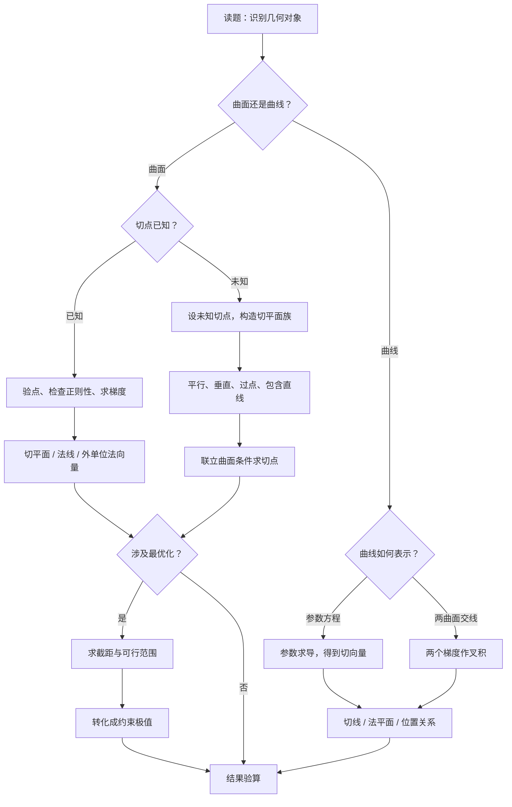

学习范围：曲面的切平面与法线、空间曲线的切线与法平面、旋转曲面、几何位置关系、切平面族及几何最优化。

我已读取你提供的《数学分类题目1101.zip》，确认本节为《第六模块·多元函数微分学及其应用》第五节，并核对了其中的核心题目、分类模拟题，以及张宇、李林、李正元练习题的相关章节。

本节与前面学习的偏导数、全微分、方向导数、梯度和多元函数极值联系非常紧密。

本节的根本思想是：用微分确定方向，用向量描述几何，再把几何条件转化成代数方程。

## 一、先建立本节的完整知识体系

这一节表面上公式很多，实际上主要围绕两类几何对象展开。

| 几何对象                        | 需要求什么     | 核心数学工具                      |
| --------------------------- | --------- | --------------------------- |
| 隐式曲面 $F(x,y,z)=0$       | 切平面、法线    | 梯度 $\nabla F$           |
| 显式曲面 $z=f(x,y)$         | 切平面、法线    | 偏导数 $f_x,f_y$           |
| 参数曲线 $\boldsymbol r(t)$ | 切线、法平面    | 导向量 $\boldsymbol r'(t)$ |
| 两曲面交线                       | 切线、法平面    | 两个梯度的叉积                     |
| 旋转曲面                        | 曲面方程、法线   | 距离不变量、梯度                    |
| 特殊切平面                       | 平行、垂直、过定点 | 法向量与点积                      |
| 几何最优化                       | 最小面积、最小体积 | 截距公式、极值、不等式                 |

### 最重要的四组公式

设 $P=(x_0,y_0,z_0)$。

1\. 隐式曲面的切平面

若 $F(P)=0$，且 $\nabla F(P)\ne\boldsymbol0$，则

$$
\boxed{ F_x(P)(x-x_0)+F_y(P)(y-y_0)+F_z(P)(z-z_0)=0 }
$$

其法线方向为

$$
\boxed{\boldsymbol n=\nabla F(P)}
$$

2\. 显式曲面的切平面

如果 $z=f(x,y)$ 在 $(x_0,y_0)$ 处可微，那么

$$
\boxed{ z-z_0=f_x(P)(x-x_0)+f_y(P)(y-y_0) }
$$

这里的 $f_x(P),f_y(P)$ 表示在 $(x_0,y_0)$ 处取值。

3\. 参数曲线的切线

若曲线为

$$
\boldsymbol r(t)=(x(t),y(t),z(t)),
$$

且 $\boldsymbol r'(t_0)\ne\boldsymbol0$，则切向量为

$$
\boxed{ \boldsymbol v=\boldsymbol r'(t_0) }
$$

4\. 两个曲面的交线

若

$$
\begin{cases} F(x,y,z)=0,\\ G(x,y,z)=0, \end{cases}
$$

且两曲面在切点的梯度线性无关，那么交线的切向量可以取

$$
\boxed{ \boldsymbol v=\nabla F(P)\times\nabla G(P) }
$$

这四组公式是整节的基础。几乎所有常规题，最终都要回到它们。

<Callout type="idea" title="本节解题主线">

但高分题的关键并不是背下公式，而是知道什么时候能用、什么时候不能用、条件不足时如何转换思路。

</Callout>

## 二、基础原理：为什么梯度是曲面的法向量？

这是全节最值得理解的知识点。

### 2.1 从二维等值线推广到三维等值面

先考虑二元函数的等值线：

$$
F(x,y)=C.
$$

假设某条曲线位于这条等值线上，参数方程为

$$
x=x(t),\qquad y=y(t).
$$

因为曲线上每个点的函数值都等于 $C$，所以

$$
F(x(t),y(t))=C.
$$

对 $t$ 求导：

$$
F_x\frac{dx}{dt}+F_y\frac{dy}{dt}=0.
$$

写成向量形式：

$$
(F_x,F_y)\cdot(x',y')=0.
$$

也就是说，梯度与曲线的切向量垂直。

现在推广到三维空间。

设曲面为

$$
F(x,y,z)=0,
$$

曲面上经过点 $P$ 的一条可微曲线为

$$
\boldsymbol r(t)=(x(t),y(t),z(t)).
$$

因为曲线始终位于曲面上，

$$
F(x(t),y(t),z(t))=0.
$$

对参数求导：

$$
F_xx'+F_yy'+F_zz'=0.
$$

因此

$$
\boxed{\nabla F(P)\cdot\boldsymbol r'(t_0)=0}.
$$

这意味着曲面上经过 $P$ 的所有正则曲线，其切向量都与 $\nabla F(P)$ 垂直。

这些切向量所张成的二维空间，就是曲面的切平面。

所以：

$$
\boxed{\text{梯度是曲面的法向量。}}
$$

### 2.2 切平面的本质是局部线性近似

设 $F$ 在 $P$ 附近连续可微。

在 $P$ 附近，有一阶展开：

$$
\begin{aligned} F(x_0+\Delta x,y_0+\Delta y,z_0+\Delta z) ={}&F(P)\\ &+F_x(P)\Delta x\\ &+F_y(P)\Delta y\\ &+F_z(P)\Delta z\\ &+o(\rho), \end{aligned}
$$

其中

$$
\rho=\sqrt{(\Delta x)^2+(\Delta y)^2+(\Delta z)^2}.
$$

对于曲面上的点，$F=0$，而 $F(P)=0$，因此

$$
F_x(P)\Delta x+F_y(P)\Delta y+F_z(P)\Delta z =-o(\rho).
$$

忽略比距离更高阶的误差，就得到切平面：

$$
F_x(P)\Delta x+F_y(P)\Delta y+F_z(P)\Delta z=0.
$$

直观理解：切平面是曲面在切点附近的一阶近似。

这也解释了为什么切平面只与一阶偏导数有关，而曲面的弯曲程度需要进一步研究二阶偏导数。

### 2.3 一个必须牢记的条件

使用隐式曲面切平面公式，一般需要：

$$
F(P)=0,\qquad \nabla F(P)\ne\boldsymbol0,
$$

并且 $F$ 在该点附近具有适当的连续可微性。

梯度非零的点称为正则点。

如果

$$
\nabla F(P)=\boldsymbol0,
$$

就不能直接使用这个公式。

但是注意：

<Callout type="warn" title="非正则表示陷阱">

梯度为零并不必然意味着几何切平面不存在，只意味着当前隐式表示不能通过梯度公式确定它。

</Callout>

例如：

$$
F(x,y,z)=z^2=0
$$

描述的几何曲面实际上就是平面 $z=0$。

虽然它的梯度在曲面上处处为零，但这个几何曲面显然有切平面。

相反，双圆锥面

$$
z^2=x^2+y^2
$$

在原点是锥顶，不存在唯一的通常意义下的切平面。

这两种情况必须区分。

## 三、真题母题一：隐式曲面的切平面与法线

### 3.1 资料标注：2013年考研数学一真题

题目：

曲面

$$
x^2+\cos(xy)+yz+x=0
$$

在点 $P(0,1,-1)$ 处的切平面是什么？

<Steps>

  <Step>

### 第一步：识别几何对象

题目给出的是隐式曲面

$$
F(x,y,z)=0.
$$

因此优先求梯度，不必尝试解出 $z=f(x,y)$。

设

$$
F=x^2+\cos(xy)+yz+x.
$$

  </Step>

  <Step>

### 第二步：计算三个偏导数

$$
F_x=2x-y\sin(xy)+1,
$$

$$
F_y=-x\sin(xy)+z,
$$

$$
F_z=y.
$$

  </Step>

  <Step>

### 第三步：代入切点

$$
F_x(P)=1,\quad F_y(P)=-1,\quad F_z(P)=1.
$$

所以

$$
\nabla F(P)=(1,-1,1).
$$

梯度非零，可以直接使用切平面公式。

  </Step>

  <Step>

### 第四步：写出切平面

$$
(x-0)-(y-1)+(z+1)=0.
$$

整理：

$$
\boxed{x-y+z=-2}.
$$

法线方程可以写为

$$
\boxed{ \begin{cases} x=t,\\ y=1-t,\\ z=-1+t. \end{cases}}
$$

  </Step>

</Steps>
### 3.2 从这道真题提炼出什么？

面对一般隐式曲面，解题顺序是：

$$
\boxed{ \text{验点} \rightarrow \text{求梯度} \rightarrow \text{验正则性} \rightarrow \text{写切平面或法线} }
$$

其中「验点」往往被忽略。

如果给定点不在曲面上，就不存在题目所说的该点处的切平面。

### 3.3 更深一层：切平面与法线互为对偶

一旦得到

$$
\nabla F(P)=(A,B,C),
$$

切平面就是

$$
A(x-x_0)+B(y-y_0)+C(z-z_0)=0,
$$

法线就是

$$
\begin{cases} x=x_0+At,\\ y=y_0+Bt,\\ z=z_0+Ct. \end{cases}
$$

为什么一个向量能同时解决两个问题？

因为法线的方向恰好垂直于切平面。

一道题如果同时要求切平面和法线，不需要进行两次求导。

## 四、真题母题二：切平面可能平行于坐标轴

### 4.1 资料标注：1994年考研数学一真题

题目：

求曲面

$$
z-e^z+2xy=3
$$

在 $P(1,2,0)$ 处的切平面。

这道题同时出现在李正元《多元函数微分学》的相关练习中。

设

$$
F(x,y,z)=z-e^z+2xy-3.
$$

求梯度：

$$
\nabla F=(2y,2x,1-e^z).
$$

在 $P(1,2,0)$ 处，

$$
\nabla F(P)=(4,2,0).
$$

因此切平面为

$$
4(x-1)+2(y-2)=0,
$$

即

$$
\boxed{2x+y-4=0}.
$$

### 4.2 为什么这道题特别重要？

注意：

$$
F_z(P)=0.
$$

但

$$
\nabla F(P)\ne\boldsymbol0.
$$

这说明：

<Callout type="warn" title="几何切平面与隐函数">

隐函数 $z=z(x,y)$ 的局部存在定理不能直接用在这里，但曲面的切平面仍然可以正常求出。

</Callout>

因为完整梯度非零，曲面仍然是正则曲面。

而且

$$
F_x(P)=4\ne0,
$$

所以可以在该点附近把 $x$ 局部表示成 $y,z$ 的函数。

### 4.3 几何意义

切平面

$$
2x+y-4=0
$$

不含 $z$。

它的法向量为

$$
(2,1,0).
$$

由于

$$
(2,1,0)\cdot(0,0,1)=0,
$$

所以 $z$ 轴方向位于这个平面内。

因此切平面平行于 $z$ 轴。

从这个例子可以得到一个常用判断：

设正则曲面的切平面法向量为

$$
(A,B,C).
$$

若

$$
C=0,
$$

则切平面包含 $z$ 轴方向。

同理：

$$
A=0\Rightarrow \text{切平面包含 }x\text{ 轴方向},
$$

$$
B=0\Rightarrow \text{切平面包含 }y\text{ 轴方向}.
$$

注意这里说的是平行于对应坐标轴的方向，不代表切平面一定经过该坐标轴。

## 五、真题母题三：偏导数存在与切平面存在的区别

### 5.1 资料标注：2001年考研数学一真题

已知

$$
f_x(0,0)=3,\qquad f_y(0,0)=1.
$$

考虑曲线

$$
\begin{cases} z=f(x,y),\\ y=0. \end{cases}
$$

求它在

$$
P=(0,0,f(0,0))
$$

处的一个切向量。

### 解题思路

题目没有说 $f(x,y)$ 可微。

这是关键。

我们不能直接断定整个曲面存在由两个偏导数确定的切平面。

但是题目要求的是 $y=0$ 这条截线的切向量。

把它参数化：

$$
\boldsymbol r(t)=(t,0,f(t,0)).
$$

对 $t$ 求导：

$$
\boldsymbol r'(t) = \left(1,0,\frac{d}{dt}f(t,0)\right).
$$

因此

$$
\boldsymbol r'(0)=(1,0,f_x(0,0)).
$$

所以

$$
\boxed{\boldsymbol v=(1,0,3)}.
$$

### 5.2 为什么有偏导数不代表有切平面？

考虑下面的函数：

$$
f(x,y)= \begin{cases} 3x+y+\dfrac{xy}{\sqrt{x^2+y^2}},&(x,y)\ne(0,0),\\[6pt] 0,&(x,y)=(0,0). \end{cases}
$$

沿坐标轴计算：

$$
f(x,0)=3x,\qquad f(0,y)=y.
$$

所以

$$
f_x(0,0)=3,\qquad f_y(0,0)=1.
$$

两个偏导数都存在。

但如果它在原点可微，其线性主部只能是

$$
3x+y.
$$

考察余项：

$$
R(x,y)=\frac{xy}{\sqrt{x^2+y^2}}.
$$

沿 $y=x$ 趋近原点，

$$
\frac{R(x,x)}{\sqrt{x^2+x^2}} = \frac{x^2}{2x^2} =\frac12.
$$

该比值不趋于零。

因此它不是

$$
o\left(\sqrt{x^2+y^2}\right).
$$

所以函数在原点不可微。

这说明：

$$
\boxed{ \text{偏导数存在} \not\Rightarrow \text{二元函数可微} }
$$

### 5.3 本题所对应的完整知识链

对于二元函数，应该区分：

| 已知条件                     | 可以保证什么              |
| ------------------------ | ------------------- |
| $f_x(P)$ 存在          | 沿 $x$ 方向的坐标截线可导 |
| $f_y(P)$ 存在          | 沿 $y$ 方向的坐标截线可导 |
| 两个偏导数都存在                 | 不能保证连续、可微           |
| $f$ 在 $P$ 处可微    | 存在一阶线性近似            |
| 两个偏导数在邻域内存在且在 $P$ 连续 | 可以保证 $P$ 处可微    |

考试中遇到「已知偏导数存在，下面哪个结论必然成立」，应该立即检查选项是否偷偷使用了可微性。

## 六、真题母题四：旋转曲面的法向量

### 6.1 资料标注：1993年考研数学一真题

曲线

$$
\begin{cases} 3x^2+2y^2=12,\\ z=0 \end{cases}
$$

绕 $y$ 轴旋转一周，求所得曲面在

$$
P=(0,\sqrt3,\sqrt2)
$$

处指向外侧的单位法向量。

<Steps>

  <Step>

### 第一步：旋转之后，什么保持不变？

绕 $y$ 轴旋转时：

- $y$ 坐标不变；
- 点到 $y$ 轴的距离不变。

到 $y$ 轴的距离为

$$
r=\sqrt{x^2+z^2}.
$$

原曲线中的 $x^2$ 应替换成

$$
x^2+z^2.
$$

得到旋转面：

$$
3(x^2+z^2)+2y^2=12.
$$

设

$$
F(x,y,z)=3x^2+2y^2+3z^2-12.
$$

  </Step>

  <Step>

### 第二步：计算梯度

$$
\nabla F=(6x,4y,6z).
$$

在 $P$ 处：

$$
\nabla F(P)=(0,4\sqrt3,6\sqrt2).
$$

这个向量指向哪一侧？

曲面内部满足

$$
F<0,
$$

外部满足

$$
F>0.
$$

梯度指向函数增长最快的方向，因此这里的梯度指向椭球外侧。

  </Step>

  <Step>

### 第三步：归一化

梯度的模：

$$
\begin{aligned} |\nabla F(P)| &=\sqrt{(4\sqrt3)^2+(6\sqrt2)^2}\\ &=\sqrt{48+72}\\ &=2\sqrt{30}. \end{aligned}
$$

因此外侧单位法向量为

$$
\begin{aligned} \boldsymbol n &=\frac{(0,4\sqrt3,6\sqrt2)}{2\sqrt{30}}\\ &=\boxed{\frac1{\sqrt5}(0,\sqrt2,\sqrt3)}. \end{aligned}
$$

  </Step>

</Steps>
### 6.2 旋转曲面的一般处理方法

若平面曲线

$$
G(x,y)=0,\qquad z=0
$$

绕 $y$ 轴旋转，应优先考虑：

$$
r=\sqrt{x^2+z^2}.
$$

若曲线方程可写成

$$
H(x^2,y)=0,
$$

那么旋转曲面可以直接写成

$$
\boxed{H(x^2+z^2,y)=0}.
$$

类似地：

绕 $x$ 轴旋转：

$$
r^2=y^2+z^2.
$$

绕 $z$ 轴旋转：

$$
r^2=x^2+y^2.
$$

但如果原方程中含有一次方的 $x$、平方根或分支限制，不能机械替换。需要检查旋转后实际能够到达的半径范围。

### 6.3 对应模拟题：汤家凤八套卷

资料中的题目：

直线

$$
\frac{x}{1}=\frac{y}{-1}=\frac{z}{2}
$$

绕 $x$ 轴旋转得到曲面，在

$$
P=(-1,1,-2)
$$

处求法线。

直线参数化为

$$
(x,y,z)=(t,-t,2t).
$$

绕 $x$ 轴旋转，得到

$$
y^2+z^2=5x^2.
$$

设

$$
F=5x^2-y^2-z^2.
$$

梯度为

$$
\nabla F=(10x,-2y,-2z).
$$

在 $P$ 处：

$$
\nabla F(P)=(-10,-2,4).
$$

取反向的简化法向量：

$$
\boldsymbol n=(5,1,-2).
$$

因此法线方程为

$$
\boxed{ \begin{cases} x=-1+5t,\\ y=1+t,\\ z=-2-2t. \end{cases}}
$$

这类题的完整思维链是：

$$
\boxed{ \text{旋转不变量} \rightarrow \text{曲面方程} \rightarrow \text{梯度} \rightarrow \text{法线} }
$$

## 七、空间曲线的切线与法平面

这是本节第二条主线。

### 7.1 参数曲线的切线

设

$$
\boldsymbol r(t)=(x(t),y(t),z(t)).
$$

在参数 $t_0$ 处：

$$
P=\boldsymbol r(t_0).
$$

若

$$
\boldsymbol r'(t_0)\ne\boldsymbol0,
$$

则切线方向为

$$
\boldsymbol v=\boldsymbol r'(t_0).
$$

所以切线的参数方程为

$$
\boxed{ \boldsymbol r=\boldsymbol r(t_0)+s\boldsymbol r'(t_0) }.
$$

法平面垂直于曲线切线，其法向量就是曲线切向量：

$$
\boxed{ x'(t_0)(x-x_0)+y'(t_0)(y-y_0)+z'(t_0)(z-z_0)=0 }.
$$

注意两个概念：

曲面的法线：垂直于曲面切平面的直线。

曲线的法平面：垂直于曲线切线的平面。

二者并不是同一个东西。

### 7.2 资料标注：1992年考研数学一真题

曲线

$$
\begin{cases} x=t,\\ y=-t^2,\\ z=t^3 \end{cases}
$$

的切线中，有多少条与平面

$$
x+2y+z=4
$$

平行？

<Steps>

  <Step>

### 第一步：求曲线切向量

$$
\boldsymbol r'(t)=(1,-2t,3t^2).
$$

  </Step>

  <Step>

### 第二步：求平面法向量

$$
\boldsymbol n=(1,2,1).
$$

  </Step>

  <Step>

### 第三步：转化平行条件

直线平行于平面，要求直线的方向向量垂直于平面法向量。

所以

$$
\boldsymbol r'(t)\cdot\boldsymbol n=0.
$$

即

$$
1-4t+3t^2=0.
$$

因式分解：

$$
(3t-1)(t-1)=0.
$$

得到

$$
t=\frac13,\qquad t=1.
$$

这两个参数对应两个不同的切点和两条不同的切线。

而且这两条切线都不在给定平面内。

所以答案是

$$
\boxed{2\text{条}}.
$$

  </Step>

</Steps>
### 7.3 这道题的真正母题是什么？

不是「求两条切线」，而是：

> 给定参数曲线，求所有满足某种空间位置关系的切线。

如果给定平面法向量 $\boldsymbol n$，那么：

切线平行于该平面的必要方向条件：

$$
\boxed{\boldsymbol r'(t)\cdot\boldsymbol n=0}.
$$

切线垂直于该平面的条件：

$$
\boxed{\boldsymbol r'(t)\parallel\boldsymbol n}.
$$

若要求切线在平面内，还必须检查切点是否属于平面。

如果要求切线经过空间定点 $Q$，则存在实数 $\lambda$，使

$$
\boxed{ Q-\boldsymbol r(t)=\lambda\boldsymbol r'(t) }.
$$

这类题最终都转化为关于 $t$ 的代数方程或方程组。

## 八、核心母题：两曲面交线的切线与法平面

### 8.1 为什么使用叉积？

设空间曲线由两个曲面的交线给出：

$$
\begin{cases} F(x,y,z)=0,\\ G(x,y,z)=0. \end{cases}
$$

在交点 $P$：

第一个曲面的法向量：

$$
\boldsymbol n_1=\nabla F(P).
$$

第二个曲面的法向量：

$$
\boldsymbol n_2=\nabla G(P).
$$

交线的切向量必须同时垂直于两个法向量。

而叉积恰好构造出这样的方向：

$$
\boxed{ \boldsymbol v=\boldsymbol n_1\times\boldsymbol n_2 }.
$$

前提是两个法向量线性无关。

### 8.2 李林880代表题

空间曲线由

$$
\begin{cases} x^2+y^2=10,\\ x^2+z^2=10 \end{cases}
$$

确定。

求它在 $P=(3,1,1)$ 处的切线与法平面。

设

$$
F=x^2+y^2-10,
$$

$$
G=x^2+z^2-10.
$$

两梯度为

$$
\nabla F=(2x,2y,0),
$$

$$
\nabla G=(2x,0,2z).
$$

在 $P$ 处：

$$
\boldsymbol n_1=(6,2,0),
$$

$$
\boldsymbol n_2=(6,0,2).
$$

计算叉积：

$$
\begin{aligned} \boldsymbol v &=(6,2,0)\times(6,0,2)\\ &=(4,-12,-12)\\ &=4(1,-3,-3). \end{aligned}
$$

取切向量

$$
\boldsymbol v=(1,-3,-3).
$$

所以切线为

$$
\boxed{ \frac{x-3}{1} = \frac{y-1}{-3} = \frac{z-1}{-3} }.
$$

法平面的法向量就是 $\boldsymbol v$，因此

$$
(x-3)-3(y-1)-3(z-1)=0.
$$

得到

$$
\boxed{x-3y-3z+3=0}.
$$

### 8.3 什么时候不能直接使用叉积？

如果

$$
\nabla F(P)\times\nabla G(P)=\boldsymbol0,
$$

那么两个梯度线性相关。

<Callout type="warn" title="叉积为零的处理">

这时不能直接认为交线没有切线，也不能把零向量当作切向量。

</Callout>

需要进一步研究两个曲面的局部关系。

例如

$$
\begin{cases} x^2+y^2+z^2=3,\\ x+y+z=3 \end{cases}
$$

在 $P=(1,1,1)$ 处，两法向量平行。

实际上根据柯西不等式，

$$
(x+y+z)^2\le3(x^2+y^2+z^2)=9.
$$

等号在 $x=y=z$ 时成立。

结合 $x+y+z=3$，交集只有

$$
(1,1,1).
$$

所以这两个曲面在该点相切，交集并不是一条正常的空间曲线。

这说明，叉积非零不仅是计算方便的条件，还保证了交线的局部正则性。

## 九、李正元综合母题：两条截线的切线确定曲面的切平面

这道题很适合训练综合思维。

### 9.1 题目

球面

$$
x^2+y^2+z^2=169
$$

上有一点

$$
M=(3,4,12).
$$

分别过 $M$ 作垂直于 $x$ 轴、$y$ 轴的平面。

求这两个平面与球面的截线在 $M$ 处的切线，以及经过这两条切线的平面。

<Steps>

  <Step>

### 9.2 第一步：先找两个截平面

垂直于 $x$ 轴且经过 $M$ 的平面为

$$
x=3.
$$

垂直于 $y$ 轴且经过 $M$ 的平面为

$$
y=4.
$$

球面的法向量可取

$$
\boldsymbol n=(3,4,12).
$$

  </Step>

  <Step>

### 9.3 第二步：求第一条截线的切向量

第一条截线是球面与 $x=3$ 的交线。

平面 $x=3$ 的法向量是

$$
\boldsymbol e_1=(1,0,0).
$$

所以截线的切向量为

$$
\begin{aligned} \boldsymbol v_1 &=\boldsymbol e_1\times\boldsymbol n\\ &=(0,-12,4)\\ &\parallel(0,-3,1). \end{aligned}
$$

第一条切线：

$$
\boxed{ \begin{cases} x=3,\\ y=4-3t,\\ z=12+t. \end{cases}}
$$

  </Step>

  <Step>

### 9.4 第三步：求第二条截线的切向量

平面 $y=4$ 的法向量是

$$
\boldsymbol e_2=(0,1,0).
$$

因此

$$
\begin{aligned} \boldsymbol v_2 &=\boldsymbol e_2\times\boldsymbol n\\ &=(12,0,-3)\\ &\parallel(4,0,-1). \end{aligned}
$$

第二条切线：

$$
\boxed{ \begin{cases} x=3+4s,\\ y=4,\\ z=12-s. \end{cases}}
$$

  </Step>

  <Step>

### 9.5 第四步：求经过两条切线的平面

两条直线都经过 $M$，方向向量分别为

$$
\boldsymbol v_1=(0,-3,1), \qquad \boldsymbol v_2=(4,0,-1).
$$

它们不平行，所以确定唯一平面。

该平面的法向量可以取

$$
\begin{aligned} \boldsymbol N &=\boldsymbol v_1\times\boldsymbol v_2\\ &=(3,4,12). \end{aligned}
$$

因此所求平面为

$$
3(x-3)+4(y-4)+12(z-12)=0.
$$

整理：

$$
\boxed{3x+4y+12z-169=0}.
$$

  </Step>

</Steps>
### 9.6 真正值得学习的结论

这道题最重要的不是叉积计算，而是发现：

两条位于同一正则曲面上的、经过同一切点且切向量不平行的曲线，它们的切线张成该曲面的切平面。

因此本题也可以直接写出球面在 $M$ 处的切平面：

$$
3x+4y+12z=169.
$$

这种思路能够处理未来的创新题：

题目不直接要求曲面的切平面，而是给出若干截线、切线、相交平面，让你从几何关系中恢复切平面。

## 十、位置关系：平行、垂直、相交、异面

几何应用题中，最容易出错的不是求导，而是判断空间位置关系。

设直线方向向量为 $\boldsymbol v$，平面法向量为 $\boldsymbol n$。

### 10.1 直线和平面

| 几何关系      | 向量条件                                      | 还需检查什么           |
| --------- | ----------------------------------------- | ---------------- |
| 直线方向平行于平面 | $\boldsymbol v\cdot\boldsymbol n=0$   | 直线是在平面内，还是与平面无交点 |
| 直线垂直于平面   | $\boldsymbol v\parallel\boldsymbol n$ | 方向条件已经足够         |
| 直线包含于平面   | $\boldsymbol v\cdot\boldsymbol n=0$   | 直线上一点在平面内        |

### 10.2 两个平面

若两个平面法向量为 $\boldsymbol n_1,\boldsymbol n_2$，则

平面平行：

$$
\boxed{\boldsymbol n_1\parallel\boldsymbol n_2}.
$$

平面垂直：

$$
\boxed{\boldsymbol n_1\cdot\boldsymbol n_2=0}.
$$

这里还需区分两个平面平行与重合。

### 10.3 两条空间直线

设

$$
L_1:P+t\boldsymbol v,
$$

$$
L_2:Q+s\boldsymbol w.
$$

方向向量垂直，即

$$
\boldsymbol v\cdot\boldsymbol w=0,
$$

只能说明两条直线的方向正交。

如果题目要求判断两直线是「相交且垂直」还是「异面」，还必须求解

$$
P+t\boldsymbol v=Q+s\boldsymbol w.
$$

有解，说明相交。

无解，说明不相交。

### 10.4 对应分类模拟题：李永乐六套卷

资料中的一道题要求判断：

空间曲线

$$
\begin{cases} x^2+y^2=2,\\ x+z=2 \end{cases}
$$

在 $(1,1,1)$ 处的切线，与球面

$$
x^2+(y+2)^2+z^2=2
$$

在 $(1,-1,0)$ 处的法线之间的关系。

首先求交线切向量：

$$
(2,2,0)\times(1,0,1) =(2,-2,-2).
$$

取

$$
\boldsymbol v=(1,-1,-1).
$$

球面法线方向为

$$
\boldsymbol n=(1,1,0).
$$

两方向满足

$$
\boldsymbol v\cdot\boldsymbol n=1-1=0.
$$

接着判断是否相交。

第一条直线：

$$
\begin{cases} x=1+t,\\ y=1-t,\\ z=1-t. \end{cases}
$$

第二条直线：

$$
\begin{cases} x=1+s,\\ y=-1+s,\\ z=0. \end{cases}
$$

由 $z=0$ 可得第一条直线的参数 $t=1$。

这时第一条直线经过

$$
(2,0,0).
$$

第二条直线取 $s=1$ 也经过该点。

因此两直线相交，而且方向垂直。

答案：

$$
\boxed{\text{相交且垂直}}.
$$

遇到空间直线位置关系，务必记住：点积解决角度问题，联立方程解决交点问题。

## 十一、真题母题：切平面平行、过定点与切平面族

这部分是最容易出现综合题的内容。

### 11.1 切点未知时，如何处理？

设曲面为

$$
z=f(x,y).
$$

令未知切点为

$$
P=(a,b,f(a,b)).
$$

它的切平面为

$$
z-f(a,b)=f_x(a,b)(x-a)+f_y(a,b)(y-b).
$$

这个平面含有未知参数 $a,b$。

题目再给出的「平行」「垂直」「经过某点」等几何条件，就是用来确定 $a,b$ 的。

关键技巧：

$$
\boxed{\text{先设切点，再表示切平面。}}
$$

不要一开始就猜切平面方程。

### 11.2 资料标注：2018年考研数学一真题

求所有经过

$$
A=(1,0,0),\qquad B=(0,1,0)
$$

且与抛物面

$$
z=x^2+y^2
$$

相切的平面。

<Steps>

  <Step>

### 第一步：设未知切点

令切点为

$$
P=(a,b,a^2+b^2).
$$

抛物面在该点的切平面：

$$
z-(a^2+b^2)=2a(x-a)+2b(y-b).
$$

整理：

$$
\boxed{2ax+2by-z=a^2+b^2}.
$$

  </Step>

  <Step>

### 第二步：代入给定的两个点

平面经过 $A=(1,0,0)$，所以

$$
2a=a^2+b^2.
$$

平面经过 $B=(0,1,0)$，所以

$$
2b=a^2+b^2.
$$

因此

$$
a=b.
$$

代回：

$$
2a=2a^2.
$$

所以

$$
a=0\quad\text{或}\quad a=1.
$$

于是两个切点为

$$
(0,0,0)
$$

和

$$
(1,1,2).
$$

  </Step>

  <Step>

### 第三步：写出两个切平面

当 $a=b=0$：

$$
\boxed{z=0}.
$$

当 $a=b=1$：

$$
\boxed{2x+2y-z=2}.
$$

因此共有两个切平面。

  </Step>

</Steps>
### 11.3 这道题的创新方向

如果未来的题目改成：

「求与某曲面相切、且经过一条已知直线的所有平面。」

思路完全一样。

先表示切平面族。

再要求给定直线位于切平面内。

若直线为

$$
\boldsymbol r=\boldsymbol p+t\boldsymbol v,
$$

切平面为

$$
\boldsymbol n(a,b)\cdot(\boldsymbol r-\boldsymbol r_0(a,b))=0,
$$

则需要满足

$$
\boldsymbol n(a,b)\cdot\boldsymbol v=0
$$

以及

$$
\boldsymbol n(a,b)\cdot (\boldsymbol p-\boldsymbol r_0(a,b))=0.
$$

分别对应方向条件和位置条件。

这比直接联立三维坐标更有结构。

## 十二、平行切平面：李林880代表母题

设椭球面

$$
x^2+2y^2+3z^2=21.
$$

求所有平行于平面

$$
x+4y+6z=0
$$

的切平面。

<Steps>

  <Step>

### 第一步：设切点

令

$$
P=(x_0,y_0,z_0).
$$

椭球面的法向量：

$$
\nabla F(P)=(2x_0,4y_0,6z_0).
$$

给定平面的法向量：

$$
\boldsymbol n=(1,4,6).
$$

平行意味着两个法向量成比例。

可以设

$$
(2x_0,4y_0,6z_0)=2\lambda(1,4,6).
$$

得到

$$
x_0=\lambda,\quad y_0=2\lambda,\quad z_0=2\lambda.
$$

  </Step>

  <Step>

### 第二步：代回曲面条件

$$
\lambda^2+2(2\lambda)^2+3(2\lambda)^2=21.
$$

即

$$
21\lambda^2=21.
$$

所以

$$
\lambda=\pm1.
$$

两个切点为

$$
P_1=(1,2,2), \qquad P_2=(-1,-2,-2).
$$

  </Step>

  <Step>

### 第三步：写切平面

椭球面在 $P$ 处的切平面可写成

$$
x_0x+2y_0y+3z_0z=21.
$$

因此：

$$
\boxed{x+4y+6z=21}
$$

或

$$
\boxed{x+4y+6z=-21}.
$$

  </Step>

</Steps>
### 12.1 推广：二次曲面的切平面速写

对于椭球

$$
\frac{x^2}{a^2} +\frac{y^2}{b^2} +\frac{z^2}{c^2}=1,
$$

在点 $P=(x_0,y_0,z_0)$ 处的切平面是

$$
\boxed{ \frac{x_0x}{a^2} +\frac{y_0y}{b^2} +\frac{z_0z}{c^2}=1 }.
$$

这个公式非常值得掌握。

球面

$$
x^2+y^2+z^2=R^2
$$

在 $P$ 处的切平面则为

$$
\boxed{x_0x+y_0y+z_0z=R^2}.
$$

它们都可以由梯度公式推导，不需要机械死记。

## 十三、李正元拔高母题：求满足特殊切平面条件的点的轨迹

### 13.1 题目

在椭球面

$$
x^2+y^2+z^2-yz=1
$$

上，求所有使切平面与 $xOy$ 平面垂直的点组成的轨迹。

这种题不是求某一个切平面，而是寻找满足条件的全部切点。

<Steps>

  <Step>

### 第一步：求任意点处的法向量

设

$$
F=x^2+y^2+z^2-yz-1.
$$

梯度为

$$
\nabla F=(2x,2y-z,2z-y).
$$

  </Step>

  <Step>

### 第二步：把平面垂直条件代数化

$xOy$ 平面的法向量是

$$
\boldsymbol k=(0,0,1).
$$

两个平面垂直意味着它们的法向量垂直。

因此

$$
\nabla F\cdot\boldsymbol k=0.
$$

即

$$
2z-y=0.
$$

得到

$$
\boxed{y=2z}.
$$

  </Step>

  <Step>

### 第三步：与原曲面联立

将 $y=2z$ 代入：

$$
x^2+4z^2+z^2-2z^2=1.
$$

所以

$$
x^2+3z^2=1.
$$

最终轨迹：

$$
\boxed{ \begin{cases} y=2z,\\ x^2+3z^2=1. \end{cases}}
$$

这是一条空间椭圆。

  </Step>

</Steps>
### 13.2 从这道题学到的方法

凡是问：

「曲面上哪些点的切平面满足某种性质？」

通常不要先写出完整切平面方程。

更高效的方法是：

$$
\boxed{ \text{设任意曲面点} \rightarrow \text{写梯度} \rightarrow \text{建立法向量关系} \rightarrow \text{联立曲面方程} }
$$

这样常常可以少做大量代数运算。

## 十四、特殊结构题：从函数表达式中寻找几何不变量

这是李林880中非常有价值的一类题。

### 14.1 题目

曲面

$$
F(ax-bz,ay-cz)=0
$$

在正则点处，证明其切平面都平行于方向

$$
(b,c,a).
$$

<Tabs items={["链式法则", "几何不变量"]} defaultIndex={0}>

  <Tab value="链式法则">

**方法一：链式法则**

记

$$
u=ax-bz,\qquad v=ay-cz.
$$

令

$$
G(x,y,z)=F(u,v).
$$

那么

$$
G_x=aF_u,
$$

$$
G_y=aF_v,
$$

$$
G_z=-bF_u-cF_v.
$$

因此

$$
\nabla G=(aF_u,aF_v,-bF_u-cF_v).
$$

考察梯度与向量 $(b,c,a)$ 的点积：

$$
\begin{aligned} \nabla G\cdot(b,c,a) &=abF_u+acF_v\\ &\quad-a(bF_u+cF_v)\\ &=0. \end{aligned}
$$

所以 $(b,c,a)$ 与曲面的法向量垂直。

因此它平行于切平面。

  </Tab>

  <Tab value="几何不变量">

**方法二：直接寻找曲面上的直线**

这是更值得学习的几何方法。

设

$$
P=(x_0,y_0,z_0)
$$

在曲面上。

考虑经过 $P$、方向为 $(b,c,a)$ 的直线：

$$
\begin{cases} x=x_0+bt,\\ y=y_0+ct,\\ z=z_0+at. \end{cases}
$$

计算组合变量：

$$
\begin{aligned} ax-bz &=a(x_0+bt)-b(z_0+at)\\ &=ax_0-bz_0. \end{aligned}
$$

同样，

$$
ay-cz=ay_0-cz_0.
$$

这说明，沿着这个方向移动时，函数 $F$ 的两个输入始终不变。

因此整条直线都在曲面上。

换句话说，曲面本身具有方向为 $(b,c,a)$ 的直母线。

所以在每一个正则点，它的切平面必然包含这个方向。

  </Tab>

</Tabs>

### 14.2 为什么这个方法比直接计算更高级？

因为它利用了曲面自身的结构，而不仅仅是求导公式。

未来若遇到

$$
F(L_1(x,y,z),L_2(x,y,z))=0,
$$

其中 $L_1,L_2$ 是两个线性函数，就可以寻找同时满足

$$
\Delta L_1=0,\qquad \Delta L_2=0
$$

的非零方向向量。

这种方向往往揭示曲面的特殊几何结构。

## 十五、齐次函数与切平面：欧拉公式的几何应用

资料中的李林880还有一道具有代表性的综合题。

设

$$
f(tx,ty)=t^2f(x,y),
$$

且 $f$ 可微。

已知

$$
P=(1,-2,2)
$$

位于曲面 $z=f(x,y)$ 上，并且

$$
f_x(1,-2)=4.
$$

求该点的切平面。

<Steps>

  <Step>

### 第一步：使用齐次函数的欧拉公式

如果 $f$ 是 $k$ 次齐次函数，满足

$$
f(tx,ty)=t^kf(x,y),\qquad t>0,
$$

那么

$$
\boxed{xf_x+yf_y=kf}.
$$

本题是二次齐次函数：

$$
xf_x+yf_y=2f.
$$

  </Step>

  <Step>

### 第二步：求未知偏导数

因为点 $P$ 在曲面上，

$$
f(1,-2)=2.
$$

代入欧拉公式：

$$
1\cdot4-2f_y(1,-2)=2\cdot2.
$$

解得

$$
f_y(1,-2)=0.
$$

  </Step>

  <Step>

### 第三步：写切平面

$$
z-2=4(x-1)+0(y+2).
$$

所以

$$
\boxed{4x-z-2=0}.
$$

  </Step>

</Steps>
### 方法迁移

这道题说明：

即使题目没有给出完整的函数表达式，也有可能通过已知函数性质求出切平面。

常见可利用的额外信息包括：

- 齐次函数性质；
- 隐函数关系；
- 已知等值线；
- 对称性；
- 某条截线的斜率。

尤其是「已知曲面的某条截线」，经常可以通过沿截线求导，获得偏导数之间的关系。

## 十六、几何最优化：张宇1000题核心母题

这一类题把本节与多元函数极值联系起来。

### 16.1 平面曲线切线的截距面积最小

题目：

曲线

$$
x^2-xy+y^2=1,\qquad x>0,\ y>0
$$

上的哪一点，其切线与两坐标轴在第一象限围成的三角形面积最小？

<Steps>

  <Step>

### 第一步：求任意切点处的切线

令切点为

$$
P=(x_0,y_0).
$$

设

$$
F(x,y)=x^2-xy+y^2-1.
$$

梯度为

$$
\nabla F=(2x-y,2y-x).
$$

所以切线为

$$
(2x_0-y_0)(x-x_0) + (2y_0-x_0)(y-y_0)=0.
$$

整理：

$$
(2x_0-y_0)x+(2y_0-x_0)y =2(x_0^2-x_0y_0+y_0^2).
$$

利用曲线约束，得到

$$
\boxed{ (2x_0-y_0)x+(2y_0-x_0)y=2 }.
$$

  </Step>

  <Step>

### 第二步：求截距

与 $x$ 轴交点的横坐标为

$$
A=\frac{2}{2x_0-y_0}.
$$

与 $y$ 轴交点的纵坐标为

$$
B=\frac{2}{2y_0-x_0}.
$$

为了在第一象限围成有界三角形，需要

$$
2x_0-y_0>0,\qquad 2y_0-x_0>0.
$$

面积为

$$
S=\frac12 AB.
$$

因此

$$
S= \frac{2}{(2x_0-y_0)(2y_0-x_0)}.
$$

  </Step>

  <Step>

### 第三步：利用约束化简

展开分母：

$$
\begin{aligned} &(2x_0-y_0)(2y_0-x_0)\\ &=5x_0y_0-2x_0^2-2y_0^2. \end{aligned}
$$

而

$$
x_0^2+y_0^2=1+x_0y_0.
$$

所以

$$
(2x_0-y_0)(2y_0-x_0) =3x_0y_0-2.
$$

得到

$$
\boxed{S=\frac{2}{3x_0y_0-2}}.
$$

  </Step>

  <Step>

### 第四步：转化为乘积最大值问题

题目原来要求面积最小。

现在转化为要求

$$
x_0y_0
$$

最大。

由约束：

$$
x_0^2-x_0y_0+y_0^2=1
$$

可写成

$$
(x_0-y_0)^2+x_0y_0=1.
$$

于是

$$
x_0y_0\le1.
$$

等号成立当且仅当

$$
x_0=y_0.
$$

结合约束与正坐标条件：

$$
x_0=y_0=1.
$$

所以最佳切点是

$$
\boxed{P=(1,1)}.
$$

此时切线为

$$
x+y=2.
$$

两坐标轴截距均为 $2$。

因此

$$
\boxed{S_{\min}=2}.
$$

  </Step>

</Steps>
### 16.2 为什么这道题是母题？

因为它体现了一条非常重要的思路：

$$
\boxed{ \text{切线方程} \rightarrow \text{截距} \rightarrow \text{面积函数} \rightarrow \text{约束最优化} }
$$

任何类似的椭圆、二次曲线切线面积题，都可以沿着这个框架处理。

而且不一定要使用拉格朗日乘数法。

如果约束能自然转化为基本不等式，通常会更快。

## 十七、李林880变式：反向确定曲线参数

题目：

在第一象限内，曲线

$$
3x^2+2xy+3y^2=a
$$

的切线与两坐标轴围成三角形，已知最小面积为

$$
\frac14,
$$

求参数 $a$。

这是一道与上一题结构相似、但设问方向不同的题。

<Steps>

  <Step>

### 第一步：求切线

在切点 $(x_0,y_0)$ 处，切线可化为

$$
(3x_0+y_0)x+(x_0+3y_0)y=a.
$$

因此两个截距为

$$
A=\frac{a}{3x_0+y_0},
$$

$$
B=\frac{a}{x_0+3y_0}.
$$

面积：

$$
S=\frac{a^2}{2(3x_0+y_0)(x_0+3y_0)}.
$$

展开：

$$
(3x_0+y_0)(x_0+3y_0) =3x_0^2+10x_0y_0+3y_0^2.
$$

利用约束：

$$
3x_0^2+2x_0y_0+3y_0^2=a,
$$

得到

$$
\boxed{ S=\frac{a^2}{2(a+8x_0y_0)} }.
$$

  </Step>

  <Step>

### 第二步：求乘积最大值

约束可以改写为

$$
3(x_0-y_0)^2+8x_0y_0=a.
$$

因此

$$
x_0y_0\le\frac a8.
$$

等号当且仅当

$$
x_0=y_0.
$$

所以

$$
S_{\min} = \frac{a^2}{2(a+a)} =\frac a4.
$$

题目给出

$$
S_{\min}=\frac14.
$$

因此

$$
\boxed{a=1}.
$$

两道题结合起来，基本覆盖了二次曲线切线截距面积问题的常见变化方式。

  </Step>

</Steps>
## 十八、三维最优化：椭球切平面的最小截距体积

这是一道李正元和李林相关章节中都收录的经典综合题。

### 18.1 题目

在椭球

$$
\frac{x^2}{a^2} +\frac{y^2}{b^2} +\frac{z^2}{c^2}=1, \qquad a,b,c>0
$$

第一卦限内，求一个点，使该点的切平面与三个坐标面围成的四面体体积最小。

并求最小体积。

<Steps>

  <Step>

### 第一步：设切点

令

$$
P=(x_0,y_0,z_0), \qquad x_0,y_0,z_0>0.
$$

切平面：

$$
\frac{x_0x}{a^2} + \frac{y_0y}{b^2} + \frac{z_0z}{c^2}=1.
$$

  </Step>

  <Step>

### 第二步：求三轴截距

令 $y=z=0$，得到 $x$ 轴截距：

$$
A=\frac{a^2}{x_0}.
$$

同理：

$$
B=\frac{b^2}{y_0},
$$

$$
C=\frac{c^2}{z_0}.
$$

与三个坐标面围成的四面体体积为

$$
V=\frac16ABC.
$$

所以

$$
\boxed{ V=\frac{a^2b^2c^2}{6x_0y_0z_0} }.
$$

  </Step>

  <Step>

### 第三步：转化为坐标乘积最大值

最小化 $V$ 等价于最大化

$$
x_0y_0z_0.
$$

令

$$
X=\frac{x_0}{a}, \qquad Y=\frac{y_0}{b}, \qquad Z=\frac{z_0}{c}.
$$

那么

$$
X^2+Y^2+Z^2=1,
$$

且

$$
X,Y,Z>0.
$$

根据均值不等式：

$$
\frac{X^2+Y^2+Z^2}{3} \ge \sqrt[3]{X^2Y^2Z^2}.
$$

所以

$$
\frac13\ge(XYZ)^{2/3}.
$$

得到

$$
XYZ\le\frac1{3\sqrt3}.
$$

因此

$$
x_0y_0z_0\le\frac{abc}{3\sqrt3}.
$$

等号成立当且仅当

$$
X=Y=Z=\frac1{\sqrt3}.
$$

也就是

$$
\boxed{ P=\left( \frac a{\sqrt3}, \frac b{\sqrt3}, \frac c{\sqrt3} \right) }.
$$

  </Step>

  <Step>

### 第四步：计算最小体积

代回体积公式：

$$
V_{\min} = \frac{a^2b^2c^2} {6\cdot\frac{abc}{3\sqrt3}}.
$$

所以

$$
\boxed{ V_{\min}=\frac{\sqrt3}{2}abc }.
$$

  </Step>

</Steps>
### 18.2 从二维面积到三维体积

对比前面的张宇题：

二维：

$$
S=\frac12AB.
$$

三维：

$$
V=\frac16ABC.
$$

这反映了相同的几何优化结构。

一般遇到切线或切平面截距问题，应该优先考虑：

$$
\boxed{ \text{求截距} \rightarrow \text{建立面积或体积} \rightarrow \text{利用约束求极值} }
$$

<Callout type="warn" title="几何截距条件">

其中正截距条件不能省略。

</Callout>

## 十九、考研中最容易出现的八类陷阱

| 陷阱 | 错误想法               | 正确处理              |
| -- | ------------------ | ----------------- |
| 1  | 偏导数存在就能写切平面        | 先检查可微性或适当的正则条件    |
| 2  | $F_z=0$ 就没有切平面 | 检查完整梯度是否非零        |
| 3  | 梯度为零就一定没有几何切平面     | 当前公式失效，需要研究曲面局部结构 |
| 4  | 叉积为零时仍可直接写交线切向量    | 检查交线是否正则          |
| 5  | 法平面与切平面是一回事        | 区分空间曲线和空间曲面       |
| 6  | 方向向量正交就一定是相交垂直     | 还要检查两直线是否相交       |
| 7  | 找出一个满足条件的切点就结束     | 可能存在多个切点或多个切平面    |
| 8  | 面积体积公式写出来就直接求极值    | 先明确正截距、参数范围和边界条件  |

其中最容易被命题人用来构造选择题的是第1、2、3类。

最容易被用来构造综合解答题的是第4、6、7、8类。

## 二十、面对新题，如何快速识别方法？

下面这张表可以直接用于考试时判断解题入口。

| 题目关键词            | 第一反应   | 主要计算         |
| ---------------- | ------ | ------------ |
| 曲面在某点的切平面        | 求法向量   | 梯度           |
| 曲面在某点的法线         | 求法向量   | 梯度           |
| 曲面外侧单位法向量        | 先定方向   | 梯度归一化        |
| 曲线在某点的切线         | 求切向量   | 参数求导或叉积      |
| 曲线的法平面           | 找切向量   | 切向量作法向量      |
| 与某平面平行的切平面       | 设未知切点  | 法向量成比例       |
| 与某平面垂直的切平面       | 设未知切点  | 法向量点积为零      |
| 经过定点的切平面         | 设切平面族  | 代入定点         |
| 经过已知直线的切平面       | 设切平面族  | 点与方向双条件      |
| 切线与平面平行          | 找曲线切向量 | 点积等于零        |
| 旋转曲面的法线          | 先还原曲面  | 旋转距离不变量      |
| 切线围成最小面积         | 写截距    | 约束极值         |
| 切平面围成最小体积        | 写截距    | 约束极值         |
| 函数由线性组合构成        | 查找不变量  | 链式法则         |
| 曲面出现未知函数 $f$ | 利用函数性质 | 齐次性、隐式关系、等值线 |

真正熟练之后，你应该先判断几何对象是什么，再判断需要求的是切向量还是法向量。

不要看到题目就开始盲目求偏导。

## 二十一、专项训练：从基础到创新

下面精选7道训练题，覆盖本节主要方法。

建议先独立完成，再看后面的答案。

### 练习1：基础切平面与外法线

曲面

$$
x^2+2y^2+3z^2=14
$$

在点 $(1,2,\sqrt{5/3})$ 处是否有切平面？

如果有，求其切平面。

### 练习2：参数曲线的切线

曲线

$$
x=t,\qquad y=t^2,\qquad z=t^3
$$

上，求所有与平面

$$
x-2y+z=10
$$

平行的切线的切点。

### 练习3：两曲面交线

空间曲线

$$
\begin{cases} x^2+y^2=5,\\ z=x+y \end{cases}
$$

在 $P=(1,2,3)$ 处的切线和法平面。

### 练习4：求未知切点

抛物面

$$
z=4-x^2-y^2
$$

在什么点处的切平面平行于

$$
2x+2y+z=1?
$$

### 练习5：切平面位置条件

球面

$$
x^2+y^2+z^2=1
$$

上，求所有切平面与 $xOy$ 平面垂直的点的轨迹。

### 练习6：综合最优化

椭球面

$$
\frac{x^2}{4} +\frac{y^2}{9} +\frac{z^2}{36}=1
$$

在第一卦限内的切平面，与三个坐标面围成的四面体，求最小体积。

### 练习7：创新判断题

曲面

$$
F(x,y,z)=z^2=0
$$

在原点满足

$$
\nabla F(0,0,0)=\boldsymbol0.
$$

能否断定这个几何曲面在原点不存在唯一切平面？

## 二十二、专项训练答案与关键思路

<Accordions>

  <Accordion title="练习1 · 答案与解析">

这里有意设置了一个最基础但非常容易漏掉的步骤：检查切点。

代入：

$$
1^2+2\cdot2^2+3\left(\sqrt{\frac53}\right)^2 =1+8+5=14.
$$

点确实在曲面上。

设

$$
F=x^2+2y^2+3z^2-14.
$$

梯度：

$$
\nabla F=(2x,4y,6z).
$$

在给定点处：

$$
\nabla F(P)= \left(2,8,6\sqrt{\frac53}\right).
$$

所以切平面为

$$
\boxed{ 2(x-1)+8(y-2)+6\sqrt{\frac53} \left(z-\sqrt{\frac53}\right)=0 }.
$$

整理得到

$$
\boxed{ 2x+8y+2\sqrt{15}\,z-28=0 }.
$$

  </Accordion>

  <Accordion title="练习2 · 答案与解析">

切向量：

$$
\boldsymbol r'(t)=(1,2t,3t^2).
$$

给定平面法向量：

$$
\boldsymbol n=(1,-2,1).
$$

平行条件：

$$
1-4t+3t^2=0.
$$

得到

$$
t=\frac13,\qquad t=1.
$$

切点为

$$
\boxed{ \left(\frac13,\frac19,\frac1{27}\right) }
$$

和

$$
\boxed{(1,1,1)}.
$$

  </Accordion>

  <Accordion title="练习3 · 答案与解析">

两曲面的法向量分别为

$$
(2x,2y,0),
$$

$$
(-1,-1,1).
$$

在 $P$ 处，叉积：

$$
(2,4,0)\times(-1,-1,1) =(4,-2,2).
$$

可取切向量：

$$
\boldsymbol v=(2,-1,1).
$$

切线：

$$
\boxed{ \begin{cases} x=1+2t,\\ y=2-t,\\ z=3+t. \end{cases}}
$$

法平面：

$$
2(x-1)-(y-2)+(z-3)=0.
$$

因此

$$
\boxed{2x-y+z-3=0}.
$$

  </Accordion>

  <Accordion title="练习4 · 答案与解析">

法向量：

$$
(2x,2y,1).
$$

要求与

$$
(2,2,1)
$$

平行。

比较第三个分量可知比例系数为 $1$。

所以

$$
x=y=1.
$$

代回抛物面：

$$
z=4-1-1=2.
$$

因此

$$
\boxed{P=(1,1,2)}.
$$

  </Accordion>

  <Accordion title="练习5 · 答案与解析">

球面法向量为

$$
(2x,2y,2z).
$$

与 $xOy$ 平面垂直，需要

$$
(2x,2y,2z)\cdot(0,0,1)=0.
$$

所以

$$
z=0.
$$

再联立球面：

$$
x^2+y^2=1.
$$

因此轨迹为

$$
\boxed{ \begin{cases} z=0,\\ x^2+y^2=1. \end{cases}}
$$

即球面的赤道圆。

  </Accordion>

  <Accordion title="练习6 · 答案与解析">

套用前面证明过的椭球最小截距体积公式：

$$
V_{\min}=\frac{\sqrt3}{2}abc.
$$

其中

$$
a=2,\qquad b=3,\qquad c=6.
$$

所以

$$
\boxed{V_{\min}=18\sqrt3}.
$$

最优切点：

$$
\boxed{ P=\left( \frac2{\sqrt3}, \sqrt3, 2\sqrt3 \right) }.
$$

  </Accordion>

  <Accordion title="练习7 · 答案与解析">

不能断定。

因为曲面实际上为

$$
z=0.
$$

它就是一个平面。

所以原点处当然存在唯一的几何切平面：

$$
\boxed{z=0}.
$$

虽然梯度为零，但这只是说明当前的隐式表示不是正则表示。

  </Accordion>

</Accordions>

## 二十三、最后把全节压缩成一张解题决策图

## 二十四、复习优先级与最终总结

根据本节核心题目、真题分类和三本练习资料的交叉情况，我建议按以下顺序掌握。

| 重要程度  | 题型               | 应达到的水平        |
| ----- | ---------------- | ------------- |
| ★★★★★ | 隐式曲面的切平面与法线      | 熟练、快速、条件判断准确  |
| ★★★★★ | 两曲面交线的切线与法平面     | 能直接使用叉积并判断正则性 |
| ★★★★★ | 平行、垂直、过定点的切平面    | 能设未知切点并建立方程组  |
| ★★★★★ | 切线面积与切平面体积最优化    | 能独立完成几何建模与求极值 |
| ★★★★☆ | 偏导存在、可微性和切平面存在条件 | 能处理反例与逻辑判断    |
| ★★★★☆ | 旋转曲面与外法向量        | 能还原曲面并判断方向    |
| ★★★★☆ | 两直线的相交、垂直及异面关系   | 能同时判断方向和位置    |
| ★★★★☆ | 未知函数、齐次函数与切平面    | 能利用额外性质补全偏导   |
| ★★★☆☆ | 特殊结构曲面、不变量与直母线   | 能看出结构并构造证明    |

### 最终应该记住的不是十几个公式，而是五条原则

第一，曲面找法向量，曲线找切向量。

第二，隐式曲面优先求梯度，两曲面交线优先考虑叉积。

第三，所有空间位置条件都尽量转化为点积、叉积、向量成比例和点的归属条件。

第四，切点未知就设切点；涉及最值就先建立几何量的表达式，并检查可行条件。

第五，先判断条件是否足够，再使用公式。偏导数存在不等于可微，梯度为零也不能简单等同于几何切平面不存在。

学完本节后，应当能够独立处理三层难度：

基础层：直接求切平面、法线、切线和法平面。

强化层：根据平行、垂直、过定点等条件反求切点，并处理空间位置关系。

综合创新层：把截线、未知函数性质、曲面结构与几何最优化结合起来，主动建立模型，而不是等待题目给出现成公式。

这就是考研数学一《第六模块·第五节 多元函数微分学的几何应用》最核心、最值得迁移的解题体系。
