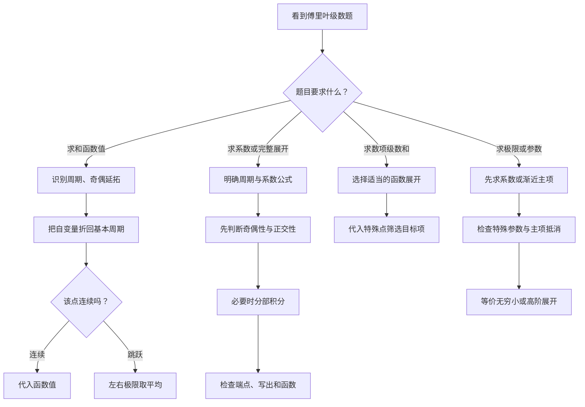

学习目标：从傅里叶级数的基础原理出发，掌握全部核心题型，并建立解决综合题、创新题的方法体系。

我已经读取你提供的 Google Drive 压缩包《数学分类题目1101.zip》，定位并核对了以下内容：

- 《考研核心题目》第七模块第3节《傅里叶级数》：20道核心题，包括历年真题、教材练习和拓展题。
- 《数学模拟题分类》第七模块第3节：7道分类模拟题。
- 张宇1000题第16章《无穷级数》中与傅里叶级数有关的练习。
- 李林880题第八章《无穷级数》对应题目。
- 李正元《无穷级数》章节中关于傅里叶展开、对称性与级数求和的题目。

另外，我核对了2023、2024、2025年考研数学一公开真题，确认其中包含这一节的重要考法。

[image](https://www.google.com/s2/favicons?domain=https://www.kuaiyizhi.cn\&sz=32)

快易知+2

以下将以这三年的真题为优先讲解对象，再深入到经典母题、模拟题和创新题。对于资料中标注但未独立核实年份的旧题，只按资料原标注介绍，不将其冒充已核实的真题。

## 一、先建立本节的完整知识框架

傅里叶级数的核心思想是：

利用不同频率的正弦函数与余弦函数，将一个周期函数表示成无限多个三角函数的叠加。

例如，一个看起来复杂的周期函数，可以表示为

$$
f(x)\sim \frac{a_0}{2} +\sum_{n=1}^{\infty} \left(a_n\cos nx+b_n\sin nx\right).
$$

其中：

- $a_0/2$ 表示平均水平。
- $a_n$ 表示第 $n$ 次余弦谐波的贡献。
- $b_n$ 表示第 $n$ 次正弦谐波的贡献。
- 高频项描述函数更精细的变化。

<Callout type="info" title="级数与原函数值并非处处相同">

这里首先使用符号 $\sim$，因为傅里叶级数是否在某点等于原函数值，需要检查相应的收敛条件。

</Callout>

### 1.1 考研数学一的核心考点地图

| 核心考点       | 必须掌握的能力          | 重要程度 |
| ---------- | ---------------- | ---- |
| 傅里叶级数及系数公式 | 正确识别周期与积分系数      | 必会   |
| 狄利克雷收敛定理   | 判断连续点、跳跃点、周期端点的和 | 极高   |
| 奇延拓与偶延拓    | 从正弦、余弦级数还原周期函数   | 极高   |
| 傅里叶系数计算    | 利用奇偶性、正交性和分部积分   | 极高   |
| 系数极限       | 结合等价无穷小及高阶项抵消    | 极高   |
| 完整傅里叶展开    | 计算系数并准确描述和函数     | 高    |
| 傅里叶级数求数项级数 | 通过特殊点求平方、立方倒数和   | 高    |
| 系数对称性与消项   | 判断哪些谐波恒为零        | 高    |
| 参数型傅里叶展开   | 识别特殊参数与频率重合      | 拓展   |
| 最小二乘与正交投影  | 将积分极值问题转化为系数问题   | 拓展   |

### 1.2 本节最重要的三个原则

原则一：看见正弦级数，首先想到奇延拓；看见余弦级数，首先想到偶延拓。

原则二：求傅里叶级数在某点的和，首先判断这一点是否为跳跃点，而不是立即求系数。

原则三：求系数、级数和以及极限时，优先利用奇偶性、正交性、周期性与特殊点，最后才考虑复杂积分。

这三个原则可以解决本节大量选择题、填空题，也构成综合解答题的基础。

## 二、基础理论：傅里叶级数到底是什么？

### 2.1 为什么可以用正弦和余弦展开函数？

先考虑周期为 $2\pi$ 的函数。

最基本的三角函数族为

$$
1,\cos x,\sin x,\cos2x,\sin2x,\ldots
$$

它们有一个非常重要的性质：正交性。

对于正整数 $m,n$，

$$
\int_{-\pi}^{\pi}\cos mx\cos nx\,dx = \begin{cases} 0,&m\ne n,\\ \pi,&m=n. \end{cases}
$$

同样，

$$
\int_{-\pi}^{\pi}\sin mx\sin nx\,dx = \begin{cases} 0,&m\ne n,\\ \pi,&m=n. \end{cases}
$$

而

$$
\int_{-\pi}^{\pi}\sin mx\cos nx\,dx=0.
$$

还要记住

$$
\int_{-\pi}^{\pi}\cos nx\,dx = \int_{-\pi}^{\pi}\sin nx\,dx=0.
$$

### 直观理解

可以把不同频率的三角函数看成相互独立的“方向”。

这和线性代数中的正交向量非常相似。

在线性代数中，一个向量可以沿正交基分解：

$$
\boldsymbol v=c_1\boldsymbol e_1+\cdots+c_n\boldsymbol e_n.
$$

傅里叶级数则是将函数沿不同的三角函数方向展开。

傅里叶系数相当于函数在这些方向上的投影。

这也解释了为什么它能够与线性代数中的正交投影、最小二乘法结合。

### 2.2 周期为 $2\pi$ 的傅里叶展开

设 $f(x)$ 以 $2\pi$ 为周期，满足适当的可积条件，则其傅里叶级数定义为

$$
\boxed{ \frac{a_0}{2} +\sum_{n=1}^{\infty} \left(a_n\cos nx+b_n\sin nx\right) }
$$

其中

$$
\boxed{ a_0=\frac1\pi\int_{-\pi}^{\pi}f(x)\,dx }
$$

$$
\boxed{ a_n=\frac1\pi\int_{-\pi}^{\pi}f(x)\cos nx\,dx }
$$

$$
\boxed{ b_n=\frac1\pi\int_{-\pi}^{\pi}f(x)\sin nx\,dx }
$$

这里 $n=1,2,\ldots$。

### 系数公式是怎么推导出来的？

先考虑有限三角多项式

$$
T(x)=\frac{a_0}{2} +\sum_{n=1}^{N}(a_n\cos nx+b_n\sin nx).
$$

两边乘 $\cos mx$，再在 $[-\pi,\pi]$ 上积分。

根据正交性，除了 $\cos mx$ 对应的项，其他积分全部为零。

于是

$$
\int_{-\pi}^{\pi}T(x)\cos mx\,dx =\pi a_m.
$$

因此

$$
a_m=\frac1\pi\int_{-\pi}^{\pi}T(x)\cos mx\,dx.
$$

对于一般可积函数，可以直接用同样的积分公式定义其傅里叶系数；在满足相应条件时，傅里叶级数进一步具有收敛性质。

### 最容易犯的错误

题目写作

$$
f(x)\sim\frac{a_0}{2}+\sum_{n=1}^{\infty}(\cdots)
$$

常数项是 $a_0/2$，不是 $a_0$。

因此计算完

$$
a_0=\frac1\pi\int_{-\pi}^{\pi}f(x)\,dx
$$

以后，还要除以 $2$ 才是傅里叶展开中的常数项。

### 2.3 一般周期 $2L$ 的公式

如果函数周期不是 $2\pi$，而是 $2L$，则必须把频率换成

$$
\frac{n\pi}{L}.
$$

傅里叶级数为

$$
\boxed{ f(x)\sim\frac{a_0}{2} +\sum_{n=1}^{\infty} \left[ a_n\cos\frac{n\pi x}{L} +b_n\sin\frac{n\pi x}{L} \right] }
$$

对应系数

$$
\boxed{ \begin{aligned} a_0&=\frac1L\int_{-L}^{L}f(x)\,dx,\\ a_n&=\frac1L\int_{-L}^{L} f(x)\cos\frac{n\pi x}{L}\,dx,\\ b_n&=\frac1L\int_{-L}^{L} f(x)\sin\frac{n\pi x}{L}\,dx. \end{aligned} }
$$

可以记为：

$$
\boxed{\text{周期 }2L \quad\Longrightarrow\quad \text{基频 }\frac{\pi}{L}}
$$

例如：

| 周期         | $L$   | 第 $n$ 次谐波                                   |
| ---------- | --------- | ----------------------------------------------- |
| $2\pi$ | $\pi$ | $\cos nx,\sin nx$                           |
| $2$    | $1$   | $\cos n\pi x,\sin n\pi x$                   |
| $4$    | $2$   | $\cos\frac{n\pi x}{2},\sin\frac{n\pi x}{2}$ |

系数公式可以在任意一个长度为 $2L$ 的完整周期区间上积分，不必局限于 $[-L,L]$。

## 三、狄利克雷收敛定理：本节最关键的定理

这是2025年真题以及大量经典题、模拟题的直接理论基础。

### 3.1 定理内容

如果周期函数 $f(x)$ 在一个周期内分段光滑（例如分段连续可导，且具有有限的单侧极限），那么它的傅里叶级数在每一点都收敛到

$$
\boxed{ S(x)=\frac{f(x-0)+f(x+0)}2 }
$$

这里两侧极限取自函数的周期延拓。

因此：

情况一：连续点

若 $f$ 在 $x_0$ 连续，

$$
S(x_0)=f(x_0).
$$

情况二：跳跃间断点

若

$$
f(x_0-0)=A,\qquad f(x_0+0)=B,
$$

则

$$
\boxed{S(x_0)=\frac{A+B}{2}}.
$$

情况三：周期拼接点

若周期为 $2L$，在 $x=L$ 处，

$$
\boxed{ S(L)=\frac{f(L-0)+f(-L+0)}2 }
$$

### 3.2 最容易忽略的一点

傅里叶级数在某点的和，不一定等于函数在该点人为规定的值。

例如，

$$
f(x)= \begin{cases} 1,&x<0,\\ 100,&x=0,\\ 3,&x>0. \end{cases}
$$

如果其周期延拓满足分段光滑条件，那么在 $x=0$ 处，傅里叶级数的和为

$$
S(0)=\frac{1+3}{2}=2.
$$

虽然

$$
f(0)=100,
$$

但这不影响傅里叶系数，也不改变傅里叶级数在跳跃点的收敛值。

原因是：改变有限个点的函数值，不改变其积分，因而不改变傅里叶系数。

考试结论：傅里叶级数看的是函数在某点两侧的变化趋势，而不是那个孤立点被赋予的数值。

## 四、真题精讲：先掌握近年最有代表性的考法

### 母题一：2025年考研数学一第12题

考点：正弦级数、周期性、跳跃点的收敛值。

这是本节应该优先掌握的真题。

[image](https://www.google.com/s2/favicons?domain=https://cf.kuaiyizhi.cn\&sz=32)

快易知+1

### 题目

已知

$$
f(x)= \begin{cases} 0,&0\le x<\dfrac12,\\[4pt] x^2,&\dfrac12\le x\le1. \end{cases}
$$

其傅里叶正弦级数为

$$
\sum_{n=1}^{\infty}b_n\sin n\pi x.
$$

设该级数的和函数为 $S(x)$，求

$$
S\left(-\frac72\right).
$$

<Steps>

  <Step>

### 第一步：识别展开方式

题目出现

$$
\sum_{n=1}^{\infty}b_n\sin n\pi x,
$$

这说明它是区间 $[0,1]$ 上的正弦级数。

因此必须将 $f(x)$：

1. 先从 $[0,1]$ 奇延拓到 $[-1,1]$；
2. 再进行周期为 $2$ 的周期延拓。

所以 $S(x)$ 满足

$$
S(x+2)=S(x),\qquad S(-x)=-S(x).
$$

  </Step>

  <Step>

### 第二步：利用周期性

因为

$$
-\frac72+4=\frac12,
$$

所以

$$
S\left(-\frac72\right)=S\left(\frac12\right).
$$

注意，周期为 $2$，平移 $4$ 当然也不改变函数值。

  </Step>

  <Step>

### 第三步：判断 $x=1/2$ 是否连续

在 $x=\frac12$ 处，

$$
f\left(\frac12-0\right)=0,
$$

而

$$
f\left(\frac12+0\right)=\frac14.
$$

左右极限不相等，因此这里是一个跳跃间断点。

根据狄利克雷收敛定理，

$$
S\left(\frac12\right) =\frac12\left(0+\frac14\right) =\frac18.
$$

最终答案：

$$
\boxed{S\left(-\frac72\right)=\frac18}
$$

  </Step>

</Steps>

### 这道题真正考查什么？

它不是要求你计算 $b_n$。

如果一上来就计算

$$
b_n=2\int_0^1f(x)\sin n\pi x\,dx,
$$

再试图对无穷级数求和，就偏离了最优解题路线。

这道题的核心流程只有三个环节：

$$
\boxed{ \text{识别正弦展开} \longrightarrow \text{按周期折回} \longrightarrow \text{左右极限取平均} }
$$

### 迁移能力：如何解决新题？

如果将原函数变成

$$
f(x)= \begin{cases} a,&0\le x<\frac12,\\ bx^2,&\frac12\le x\le1, \end{cases}
$$

则完全不需要重新计算傅里叶系数。

仍然有

$$
S\left(-\frac72\right)=S\left(\frac12\right).
$$

因此

$$
\boxed{ S\left(-\frac72\right)=\frac a2+\frac b8 }
$$

母题结论：只要题目要求的是傅里叶级数的某一点取值，通常应该先尝试通过函数延拓与收敛定理求解。

### 母题二：2024年考研数学一第13题

考点：余弦系数、分部积分、奇偶下标、等价无穷小。

这道题体现了傅里叶系数与极限计算相结合的考法。

[image](https://www.google.com/s2/favicons?domain=https://www.kuaiyizhi.cn\&sz=32)

快易知+1

### 题目

设

$$
f(x)=x+1,\qquad x\in[0,\pi].
$$

若其傅里叶余弦级数为

$$
f(x)=\frac{a_0}{2} +\sum_{n=1}^{\infty}a_n\cos nx,
$$

求

$$
\lim_{n\to\infty}n^2\sin a_{2n-1}.
$$

<Steps>

  <Step>

### 第一步：写出余弦系数

因为是 $[0,\pi]$ 上的余弦展开，

$$
a_n=\frac2\pi\int_0^\pi(x+1)\cos nx\,dx.
$$

将积分拆开：

$$
a_n=\frac2\pi \left[ \int_0^\pi x\cos nx\,dx + \int_0^\pi\cos nx\,dx \right].
$$

由于

$$
\int_0^\pi\cos nx\,dx=0,
$$

所以

$$
a_n=\frac2\pi\int_0^\pi x\cos nx\,dx.
$$

  </Step>

  <Step>

### 第二步：分部积分

$$
\begin{aligned} \int_0^\pi x\cos nx\,dx &=\left[\frac{x\sin nx}{n}\right]_0^\pi -\frac1n\int_0^\pi\sin nx\,dx\\ &=\frac{(-1)^n-1}{n^2}. \end{aligned}
$$

于是

$$
\boxed{ a_n=\frac{2[(-1)^n-1]}{\pi n^2} }
$$

由此得到

$$
a_{2n}=0,
$$

$$
a_{2n-1}=-\frac4{\pi(2n-1)^2}.
$$

  </Step>

  <Step>

### 第三步：利用等价无穷小

因为

$$
a_{2n-1}\longrightarrow0,
$$

所以

$$
\sin a_{2n-1}\sim a_{2n-1}.
$$

因此

$$
\begin{aligned} \lim_{n\to\infty}n^2\sin a_{2n-1} &=\lim_{n\to\infty}n^2a_{2n-1}\\ &=-\frac4\pi \lim_{n\to\infty}\frac{n^2}{(2n-1)^2}\\ &=-\frac4\pi\cdot\frac14. \end{aligned}
$$

得到

$$
\boxed{-\frac1\pi}
$$

  </Step>

</Steps>

### 这一类题的通用规律

若已知

$$
a_n\sim\frac{C}{n^p},
$$

要求

$$
\lim_{n\to\infty}n^p\varphi(a_{kn+r}),
$$

其中

$$
\varphi(t)\sim t\qquad(t\to0),
$$

那么通常可以化为

$$
\lim_{n\to\infty}n^pa_{kn+r}.
$$

当适当的渐近关系成立时，

$$
n^pa_{kn+r}\longrightarrow\frac{C}{k^p}.
$$

所以这类题需要特别注意两个问题：

第一，傅里叶系数是否趋于零。

第二，系数的下标是否发生了变化。

例如 $a_{2n-1}$ 的分母是 $(2n-1)^2$，不能直接把它当成 $n^2$。

### 母题三：2023年考研数学一第13题

考点：余弦系数、偶数下标系数和、频谱筛选。

这一题很适合训练“一题多解”的能力。

[image](https://www.google.com/s2/favicons?domain=https://www.kuaiyizhi.cn\&sz=32)

快易知+1

### 题目

设

$$
f(x)=1-x,\qquad 0\le x\le1.
$$

其傅里叶余弦展开为

$$
f(x)=\frac{a_0}{2} +\sum_{n=1}^{\infty}a_n\cos n\pi x.
$$

求

$$
\sum_{n=1}^{\infty}a_{2n}.
$$

<Tabs items={["直接计算系数", "特殊点代入"]} defaultIndex={0}>

  <Tab value="直接计算系数">

### 方法一：直接计算系数

根据余弦级数公式，

$$
a_n=2\int_0^1(1-x)\cos n\pi x\,dx.
$$

记 $k=n\pi$，分部积分得

$$
\begin{aligned} \int_0^1(1-x)\cos kx\,dx &=\left[\frac{(1-x)\sin kx}{k}\right]_0^1\\ &\quad+\frac1k\int_0^1\sin kx\,dx\\ &=\frac{1-\cos k}{k^2}. \end{aligned}
$$

因此

$$
\boxed{ a_n=\frac{2[1-(-1)^n]}{n^2\pi^2} }
$$

当下标为偶数时，

$$
a_{2n}=\frac{2(1-1)}{4n^2\pi^2}=0.
$$

所以

$$
\boxed{ \sum_{n=1}^{\infty}a_{2n}=0 }
$$

这里要注意系数通项的符号：正确结果是 $1-(-1)^n$，不是相反的顺序。

  </Tab>

  <Tab value="特殊点代入">

### 方法二：特殊点代入法

这种方法更值得推广。

先计算

$$
a_0=2\int_0^1(1-x)\,dx=1.
$$

由于余弦级数对应偶延拓和周期为 $2$ 的延拓，且该延拓在 $x=0,1$ 处均连续，因此

$$
S(0)=f(0)=1,
$$

$$
S(1)=f(1)=0.
$$

在 $x=0$ 代入傅里叶级数：

$$
1=\frac{a_0}{2}+\sum_{n=1}^{\infty}a_n.
$$

在 $x=1$ 代入：

$$
0=\frac{a_0}{2} +\sum_{n=1}^{\infty}(-1)^na_n.
$$

两式相加：

$$
1=a_0+2\sum_{n=1}^{\infty}a_{2n}.
$$

又因为 $a_0=1$，得到

$$
\boxed{\sum_{n=1}^{\infty}a_{2n}=0}.
$$

  </Tab>

</Tabs>

### 为什么第二种方法更重要？

因为第一种方法要求能够计算出全部系数。

而第二种方法只需要知道：

$$
S(0),\quad S(1),\quad a_0.
$$

事实上，对于满足端点收敛条件的余弦级数

$$
S(x)=\frac{a_0}{2} +\sum_{n=1}^{\infty}a_n\cos n\pi x,
$$

可以得到

$$
\boxed{ \sum_{n=1}^{\infty}a_{2n} =\frac{S(0)+S(1)-a_0}{2} }
$$

和

$$
\boxed{ \sum_{n=1}^{\infty}a_{2n-1} =\frac{S(0)-S(1)}2 }
$$

这是非常有用的通用推论。

遇到求偶数项系数和、奇数项系数和的题目，应当优先考虑在特殊点建立方程，而不是直接计算所有系数。

## 五、核心题型：周期延拓、奇延拓与偶延拓

这是连接基础理论与实际解题的关键部分。

### 5.1 正弦级数与余弦级数有什么本质区别？

设函数只定义在

$$
0\le x\le L.
$$

它有两种常用的半区间傅里叶展开。

### 第一种：傅里叶正弦级数

形式为

$$
S_{\mathrm s}(x) =\sum_{n=1}^{\infty}b_n \sin\frac{n\pi x}{L},
$$

其中

$$
\boxed{ b_n=\frac2L\int_0^Lf(x) \sin\frac{n\pi x}{L}\,dx }
$$

它对应的延拓为

$$
F_{\mathrm s}(x)= \begin{cases} -f(-x),&-L<x<0,\\ f(x),&0<x<L. \end{cases}
$$

再将这个函数按周期 $2L$ 延拓。

因此其和函数必然满足

$$
S_{\mathrm s}(-x)=-S_{\mathrm s}(x),
$$

以及

$$
S_{\mathrm s}(x+2L)=S_{\mathrm s}(x).
$$

特别地，

$$
\boxed{S_{\mathrm s}(0)=S_{\mathrm s}(L)=0}.
$$

这既可以从每一项的正弦函数直接看出，也与周期拼接点的左右极限平均值一致。

即使

$$
f(L)\ne0,
$$

正弦级数在 $x=L$ 的和仍然为零。

### 第二种：傅里叶余弦级数

形式为

$$
S_{\mathrm c}(x) =\frac{a_0}{2} +\sum_{n=1}^{\infty}a_n \cos\frac{n\pi x}{L}.
$$

系数为

$$
\boxed{ a_n=\frac2L\int_0^Lf(x) \cos\frac{n\pi x}{L}\,dx }
$$

其中 $n=0,1,2,\ldots$。

它对应偶延拓：

$$
F_{\mathrm c}(x)=f(|x|),\qquad -L\le x\le L,
$$

然后按周期 $2L$ 延拓。

因此

$$
S_{\mathrm c}(-x)=S_{\mathrm c}(x),
$$

$$
S_{\mathrm c}(x+2L)=S_{\mathrm c}(x).
$$

如果 $f$ 在端点有相应的单侧连续性，那么余弦级数在 $0,L$ 的和分别为

$$
S_{\mathrm c}(0)=f(0+),
$$

$$
S_{\mathrm c}(L)=f(L-).
$$

这与正弦级数有重要区别。

### 5.2 必须熟记的对比

| 性质              | 正弦级数                       | 余弦级数                       |
| --------------- | -------------------------- | -------------------------- |
| 延拓方式            | 奇延拓                        | 偶延拓                        |
| 周期              | $2L$                   | $2L$                   |
| 奇偶性             | 奇函数                        | 偶函数                        |
| 系数              | $\frac2L\int_0^Lf\sin$ | $\frac2L\int_0^Lf\cos$ |
| 在 $x=0$ 处的和 | $0$                    | 通常为 $f(0+)$            |
| 在 $x=L$ 处的和 | $0$                    | 通常为 $f(L-)$            |
| 解题重点            | 符号变化、端点跳跃                  | 对称折返、内部跳跃                  |

### 母题四：张宇8套卷第4套第3题

考点：余弦级数、周期折返、内部跳跃点。

题目给出

$$
f(x)= \begin{cases} x,&0\le x\le\frac12,\\ 2-2x,&\frac12<x<1. \end{cases}
$$

定义

$$
S(x)=\frac{a_0}{2} +\sum_{n=1}^{\infty}a_n\cos n\pi x,
$$

其中

$$
a_n=2\int_0^1f(x)\cos n\pi x\,dx.
$$

求

$$
S\left(-\frac52\right).
$$

### 解题过程

由于是余弦级数，$S(x)$ 是偶函数且周期为 $2$。

所以

$$
S\left(-\frac52\right) =S\left(-\frac12\right) =S\left(\frac12\right).
$$

观察 $x=\frac12$：

左极限为

$$
f\left(\frac12-0\right)=\frac12.
$$

右极限为

$$
f\left(\frac12+0\right)=2-2\cdot\frac12=1.
$$

因此

$$
S\left(\frac12\right) =\frac{\frac12+1}{2} =\frac34.
$$

最终

$$
\boxed{S(-5/2)=\frac34}.
$$

### 进一步推广

原函数在 $[0,1]$ 上分段给出时，求

$$
S(-2k-t),\qquad 0<t<1,
$$

先利用周期性、偶性化为

$$
S(t),
$$

然后再判断 $t$ 是否是跳跃点。

不要因为某个点在分段函数里被归入第一段，就自动认为级数和等于第一段的函数值。

### 母题五：李永乐六套卷第6套第13题

考点：周期拼接点、函数极限、泰勒展开、傅里叶级数的综合应用。

这道题比普通跳跃点问题难，因为左右极限不能直接代入，需要先处理两种特殊极限。

### 题目

设 $f(x)$ 是周期为 $2$ 的函数，在 $[0,2)$ 上满足

$$
f(x)= \begin{cases} 0,&x=0,\\[3pt] \dfrac{\int_0^x(\cos t-1)\,dt}{x^3}, &0<x<1,\\[9pt] \dfrac{(3-x)^{1/(2-x)}-e}{2-x}, &1\le x<2. \end{cases}
$$

求其傅里叶级数在 $x=0$ 的收敛值。

<Steps>

  <Step>

### 第一步：明确真正需要计算的对象

设傅里叶级数和函数为 $S(x)$。

由于 $f$ 的周期为 $2$，

$$
S(0)=\frac{f(0+)+f(2-)}2.
$$

这里根本不需要计算任何傅里叶系数。

问题被转化为两个函数极限。

  </Step>

  <Step>

### 第二步：求 $f(0+)$

因为

$$
\int_0^x(\cos t-1)\,dt =\sin x-x,
$$

所以

$$
f(0+)=\lim_{x\to0+}\frac{\sin x-x}{x^3}.
$$

利用泰勒展开

$$
\sin x=x-\frac{x^3}{6}+O(x^5),
$$

得到

$$
\boxed{f(0+)=-\frac16}.
$$

  </Step>

  <Step>

### 第三步：求 $f(2-)$

令

$$
t=2-x,
$$

则 $t\to0+$，并且

$$
3-x=1+t.
$$

因此

$$
f(2-) =\lim_{t\to0+} \frac{(1+t)^{1/t}-e}{t}.
$$

先考虑指数部分。

$$
(1+t)^{1/t} =\exp\left(\frac{\ln(1+t)}t\right).
$$

由

$$
\frac{\ln(1+t)}t =1-\frac t2+O(t^2),
$$

得到

$$
\begin{aligned} (1+t)^{1/t} &=e\exp\left(-\frac t2+O(t^2)\right)\\ &=e\left(1-\frac t2+O(t^2)\right). \end{aligned}
$$

所以

$$
\boxed{f(2-)=-\frac e2}.
$$

  </Step>

  <Step>

### 第四步：代入傅里叶收敛公式

$$
\begin{aligned} S(0) &=\frac12\left(-\frac16-\frac e2\right)\\ &=\boxed{-\frac1{12}-\frac e4}. \end{aligned}
$$

  </Step>

</Steps>

### 这类综合题的识别方法

出题人可能把左右极限隐藏成：

- 泰勒展开型极限；
- 洛必达型极限；
- 变上限积分型极限；
- 含参函数极限；
- 指数对数型极限。

但是题目的核心仍然是

$$
\boxed{S(x_0)=\frac{f(x_0-0)+f(x_0+0)}2}.
$$

傅里叶级数在这里只提供解题入口，真正的计算任务来自极限章节。

这也是考研综合题常见的命题方式：把基础定理与以前学过的计算方法组合起来。

## 六、核心题型：傅里叶系数计算与频谱结构

求傅里叶系数时，不应每次都机械地进行复杂积分。

正确顺序是：

$$
\boxed{ \text{明确周期} \to \text{判断奇偶性} \to \text{利用正交性} \to \text{分部积分} }
$$

### 6.1 奇偶性如何简化计算？

设 $f$ 的周期为 $2\pi$。

如果 $f$ 是偶函数，

$$
f(-x)=f(x),
$$

则

$$
b_n=0.
$$

因此

$$
\boxed{ f(x)\sim\frac{a_0}{2}+\sum_{n=1}^{\infty}a_n\cos nx }
$$

其中

$$
a_n=\frac2\pi\int_0^\pi f(x)\cos nx\,dx.
$$

如果 $f$ 是奇函数，

$$
f(-x)=-f(x),
$$

则

$$
a_0=0,\qquad a_n=0.
$$

所以

$$
\boxed{ f(x)\sim\sum_{n=1}^{\infty}b_n\sin nx }
$$

且

$$
b_n=\frac2\pi\int_0^\pi f(x)\sin nx\,dx.
$$

### 更一般的函数怎么办？

任何函数都可以分解为

$$
f(x)=f_{\mathrm e}(x)+f_{\mathrm o}(x),
$$

其中

$$
f_{\mathrm e}(x)=\frac{f(x)+f(-x)}2,
$$

$$
f_{\mathrm o}(x)=\frac{f(x)-f(-x)}2.
$$

于是：

- 余弦系数只由偶部决定；
- 正弦系数只由奇部决定。

这一结论对于含参数函数尤其有用。

### 母题六：完整展开与参数综合

下面使用《考研核心题目》中的一类重要拓展题。

设

$$
f_\lambda(x)=x^2+\lambda x, \qquad -\pi\le x\le\pi,
$$

其中 $\lambda$ 是实参数。

要求：

（1）求傅里叶级数。

（2）求傅里叶级数在 $x=\pi$ 的和。

（3）确定什么情况下，傅里叶级数在 $x=\pi$ 的和等于 $f_\lambda(\pi)$。

<Steps>

  <Step>

### 第一步：拆分奇偶部分

$$
x^2\quad\text{为偶函数},
$$

$$
\lambda x\quad\text{为奇函数}.
$$

因此余弦系数只需考虑 $x^2$，正弦系数只需考虑 $\lambda x$。

  </Step>

  <Step>

### 第二步：计算常数项

$$
\begin{aligned} a_0 &=\frac1\pi\int_{-\pi}^{\pi}(x^2+\lambda x)\,dx\\ &=\frac2\pi\int_0^\pi x^2\,dx\\ &=\frac{2\pi^2}{3}. \end{aligned}
$$

所以常数项为

$$
\frac{a_0}{2}=\frac{\pi^2}{3}.
$$

  </Step>

  <Step>

### 第三步：计算余弦系数

$$
a_n=\frac2\pi\int_0^\pi x^2\cos nx\,dx.
$$

第一次分部积分：

$$
\int_0^\pi x^2\cos nx\,dx =-\frac2n\int_0^\pi x\sin nx\,dx.
$$

第二次分部积分：

$$
\int_0^\pi x\sin nx\,dx =-\frac{\pi(-1)^n}{n}.
$$

于是

$$
\boxed{ a_n=\frac{4(-1)^n}{n^2} }
$$

  </Step>

  <Step>

### 第四步：计算正弦系数

$$
b_n=\frac{2\lambda}{\pi} \int_0^\pi x\sin nx\,dx.
$$

利用刚才的积分结果：

$$
\boxed{ b_n=\frac{2\lambda(-1)^{n+1}}n }
$$

  </Step>

  <Step>

### 第五步：得到完整傅里叶级数

$$
\boxed{ f_\lambda(x)\sim \frac{\pi^2}{3} + \sum_{n=1}^{\infty} \left[ \frac{4(-1)^n}{n^2}\cos nx + \frac{2\lambda(-1)^{n+1}}n\sin nx \right] }
$$

这个展开在 $-\pi<x<\pi$ 内收敛到原函数。

  </Step>

  <Step>

### 第六步：求周期拼接点处的和

在 $x=\pi$，

$$
f_\lambda(\pi-0)=\pi^2+\lambda\pi.
$$

由于周期为 $2\pi$，

$$
f_\lambda(\pi+0)=f_\lambda(-\pi+0) =\pi^2-\lambda\pi.
$$

所以

$$
\begin{aligned} S_\lambda(\pi) &=\frac{\pi^2+\lambda\pi+\pi^2-\lambda\pi}{2}\\ &=\boxed{\pi^2}. \end{aligned}
$$

注意：最终结果与 $\lambda$ 无关。

  </Step>

  <Step>

### 第七步：确定参数

要求

$$
S_\lambda(\pi)=f_\lambda(\pi).
$$

即

$$
\pi^2=\pi^2+\lambda\pi.
$$

因此

$$
\boxed{\lambda=0}.
$$

  </Step>

</Steps>

### 这道题的深层意义

这个例子同时体现了三个现象。

第一，函数的偶部与奇部分别控制余弦系数和正弦系数。

第二，参数 $\lambda$ 虽然改变了函数，但周期端点处的傅里叶收敛值可能保持不变。

第三，系数具有不同的衰减速度：

$$
a_n=O\left(\frac1{n^2}\right),
$$

而当 $\lambda\ne0$ 时，

$$
b_n=O\left(\frac1n\right).
$$

这与周期拼接点的跳跃现象有关。

通常情况下，函数的周期延拓存在跳跃时，其傅里叶系数往往具有 $n^{-1}$ 级别的主项；当函数连续且具有足够的分段光滑性时，系数可能衰减得更快。

因此，未来如果出现“参数决定傅里叶系数衰减速度”的新题，可以反过来研究周期拼接点的连续性。

## 七、核心题型：利用傅里叶级数计算数项级数

这类题属于完整展开的进一步应用。

命题逻辑是：

$$
\boxed{ \text{选择适当函数} \to \text{求傅里叶系数} \to \text{代入特殊点} \to \text{得到目标级数} }
$$

### 母题七：由 $|x|$ 的展开求平方倒数和

张宇1000题中包含相应练习，《考研核心题目》也通过同类型题进行了拓展。

### 题目

将

$$
f(x)=|x|,\qquad -\pi\le x\le\pi
$$

展开成傅里叶级数，并求

$$
\sum_{n=1}^{\infty}\frac1{(2n-1)^2}
$$

及

$$
\sum_{n=1}^{\infty}\frac1{n^2}.
$$

<Steps>

  <Step>

### 第一步：利用奇偶性

因为 $|x|$ 是偶函数，

$$
b_n=0.
$$

所以只需求余弦系数。

  </Step>

  <Step>

### 第二步：计算 $a_0$

$$
a_0=\frac2\pi\int_0^\pi x\,dx=\pi.
$$

因此

$$
\frac{a_0}{2}=\frac\pi2.
$$

  </Step>

  <Step>

### 第三步：计算 $a_n$

$$
a_n=\frac2\pi\int_0^\pi x\cos nx\,dx.
$$

利用已经掌握的积分：

$$
\int_0^\pi x\cos nx\,dx =\frac{(-1)^n-1}{n^2}.
$$

所以

$$
a_n=\frac{2[(-1)^n-1]}{\pi n^2}.
$$

于是

$$
a_n= \begin{cases} 0,&n\text{ 为偶数},\\[3pt] -\dfrac4{\pi n^2},&n\text{ 为奇数}. \end{cases}
$$

  </Step>

  <Step>

### 第四步：写出傅里叶展开

$$
\boxed{ |x| =\frac\pi2 -\frac4\pi \sum_{n=1}^{\infty} \frac{\cos(2n-1)x}{(2n-1)^2} }
$$

这里周期延拓连续且分段光滑，所以在 $[-\pi,\pi]$ 上可以取等号。

  </Step>

  <Step>

### 第五步：代入特殊点 $x=0$

因为

$$
|0|=0,\qquad \cos0=1,
$$

所以

$$
0=\frac\pi2 -\frac4\pi\sum_{n=1}^{\infty}\frac1{(2n-1)^2}.
$$

因此

$$
\boxed{ \sum_{n=1}^{\infty}\frac1{(2n-1)^2} =\frac{\pi^2}{8} }
$$

  </Step>

  <Step>

### 第六步：求所有正整数平方倒数和

设

$$
A=\sum_{n=1}^{\infty}\frac1{n^2}.
$$

将其分成奇数项和偶数项：

$$
A= \sum_{n=1}^{\infty}\frac1{(2n-1)^2} + \sum_{n=1}^{\infty}\frac1{(2n)^2}.
$$

由于

$$
\sum_{n=1}^{\infty}\frac1{(2n)^2}=\frac A4,
$$

所以

$$
A=\frac{\pi^2}{8}+\frac A4.
$$

解得

$$
\boxed{ \sum_{n=1}^{\infty}\frac1{n^2} =\frac{\pi^2}{6} }
$$

  </Step>

</Steps>

### 母题总结

这类题最重要的是识别傅里叶系数中出现的结构：

$$
\frac1{n^2},\qquad \frac{(-1)^n}{n^2},\qquad \frac1{(2n-1)^2}.
$$

然后寻找对应的特殊点。

常用的特殊点包括

$$
x=0,\qquad x=\frac\pi2,\qquad x=\pi.
$$

因为这些点能够让

$$
\sin nx,\quad \cos nx
$$

化成 $0,1,-1$，或者周期循环的数列。

### 母题八：利用余弦级数求交错平方倒数和

这类题在李林880及核心题目中都有对应练习。

设

$$
f(x)=1-x^2,\qquad 0\le x\le\pi.
$$

将它展开成傅里叶余弦级数，并求

$$
A=\sum_{n=1}^{\infty}\frac{(-1)^{n-1}}{n^2}.
$$

<Steps>

  <Step>

### 第一步：计算常数项

$$
\begin{aligned} a_0 &=\frac2\pi\int_0^\pi(1-x^2)\,dx\\ &=2-\frac{2\pi^2}{3}. \end{aligned}
$$

所以

$$
\frac{a_0}{2}=1-\frac{\pi^2}{3}.
$$

  </Step>

  <Step>

### 第二步：计算余弦系数

对于 $n\ge1$，

$$
a_n=\frac2\pi\int_0^\pi(1-x^2)\cos nx\,dx.
$$

其中常数项对应的积分为零，因此

$$
a_n=-\frac2\pi\int_0^\pi x^2\cos nx\,dx.
$$

利用前面母题六已经得到的结果，

$$
\boxed{ a_n=\frac{4(-1)^{n+1}}{n^2} }
$$

  </Step>

  <Step>

### 第三步：写出展开

$$
\boxed{ 1-x^2 = 1-\frac{\pi^2}{3} + 4\sum_{n=1}^{\infty} \frac{(-1)^{n+1}}{n^2}\cos nx }
$$

  </Step>

  <Step>

### 第四步：代入 $x=0$

$$
1= 1-\frac{\pi^2}{3} + 4\sum_{n=1}^{\infty}\frac{(-1)^{n+1}}{n^2}.
$$

所以

$$
\boxed{ \sum_{n=1}^{\infty}\frac{(-1)^{n-1}}{n^2} =\frac{\pi^2}{12} }
$$

  </Step>

</Steps>

### 能否不用重新展开？

可以。

利用

$$
\sum_{n=1}^{\infty}\frac1{n^2}=\frac{\pi^2}{6},
$$

有

$$
\begin{aligned} \sum_{n=1}^{\infty}\frac{(-1)^{n-1}}{n^2} &=\sum_{n=1}^{\infty}\frac1{n^2} -2\sum_{n=1}^{\infty}\frac1{(2n)^2}\\ &=A-\frac A2\\ &=\frac A2. \end{aligned}
$$

因此仍然得到

$$
\frac{\pi^2}{12}.
$$

这说明在考场上，若你已经掌握一个经典级数的和，不一定需要每次重新作傅里叶展开。

## 八、进阶题型：正弦级数与奇数立方倒数和

前面利用余弦展开求出了平方倒数和。进一步的问题是：

如果目标级数包含

$$
\frac1{(2n-1)^3},
$$

应该如何构造傅里叶级数？

这正是《考研核心题目》中一道具有代表性的拓展母题。

### 母题九：求交错奇数立方倒数和

设

$$
f(x)=x(\pi-x),\qquad 0\le x\le\pi.
$$

将其展开为正弦级数，并求

$$
A=\sum_{n=0}^{\infty}\frac{(-1)^n}{(2n+1)^3}.
$$

<Steps>

  <Step>

### 第一步：写出正弦系数

$$
b_n=\frac2\pi\int_0^\pi x(\pi-x)\sin nx\,dx.
$$

这里应当注意

$$
f(0)=f(\pi)=0.
$$

这意味着第一次分部积分的边界项恰好为零。

  </Step>

  <Step>

### 第二步：分部积分

记

$$
I_n=\int_0^\pi x(\pi-x)\sin nx\,dx.
$$

取

$$
u=x(\pi-x),\qquad dv=\sin nx\,dx.
$$

于是

$$
\begin{aligned} I_n &=\frac1n\int_0^\pi(\pi-2x)\cos nx\,dx\\ &=-\frac2n\int_0^\pi x\cos nx\,dx. \end{aligned}
$$

由

$$
\int_0^\pi x\cos nx\,dx =\frac{(-1)^n-1}{n^2},
$$

得到

$$
I_n=\frac{2[1-(-1)^n]}{n^3}.
$$

因此

$$
\boxed{ b_n=\frac{4[1-(-1)^n]}{\pi n^3} }
$$

即

$$
b_n= \begin{cases} 0,&n\text{ 为偶数},\\[3pt] \dfrac8{\pi n^3},&n\text{ 为奇数}. \end{cases}
$$

  </Step>

  <Step>

### 第三步：得到正弦展开

$$
\boxed{ x(\pi-x) = \frac8\pi \sum_{n=0}^{\infty} \frac{\sin(2n+1)x}{(2n+1)^3} }
$$

因为该函数的奇延拓在周期拼接点连续，且分段光滑，所以在 $[0,\pi]$ 上可以取等号。

  </Step>

  <Step>

### 第四步：寻找特殊点

目标级数出现

$$
(-1)^n.
$$

而

$$
\sin\frac{(2n+1)\pi}{2}=(-1)^n.
$$

所以取

$$
x=\frac\pi2.
$$

左边为

$$
f\left(\frac\pi2\right)=\frac{\pi^2}{4}.
$$

右边为

$$
\frac8\pi \sum_{n=0}^{\infty}\frac{(-1)^n}{(2n+1)^3}.
$$

于是

$$
\frac{\pi^2}{4}=\frac8\pi A.
$$

最终

$$
\boxed{ \sum_{n=0}^{\infty}\frac{(-1)^n}{(2n+1)^3} =\frac{\pi^3}{32} }
$$

  </Step>

</Steps>

### 怎样举一反三？

这道题说明，构造函数时应考虑目标级数的两个特征。

第一个特征：分母次数。

为了产生 $n^{-3}$，可以考虑经过多次分部积分后得到三次倒数的多项式函数。

第二个特征：下标与符号。

为了产生奇数下标及交错符号，可以利用

$$
1-(-1)^n
$$

筛选奇数项，再用

$$
\sin\frac{(2n+1)\pi}{2}=(-1)^n
$$

产生交错符号。

这是一种反向构造傅里叶级数的思维方式，比单纯记忆级数求和公式更有价值。

## 九、进阶题型：利用对称性判断傅里叶系数

这类题在张宇1000题、李正元练习中都有体现。

核心思想是：函数的对称性决定傅里叶展开中哪些频率能够出现。

### 9.1 四种必须掌握的对称性

对于周期 $2\pi$ 的可积函数：

| 条件                   | 系数结论                        |
| -------------------- | --------------------------- |
| $f(-x)=f(x)$     | $b_n=0$                 |
| $f(-x)=-f(x)$    | $a_0=a_n=0$             |
| $f(x+\pi)=-f(x)$ | $a_0=a_{2n}=b_{2n}=0$ |
| $f(x+\pi)=f(x)$  | $a_{2n-1}=b_{2n-1}=0$ |

前两种是普通奇偶性。

后两种分别叫作半周期反对称性与半周期重复性。

它们能进一步筛选出奇次或偶次谐波。

### 母题十：李正元练习——证明偶次余弦系数为零

设 $f(x)$ 是 $[-\pi,\pi]$ 上的偶函数，且满足

$$
f\left(\frac\pi2+t\right) =-f\left(\frac\pi2-t\right), \qquad -\frac\pi2\le t\le\frac\pi2.
$$

证明：

$$
a_{2n}=0,\qquad n=1,2,\ldots
$$

<Steps>

  <Step>

### 第一步：把条件转化为反射关系

令

$$
x=\frac\pi2+t.
$$

那么

$$
\frac\pi2-t=\pi-x.
$$

因此原条件等价于

$$
\boxed{f(x)=-f(\pi-x)},\qquad 0\le x\le\pi.
$$

这说明函数关于 $x=\pi/2$ 具有反对称性。

  </Step>

  <Step>

### 第二步：写出余弦系数

由于 $f$ 为偶函数，

$$
a_{2n} =\frac2\pi\int_0^\pi f(x)\cos2nx\,dx.
$$

记

$$
I=\int_0^\pi f(x)\cos2nx\,dx.
$$

  </Step>

  <Step>

### 第三步：利用对称代换

令

$$
x=\pi-t.
$$

则

$$
I=\int_0^\pi f(\pi-t)\cos[2n(\pi-t)]\,dt.
$$

由于

$$
f(\pi-t)=-f(t)
$$

及

$$
\cos(2n\pi-2nt)=\cos2nt,
$$

得到

$$
I=-\int_0^\pi f(t)\cos2nt\,dt=-I.
$$

所以

$$
I=0.
$$

最终

$$
\boxed{a_{2n}=0}.
$$

  </Step>

</Steps>

### 这类证明题的标准套路

当题目给出某种对称关系时：

1. 将对称关系转化为 $f(a-x)=\pm f(x)$ 的形式。
2. 写出对应的傅里叶系数积分。
3. 对积分作对称代换。
4. 判断新积分与原积分是相等还是相反。
5. 如果得到 $I=-I$，立即推出 $I=0$。

这套方法不仅适用于傅里叶级数，也适用于对称积分、正交性证明和某些含参积分问题。

## 十、进阶题型：带参数的傅里叶级数

参数问题最重要的难点是：

普通参数公式在某些特殊参数下可能失效，必须单独讨论。

### 母题十一：李正元练习——参数频率重合

设

$$
f(x)=\sin ax,\qquad -\pi\le x\le\pi,\quad a>0.
$$

将其展开为以 $2\pi$ 为周期的傅里叶级数。

<Steps>

  <Step>

### 第一步：判断奇偶性

$\sin ax$ 是奇函数。

所以

$$
a_0=a_n=0.
$$

只需计算

$$
b_n=\frac2\pi\int_0^\pi\sin ax\sin nx\,dx.
$$

  </Step>

  <Step>

### 第二步：利用积化和差

$$
2\sin ax\sin nx =\cos(a-n)x-\cos(a+n)x.
$$

因此，当 $a\ne n$ 时，

$$
\begin{aligned} b_n &=\frac1\pi \int_0^\pi[\cos(a-n)x-\cos(a+n)x]\,dx\\ &=\frac1\pi \left[ \frac{\sin(a-n)\pi}{a-n} -\frac{\sin(a+n)\pi}{a+n} \right]. \end{aligned}
$$

利用

$$
\sin(a\pm n)\pi=(-1)^n\sin a\pi,
$$

化简得

$$
\boxed{ b_n= \frac{2n(-1)^{n+1}\sin a\pi} {\pi(n^2-a^2)} }
$$

所以当 $a\notin\mathbb N^+$ 时，

$$
\boxed{ \sin ax= \frac{2\sin a\pi}{\pi} \sum_{n=1}^{\infty} \frac{(-1)^{n+1}n}{n^2-a^2}\sin nx }
$$

该等式在 $-\pi<x<\pi$ 成立。

  </Step>

  <Step>

### 第三步：单独处理整数参数

如果

$$
a=m\in\mathbb N^+,
$$

那么上述通项在 $n=m$ 处出现

$$
\frac00.
$$

不能简单认为系数为零，也不能认为傅里叶展开不存在。

此时应回到原始积分：

$$
b_n=\frac2\pi\int_0^\pi\sin mx\sin nx\,dx.
$$

根据正交性，

$$
b_n= \begin{cases} 1,&n=m,\\ 0,&n\ne m. \end{cases}
$$

于是

$$
\boxed{f(x)=\sin mx}.
$$

  </Step>

  <Step>

### 第四步：讨论端点收敛值

当 $a$ 不是整数时，在 $x=\pi$ 处，

$$
f(\pi-0)=\sin a\pi,
$$

而周期延拓后的右极限为

$$
f(\pi+0)=f(-\pi+0)=-\sin a\pi.
$$

所以

$$
\boxed{S(\pi)=0}.
$$

同理，

$$
S(-\pi)=0.
$$

整数情形下，原函数在端点也等于零。

  </Step>

</Steps>

### 一定要掌握的命题陷阱

只要傅里叶系数公式的分母出现

$$
n^2-a^2,
$$

就应检查

$$
a=n
$$

是否属于允许的参数范围。

对于特殊参数，首先回到系数积分定义，而不是机械代入普通公式。

## 十一、创新考法：傅里叶系数与相邻下标抵消

这是李永乐六套卷第1套第14题涉及的题型。

这种题的特色是：单个系数虽然只有 $n^{-2}$ 级别，但两个相邻下标的系数相加以后，主项可能抵消，从而出现 $n^{-3}$ 级别。

### 母题十二：求相邻系数组合的极限

设

$$
f(x)=x^2,\qquad 0\le x\le\pi,
$$

其余弦系数为 $a_n$。

求

$$
\lim_{n\to\infty}n^3(a_{2n}+a_{2n+1}).
$$

<Steps>

  <Step>

### 第一步：计算傅里叶系数

前面已经得到

$$
a_n=\frac{4(-1)^n}{n^2}.
$$

因此

$$
a_{2n}=\frac4{4n^2}=\frac1{n^2},
$$

而

$$
a_{2n+1}=-\frac4{(2n+1)^2}.
$$

  </Step>

  <Step>

### 第二步：先合并，再求极限

$$
\begin{aligned} a_{2n}+a_{2n+1} &=\frac1{n^2}-\frac4{(2n+1)^2}\\ &=\frac{(2n+1)^2-4n^2} {n^2(2n+1)^2}\\ &=\frac{4n+1}{n^2(2n+1)^2}. \end{aligned}
$$

所以

$$
\begin{aligned} n^3(a_{2n}+a_{2n+1}) &=\frac{n(4n+1)}{(2n+1)^2}\\ &\longrightarrow1. \end{aligned}
$$

最终

$$
\boxed{1}
$$

  </Step>

</Steps>

### 为什么不能分别求极限？

因为

$$
n^3a_{2n}=n\longrightarrow+\infty,
$$

而

$$
n^3a_{2n+1}\longrightarrow-\infty.
$$

两项分别求极限会出现没有直接意义的

$$
+\infty-\infty.
$$

正确方法是先将两个表达式合并，再处理极限。

### 未来可能怎样创新？

例如题目要求

$$
\lim_{n\to\infty}n^3(a_{2n}-c\,a_{2n+1}),
$$

你就需要先判断参数 $c$ 是否能够让主项抵消。

这种题可以结合：

- 傅里叶系数计算；
- 参数确定；
- 高阶无穷小；
- 泰勒展开；
- 数列极限。

因此，相邻系数的组合极限是值得重点训练的综合题型。

## 十二、创新考法：正交性与最小二乘法

这一考点在张宇8套卷第3套第2题中出现。

它虽然不是传统的傅里叶展开问题，却能帮助你真正理解傅里叶系数为什么采用积分形式。

### 母题十三：函数的最佳三角近似

设函数 $f(x)$ 在 $[-\pi,\pi]$ 上连续。

令

$$
F(a)=\int_{-\pi}^{\pi}[f(x)-a\cos nx]^2\,dx,
$$

其中 $n\in\mathbb N^+$。

求使 $F(a)$ 最小的 $a$。

<Tabs items={["直接求导", "正交投影"]} defaultIndex={0}>

  <Tab value="直接求导">

### 方法一：直接求导

展开平方：

$$
\begin{aligned} F(a) &=\int_{-\pi}^{\pi}f^2(x)\,dx\\ &\quad-2a\int_{-\pi}^{\pi}f(x)\cos nx\,dx\\ &\quad+a^2\int_{-\pi}^{\pi}\cos^2nx\,dx. \end{aligned}
$$

由于

$$
\int_{-\pi}^{\pi}\cos^2nx\,dx=\pi,
$$

所以

$$
F'(a) =-2\int_{-\pi}^{\pi}f(x)\cos nx\,dx+2\pi a.
$$

令

$$
F'(a)=0,
$$

得到

$$
\boxed{ a=\frac1\pi\int_{-\pi}^{\pi}f(x)\cos nx\,dx }
$$

又因为

$$
F''(a)=2\pi>0,
$$

所以这确实是唯一极小值点。

  </Tab>

  <Tab value="正交投影">

### 方法二：正交投影理解

将

$$
\int_{-\pi}^{\pi}f(x)\cos nx\,dx
$$

看成函数 $f$ 与 $\cos nx$ 的内积。

那么最优系数就是

$$
\boxed{ a=\frac{\langle f,\cos nx\rangle} {\langle\cos nx,\cos nx\rangle} }
$$

分母恰好为 $\pi$。

因此得到同样的答案。

  </Tab>

</Tabs>

### 推广到两个参数

如果题目改成

$$
F(a,b) =\int_{-\pi}^{\pi} [f(x)-a\cos nx-b\sin nx]^2\,dx,
$$

由于

$$
\int_{-\pi}^{\pi}\cos nx\sin nx\,dx=0,
$$

所以两个参数可以分别确定：

$$
\boxed{ a=\frac1\pi\int_{-\pi}^{\pi}f(x)\cos nx\,dx }
$$

$$
\boxed{ b=\frac1\pi\int_{-\pi}^{\pi}f(x)\sin nx\,dx }
$$

这说明傅里叶系数实际上就是函数在三角函数方向上的最优平方近似系数。

### 12.1 帕塞瓦尔公式：进一步理解平方和

当 $f$ 是周期为 $2L$ 的平方可积函数时，有

$$
\boxed{ \frac1L\int_{-L}^{L}f^2(x)\,dx = \frac{a_0^2}{2} +\sum_{n=1}^{\infty}(a_n^2+b_n^2) }
$$

这称为帕塞瓦尔恒等式。

它的意义是：

函数的整体平方大小，可以分解为各个三角函数分量的平方贡献。

需要注意，它表达的是平方积分意义下的能量关系，不应与傅里叶级数在每一点的收敛结论混为一谈。

对于普通考研数学一复习，先掌握傅里叶系数和正交性；帕塞瓦尔公式可以作为拓展工具。

## 十三、完整展开的综合母题

前面重点讨论了求值、系数和极限。接下来考虑真正需要写出整个傅里叶级数的题目。

### 母题十四：张宇8套卷第5套第19题

设 $f(x)$ 是周期为 $2\pi$ 的函数，在 $[-\pi,\pi]$ 上

$$
f(x)= \begin{cases} x+2\pi,&-\pi\le x<0,\\ 0,&x=0,\\ x,&0<x\le\pi. \end{cases}
$$

要求将 $f(x)$ 展开为傅里叶级数。

<Steps>

  <Step>

### 第一步：判断奇偶性

这个函数既不是奇函数，也不是偶函数。

所以必须同时计算

$$
a_0,\quad a_n,\quad b_n.
$$

  </Step>

  <Step>

### 第二步：计算 $a_0$

$$
\begin{aligned} a_0 &=\frac1\pi\left[ \int_{-\pi}^0(x+2\pi)\,dx +\int_0^\pi x\,dx \right]\\ &=2\pi. \end{aligned}
$$

因此常数项为

$$
\frac{a_0}{2}=\pi.
$$

  </Step>

  <Step>

### 第三步：计算 $a_n$

$$
a_n=\frac1\pi \left[ \int_{-\pi}^0(x+2\pi)\cos nx\,dx +\int_0^\pi x\cos nx\,dx \right].
$$

将其改写为

$$
a_n= \frac1\pi\int_{-\pi}^{\pi}x\cos nx\,dx +2\int_{-\pi}^0\cos nx\,dx.
$$

其中第一项的被积函数是奇函数，积分为零。

第二项为

$$
2\left[\frac{\sin nx}{n}\right]_{-\pi}^0=0.
$$

所以

$$
\boxed{a_n=0}.
$$

  </Step>

  <Step>

### 第四步：计算 $b_n$

$$
\begin{aligned} b_n &=\frac1\pi \left[ \int_{-\pi}^{\pi}x\sin nx\,dx +2\pi\int_{-\pi}^0\sin nx\,dx \right]. \end{aligned}
$$

第一部分为

$$
\int_{-\pi}^{\pi}x\sin nx\,dx =-\frac{2\pi(-1)^n}{n}.
$$

第二部分为

$$
\int_{-\pi}^0\sin nx\,dx =\frac{(-1)^n-1}{n}.
$$

于是

$$
\begin{aligned} b_n &=-\frac{2(-1)^n}{n} +\frac{2[(-1)^n-1]}n\\ &=-\frac2n. \end{aligned}
$$

所以

$$
\boxed{b_n=-\frac2n}.
$$

  </Step>

  <Step>

### 第五步：写出展开

$$
\boxed{ f(x)\sim \pi-2\sum_{n=1}^{\infty}\frac{\sin nx}{n} }
$$

这里还需要写出和函数。

在 $x=0$ 处，

$$
f(0-0)=2\pi,\qquad f(0+0)=0.
$$

因此

$$
S(0)=\pi.
$$

周期拼接点 $x=\pm\pi$ 处，左右极限都是 $\pi$，因此

$$
S(\pm\pi)=\pi.
$$

所以傅里叶级数的和函数为

$$
\boxed{ S(x)= \begin{cases} x+2\pi,&-\pi<x<0,\\ \pi,&x=0,\\ x,&0<x<\pi, \end{cases} }
$$

再作 $2\pi$ 周期延拓。

  </Step>

</Steps>

### 解答题的完整得分结构

对于“将分段函数展开为傅里叶级数”这种题，标准答案一般需要写清楚：

1. 所采用的周期和傅里叶系数公式；
2. $a_0$、$a_n$、$b_n$ 的计算；
3. 傅里叶级数的完整表达式；
4. 函数在哪些点连续、在哪些点跳跃；
5. 级数在跳跃点及周期端点的和。

<Callout type="warn" title="解答题不要遗漏收敛说明">

不要只计算完三个系数就停止，也不要在分段函数跳跃点直接把级数和写成原函数值。

</Callout>

## 十四、把复杂问题统一为六种母题

学完上面的例子，可以把这一节的主要题型统一为以下六类。

| 题型     | 典型题目特征                                  | 第一反应    | 关键方法                 |
| ------ | --------------------------------------- | ------- | -------------------- |
| 求和函数值  | 给 $S(x_0)$ 或 $S(kL+t)$          | 判断周期与延拓 | 周期折回、奇偶性、左右平均        |
| 求系数    | 求 $a_n,b_n$                         | 看周期与奇偶性 | 正交积分、分部积分            |
| 完整展开   | 要求展开分段函数                                | 写出全部系数  | 分段积分、端点收敛            |
| 求特殊级数和 | $\sum n^{-2}$、交错和                   | 寻找可用展开  | 代入 $0,\pi/2,\pi$ |
| 系数极限   | $n^p\varphi(a_{kn+r})$             | 先求系数主项  | 等价无穷小、合并抵消           |
| 对称与参数题 | $f(\pi-x)$、$f(x+\pi)$、含 $a$ | 找隐藏的对称性 | 积分对称、特殊参数讨论          |

真正遇到新题时，先判断它属于哪一类，再选择方法。

## 十五、考研最容易犯的12类错误

这部分值得反复复习，因为很多傅里叶级数题的错误不是计算能力不足，而是判断条件出错。

| 常见错误                                   | 为什么错误                    | 正确做法                    |
| -------------------------------------- | ------------------------ | ----------------------- |
| 1. 直接代入 $f(x_0)$                   | 该点可能跳跃                   | 先检查左右极限                 |
| 2. 忘记周期拼接                              | 区间右端的右极限来自下一个周期          | 将右极限折回区间左端              |
| 3. 把正弦展开当成原函数在负半轴的表达式                  | 正弦级数对应奇延拓                | 先明确延拓方式                 |
| 4. 把余弦展开当成奇延拓                          | 余弦级数对应偶延拓                | 使用 $S(-x)=S(x)$     |
| 5. 周期为 $2L$ 时仍用 $\cos nx$      | 基频发生变化                   | 改成 $\cos(n\pi x/L)$ |
| 6. 忘记常数项要除以2                           | 标准形式是 $a_0/2$        | 分开计算 $a_0$ 和常数项     |
| 7. 不判断奇偶性直接积分                          | 容易增加计算量和出错机会             | 先筛掉为零的系数                |
| 8. 看到 $\sin a_n$ 就直接令其等于 $a_n$ | 必须有 $a_n\to0$        | 先证明系数趋零                 |
| 9. 分别计算会相互抵消的极限                        | 可能出现 $\infty-\infty$ | 先合并再展开                  |
| 10. 在跳跃点把 $f(x_0)$ 写成级数和           | 点值不决定傅里叶收敛值              | 取左右极限平均                 |
| 11. 参数使公式分母为零仍直接代入                     | 普通公式可能只适用于非特殊参数          | 回到原始系数积分                |
| 12. 直接对傅里叶级数逐项求导                       | 可能不满足逐项求导的条件             | 先核实一致收敛等充分条件            |

尤其需要重视第12点。

例如在区间内部成立的

$$
x=2\sum_{n=1}^{\infty}\frac{(-1)^{n+1}}n\sin nx
$$

不能未经检验就逐项求导并声称

$$
1=2\sum_{n=1}^{\infty}(-1)^{n+1}\cos nx.
$$

右侧的普通级数一般并不收敛。

<Callout type="warn" title="逐项运算必须核查条件">

傅里叶级数能表示函数，并不自动意味着可以在所有点随意逐项求导或积分。

</Callout>

## 十六、预测型综合训练：模拟未来考法

下面给出四道按照已学母题构造的训练题，侧重迁移能力。它们是新增训练题，不标注为历年真题。

### 创新题一：参数、奇延拓、跳跃点综合

设

$$
f(x)= \begin{cases} x,&0\le x\le\dfrac12,\\[3pt] c(1-x),&\dfrac12<x\le1. \end{cases}
$$

其正弦级数的和函数为 $S(x)$。

求

$$
S\left(-\frac92\right)
$$

并确定使该值等于 $-\frac12$ 的参数 $c$。

### 解答

正弦级数对应奇延拓，周期为 $2$。

由于

$$
-\frac92+4=-\frac12,
$$

所以

$$
S\left(-\frac92\right) =S\left(-\frac12\right) =-S\left(\frac12\right).
$$

在 $x=\frac12$ 处，

$$
f\left(\frac12-0\right)=\frac12,
$$

$$
f\left(\frac12+0\right)=\frac c2.
$$

故

$$
S\left(\frac12\right)=\frac{1+c}{4}.
$$

因此

$$
\boxed{ S\left(-\frac92\right)=-\frac{1+c}{4} }
$$

要求

$$
-\frac{1+c}{4}=-\frac12,
$$

得到

$$
\boxed{c=1}.
$$

这道题同时考查四件事：正弦延拓、周期、奇性、跳跃点平均值。

### 创新题二：反周期性与傅里叶频谱

设 $f(x)$ 是周期为 $2\pi$ 的分段光滑函数，且满足

$$
f(x+\pi)=-f(x).
$$

证明：

$$
a_0=a_{2n}=b_{2n}=0.
$$

### 解答思路

以 $a_{2n}$ 为例，在一个完整周期 $[0,2\pi]$ 上，

$$
a_{2n} =\frac1\pi\int_0^{2\pi}f(x)\cos2nx\,dx.
$$

将积分拆成

$$
[0,\pi],\qquad[\pi,2\pi].
$$

第二个积分令

$$
x=t+\pi.
$$

于是

$$
\begin{aligned} \pi a_{2n} &=\int_0^\pi f(t)\cos2nt\,dt\\ &\quad+\int_0^\pi f(t+\pi)\cos(2nt+2n\pi)\,dt\\ &=\int_0^\pi[f(t)+f(t+\pi)]\cos2nt\,dt\\ &=0. \end{aligned}
$$

所以

$$
a_{2n}=0.
$$

同理，

$$
b_{2n}=0,\qquad a_0=0.
$$

最终

$$
\boxed{ f(x)\sim \sum_{n=1}^{\infty} \left[ a_{2n-1}\cos(2n-1)x +b_{2n-1}\sin(2n-1)x \right] }
$$

即只可能存在奇次谐波。

### 创新题三：傅里叶级数与函数极值

设

$$
f(x)=x^2,\qquad -\pi\le x\le\pi.
$$

对固定正整数 $n$，考虑

$$
F(a,b)= \int_{-\pi}^{\pi} [f(x)-a\cos nx-b\sin nx]^2\,dx.
$$

求 $F(a,b)$ 的最小值点。

### 解答

因为 $x^2$ 是偶函数，

$$
\int_{-\pi}^{\pi}x^2\sin nx\,dx=0.
$$

而

$$
\frac1\pi\int_{-\pi}^{\pi}x^2\cos nx\,dx =\frac{4(-1)^n}{n^2}.
$$

根据正交投影原理，

$$
\boxed{ a=\frac{4(-1)^n}{n^2},\qquad b=0 }
$$

即为唯一的最小值点。

这道题表面上是二元函数极值问题，本质上是傅里叶系数的正交投影。

### 创新题四：根据傅里叶系数反推函数值

设函数 $f(x)$ 在 $[0,1]$ 上连续，其余弦级数为

$$
S(x)=\frac{a_0}{2} +\sum_{n=1}^{\infty}a_n\cos n\pi x.
$$

已知

$$
a_0=2,\qquad f(0)=3,\qquad f(1)=1.
$$

求

$$
A=\sum_{n=1}^{\infty}a_{2n-1},
$$

$$
B=\sum_{n=1}^{\infty}a_{2n}.
$$

### 解答

因为偶延拓、周期延拓在端点连续，所以

$$
S(0)=3,\qquad S(1)=1.
$$

在 $x=0$ 处，

$$
3=1+A+B.
$$

所以

$$
A+B=2.
$$

在 $x=1$ 处，

$$
1=1-A+B.
$$

所以

$$
B-A=0.
$$

联立解得

$$
\boxed{A=1,\qquad B=1}.
$$

整个过程没有计算一个具体的 $a_n$。

这就是未来创新题很可能采用的方向：把傅里叶系数的复杂计算改写为特殊点的代数方程。

## 十七、分层练习：检验是否真正掌握

以下练习按照考研复习的三个层次安排。

## 基础层：识别与判断

| 题目                                                                    | 训练内容     |
| --------------------------------------------------------------------- | -------- |
| 1. $f(x)=x^2$ 在 $[0,2]$ 上作正弦展开，求 $S(-5)$。                 | 奇延拓与周期   |
| 2. $f(x)=x$ 在 $[0,\pi]$ 上作余弦展开，求 $S(3\pi)$。               | 偶延拓与端点   |
| 3. $f(x)=x$ 在 $(-\pi,\pi)$ 上作 $2\pi$ 周期展开，求 $S(\pi)$。 | 周期端点左右平均 |
| 4. 若周期为 $2\pi$ 的函数满足 $f(-x)=f(x)$，判断 $b_n$。               | 奇偶性      |
| 5. 若函数满足 $f(x+\pi)=-f(x)$，判断偶次谐波系数。                               | 半周期反对称   |

对应答案：

$$
\boxed{ \begin{aligned} 1.&\ -1,\\ 2.&\ \pi,\\ 3.&\ 0,\\ 4.&\ b_n=0,\\ 5.&\ a_{2n}=b_{2n}=0. \end{aligned} }
$$

第5题还可以进一步推出 $a_0=0$。

## 提高层：计算与求和

| 题目                                                                              | 训练内容   |
| ------------------------------------------------------------------------------- | ------ |
| 6. 求 $x^2$ 在 $[0,\pi]$ 上的余弦系数 $a_n$。                                | 两次分部积分 |
| 7. 求 $\lim\limits_{n\to\infty}n^3(a_{2n}+a_{2n+1})$，其中 $a_n$ 为第6题系数。 | 相邻系数抵消 |
| 8. 由 $\|x\|$ 的傅里叶展开求 $\sum_{n=1}^{\infty}(2n-1)^{-2}$。                 | 特殊点求和  |
| 9. 利用傅里叶级数求 $\sum_{n=1}^{\infty}(-1)^{n-1}n^{-2}$。                         | 交错级数求和 |
| 10. 求 $f(x)=\sin x$ 在 $[0,\pi]$ 上的余弦系数 $a_{2n}$。                   | 积化和差   |

对应答案：

$$
\boxed{a_n=\frac{4(-1)^n}{n^2}}
$$

$$
\boxed{\text{第7题}=1}
$$

$$
\boxed{\text{第8题}=\frac{\pi^2}{8}}
$$

$$
\boxed{\text{第9题}=\frac{\pi^2}{12}}
$$

$$
\boxed{ \text{第10题：}\quad a_{2n}=\frac4{\pi(1-4n^2)} }
$$

## 综合层：创新与迁移

| 题目                                                    | 核心训练目标       |
| ----------------------------------------------------- | ------------ |
| 11. 完整展开 $f(x)=x^2+\lambda x$，并讨论端点收敛。            | 参数、奇偶分解、系数计算 |
| 12. 展开 $f(x)=\sin ax$，特别讨论 $a\in\mathbb N^+$。 | 参数共振         |
| 13. 利用 $f(\pi-x)=-f(x)$ 证明 $a_{2n}=0$。       | 反射对称         |
| 14. 从傅里叶系数出发，求最佳三角函数平方近似。                             | 正交投影         |
| 15. 将 $x(\pi-x)$ 展开为正弦级数，并求交错奇数立方倒数和。             | 高阶分部积分与求和    |

综合层不应该只要求得到答案，还应该能够独立解释：

- 为什么选择这种延拓？
- 为什么某些系数为零？
- 为什么可以在指定点代入傅里叶级数？
- 哪些参数需要分类讨论？
- 为什么计算出来的级数和与原函数某个点值可能不同？

如果这五个问题都能解释清楚，说明已经开始具备解决未知题型的能力。

## 十八、针对资料的推荐刷题顺序

结合本次读取的原文和练习资料，我建议按以下顺序训练，而不是无差别地重复做题。

| 顺序 | 题目来源                           | 重点训练内容       |
| -- | ------------------------------ | ------------ |
| 1  | 2025年数一第12题                    | 正弦延拓、周期和跳跃点  |
| 2  | 2024年数一第13题                    | 余弦系数与极限      |
| 3  | 2023年数一第13题                    | 特殊点与偶数系数和    |
| 4  | 张宇8套卷第4套第3题                    | 偶延拓与内部跳跃     |
| 5  | 李永乐六套卷第6套第13题                  | 复杂极限与周期拼接    |
| 6  | 张宇1000题第16章有关 $\|x\|$ 展开的题 | 傅里叶展开与数项级数求和 |
| 7  | 李林880第八章有关 $1-x^2$ 的题      | 余弦展开与交错级数    |
| 8  | 李永乐六套卷第1套第14题                  | 相邻系数与高阶抵消    |
| 9  | 张宇8套卷第3套第2题                    | 正交投影与最小二乘    |
| 10 | 李正元第十一章有关对称性的证明题               | 偶次谐波消失       |
| 11 | 李正元第十一章有关 $\sin ax$ 的题     | 含参傅里叶展开      |
| 12 | 张宇8套卷第5套第19题                   | 分段周期函数完整展开   |

其中前三道真题应当做到完全脱离答案独立解出。

接下来的题目可以重点训练方法迁移，而不是单纯增加刷题数量。

## 十九、考场速查公式与决策方法

### 19.1 最重要的公式汇总

一般周期 $2L$：

$$
\boxed{ f(x)\sim\frac{a_0}{2} +\sum_{n=1}^{\infty} \left( a_n\cos\frac{n\pi x}{L} +b_n\sin\frac{n\pi x}{L} \right) }
$$

$$
\boxed{ a_n=\frac1L\int_{-L}^{L} f(x)\cos\frac{n\pi x}{L}\,dx }
$$

$$
\boxed{ b_n=\frac1L\int_{-L}^{L} f(x)\sin\frac{n\pi x}{L}\,dx }
$$

半区间正弦级数：

$$
\boxed{ b_n=\frac2L\int_0^Lf(x) \sin\frac{n\pi x}{L}\,dx }
$$

半区间余弦级数：

$$
\boxed{ a_n=\frac2L\int_0^Lf(x) \cos\frac{n\pi x}{L}\,dx }
$$

狄利克雷收敛定理：

$$
\boxed{ S(x_0)=\frac{f(x_0-0)+f(x_0+0)}2 }
$$

周期端点：

$$
\boxed{ S(L)=\frac{f(L-0)+f(-L+0)}2 }
$$

这里默认函数满足相应的分段光滑收敛条件。

常用经典级数：

$$
\boxed{ \sum_{n=1}^{\infty}\frac1{n^2}=\frac{\pi^2}{6} }
$$

$$
\boxed{ \sum_{n=1}^{\infty}\frac1{(2n-1)^2}=\frac{\pi^2}{8} }
$$

$$
\boxed{ \sum_{n=1}^{\infty}\frac{(-1)^{n-1}}{n^2}=\frac{\pi^2}{12} }
$$

$$
\boxed{ \sum_{n=0}^{\infty}\frac{(-1)^n}{2n+1}=\frac\pi4 }
$$

$$
\boxed{ \sum_{n=0}^{\infty}\frac{(-1)^n}{(2n+1)^3}=\frac{\pi^3}{32} }
$$

### 19.2 考场决策流程

## 二十、最终总结：这一节真正要建立的能力

傅里叶级数虽然公式不少，但它的主要考法可以归结为四种思想。

第一种：延拓思想。 给定的函数可能只定义在半个区间上，而傅里叶正弦、余弦级数实际上研究的是相应的奇延拓、偶延拓及周期延拓。只有先认清被展开的函数，才能正确判断和函数。

第二种：正交思想。 傅里叶系数不是需要死记硬背的积分公式。它们本质上是函数在不同三角函数方向上的投影，因此可以利用奇偶性、正交性、对称性和最小二乘法求解。

第三种：局部与整体的联系。 傅里叶系数由整个周期上的积分确定，而级数在某一点的和又取决于该点左右极限。完整展开、周期拼接、特殊点求值和数项级数求和，都是在建立局部性质与整体表示之间的联系。

第四种：综合迁移思想。 考研中的傅里叶级数题可以与极限、泰勒展开、积分、参数讨论、对称性及数列求和结合。面对新题，应首先识别其基本结构，而不是试图记住所有具体题目的解法。

对于考研数学一，建议把最终掌握标准定为：

看到求值题能立即还原延拓；看到系数题能优先利用对称性；看到展开题能完整计算并说明收敛；看到综合题能将傅里叶知识转化为熟悉的极限、积分或代数问题。

做到这四点，便不只是会解本节的现有练习，而是形成了应对傅里叶级数新题的完整方法体系。
