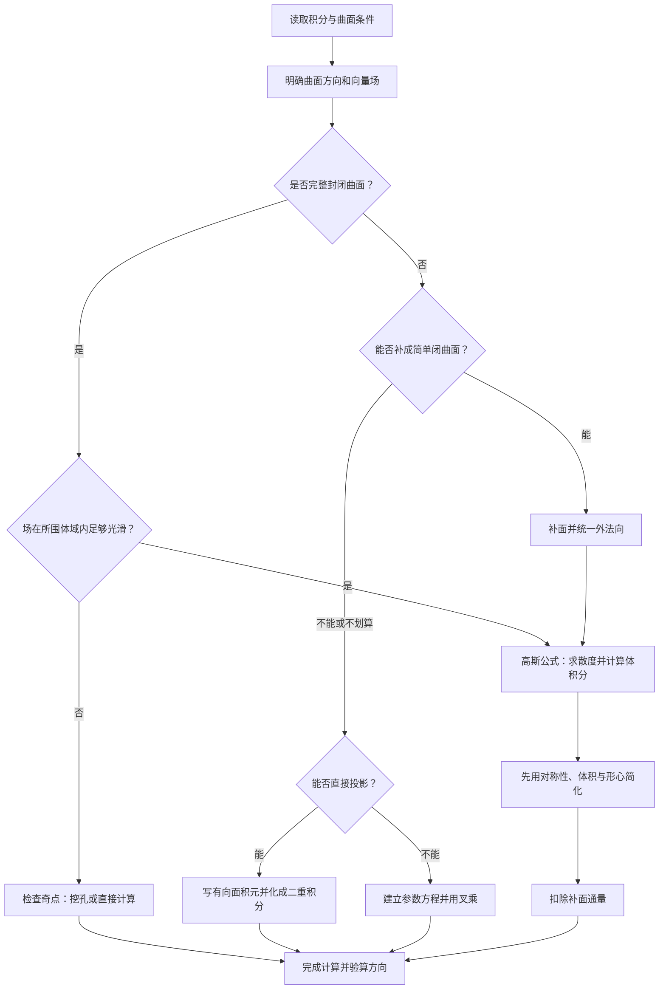

核心主题：第二类曲面积分、曲面定向、高斯公式、补面法、奇点通量，以及与斯托克斯公式的综合应用。

本节要解决的根本问题是：

> 面对一道陌生的空间曲面积分题，如何判断方向、理解空间几何结构，并选择最简单的计算方法，而不是机械地套公式？

我已读取你提供的《数学分类题目1101.zip》，重点核对了以下资料：

| 资料      | 阅读范围                             |
| ------- | -------------------------------- |
| 考研核心题目  | 第九模块第六节《第二类曲面积分》，24道题，含真题标注及详细解析 |
| 分类模拟题   | 第九模块第六节，11道归档题，涉及张宇、汤家凤、李永乐模拟卷   |
| 张宇1000题 | 高数第18章《多元函数积分学》                  |
| 李林880题  | 高等数学第九章《曲线积分与曲面积分》               |
| 李正元练习题  | 第九章与第十章的相关曲面积分、高斯公式题目            |

以下以资料中标注的历年考研数学一真题为主线，结合典型练习题和模拟题构建知识体系。真题年份按资料标注引用，未逐题与官方原卷独立核验。部分模拟题存在文字或符号不一致，我会指出其中影响解题的地方。

## 一、首先建立完整的知识框架

这一节看似公式很多，实际上可以归纳成三条主线。

| 主线 | 核心问题               | 主要工具           |
| -- | ------------------ | -------------- |
| 方向 | 曲面朝哪一侧？            | 法向量、有向面积元      |
| 计算 | 曲面通量怎样转化为容易算的积分？   | 直接投影、高斯公式、补面法  |
| 综合 | 遇到未知函数、奇点、旋转曲面怎么办？ | 散度、对称性、挖孔法、参数化 |

其中最重要的是：

第二类曲面积分考查的并不只是积分计算，更考查空间几何理解、方向判断和积分转化能力。

### 1.1 第一类与第二类曲面积分的本质区别

第一类曲面积分是

$$
\iint_\Sigma f(x,y,z)\,\mathrm dS.
$$

它计算的是标量函数在曲面上的积分。

其中 $\mathrm dS$ 表示非负的面积微元，因此不依赖曲面的定向。

第二类曲面积分是

$$
\boxed{ I=\iint_\Sigma P\,\mathrm dy\,\mathrm dz +Q\,\mathrm dz\,\mathrm dx +R\,\mathrm dx\,\mathrm dy }
$$

它不仅涉及曲面大小，还涉及方向。

设向量场为

$$
\mathbf F=(P,Q,R),
$$

曲面的单位法向量为

$$
\mathbf n=(\cos\alpha,\cos\beta,\cos\gamma).
$$

那么

$$
\boxed{ I=\iint_\Sigma\mathbf F\cdot\mathbf n\,\mathrm dS }
$$

即

$$
I=\iint_\Sigma (P\cos\alpha+Q\cos\beta+R\cos\gamma)\,\mathrm dS.
$$

这就是第二类曲面积分的核心定义。

### 1.2 什么是通量？

可以把 $\mathbf F$ 想象成流体在空间中的速度场。

在曲面上取一小块面积 $\Delta S$，有

$$
\Delta\Phi\approx \mathbf F\cdot\mathbf n\,\Delta S.
$$

利用数量积：

$$
\mathbf F\cdot\mathbf n =|\mathbf F|\cos\theta,
$$

其中 $\theta$ 是流速方向与法向量之间的夹角。

因此：

- 当 $\mathbf F\cdot\mathbf n>0$ 时，流体沿指定法向穿过曲面，通量为正。
- 当 $\mathbf F\cdot\mathbf n<0$ 时，流体沿法向的反方向穿过曲面，通量为负。
- 当 $\mathbf F\cdot\mathbf n=0$ 时，流体沿曲面切向流动，没有穿透曲面的分量。

把每一小块的通量相加，就得到

$$
\Phi=\iint_\Sigma\mathbf F\cdot\mathbf n\,\mathrm dS.
$$

重要结论：反转曲面方向，第二类曲面积分整体变号。

$$
\boxed{ \iint_{-\Sigma}\mathbf F\cdot\mathbf n\,\mathrm dS = -\iint_\Sigma\mathbf F\cdot\mathbf n\,\mathrm dS }
$$

第一类曲面积分则不具备这种性质。

### 1.3 为什么出现三个有向面积元？

第二类曲面积分中，

$$
\mathrm dy\,\mathrm dz,\qquad \mathrm dz\,\mathrm dx,\qquad \mathrm dx\,\mathrm dy
$$

分别对应曲面在三个坐标平面上的有向投影。

其关系为

$$
\boxed{ \begin{aligned} \mathrm dy\,\mathrm dz&=n_x\,\mathrm dS,\\ \mathrm dz\,\mathrm dx&=n_y\,\mathrm dS,\\ \mathrm dx\,\mathrm dy&=n_z\,\mathrm dS. \end{aligned} }
$$

这里的 $n_x,n_y,n_z$ 是单位法向量的三个分量。

因此，这三个符号不是可以随意交换的普通面积元，而是具有方向信息的有向面积元。

这也解释了为什么第二类曲面积分可以化成第一类曲面积分：

$$
\iint_\Sigma P\,\mathrm dy\,\mathrm dz +Q\,\mathrm dz\,\mathrm dx +R\,\mathrm dx\,\mathrm dy = \iint_\Sigma (Pn_x+Qn_y+Rn_z)\,\mathrm dS.
$$

以后遇到陌生曲面时，只要能确定法向量，就能建立积分。

## 二、必须熟练掌握的三类曲面投影公式

### 2.1 曲面写成 $z=f(x,y)$

这是最重要、最常用的情况。

设

$$
\Sigma:z=f(x,y), \qquad (x,y)\in D.
$$

其参数方程为

$$
\mathbf r(x,y)=(x,y,f(x,y)).
$$

沿两个参数方向求切向量：

$$
\mathbf r_x=(1,0,f_x), \qquad \mathbf r_y=(0,1,f_y).
$$

叉乘：

$$
\mathbf r_x\times\mathbf r_y =(-f_x,-f_y,1).
$$

因为其第三分量为正，所以对应上侧。

于是

$$
\boxed{ \mathbf n\,\mathrm dS =(-f_x,-f_y,1)\,\mathrm dx\,\mathrm dy \quad\text{（上侧）} }
$$

代入第二类曲面积分：

$$
\boxed{ I= \iint_D \left(-Pf_x-Qf_y+R\right) \,\mathrm dx\,\mathrm dy }
$$

其中 $P,Q,R$ 中的 $z$ 都要代入 $f(x,y)$。

如果取下侧，则

$$
\boxed{ I= \iint_D \left(Pf_x+Qf_y-R\right) \,\mathrm dx\,\mathrm dy }
$$

这是本节最需要形成条件反射的公式。

### 2.2 曲面写成 $x=g(y,z)$

当曲面更适合向 $yOz$ 平面投影时，应换成这一形式。

若取前侧，即法向量 $x$ 分量为正：

$$
\boxed{ \mathbf n\,\mathrm dS =(1,-g_y,-g_z)\,\mathrm dy\,\mathrm dz }
$$

因此

$$
\boxed{ I=\iint_D(P-Qg_y-Rg_z)\,\mathrm dy\,\mathrm dz }
$$

若取后侧，则整体变号：

$$
\boxed{ I=\iint_D(-P+Qg_y+Rg_z)\,\mathrm dy\,\mathrm dz }
$$

注意：“前侧、后侧”在通常高等数学约定下，分别对应法向量 $x$ 分量为正、负。

### 2.3 曲面写成 $y=h(z,x)$

若取法向量 $y$ 分量为正的一侧，有

$$
\boxed{ \mathbf n\,\mathrm dS =(-h_x,1,-h_z)\,\mathrm dz\,\mathrm dx }
$$

因此

$$
\boxed{ I=\iint_D(-Ph_x+Q-Rh_z)\,\mathrm dz\,\mathrm dx }
$$

如果取反方向，结果整体变号。

### 三种投影方式的速查表

| 曲面形式           | 正向规定            | 有向面积向量                                        |
| -------------- | --------------- | --------------------------------------------- |
| $z=f(x,y)$ | 上侧              | $(-f_x,-f_y,1)\,\mathrm dx\,\mathrm dy$ |
| $x=g(y,z)$ | 前侧              | $(1,-g_y,-g_z)\,\mathrm dy\,\mathrm dz$ |
| $y=h(z,x)$ | $y$ 分量为正的一侧 | $(-h_x,1,-h_z)\,\mathrm dz\,\mathrm dx$ |

所有反方向均取上述向量的相反数。

学习要求：不只是背公式，还必须理解法向量从哪里来。这样题目换成斜面、旋转面、参数曲面时才不会失去解题能力。

### 2.4 隐式曲面的法向量

如果曲面由

$$
G(x,y,z)=0
$$

给出，且在所讨论的点满足

$$
\nabla G\ne\mathbf0,
$$

那么

$$
\boxed{ \mathbf n=\pm\frac{\nabla G}{|\nabla G|} }
$$

因为梯度垂直于等值面。

例如椭球面

$$
\frac{x^2}{a^2}+\frac{y^2}{b^2} +\frac{z^2}{c^2}=1,
$$

取

$$
G=\frac{x^2}{a^2}+\frac{y^2}{b^2} +\frac{z^2}{c^2}-1.
$$

则

$$
\nabla G= \left(\frac{2x}{a^2}, \frac{2y}{b^2}, \frac{2z}{c^2}\right).
$$

由于椭球内部满足 $G<0$，外侧满足 $G>0$，所以 $\nabla G$ 指向外侧。

这是一种比死记球面法向量更一般的方法。

## 三、真题母题一：直接投影法

这部分是所有后续题型的基础。

核心任务是：把三维曲面积分变成二维区域上的二重积分。

### 母题1：2024年数学一——根据上侧确定有向面积元

资料中的2024年真题给出曲面

$$
z=\sqrt{1-x^2-y^2}, \qquad x\le0,\quad y\ge0,
$$

取上侧，要求判断

$$
\iint_\Sigma P\,\mathrm dy\,\mathrm dz+ Q\,\mathrm dz\,\mathrm dx
$$

可以化为怎样的投影积分。

第一步：判断曲面形式。

它是上半球的一部分，能够写成

$$
z=f(x,y).
$$

因此优先使用向 $xOy$ 平面投影的公式。

第二步：求偏导。

$$
f_x=-\frac{x}{\sqrt{1-x^2-y^2}}=-\frac{x}{z},
$$

$$
f_y=-\frac{y}{\sqrt{1-x^2-y^2}}=-\frac{y}{z}.
$$

第三步：使用上侧公式。

$$
I=\iint_D(-Pf_x-Qf_y)\,\mathrm dx\,\mathrm dy.
$$

代入得

$$
\boxed{ I=\iint_D \left(\frac{xP}{z}+\frac{yQ}{z}\right) \,\mathrm dx\,\mathrm dy }
$$

其中

$$
D=\{(x,y):x^2+y^2\le1,\ x\le0,\ y\ge0\}.
$$

答案为资料中的 A 选项。

#### 这道题真正考什么？

它并不要求复杂积分，而是检查三个问题：

第一，是否知道上侧的有向面积向量是 $(-f_x,-f_y,1)$。

第二，是否知道缺少 $R\,\mathrm dx\,\mathrm dy$ 这一项意味着 $R=0$。

第三，是否能区分公式里的代数符号与 $x,y$ 本身的正负。

例如本题 $x\le0$，但公式中 $xP/z$ 前面仍然是正号。这不意味着该项数值为正。

迁移方法： 未来如果把上侧改成下侧，不需要重新积分，只需将结果整体乘以 $-1$。

若把上半球改为椭球，同样适用这一方法，只是偏导发生变化。

### 母题2：2006年数学一——圆锥面下侧的通量

资料中的题目为：

$$
\Sigma:z=\sqrt{x^2+y^2}, \qquad 0\le z\le1,
$$

取下侧，计算

$$
I=\iint_\Sigma x\,\mathrm dy\,\mathrm dz +2y\,\mathrm dz\,\mathrm dx +3(z-1)\,\mathrm dx\,\mathrm dy.
$$

这是一道非常典型的直接投影综合题。

<Steps>

  <Step>

### 第一步：识别几何形状

令

$$
r=\sqrt{x^2+y^2}.
$$

曲面就是

$$
z=r.
$$

它是圆锥侧面，在 $xOy$ 平面上的投影为单位圆盘：

$$
D:x^2+y^2\le1.
$$

  </Step>

  <Step>

### 第二步：写下侧有向面积向量

因为

$$
f_x=\frac{x}{r},\qquad f_y=\frac{y}{r},
$$

下侧对应

$$
\boxed{ \mathbf n\,\mathrm dS= \left(\frac xr,\frac yr,-1\right) \,\mathrm dx\,\mathrm dy }
$$

注意第三分量为负。

  </Step>

  <Step>

### 第三步：代入向量场

$$
\mathbf F=(x,2y,3(z-1)).
$$

因此

$$
\begin{aligned} I &=\iint_D \left( \frac{x^2}{r} +\frac{2y^2}{r} -3(z-1) \right)\mathrm dx\,\mathrm dy. \end{aligned}
$$

利用 $z=r$，得到

$$
I=\iint_D \left(\frac{x^2+2y^2}{r}-3r+3\right) \,\mathrm dx\,\mathrm dy.
$$

  </Step>

  <Step>

### 第四步：极坐标计算

取

$$
x=r\cos\theta,\quad y=r\sin\theta.
$$

注意

$$
\mathrm dx\,\mathrm dy=r\,\mathrm dr\,\mathrm d\theta.
$$

于是

$$
\begin{aligned} I &=\int_0^{2\pi}\int_0^1 \left(r\cos^2\theta+2r\sin^2\theta-3r+3\right) r\,\mathrm dr\,\mathrm d\theta\\ &=\int_0^1(3\pi r^2-6\pi r^2+6\pi r)\,\mathrm dr\\ &=-\pi+3\pi. \end{aligned}
$$

最终

$$
\boxed{I=2\pi}.
$$

  </Step>

</Steps>

#### 这道题的可迁移方法

以后看到

$$
z=\sqrt{x^2+y^2}
$$

或者更一般的

$$
z=k\sqrt{x^2+y^2},
$$

就应当想到：

1. 曲面是圆锥，优先采用极坐标。
2. 上侧或下侧先决定有向面积向量。
3. 代入曲面关系 $z=kr$。
4. 把 $x^2,y^2,xy$ 换成极坐标。
5. 先完成角度积分，再完成径向积分。

尤其要熟记：

$$
\int_0^{2\pi}\cos^2\theta\,\mathrm d\theta = \int_0^{2\pi}\sin^2\theta\,\mathrm d\theta =\pi,
$$

$$
\int_0^{2\pi}\sin\theta\cos\theta\,\mathrm d\theta=0.
$$

这三个公式会反复出现在圆锥、圆柱、球面和旋转曲面的计算中。

### 母题3：2019年数学一——先利用曲面约束化简被积函数

题目为：

$$
\Sigma:x^2+y^2+4z^2=4,\qquad z>0,
$$

取上侧，计算

$$
I=\iint_\Sigma \sqrt{4-x^2-4z^2}\,\mathrm dx\,\mathrm dy.
$$

很多同学看到椭球就急于求偏导。

这道题的关键恰恰是不需要求偏导。

<Steps>

  <Step>

### 第一步：利用曲面方程

在曲面上有

$$
x^2+y^2+4z^2=4.
$$

所以

$$
4-x^2-4z^2=y^2.
$$

因此

$$
\sqrt{4-x^2-4z^2}=|y|.
$$

注意：

$$
\boxed{\sqrt{y^2}=|y|\ne y}
$$

这是本题的第一处陷阱。

  </Step>

  <Step>

### 第二步：利用上侧定向

因为题目仅含

$$
R\,\mathrm dx\,\mathrm dy
$$

这一项，而且曲面取上侧，所以可直接得到

$$
I=\iint_D|y|\,\mathrm dx\,\mathrm dy,
$$

其中

$$
D:x^2+y^2\le4.
$$

  </Step>

  <Step>

### 第三步：利用对称性

$$
\begin{aligned} I &=4\int_0^2y\sqrt{4-y^2}\,\mathrm dy\\ &=\frac{32}{3}. \end{aligned}
$$

因此

$$
\boxed{I=\frac{32}{3}}.
$$

  </Step>

</Steps>

#### 这道题揭示的重要思想

如果曲面积分的被积函数含有

$$
x^2+y^2+z^2,\quad ax^2+by^2+cz^2
$$

或者其他与曲面方程类似的表达式，应当先利用曲面约束进行化简。

例如，若题目给出

$$
x^2+y^2+2z^2=1
$$

并要求计算上侧的

$$
\iint_\Sigma \sqrt{1-x^2-2z^2}\,\mathrm dx\,\mathrm dy,
$$

则根式直接化为 $|y|$。

这也正是你提供的张宇模拟卷第8套第13题采用的方法，其答案为

$$
\boxed{\frac43}.
$$

母题规律：曲面方程有时比积分公式本身更重要。

## 四、本节最核心的定理：高斯公式

直接投影是基础，但在考研数学一中，许多复杂曲面积分真正的突破口是高斯公式。

### 4.1 高斯公式的内容

设 $\Omega$ 是空间中的有界区域，边界为分片光滑的封闭曲面 $\Sigma=\partial\Omega$。

曲面取外侧，向量场

$$
\mathbf F=(P,Q,R)
$$

在包含 $\overline\Omega$ 的适当邻域内具有连续的一阶偏导数。

则

$$
\boxed{ \begin{aligned} &\oiint_\Sigma P\,\mathrm dy\,\mathrm dz+ Q\,\mathrm dz\,\mathrm dx+ R\,\mathrm dx\,\mathrm dy\\ &\qquad = \iiint_\Omega \left( \frac{\partial P}{\partial x} +\frac{\partial Q}{\partial y} +\frac{\partial R}{\partial z} \right)\mathrm dV. \end{aligned} }
$$

定义向量场的散度：

$$
\boxed{ \nabla\cdot\mathbf F = P_x+Q_y+R_z }
$$

则高斯公式可写成

$$
\boxed{ \oiint_{\partial\Omega} \mathbf F\cdot\mathbf n\,\mathrm dS = \iiint_\Omega\nabla\cdot\mathbf F\,\mathrm dV }
$$

### 4.2 高斯公式的直观理解

可以把空间区域分割成许多非常小的立方体。

每个立方体都有六个面。

相邻立方体的公共面，对于其中一个立方体而言是流出面，对于另一个立方体而言是流入面。

因为两个立方体在公共面上的外法向相反，所以内部公共面上的通量互相抵消。

最终只剩下整个区域外边界的通量。

另一方面，小立方体内部的流量净变化由散度控制。

对于边长很小的立方体，近似有

$$
\text{净流出通量} \approx (\nabla\cdot\mathbf F)\Delta V.
$$

累加并取极限，就得到高斯公式。

因此可以这样理解：

> 散度描述单位体积内的净流出强度，高斯公式把空间内部全部净流出强度的总和与边界上的总通量联系起来。

### 4.3 使用高斯公式必须检查什么？

| 条件  | 必须核对的问题                       |
| --- | ----------------------------- |
| 封闭性 | 给出的是完整边界，还是只给出一片曲面？           |
| 定向  | 是否取整个封闭曲面的外侧？                 |
| 光滑性 | $P,Q,R$ 是否在所围体域及其边界上足够光滑？ |
| 奇点  | 向量场是否在体域内部无定义？                |
| 体域  | 能否正确写出 $\Omega$ 的范围？      |

如果取内侧，那么

$$
\iint_{\Sigma_{\mathrm{内}}} \mathbf F\cdot\mathbf n\,\mathrm dS = -\iiint_\Omega \nabla\cdot\mathbf F\,\mathrm dV.
$$

<Callout type="warn" title="高斯公式要求封闭曲面">

如果曲面不封闭，则不能直接使用完整封闭曲面的高斯公式，需要考虑补面。

</Callout>

如果内部存在奇点，通常需要挖孔处理。

### 4.4 五个非常重要的推论

推论一：散度恒为零，则光滑场穿过闭曲面的总通量为零。

在高斯公式条件满足时，

$$
\nabla\cdot\mathbf F=0 \quad\Longrightarrow\quad \oiint_{\partial\Omega} \mathbf F\cdot\mathbf n\,\mathrm dS=0.
$$

推论二：散度为常数。

若

$$
\nabla\cdot\mathbf F=c,
$$

则

$$
\boxed{\Phi=cV_\Omega}.
$$

例如

$$
\mathbf F=(x,y,z)
$$

具有散度 $3$，故

$$
\Phi=3V_\Omega.
$$

推论三：若散度为线性函数，可以利用形心。

设

$$
\nabla\cdot\mathbf F=ax+by+cz+d.
$$

由形心公式可得

$$
\boxed{ \Phi=V_\Omega (a\bar x+b\bar y+c\bar z+d) }
$$

其中 $(\bar x,\bar y,\bar z)$ 是体域形心。

推论四：若体域关于坐标平面对称，奇函数体积分为零。

例如体域关于 $x=0$ 对称，则

$$
\iiint_\Omega x\,\mathrm dV=0,
$$

以及在被积函数其他因子关于 $x$ 为偶函数、积分存在时，

$$
\iiint_\Omega xg(x^2,y,z)\,\mathrm dV=0.
$$

注意必须同时检查被积函数和积分区域。

推论五：闭曲面总通量不取决于曲面如何参数化。

只要曲面是同一个封闭边界，方向一致，其通量就等于内部散度的体积分。

这能避免对复杂曲面进行繁琐的直接参数化。

## 五、真题母题二：完整闭曲面与散度积分

### 母题4：2021年数学一——散度计算后利用空间对称性

资料中的题目：

$$
\Omega: \begin{cases} x^2+4y^2\le4,\\ 0\le z\le2. \end{cases}
$$

$\Sigma$ 是整个边界的外侧。

计算

$$
I=\oiint_\Sigma x^2\,\mathrm dy\,\mathrm dz +y^2\,\mathrm dz\,\mathrm dx +z\,\mathrm dx\,\mathrm dy.
$$

<Steps>

  <Step>

### 第一步：识别闭曲面

题目说的是整个空间区域的表面，而不是只有柱侧面。

因此可以直接使用高斯公式。

  </Step>

  <Step>

### 第二步：求散度

$$
\mathbf F=(x^2,y^2,z).
$$

所以

$$
\nabla\cdot\mathbf F=2x+2y+1.
$$

于是

$$
I=\iiint_\Omega(2x+2y+1)\,\mathrm dV.
$$

  </Step>

  <Step>

### 第三步：利用对称性

椭圆柱体关于 $x=0$、$y=0$ 对称。

因此

$$
\iiint_\Omega x\,\mathrm dV = \iiint_\Omega y\,\mathrm dV=0.
$$

所以

$$
I=\iiint_\Omega1\,\mathrm dV=V_\Omega.
$$

  </Step>

  <Step>

### 第四步：计算体积

由

$$
\frac{x^2}{4}+y^2\le1,
$$

底面椭圆半轴分别为 $2$ 和 $1$。

底面积为

$$
S=2\pi.
$$

柱高为 $2$，所以

$$
\boxed{I=4\pi}.
$$

  </Step>

</Steps>

#### 本题最重要的方法

当散度化简后出现

$$
2x+2y+1
$$

这样的函数时，不要马上列三重积分。

先观察对称性。

一般来说，考研中的高斯公式题，经常可以通过

$$
\text{高斯公式} \rightarrow \text{奇函数消项} \rightarrow \text{体积或形心}
$$

三步直接解决。

### 母题5：2023年数学一——斜顶柱体中的对称性陷阱

这是比上一题更有价值的综合母题。

题设空间区域由

$$
x^2+y^2=1,\qquad z=0,\qquad x+z=1
$$

围成。

边界取外侧，求

$$
\begin{aligned} I=\oiint_\Sigma& 2xz\,\mathrm dy\,\mathrm dz +xz\cos y\,\mathrm dz\,\mathrm dx\\ &+3yz\sin x\,\mathrm dx\,\mathrm dy. \end{aligned}
$$

<Steps>

  <Step>

### 第一步：确定体域

平面 $x+z=1$ 可写为

$$
z=1-x.
$$

因此

$$
\Omega: \begin{cases} x^2+y^2\le1,\\ 0\le z\le1-x. \end{cases}
$$

这里的高度不是常数。

  </Step>

  <Step>

### 第二步：高斯公式

向量场为

$$
\mathbf F=(2xz,xz\cos y,3yz\sin x).
$$

散度为

$$
\nabla\cdot\mathbf F = 2z-xz\sin y+3y\sin x.
$$

所以

$$
I=\iiint_\Omega (2z-xz\sin y+3y\sin x)\,\mathrm dV.
$$

  </Step>

  <Step>

### 第三步：判断哪些项可以消去

虽然区域上界 $1-x$ 依赖 $x$，但它不依赖 $y$。

因此体域仍然关于平面 $y=0$ 对称。

观察：

$$
xz\sin y
$$

关于 $y$ 为奇函数；

$$
3y\sin x
$$

也关于 $y$ 为奇函数。

因此两项的体积分均为零。

于是

$$
I=\iiint_\Omega2z\,\mathrm dV.
$$

  </Step>

  <Step>

### 第四步：先对 $z$ 积分

$$
\begin{aligned} I &=\iint_D \left[\int_0^{1-x}2z\,\mathrm dz\right] \mathrm dx\,\mathrm dy\\ &=\iint_D(1-x)^2\,\mathrm dx\,\mathrm dy. \end{aligned}
$$

展开：

$$
I=\iint_D(1-2x+x^2)\,\mathrm dx\,\mathrm dy.
$$

由于单位圆盘关于 $x=0$ 对称：

$$
\iint_Dx\,\mathrm dx\,\mathrm dy=0.
$$

又因为

$$
\iint_D1\,\mathrm dx\,\mathrm dy=\pi,
$$

$$
\iint_Dx^2\,\mathrm dx\,\mathrm dy=\frac\pi4,
$$

所以

$$
\boxed{I=\frac{5\pi}{4}}.
$$

  </Step>

</Steps>

#### 这道题应该掌握的深层规律

对称性不是看区域是否为球体或圆柱体，而是看整个积分域是否在某个变换下保持不变。

本题虽然顶部是斜面，但区域仍然关于 $y=0$ 对称，因此关于 $y$ 的奇函数可以消去。

另一方面，整个体域不关于 $x=0$ 对称，所以不能在三重积分阶段直接将所有含 $x$ 的项消掉。

只有在先完成 $z$ 积分、投影回完整单位圆盘之后，才可以利用圆盘关于 $x=0$ 的对称性。

这是未来创新题非常可能采用的考查方式：不同阶段可使用的对称性可能不同。

### 母题6：2016年数学一——形心法快速求通量

题设

$$
\Omega: \begin{cases} 2x+y+2z\le2,\\ x,y,z\ge0. \end{cases}
$$

整个边界取外侧，求

$$
I=\oiint_\Sigma (x^2+1)\,\mathrm dy\,\mathrm dz -2y\,\mathrm dz\,\mathrm dx +3z\,\mathrm dx\,\mathrm dy.
$$

求散度：

$$
\nabla\cdot\mathbf F =2x-2+3=2x+1.
$$

因此

$$
I=\iiint_\Omega(2x+1)\,\mathrm dV.
$$

这个区域是第一卦限中的四面体，三个非零坐标截距为

$$
a=1,\qquad b=2,\qquad c=1.
$$

体积为

$$
V=\frac{abc}{6}=\frac13.
$$

四面体形心坐标为

$$
\left(\frac a4,\frac b4,\frac c4\right) = \left(\frac14,\frac12,\frac14\right).
$$

于是

$$
I=V(2\bar x+1) =\frac13\left(\frac12+1\right).
$$

得到

$$
\boxed{I=\frac12}.
$$

这里可以进一步总结一个实用公式。

对第一卦限四面体

$$
\frac xa+\frac yb+\frac zc\le1, \quad x,y,z\ge0,
$$

有

$$
V=\frac{abc}{6},
$$

$$
\iiint_\Omega x\,\mathrm dV=\frac{abc}{6}\frac a4,
$$

以及 $y,z$ 的类似表达式。

如果散度是线性函数，优先用体积与形心，而不是直接做三重积分。

不过，如果散度是 $x^2+y^2$ 这样的二次函数，就不能直接用形心替代二次矩。

## 六、真题母题三：非闭曲面与补面法

这是第二类曲面积分中必须重点突破的题型。

很多考研题给出的曲面并不是完整的封闭曲面，而只是球面、抛物面、圆柱面、圆锥面的一部分。

如果直接投影，可能出现很复杂的积分。

这时可以人为添加一个或多个简单曲面，构造封闭边界，再使用高斯公式。

### 6.1 补面法的基本原理

设原曲面为 $\Sigma$，补上的辅助曲面为 $S_0$。

如果二者构成区域 $\Omega$ 的完整外向边界，那么

$$
\partial\Omega=\Sigma\cup S_0.
$$

由高斯公式：

$$
\iint_\Sigma\mathbf F\cdot\mathbf n\,\mathrm dS + \iint_{S_0}\mathbf F\cdot\mathbf n\,\mathrm dS = \iiint_\Omega\nabla\cdot\mathbf F\,\mathrm dV.
$$

因此

$$
\boxed{ I_\Sigma = \iiint_\Omega\nabla\cdot\mathbf F\,\mathrm dV - I_{S_0} }
$$

这个公式有一个重要前提：原曲面的指定方向必须与 $\Omega$ 的外法向一致。

如果原曲面方向相反，必须先处理方向符号。

### 6.2 补面方向速查

| 原曲面及所围区域     | 辅助平面          | 辅助面的外法向   |
| ------------ | ------------- | --------- |
| 上半球面及其内部半球体  | $z=0$     | 向下        |
| 下半球面及其内部半球体  | $z=0$     | 向上        |
| 上开口圆锥侧面，补上顶盖 | $z=h$     | 向上        |
| 上拱抛物面及其下方立体  | $z=0$     | 向下        |
| 竖直圆柱侧面，补上上下底 | $z=a,z=b$ | 下底向下，上底向上 |

这些是最常见的情况。实际解题时，始终以所围体域的外法向为准。

### 母题7：2004年数学一——抛物面补底面

题目为

$$
\Sigma:z=1-x^2-y^2,\qquad z\ge0,
$$

取上侧，计算

$$
\begin{aligned} I=\iint_\Sigma& 2x^3\,\mathrm dy\,\mathrm dz +2y^3\,\mathrm dz\,\mathrm dx\\ &+3(z^2-1)\,\mathrm dx\,\mathrm dy. \end{aligned}
$$

<Steps>

  <Step>

### 第一步：判断能否补面

抛物面与 $z=0$ 相交于

$$
x^2+y^2=1.
$$

因此补上圆盘

$$
S_0: \begin{cases} z=0,\\ x^2+y^2\le1. \end{cases}
$$

原曲面的上侧与所围立体的外法向一致。

底面的外法向朝下。

  </Step>

  <Step>

### 第二步：求散度

$$
\mathbf F=(2x^3,2y^3,3(z^2-1)).
$$

因此

$$
\nabla\cdot\mathbf F =6x^2+6y^2+6z.
$$

设

$$
r^2=x^2+y^2,
$$

则散度为

$$
6r^2+6z.
$$

所围体域为

$$
0\le r\le1,\qquad 0\le z\le1-r^2.
$$

  </Step>

  <Step>

### 第三步：计算闭面总通量

$$
\begin{aligned} I_{\text{闭}} &=2\pi\int_0^1r\,\mathrm dr \int_0^{1-r^2}(6r^2+6z)\,\mathrm dz\\ &=2\pi\int_0^1 \left[6r^3(1-r^2)+3r(1-r^2)^2\right] \mathrm dr\\ &=2\pi. \end{aligned}
$$

  </Step>

  <Step>

### 第四步：计算补面通量

在 $z=0$ 上，

$$
R=3(z^2-1)=-3.
$$

而补面的外法向向下，所以

$$
\mathbf F\cdot\mathbf n=3.
$$

因此

$$
I_{S_0}=3\pi.
$$

  </Step>

  <Step>

### 第五步：相减

$$
I=I_{\text{闭}}-I_{S_0}.
$$

得到

$$
\boxed{I=-\pi}.
$$

  </Step>

</Steps>

#### 为什么这道题容易错？

很多同学会产生这样的直觉：

“原曲面取上侧，所以积分应该为正。”

这是错误的。

上侧只说明法向量方向，并不能决定场与法向量数量积的正负。

此外，补面法中最常见的错误是：

$$
I_{\text{原}}=I_{\text{闭}}+I_{\text{补}}.
$$

实际上，在外向方向一致时应当是

$$
\boxed{ I_{\text{原}}=I_{\text{闭}}-I_{\text{补}}. }
$$

### 母题8：2018年数学一——半椭球、补面与线性变换

设

$$
\Sigma:x=\sqrt{1-3y^2-3z^2}
$$

取前侧，求

$$
I=\iint_\Sigma x\,\mathrm dy\,\mathrm dz +(y^3+2)\,\mathrm dz\,\mathrm dx +z^3\,\mathrm dx\,\mathrm dy.
$$

这道题把第二类曲面积分、高斯公式、椭球换元和对称性结合在一起。

<Steps>

  <Step>

### 第一步：识别半椭球

曲面可写成

$$
x^2+3y^2+3z^2=1,\qquad x\ge0.
$$

这是椭球的 $x\ge0$ 半片。

取前侧，即法向量的 $x$ 分量为正，恰好与半椭球体的外法向一致。

补面为

$$
S_0:x=0,\qquad 3y^2+3z^2\le1.
$$

  </Step>

  <Step>

### 第二步：检查补面通量

在 $x=0$ 上，外法向量为

$$
\mathbf n=(-1,0,0).
$$

原向量场为

$$
\mathbf F=(x,y^3+2,z^3).
$$

所以在补面上

$$
\mathbf F\cdot\mathbf n=-x=0.
$$

因此

$$
I_{S_0}=0.
$$

这是一个非常值得学习的技巧：

补面之后，不要立即积分，而要先检查补面的法向分量所对应的向量场分量是否为零。

  </Step>

  <Step>

### 第三步：使用高斯公式

$$
\nabla\cdot\mathbf F =1+3y^2+3z^2.
$$

故

$$
I=\iiint_\Omega(1+3y^2+3z^2)\,\mathrm dV.
$$

  </Step>

  <Step>

### 第四步：椭球化为球体

令

$$
X=x,\qquad Y=\sqrt3\,y,\qquad Z=\sqrt3\,z.
$$

则

$$
X^2+Y^2+Z^2\le1,\qquad X\ge0.
$$

雅可比为

$$
\mathrm dx\,\mathrm dy\,\mathrm dz =\frac13\,\mathrm dX\,\mathrm dY\,\mathrm dZ.
$$

因此

$$
I=\frac13 \iiint_{B_+}(1+Y^2+Z^2)\,\mathrm dV.
$$

其中 $B_+$ 是单位球的 $X\ge0$ 半球体。

  </Step>

  <Step>

### 第五步：利用球体二次矩

单位球体积为

$$
\frac{4\pi}{3}.
$$

半球体积为

$$
\frac{2\pi}{3}.
$$

由于旋转对称性，单位球满足

$$
\iiint_BX^2\,\mathrm dV = \iiint_BY^2\,\mathrm dV = \iiint_BZ^2\,\mathrm dV =\frac{4\pi}{15}.
$$

对于关于 $X=0$ 对称的 $Y^2,Z^2$，各自在半球中的积分是整球的一半：

$$
\iiint_{B_+}Y^2\,\mathrm dV = \iiint_{B_+}Z^2\,\mathrm dV =\frac{2\pi}{15}.
$$

所以

$$
\begin{aligned} I &=\frac13 \left( \frac{2\pi}{3} +\frac{2\pi}{15} +\frac{2\pi}{15} \right)\\ &=\boxed{\frac{14\pi}{45}}. \end{aligned}
$$

  </Step>

</Steps>

#### 推广：椭球换元的通用方法

对于

$$
\frac{x^2}{a^2} +\frac{y^2}{b^2} +\frac{z^2}{c^2}\le1,
$$

令

$$
x=aX,\qquad y=bY,\qquad z=cZ.
$$

那么

$$
X^2+Y^2+Z^2\le1,
$$

且

$$
\boxed{ \mathrm dV=abc\,\mathrm dX\,\mathrm dY\,\mathrm dZ }
$$

其中 $a,b,c>0$。

以后只要遇到椭球体积、椭球二次矩、椭球上的高斯公式，都应该优先考虑这类线性伸缩。

### 母题9：李正元练习题——补面通量不为零的半椭球

这一题与上一题形成很好的对照。

设 $S$ 为上半椭球面

$$
\frac{x^2}{a^2} +\frac{y^2}{b^2} +\frac{z^2}{c^2}=1,\qquad z\ge0,
$$

取上侧，计算

$$
\begin{aligned} I=\iint_S& (x^2-y^2)\,\mathrm dy\,\mathrm dz\\ &+(y^2-z^2)\,\mathrm dz\,\mathrm dx\\ &+(z^2-x^2)\,\mathrm dx\,\mathrm dy. \end{aligned}
$$

这里 $a,b,c>0$。

这道题在配套核心题目中也被归入李正元练习题。

<Steps>

  <Step>

### 第一步：补底面

补上

$$
S_0:z=0,\qquad \frac{x^2}{a^2}+\frac{y^2}{b^2}\le1,
$$

取下侧。

  </Step>

  <Step>

### 第二步：求散度

$$
\mathbf F= (x^2-y^2,y^2-z^2,z^2-x^2).
$$

所以

$$
\nabla\cdot\mathbf F=2x+2y+2z.
$$

上半椭球体关于 $x=0$、$y=0$ 对称，因此

$$
I+I_{S_0}=\iiint_\Omega2z\,\mathrm dV.
$$

固定 $z$ 的截面椭圆面积为

$$
A(z)=\pi ab\left(1-\frac{z^2}{c^2}\right).
$$

因此

$$
\begin{aligned} I_{\text{闭}} &=2\pi ab\int_0^c z\left(1-\frac{z^2}{c^2}\right)\mathrm dz\\ &=\frac{\pi abc^2}{2}. \end{aligned}
$$

  </Step>

  <Step>

### 第三步：计算底面通量

底面法向为

$$
\mathbf n=(0,0,-1).
$$

而

$$
R=z^2-x^2.
$$

在 $z=0$ 上，

$$
R=-x^2.
$$

所以

$$
\mathbf F\cdot\mathbf n=x^2.
$$

于是

$$
I_{S_0} =\iint_Dx^2\,\mathrm dx\,\mathrm dy.
$$

椭圆二次矩公式给出

$$
\boxed{ \iint_Dx^2\,\mathrm dx\,\mathrm dy =\frac{\pi a^3b}{4} }
$$

因此

$$
I =\frac{\pi abc^2}{2} -\frac{\pi a^3b}{4}.
$$

最终

$$
\boxed{ I=\frac{\pi ab}{4}(2c^2-a^2) }
$$

  </Step>

</Steps>

#### 和上一道题的根本区别

2018年真题中，补面位于 $x=0$，而向量场的 $x$ 分量恰好为 $x$，所以补面通量为零。

这道题虽然补面位于 $z=0$，但向量场的 $z$ 分量是

$$
z^2-x^2.
$$

在 $z=0$ 上并不为零。

因此不能认为“坐标等于零，补面通量就等于零”。

正确判断方式是：

$$
\boxed{ \text{补面通量} = \text{该面法向对应的场分量在补面上的积分} }
$$

## 七、真题母题四：2025年数学一——绕斜轴旋转形成的圆锥面

这是整节非常值得深入研究的一道几何综合题。

题目给出：

母线为 $z$ 轴

$$
x=0,\qquad y=0,
$$

旋转轴为

$$
x=t,\qquad y=t,\qquad z=t.
$$

将母线绕旋转轴旋转一周，得到圆锥面 $\Sigma$。

取它在

$$
x+y+z=0
$$

和

$$
x+y+z=1
$$

之间的部分 $\Sigma_1$，方向为外侧。

计算

$$
I=\iint_{\Sigma_1} x\,\mathrm dy\,\mathrm dz +(y+1)\,\mathrm dz\,\mathrm dx +(z+2)\,\mathrm dx\,\mathrm dy.
$$

这道题有两个核心难点：

一是旋转轴并不是任何一个坐标轴；

二是必须正确计算斜圆锥的高度和截面半径。

<Steps>

  <Step>

### 第一步：确定旋转轴方向

旋转轴方向向量为

$$
\mathbf a=(1,1,1).
$$

母线方向向量为

$$
\mathbf b=(0,0,1).
$$

它们的夹角为 $\alpha$。

由夹角公式：

$$
\cos\alpha =\frac{\mathbf a\cdot\mathbf b} {|\mathbf a||\mathbf b|} =\frac1{\sqrt3}.
$$

于是

$$
\sin\alpha=\sqrt{\frac23},
$$

所以

$$
\boxed{\tan\alpha=\sqrt2}.
$$

这说明旋转得到的圆锥，其母线与旋转轴的夹角固定为 $\alpha$。

  </Step>

  <Step>

### 第二步：求圆锥高度

平面

$$
x+y+z=1
$$

的法向量是 $(1,1,1)$，正好平行于圆锥旋转轴。

因此这个平面垂直于圆锥轴线，是圆锥底面所在平面。

圆锥顶点在原点。

高度就是原点到平面

$$
x+y+z-1=0
$$

的距离。

根据点到平面的距离公式：

$$
h=\frac{|0+0+0-1|}{\sqrt{1^2+1^2+1^2}}.
$$

所以

$$
\boxed{h=\frac1{\sqrt3}}.
$$

这里最容易犯的错误，就是把高度写成 $1$。

实际上平面方程右端为 $1$，并不意味着沿旋转轴的距离为 $1$。

  </Step>

  <Step>

### 第三步：求底面半径

由圆锥几何关系：

$$
r=h\tan\alpha.
$$

所以

$$
r=\frac1{\sqrt3}\cdot\sqrt2 =\sqrt{\frac23}.
$$

从而

$$
\boxed{r^2=\frac23}.
$$

圆锥体积为

$$
V=\frac13\pi r^2h =\frac13\pi\cdot\frac23\cdot\frac1{\sqrt3}.
$$

即

$$
\boxed{ V=\frac{2\pi}{9\sqrt3} }
$$

  </Step>

  <Step>

### 第四步：补上底面

补面位于

$$
x+y+z=1.
$$

它的外单位法向量为

$$
\mathbf n_0=\frac{(1,1,1)}{\sqrt3}.
$$

向量场为

$$
\mathbf F=(x,y+1,z+2).
$$

散度为

$$
\nabla\cdot\mathbf F=1+1+1=3.
$$

因此完整闭曲面的总通量为

$$
I_{\text{闭}}=3V =\frac{2\pi}{3\sqrt3}.
$$

  </Step>

  <Step>

### 第五步：计算补面通量

在底面上，

$$
x+y+z=1.
$$

因此

$$
\begin{aligned} \mathbf F\cdot\mathbf n_0 &=\frac{x+y+1+z+2}{\sqrt3}\\ &=\frac{x+y+z+3}{\sqrt3}\\ &=\frac4{\sqrt3}. \end{aligned}
$$

注意，这个值在整个底面上是常数。

底面面积为

$$
A=\pi r^2=\frac{2\pi}{3}.
$$

所以

$$
I_{\text{补}} =\frac4{\sqrt3}\cdot\frac{2\pi}{3} =\frac{8\pi}{3\sqrt3}.
$$

  </Step>

  <Step>

### 第六步：求原曲面通量

$$
\begin{aligned} I &=I_{\text{闭}}-I_{\text{补}}\\ &=\frac{2\pi}{3\sqrt3} -\frac{8\pi}{3\sqrt3}\\ &=-\frac{2\pi}{\sqrt3}. \end{aligned}
$$

最终答案为

$$
\boxed{ I=-\frac{2\sqrt3\,\pi}{3} }
$$

  </Step>

</Steps>

### 这道题应该提炼什么母题？

不是单纯记住答案，而是建立一套解决任意斜轴旋转圆锥题的程序：

| 计算对象  | 通用方法                                                                                       |
| ----- | ------------------------------------------------------------------------------------------ |
| 旋转轴方向 | 提取方向向量 $\mathbf a$                                                                     |
| 母线方向  | 提取方向向量 $\mathbf b$                                                                     |
| 半顶角   | $\cos\alpha=\frac{\|\mathbf a\cdot\mathbf b\|}{\|\mathbf a\|\|\mathbf b\|}$，根据所取锥叶确定方向 |
| 圆锥高度  | 求顶点到垂直于旋转轴的截面平面的距离                                                                         |
| 底面半径  | $r=h\tan\alpha$                                                                        |
| 体积    | $V=\frac13\pi r^2h$                                                                    |
| 总通量   | 用高斯公式                                                                                      |
| 侧面通量  | 总通量减去截面通量                                                                                  |

这套方法可以应对更换旋转轴、更换截面位置、更换向量场的许多变式。

## 八、真题母题五：奇点通量、未知函数与特殊结构

这部分是本节区分普通题和较难综合题的关键。

难题往往不是积分很难，而是不能直接套用最常见的公式。

### 母题10：2009年数学一——内部有奇点，为什么高斯公式会失效？

题目为

$$
I=\oiint_\Sigma \frac{ x\,\mathrm dy\,\mathrm dz+ y\,\mathrm dz\,\mathrm dx+ z\,\mathrm dx\,\mathrm dy }{ (x^2+y^2+z^2)^{3/2} },
$$

其中

$$
\Sigma:2x^2+2y^2+z^2=4
$$

取外侧。

<Steps>

  <Step>

### 第一步：识别向量场

令

$$
r=\sqrt{x^2+y^2+z^2}.
$$

则

$$
\mathbf F=\frac{(x,y,z)}{r^3}.
$$

对 $r>0$ 直接求散度：

$$
\begin{aligned} \nabla\cdot\mathbf F &=\frac{\partial}{\partial x}\frac{x}{r^3} +\frac{\partial}{\partial y}\frac{y}{r^3} +\frac{\partial}{\partial z}\frac{z}{r^3}\\ &=\frac3{r^3} -\frac{3(x^2+y^2+z^2)}{r^5}\\ &=0. \end{aligned}
$$

于是有人可能直接写

$$
I=\iiint_\Omega0\,\mathrm dV=0.
$$

这是错误的。

因为向量场在原点无定义，而椭球体包含原点。

高斯公式要求的光滑性条件没有得到满足。

  </Step>

  <Step>

### 第二步：在原点挖一个小球

设小球

$$
B_\varepsilon: x^2+y^2+z^2\le\varepsilon^2
$$

完全位于椭球内部。

考虑挖孔后的区域

$$
\Omega_\varepsilon=\Omega\setminus B_\varepsilon.
$$

在这个区域内，向量场没有奇点，且散度为零。

因此

$$
\oiint_{\partial\Omega_\varepsilon} \mathbf F\cdot\mathbf n\,\mathrm dS=0.
$$

新的完整边界包含：

- 原椭球外表面；
- 小球的内边界，其相对于挖孔区域的外法向指向球心。

记小球自身外向通量为 $I_\varepsilon$。

那么

$$
0=I-I_\varepsilon.
$$

因此

$$
I=I_\varepsilon.
$$

  </Step>

  <Step>

### 第三步：计算小球通量

在

$$
r=\varepsilon
$$

上，小球外单位法向为

$$
\mathbf n=\frac{(x,y,z)}{\varepsilon}.
$$

所以

$$
\mathbf F\cdot\mathbf n =\frac1{\varepsilon^2}.
$$

小球表面积为

$$
4\pi\varepsilon^2.
$$

因此

$$
I_\varepsilon =\frac1{\varepsilon^2}\cdot4\pi\varepsilon^2 =4\pi.
$$

最终

$$
\boxed{I=4\pi}.
$$

  </Step>

</Steps>

### 必须记住的奇点通量模型

对于

$$
\mathbf F= \frac{(x,y,z)} {(x^2+y^2+z^2)^{3/2}},
$$

如果封闭曲面取外侧，并且没有穿过原点，则

$$
\boxed{ \Phi= \begin{cases} 4\pi,&\text{原点在曲面内部},\\ 0,&\text{原点在曲面外部}. \end{cases} }
$$

这个结论适用于适当的分片光滑封闭曲面。

<Callout type="warn" title="奇点位于曲面时须单独判断">

如果奇点恰好位于积分曲面上，则不能直接使用这个结论，必须另行检查原积分的定义。

</Callout>

更一般地，对于

$$
\mathbf F= k\frac{\mathbf r-\mathbf a} {|\mathbf r-\mathbf a|^3},
$$

奇点位于 $\mathbf a$。

若曲面包围 $\mathbf a$，其外向通量为

$$
\boxed{\Phi=4\pi k}.
$$

这一结论在电场、流体场与多奇点综合题中很有用。

### 母题11：2020年数学一——出现未知连续函数，为什么不需要知道函数表达式？

题目给出圆锥环带

$$
\Sigma:z=\sqrt{x^2+y^2}, \qquad 1\le x^2+y^2\le4,
$$

取下侧。

设 $f$ 为连续函数，计算

$$
\begin{aligned} I=\iint_\Sigma& [xf(xy)+2x-y]\,\mathrm dy\,\mathrm dz\\ &+[yf(xy)+2y+x]\,\mathrm dz\,\mathrm dx\\ &+[zf(xy)+z]\,\mathrm dx\,\mathrm dy. \end{aligned}
$$

这道题最重要的不是计算，而是识别结构。

<Steps>

  <Step>

### 第一步：拆分向量场

$$
\mathbf F = f(xy)(x,y,z)+(2x-y,2y+x,z).
$$

可以发现未知函数都被放在同一个向量

$$
(x,y,z)
$$

前面。

这提示我们检查它是否与曲面相切。

  </Step>

  <Step>

### 第二步：求圆锥下侧的有向面积向量

令

$$
r=\sqrt{x^2+y^2}.
$$

则

$$
\mathbf n\,\mathrm dS = \left(\frac xr,\frac yr,-1\right) \mathrm dx\,\mathrm dy.
$$

检查：

$$
\begin{aligned} (x,y,z)\cdot \left(\frac xr,\frac yr,-1\right) &=\frac{x^2+y^2}{r}-z\\ &=r-z\\ &=0. \end{aligned}
$$

因为圆锥满足 $z=r$。

所以

$$
f(xy)(x,y,z)\cdot\mathbf n=0.
$$

未知函数项的通量全部为零。

这意味着无论 $f$ 是什么连续函数，它都不会影响最终答案。

  </Step>

  <Step>

### 第三步：计算剩余部分

$$
\begin{aligned} &(2x-y,2y+x,z)\cdot \left(\frac xr,\frac yr,-1\right)\\ &=\frac{2x^2-xy+2y^2+xy}{r}-z\\ &=2r-r\\ &=r. \end{aligned}
$$

于是

$$
I=\iint_Dr\,\mathrm dx\,\mathrm dy.
$$

其中

$$
D:1\le r\le2.
$$

用极坐标：

$$
\begin{aligned} I &=\int_0^{2\pi}\int_1^2r^2\,\mathrm dr\,\mathrm d\theta\\ &=2\pi\cdot\frac{2^3-1^3}{3}. \end{aligned}
$$

得到

$$
\boxed{I=\frac{14\pi}{3}}.
$$

  </Step>

</Steps>

### 一个可以迁移到未来创新题的推论

对于过原点的光滑齐次锥面

$$
G(x,y,z)=0,
$$

若 $G$ 是 $m$ 次齐次函数，则根据欧拉齐次函数定理：

$$
xG_x+yG_y+zG_z=mG.
$$

在曲面上 $G=0$，因此

$$
(x,y,z)\cdot\nabla G=0.
$$

而 $\nabla G$ 是曲面的法向量，所以

$$
\boxed{ (x,y,z)\text{ 是该齐次锥面的切向方向} }
$$

因此，任何形如

$$
h(x,y,z)(x,y,z)
$$

的向量场，只要积分有意义，其穿过该锥面的法向通量就是零。

这比只记住本题的 $f(xy)$ 更有价值。

<Callout type="idea" title="仅有连续性时优先利用结构">

另外，本题仅假设 $f$ 连续，不能未经检查就对 $f$ 求导来使用高斯公式。直接投影中的切向消项恰好避开了这个问题。

</Callout>

### 母题12：2000年数学一——任意闭曲面通量为零，反求未知函数

资料中的题目给出：对于半空间 $x>0$ 内任意适当的光滑封闭曲面 $S$，均有

$$
\oiint_S xf(x)\,\mathrm dy\,\mathrm dz -xyf(x)\,\mathrm dz\,\mathrm dx -e^{2x}z\,\mathrm dx\,\mathrm dy=0,
$$

且

$$
\lim_{x\to0^+}f(x)=1.
$$

求 $f(x)$。

<Steps>

  <Step>

### 第一步：从任意闭曲面通量为零，推出散度恒为零

向量场为

$$
\mathbf F=(xf(x),-xyf(x),-e^{2x}z).
$$

由于任意小区域的外向通量都为零，而散度连续，因此

$$
\boxed{\nabla\cdot\mathbf F=0}.
$$

注意这里的逻辑：

不是因为某一个闭曲面通量为零，就能推出散度恒为零。

而是因为任意足够小的闭曲面通量都为零。

  </Step>

  <Step>

### 第二步：计算散度

$$
\begin{aligned} \nabla\cdot\mathbf F &=f(x)+xf'(x)-xf(x)-e^{2x}. \end{aligned}
$$

令其为零：

$$
xf'(x)+(1-x)f(x)=e^{2x}.
$$

得到一阶线性微分方程。

  </Step>

  <Step>

### 第三步：用积分因子

因为 $x>0$，两边除以 $x$：

$$
f'+\left(\frac1x-1\right)f=\frac{e^{2x}}x.
$$

积分因子为

$$
\mu(x)=e^{\int(1/x-1)\,\mathrm dx} =xe^{-x}.
$$

于是

$$
(xe^{-x}f)'=e^x.
$$

积分得到

$$
xe^{-x}f=e^x+C.
$$

因此

$$
f(x)=\frac{e^{2x}+Ce^x}{x}.
$$

  </Step>

  <Step>

### 第四步：使用极限条件

要使 $x\to0^+$ 时极限有限，分子的常数项必须为零：

$$
1+C=0.
$$

所以

$$
C=-1.
$$

最终

$$
\boxed{ f(x)=\frac{e^x(e^x-1)}x },\qquad x>0.
$$

  </Step>

</Steps>

### 这一类题的通法

看到以下条件：

$$
\text{对任意闭曲面，某个通量恒为零}
$$

应立即想到

$$
\boxed{ \nabla\cdot\mathbf F=0 }
$$

再把它转化为未知函数的微分方程。

如果题目给的是“对任意闭曲线积分为零”，则要根据题目形式考虑格林公式或路径无关条件。

这类题是多元积分与微分方程结合的重要综合题型。

## 九、张宇1000题强化：复杂参数曲面怎样处理？

前面的大部分曲面都可以写成

$$
z=f(x,y)
$$

或者

$$
x=g(y,z).
$$

但未来的综合题不一定给出这种简单形式。

例如，一条空间曲线与原点连接，形成一个锥面。这样的曲面有时更适合直接参数化。

### 9.1 参数曲面的通用公式

设曲面参数方程为

$$
\mathbf r(u,v) = (x(u,v),y(u,v),z(u,v)).
$$

那么

$$
\mathbf r_u\times\mathbf r_v
$$

给出一个有向面积向量。

于是

$$
\boxed{ I= \iint_D \mathbf F(\mathbf r(u,v)) \cdot (\mathbf r_u\times\mathbf r_v) \,\mathrm du\,\mathrm dv }
$$

如果叉乘的方向与题设要求相反，就在前面加负号。

这里还必须保证参数化足够规则，且按题设的覆盖次数积分。

### 母题13：张宇1000题——非旋转锥面的参数化

资料中张宇1000题第18章的一道题给出：

锥面顶点在原点，准线为

$$
\Gamma: \begin{cases} x=1,\\ z=y^2,\quad |y|\le1. \end{cases}
$$

求锥面的方程，并计算其上侧的

$$
I=\iint_\Sigma 2x^2\,\mathrm dy\,\mathrm dz +xy\,\mathrm dz\,\mathrm dx +(z+1)\,\mathrm dx\,\mathrm dy.
$$

<Steps>

  <Step>

### 第一步：建立参数方程

准线上的点可以写成

$$
(1,t,t^2),\qquad -1\le t\le1.
$$

它与原点连线上的点可以写成

$$
\boxed{ \mathbf r(s,t)=(s,st,st^2) }
$$

其中

$$
0\le s\le1,\qquad -1\le t\le1.
$$

由

$$
x=s,\quad y=st,\quad z=st^2
$$

消去参数：

$$
\boxed{xz=y^2}.
$$

还要保留参数对应的曲面范围，不能只写这个方程就认为得到了完整的积分曲面。

  </Step>

  <Step>

### 第二步：求切向量和叉乘

$$
\mathbf r_s=(1,t,t^2),
$$

$$
\mathbf r_t=(0,s,2st).
$$

因此

$$
\mathbf r_s\times\mathbf r_t =s(t^2,-2t,1).
$$

第三分量为 $s\ge0$，所以这个方向对应上侧。

  </Step>

  <Step>

### 第三步：代入向量场

$$
\mathbf F=(2x^2,xy,z+1).
$$

参数化之后：

$$
\mathbf F=(2s^2,s^2t,st^2+1).
$$

于是

$$
\begin{aligned} \mathbf F\cdot (\mathbf r_s\times\mathbf r_t) &=2s^3t^2-2s^3t^2+s^2t^2+s\\ &=s^2t^2+s. \end{aligned}
$$

  </Step>

  <Step>

### 第四步：完成二重积分

$$
\begin{aligned} I &=\int_0^1\int_{-1}^1 (s^2t^2+s)\,\mathrm dt\,\mathrm ds\\ &=\frac29+1. \end{aligned}
$$

因此

$$
\boxed{I=\frac{11}{9}}.
$$

  </Step>

</Steps>

### 这道题的价值

它告诉我们：

遇到复杂曲面，不必强行解出 $z=f(x,y)$。

如果曲面是通过运动、旋转、放缩、连接线段形成的，直接建立参数方程可能更自然。

例如：

- 曲线绕一条空间直线旋转；
- 原点与一条准线连接形成锥面；
- 曲面由两个参数控制；
- 曲面在某个坐标平面上的投影不是单值图形。

这些都应当考虑参数曲面方法。

## 十、与斯托克斯公式的联系：空间曲线积分转化为曲面通量

你提供的第六节资料最后还安排了斯托克斯公式题目。

严格来说，斯托克斯公式连接的是第二类曲线积分与旋度通量，它可以看作本节的综合拓展。

### 10.1 斯托克斯公式

设空间闭曲线 $L$ 是有向曲面 $\Sigma$ 的边界，方向符合右手法则。

则

$$
\boxed{ \oint_L P\,\mathrm dx+Q\,\mathrm dy+R\,\mathrm dz = \iint_\Sigma (\nabla\times\mathbf F)\cdot\mathbf n\,\mathrm dS }
$$

其中

$$
\mathbf F=(P,Q,R).
$$

旋度为

$$
\boxed{ \nabla\times\mathbf F = \left( R_y-Q_z,\, P_z-R_x,\, Q_x-P_y \right) }
$$

### 10.2 高斯公式与斯托克斯公式的区别

|        | 高斯公式    | 斯托克斯公式        |
| ------ | ------- | ------------- |
| 输入     | 封闭曲面的通量 | 闭合空间曲线的环流     |
| 输出     | 散度的三重积分 | 旋度的曲面积分       |
| 核心微分算子 | 散度      | 旋度            |
| 方向     | 闭曲面取外侧  | 曲线与曲面法向符合右手法则 |
| 典型用途   | 求空间边界通量 | 求空间闭曲线积分      |

两者不能混用。

### 母题14：2024年数学一——平面截球形成的空间圆

题目给出空间闭曲线 $L$：

$$
\begin{cases} x^2+y^2+z^2=2x,\\ 2x-z-1=0. \end{cases}
$$

从 $z$ 轴正向向负向观察，曲线取逆时针方向。

计算

$$
\begin{aligned} I=\oint_L& (6xyz-yz^2)\,\mathrm dx\\ &+2x^2z\,\mathrm dy +xyz\,\mathrm dz. \end{aligned}
$$

<Steps>

  <Step>

### 第一步：选取最简单的斯托克斯曲面

曲线位于平面

$$
z=2x-1
$$

上。

因此不需要使用复杂球面，可以直接选择该交圆围成的平面圆盘。

根据题给曲线方向，选择法向量 $z$ 分量为正的一侧。

有向面积向量为

$$
\mathbf n\,\mathrm dS=(-2,0,1)\,\mathrm dx\,\mathrm dy.
$$

  </Step>

  <Step>

### 第二步：求旋度

设

$$
\mathbf F= (6xyz-yz^2,2x^2z,xyz).
$$

求导得到

$$
\nabla\times\mathbf F = \left( xz-2x^2,\, 3y(2x-z),\, z(z-2x) \right).
$$

在平面上

$$
z=2x-1,
$$

所以

$$
z-2x=-1.
$$

因此旋度化为

$$
\nabla\times\mathbf F=(-x,3y,-z).
$$

与有向面积向量点乘：

$$
\begin{aligned} (\nabla\times\mathbf F)\cdot(-2,0,1) &=2x-z\\ &=1. \end{aligned}
$$

于是

$$
I=\iint_D1\,\mathrm dx\,\mathrm dy.
$$

空间曲线积分被化成了平面投影区域的面积。

  </Step>

  <Step>

### 第三步：确定投影区域

将

$$
z=2x-1
$$

代入球面方程：

$$
x^2+y^2+(2x-1)^2=2x.
$$

整理得

$$
5\left(x-\frac35\right)^2+y^2=\frac45.
$$

这是一个椭圆。

半轴长分别为

$$
a=\frac25,\qquad b=\frac2{\sqrt5}.
$$

所以

$$
I=\pi ab.
$$

最终

$$
\boxed{ I=\frac{4\pi}{5\sqrt5} }
$$

  </Step>

</Steps>

### 这道题的核心方法

空间闭曲线给得非常复杂，并不意味着一定要参数化曲线。

只要能够找到以它为边界的更简单曲面，就可以利用斯托克斯公式。

特别是：

$$
\boxed{ \text{球面与平面的交线} \quad\Longrightarrow\quad \text{优先选交线所在平面的圆盘} }
$$

如果曲线方向反转，最后答案整体变号。

## 十一、模拟题强化：重点训练真题方法的组合应用

你提供的分类模拟题包括张宇8套卷、汤家凤八套卷、李永乐六套卷等。

其中，我认为最值得优先研究的是两类：

一类是“旋转曲面＋补面＋高斯公式”，另一类是“未知函数＋散度结构消项”。

### 模拟母题1：张宇8套卷——任意闭面通量为零，反求二阶微分方程

资料中的张宇8套卷第1套第20题给出：对第一卦限内任意闭曲面 $\Sigma$，有

$$
\begin{aligned} \oiint_\Sigma& x^2z\varphi(y)\,\mathrm dy\,\mathrm dz\\ &+2xz\varphi'(y)\,\mathrm dz\,\mathrm dx\\ &-xz^2e^y\,\mathrm dx\,\mathrm dy=0. \end{aligned}
$$

并给出

$$
\varphi(\pi)=\varphi'(\pi)=\frac{e^\pi-1}{2}.
$$

求 $\varphi(y)$。

#### 解题思路

设

$$
\mathbf F= (x^2z\varphi(y),2xz\varphi'(y),-xz^2e^y).
$$

求散度：

$$
\begin{aligned} \nabla\cdot\mathbf F &=2xz\varphi(y) +2xz\varphi''(y) -2xze^y\\ &=2xz[\varphi''(y)+\varphi(y)-e^y]. \end{aligned}
$$

由任意闭面通量为零，可得

$$
\varphi''(y)+\varphi(y)=e^y.
$$

这是二阶常系数线性微分方程。

其通解为

$$
\varphi(y) =C_1\cos y+C_2\sin y+\frac12e^y.
$$

代入条件，可得

$$
C_1=C_2=\frac12.
$$

因此

$$
\boxed{ \varphi(y)=\frac12(e^y+\cos y+\sin y) }.
$$

#### 强化意义

这道题与前面的2000年真题属于同一个母题体系。

区别在于：

- 2000年真题转化成一阶线性微分方程；
- 这道模拟题转化成二阶常系数线性微分方程。

但核心突破口都是

$$
\boxed{ \text{任意闭曲面通量恒为零} \Longrightarrow \nabla\cdot\mathbf F=0. }
$$

### 模拟母题2：李永乐六套卷——旋转曲面与未知函数消项

分类资料中的李永乐六套卷第4套第20题给出直线经过

$$
A(1,0,0),\qquad B(1,1,1),
$$

将其绕 $z$ 轴旋转，取 $0\le z\le1$ 的侧面外侧。

被积向量场为

$$
\mathbf F= \left( xf(xy)-2x,\, y^2-yf(xy),\, (z+1)^2 \right).
$$

<Steps>

  <Step>

### 第一步：求旋转曲面

直线可写成

$$
(x,y,z)=(1,t,t).
$$

在高度 $z=t$ 处，到 $z$ 轴的距离为

$$
\sqrt{1+t^2}.
$$

因此旋转曲面为

$$
\boxed{x^2+y^2=1+z^2}.
$$

  </Step>

  <Step>

### 第二步：求散度

$$
\begin{aligned} \nabla\cdot\mathbf F &=[f(xy)+xyf'(xy)-2]\\ &\quad+[2y-f(xy)-xyf'(xy)]\\ &\quad+2(z+1)\\ &=2y+2z. \end{aligned}
$$

未知函数及其导数全部抵消。

  </Step>

  <Step>

### 第三步：补上下端面

所围区域为

$$
0\le z\le1,\qquad x^2+y^2\le1+z^2.
$$

由于关于 $y=0$ 对称，散度中的 $2y$ 不产生体积分。

故

$$
\begin{aligned} I_{\text{闭}} &=2\pi\int_0^1z(1+z^2)\,\mathrm dz\\ &=\frac{3\pi}{2}. \end{aligned}
$$

上底面 $z=1$ 取向上，通量为

$$
I_{\text{上}}=4\cdot2\pi=8\pi.
$$

下底面 $z=0$ 取向下，通量为

$$
I_{\text{下}}=-\pi.
$$

所以侧面通量为

$$
\begin{aligned} I &=\frac{3\pi}{2}-8\pi-(-\pi)\\ &=\boxed{-\frac{11\pi}{2}}. \end{aligned}
$$

  </Step>

</Steps>

#### 这道题融合了四个考点

旋转曲面的方程、未知函数消项、体域对称性、两个补面的方向。

它很适合作为12分综合题训练。

### 其他值得练习的模拟题

| 题目            | 重点训练                   | 资料中的答案                |
| ------------- | ---------------------- | --------------------- |
| 张宇8套卷第2套第18题  | 抛物面与斜平面交域、平移极坐标        | $-2\pi$           |
| 张宇8套卷第3套第14题  | 椭球闭面、散度化体积             | $\frac{16\pi}{3}$ |
| 汤家凤八套卷第1套第20题 | 旋转面、截面二次矩、双补面          | $\frac{80\pi}{3}$ |
| 汤家凤八套卷第3套第20题 | 绕 $x$ 轴旋转、端盖与法向    | $\frac{8\pi}{3}$  |
| 汤家凤八套卷第5套第20题 | 平移抛物面、下侧方向             | $-\frac{5\pi}{4}$ |
| 汤家凤八套卷第7套第20题 | 第二类曲面积分与第一类曲面积分组成的积分方程 | 见分类资料                 |

其中张宇8套卷第6套第20题的存档文本值得特别注意：题干第三项写作 $c^2/\sqrt{x^2+y^2}$，但解析中变为 $e^2/\sqrt{x^2+y^2}$，另一项也存在符号表达不一致。若严格按分类文件中题干的 $c^2$ 计算，结果应为

$$
\boxed{-2\pi c^2}.
$$

这属于所提供资料内部的转写不一致，复习时不宜把两个版本混用。

## 十二、考研计算必须积累的几何积分公式

高斯公式能否快速使用，往往取决于你是否熟悉几何体积、形心和常见二次矩。

### 12.1 圆盘上的基本积分

设

$$
D_R:x^2+y^2\le R^2.
$$

则

$$
\boxed{ \iint_{D_R}1\,\mathrm dA=\pi R^2 }
$$

$$
\boxed{ \iint_{D_R}x^2\,\mathrm dA = \iint_{D_R}y^2\,\mathrm dA =\frac{\pi R^4}{4} }
$$

因此

$$
\boxed{ \iint_{D_R}(x^2+y^2)\,\mathrm dA =\frac{\pi R^4}{2} }
$$

同时有

$$
\iint_{D_R}x\,\mathrm dA = \iint_{D_R}y\,\mathrm dA = \iint_{D_R}xy\,\mathrm dA=0.
$$

这些是最常用的计算模板。

### 12.2 椭圆区域的基本积分

设

$$
D:\frac{x^2}{a^2}+\frac{y^2}{b^2}\le1.
$$

则

$$
\boxed{S_D=\pi ab}.
$$

并且

$$
\boxed{ \iint_Dx^2\,\mathrm dA =\frac{\pi a^3b}{4} }
$$

$$
\boxed{ \iint_Dy^2\,\mathrm dA =\frac{\pi ab^3}{4} }
$$

这些公式可以通过

$$
x=ar\cos\theta,\qquad y=br\sin\theta
$$

直接推导。

### 12.3 球体上的基本积分

设

$$
B_R:x^2+y^2+z^2\le R^2.
$$

球体体积为

$$
\boxed{V=\frac{4\pi R^3}{3}}.
$$

利用球坐标：

$$
\boxed{ \iiint_{B_R}(x^2+y^2+z^2)\,\mathrm dV =\frac{4\pi R^5}{5} }
$$

由球体旋转对称性，

$$
\boxed{ \iiint_{B_R}x^2\,\mathrm dV = \iiint_{B_R}y^2\,\mathrm dV = \iiint_{B_R}z^2\,\mathrm dV =\frac{4\pi R^5}{15} }
$$

对于上半球体 $B_R^+$，还有

$$
\boxed{ \iiint_{B_R^+}z\,\mathrm dV =\frac{\pi R^4}{4} }.
$$

掌握这些公式后，许多三重积分可以直接通过对称性与已知几何量计算。

## 十三、面对陌生题目的标准决策流程

这一部分比记忆单个答案更重要。

可以把第二类曲面积分的解题决策整理成下面的流程。

### 13.1 哪些特征应该触发哪种思路？

| 题目特征             | 优先想到         |
| ---------------- | ------------ |
| 只有一片简单图形曲面       | 直接投影         |
| 完整封闭曲面           | 高斯公式         |
| 散度为常数            | 求体积          |
| 散度为线性函数          | 体积与形心        |
| 散度含奇函数           | 检查体域对称性      |
| 半球、抛物面、圆锥侧面      | 补面法          |
| 曲面由旋转生成          | 先还原旋转曲面方程    |
| 曲面绕斜轴旋转          | 夹角、距离、截面几何   |
| 向量场含未知函数         | 检查结构消项       |
| 任意闭面通量为零         | 散度恒为零，建立微分方程 |
| 向量场有分母 $r^3$ | 检查内部奇点       |
| 曲面由参数或准线生成       | 参数曲面叉乘       |
| 闭合空间曲线积分         | 斯托克斯公式       |

### 13.2 标准解题步骤

对于常规第二类曲面积分，我建议在草稿纸上按以下顺序处理：

<Steps>

  <Step>

### 第一步：定对象。 写出向量场 $\mathbf F=(P,Q,R)$。

  </Step>

  <Step>

### 第二步：定曲面。 明确曲面方程、范围、边界与投影区域。

  </Step>

  <Step>

### 第三步：定方向。 上侧、下侧、前侧、后侧、外侧分别意味着什么？

  </Step>

  <Step>

### 第四步：选择方法。 直接投影还是高斯公式？是否需要补面或挖孔？

  </Step>

  <Step>

### 第五步：先化简后计算。 先检查奇偶性、对称性、曲面方程约束和结构消项。

  </Step>

  <Step>

### 第六步：处理边界贡献。 如果补面，要计算补面的通量；如果挖孔，要处理内边界方向。

  </Step>

  <Step>

### 第七步：验算。 检查方向是否正确，积分范围是否完整，结果的正负和量纲是否合理。

  </Step>
</Steps>

考研大题中，最好把“定向”和“补面”写清楚。这是推导中十分重要的部分。

## 十四、原创提高训练：从经典母题生成新题

下面设计六道题，分别对应本节最重要的六类能力。

建议先独立作答，再查看答案。

### 训练1：标准补面题

设

$$
\Sigma:z=4-x^2-y^2,\qquad z\ge0
$$

取上侧，计算

$$
I=\iint_\Sigma x\,\mathrm dy\,\mathrm dz+ y\,\mathrm dz\,\mathrm dx+ z\,\mathrm dx\,\mathrm dy.
$$

思考重点：能否直接将通量转化为体积？

<Accordions>

  <Accordion title="展开本题答案与关键方法">

答案与思路：

补上 $z=0$ 的圆盘，散度为 $3$，底面通量为零。

所围体积为

$$
V=2\pi\int_0^2(4-r^2)r\,\mathrm dr=8\pi.
$$

因此

$$
\boxed{I=24\pi}.
$$

  </Accordion>

</Accordions>

### 训练2：圆锥环带方向问题

设

$$
\Sigma:z=\sqrt{x^2+y^2}, \qquad 1\le x^2+y^2\le9,
$$

取下侧，计算

$$
I=\iint_\Sigma x\,\mathrm dy\,\mathrm dz+ y\,\mathrm dz\,\mathrm dx+ 2z\,\mathrm dx\,\mathrm dy.
$$

<Accordions>

  <Accordion title="展开本题答案与关键方法">

答案与思路：

取 $z=r$，下侧有向面积向量为

$$
\left(\frac xr,\frac yr,-1\right)\mathrm dx\,\mathrm dy.
$$

点乘得到

$$
\frac{x^2+y^2}{r}-2z=-r.
$$

所以

$$
I=-2\pi\int_1^3r^2\,\mathrm dr.
$$

最终

$$
\boxed{I=-\frac{52\pi}{3}}.
$$

  </Accordion>

</Accordions>

### 训练3：散度与对称性

设 $\Sigma$ 为椭球

$$
\frac{x^2}{4}+\frac{y^2}{9}+z^2=1
$$

的外侧，计算

$$
\begin{aligned} I=\oiint_\Sigma& (x^2+yz)\,\mathrm dy\,\mathrm dz\\ &+(y^2+xz)\,\mathrm dz\,\mathrm dx\\ &+(z^2+xy)\,\mathrm dx\,\mathrm dy. \end{aligned}
$$

<Accordions>

  <Accordion title="展开本题答案与关键方法">

答案与思路：

散度为

$$
2x+2y+2z.
$$

椭球体关于三个坐标平面均对称，因此所有一次项体积分为零。

$$
\boxed{I=0}.
$$

注意：这里散度不是处处为零，但总通量仍然为零。

  </Accordion>

</Accordions>

### 训练4：散度为零，但开放曲面通量不为零

设 $\Sigma$ 为上半球面

$$
x^2+y^2+z^2=4,\qquad z\ge0,
$$

取上侧，计算

$$
I=\iint_\Sigma\mathrm dx\,\mathrm dy.
$$

<Accordions>

  <Accordion title="展开本题答案与关键方法">

答案：

$$
\boxed{I=4\pi}.
$$

因为上侧的有向水平投影就是半径为 $2$ 的圆盘。

本题还可以把向量场理解成

$$
\mathbf F=(0,0,1).
$$

它的散度为零，但上半球面不是完整闭面，因此不能直接得出通量为零。

补上底面后，底面的通量为 $-4\pi$，两者相加才等于零。

  </Accordion>

</Accordions>

### 训练5：奇点位置改变

设

$$
\mathbf F= \frac{(x,y,z-1)} {[x^2+y^2+(z-1)^2]^{3/2}}.
$$

求它穿过球面

$$
x^2+y^2+z^2=4
$$

外侧的通量。

<Accordions>

  <Accordion title="展开本题答案与关键方法">

答案：

奇点位于

$$
(0,0,1).
$$

它位于半径为 $2$、球心为原点的球体内部。

因此

$$
\boxed{\Phi=4\pi}.
$$

若把球面改成

$$
x^2+y^2+z^2=\frac14,
$$

奇点就在球体外部，通量变成

$$
\boxed{\Phi=0}.
$$

  </Accordion>

</Accordions>

### 训练6：含参球面通量

设 $R>0$，$\Sigma$ 为上半球面

$$
z=\sqrt{R^2-x^2-y^2}
$$

的上侧。

计算

$$
I=\iint_\Sigma x\,\mathrm dy\,\mathrm dz+ y\,\mathrm dz\,\mathrm dx+ (\lambda z+\mu)\,\mathrm dx\,\mathrm dy.
$$

并求使任意 $R>0$ 都有 $I=0$ 的参数。

<Accordions>

  <Accordion title="展开本题答案与关键方法">

解题思路：

补上 $z=0$ 的底面。

散度为

$$
2+\lambda.
$$

半球体积为

$$
\frac{2\pi R^3}{3}.
$$

底面外向通量为

$$
-\mu\pi R^2.
$$

所以

$$
\boxed{ I=\frac{2\pi R^3}{3}(2+\lambda) +\mu\pi R^2 }.
$$

要求对一切 $R>0$ 成立，则

$$
\frac23(2+\lambda)R+\mu\equiv0.
$$

因此必须有

$$
\boxed{\lambda=-2,\qquad\mu=0}.
$$

这道题训练的是将参数条件与几何尺度联系起来。

体积项是 $R^3$ 量级，补面面积项是 $R^2$ 量级。

当题目要求对所有 $R$ 恒成立时，可以比较不同幂次的系数。

  </Accordion>

</Accordions>

## 十五、容易导致整题失分的八种错误

<Accordions>

  <Accordion title="展开八类高频错误与规范做法">

| 错误                                       | 为什么错                       | 正确处理           |
| ---------------------------------------- | -------------------------- | -------------- |
| 不区分上侧和下侧                                 | 第二类曲面积分依赖方向                | 先写有向面积向量       |
| 把 $\mathrm dx\,\mathrm dy$ 当作第一类面积元 | 有向投影与 $\mathrm dS$ 不相同 | 使用投影公式，不多乘面积因子 |
| 曲面不封闭就直接使用高斯公式                           | 缺少其余边界的通量                  | 补面并计算补面贡献      |
| 补面方向凭直觉选择                                | 容易将顶面、底面法向取反               | 根据所围体域统一取外法向   |
| 只算散度就结束                                  | 散度还需要在正确体域上积分              | 检查体域边界与积分限     |
| 忽略奇点                                     | 高斯公式的光滑性条件不满足              | 挖孔法或直接计算       |
| 看到圆形就消去所有奇函数                             | 三维体域未必具有所需对称性              | 明确函数与体域的对称变换   |
| 遇到未知函数就求导                                | 未知函数可能仅连续，或存在切向消项          | 先检查点乘与结构抵消     |

  </Accordion>

</Accordions>

还有两个需要特别警惕的细节。

第一，题目出现

$$
\sqrt{y^2}
$$

时一定保留绝对值：

$$
\sqrt{y^2}=|y|.
$$

第二，使用参数曲面公式时，叉乘顺序不能随意颠倒：

$$
\mathbf r_v\times\mathbf r_u =-(\mathbf r_u\times\mathbf r_v).
$$

这意味着方向反转，积分值也会反号。

## 十六、如何判断自己真正掌握了这一节？

我建议用三层标准检查，而不是单纯看做对了多少题。

### 第一层：基础计算能力

你应该能够不查公式，独立完成：

- $z=f(x,y)$ 上侧与下侧的投影；
- $x=g(y,z)$ 前侧与后侧的投影；
- 圆锥、球面、抛物面上的直接积分；
- 简单闭曲面上的高斯公式；
- 半球与抛物面的基本补面。

这一层决定基础题能否稳定得分。

### 第二层：结构识别能力

看到题目后，你应该能迅速识别：

- 散度是否为常数或简单多项式；
- 有没有可以利用的对称性；
- 能不能通过补面把复杂曲面积分变成体积分；
- 补面通量是否为零；
- 是否存在需要挖去的奇点；
- 未知函数是否可能通过散度或切向关系消掉。

这一层决定中等和较难题的解题效率。

### 第三层：综合迁移能力

你应该能够解决题目没有明确提示方法的情形，例如：

- 绕任意空间直线旋转生成曲面；
- 参数曲面与高斯公式相结合；
- 奇点通量与复杂椭球边界相结合；
- 通过任意闭面条件反求未知函数；
- 利用斯托克斯公式把空间曲线积分转化为曲面通量；
- 在不同积分阶段分别使用不同的对称性。

这一层对应未来可能出现的综合题和创新题。

## 十七、针对现有资料的复习优先级

结合你提供的第九模块第六节真题与配套练习，我建议按下表复习。

| 优先级  | 题目          | 必须掌握的方法    |
| ---- | ----------- | ---------- |
| 第一梯队 | 2024年上半球定向题 | 有向面积元      |
| 第一梯队 | 2006年圆锥下侧题  | 直接投影、极坐标   |
| 第一梯队 | 2021年椭圆柱题   | 高斯公式、对称性   |
| 第一梯队 | 2004年抛物面题   | 补面与方向      |
| 第一梯队 | 2009年奇点通量题  | 挖孔法        |
| 第二梯队 | 2023年斜顶柱体题  | 体域对称性      |
| 第二梯队 | 2018年半椭球题   | 补面、线性伸缩    |
| 第二梯队 | 2020年未知函数题  | 切向消项       |
| 第二梯队 | 2000年函数反求题  | 散度与微分方程    |
| 第二梯队 | 2024年斯托克斯题  | 旋度、曲面选择、方向 |
| 第三梯队 | 2025年斜轴圆锥题  | 空间几何与补面    |
| 第三梯队 | 张宇1000题参数锥面 | 参数化与叉乘     |
| 第三梯队 | 张宇、李永乐综合模拟题 | 多知识点组合     |

其中第一梯队务必做到不看答案独立完成。

第二梯队重点总结方法之间的联系。

第三梯队重点训练面对新几何结构时的建模能力。

## 十八、最后总结：这一节最值得记住的五个核心关系

第一个关系：第二类曲面积分就是通量。

$$
\boxed{ \iint_\Sigma P\,\mathrm dy\,\mathrm dz+ Q\,\mathrm dz\,\mathrm dx+ R\,\mathrm dx\,\mathrm dy = \iint_\Sigma\mathbf F\cdot\mathbf n\,\mathrm dS }
$$

第二个关系：图形曲面可以直接投影。

对于 $z=f(x,y)$ 的上侧：

$$
\boxed{ I=\iint_D(-Pf_x-Qf_y+R)\,\mathrm dx\,\mathrm dy }
$$

第三个关系：封闭曲面优先考虑高斯公式。

$$
\boxed{ \oiint_{\partial\Omega}\mathbf F\cdot\mathbf n\,\mathrm dS = \iiint_\Omega\nabla\cdot\mathbf F\,\mathrm dV }
$$

第四个关系：非闭曲面可以补面。

当定向与所围区域的外法向一致时：

$$
\boxed{ \Phi_{\text{原}} = \Phi_{\text{闭}} - \Phi_{\text{补}} }
$$

第五个关系：含奇点时，先检查高斯公式的条件。

特别是

$$
\boxed{ \oiint_\Sigma \frac{(x,y,z)}{(x^2+y^2+z^2)^{3/2}} \cdot\mathbf n\,\mathrm dS =4\pi }
$$

其中 $\Sigma$ 为包围原点的适当封闭曲面，取外侧。

### 本节最终的解题思想

面对未来考研数学一的新题，最重要的不是立刻开始计算，而是按以下顺序思考：

$$
\boxed{ \text{判断方向} \longrightarrow \text{识别几何} \longrightarrow \text{选择转化} \longrightarrow \text{利用结构} \longrightarrow \text{完成积分} }
$$

真正掌握第二类曲面积分，意味着你不仅能求出一个具体曲面的通量，还能看出：为什么某些题适合直接投影，为什么某些题只要求体积，为什么某些补面通量为零，为什么一些未知函数完全不影响结果，以及为什么内部奇点能改变整个闭曲面的通量。

本节最重要的能力，是把复杂的空间曲面积分，转化成自己能够控制的二重积分、三重积分或简单的几何量。
